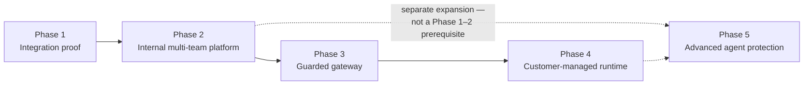
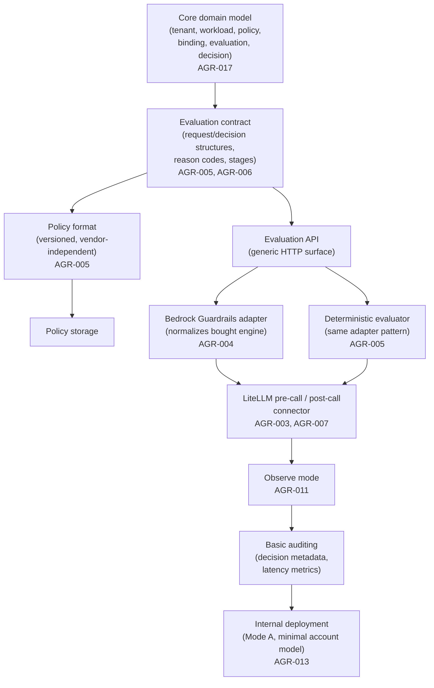
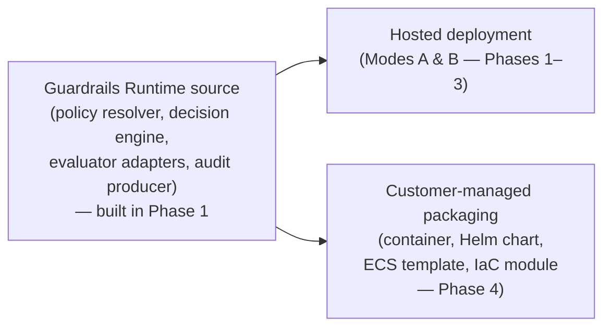
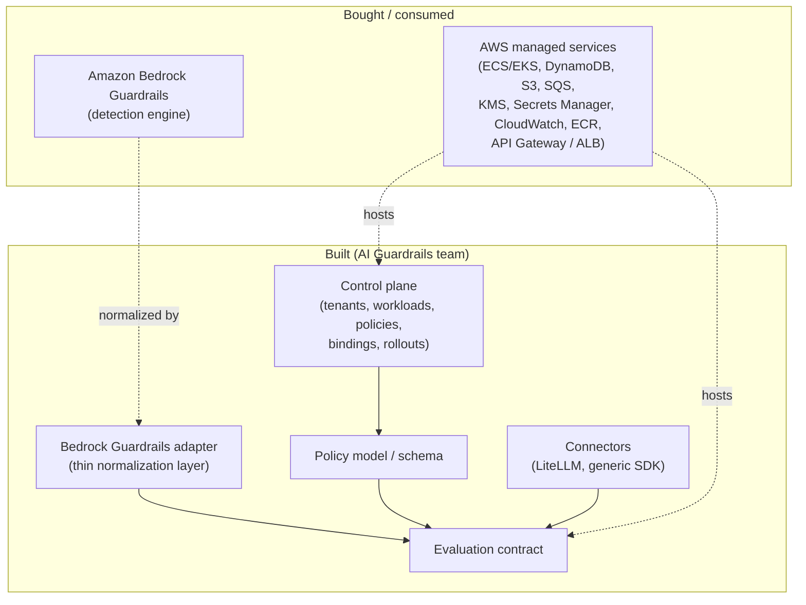
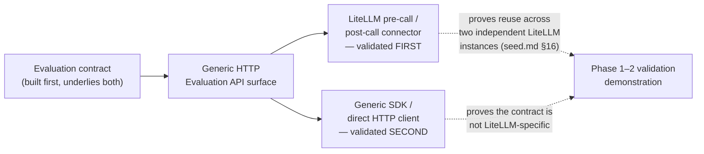
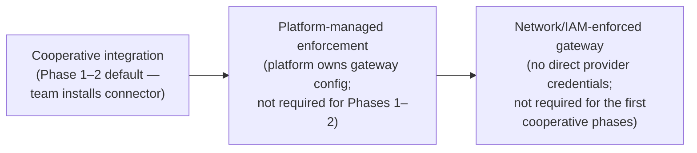
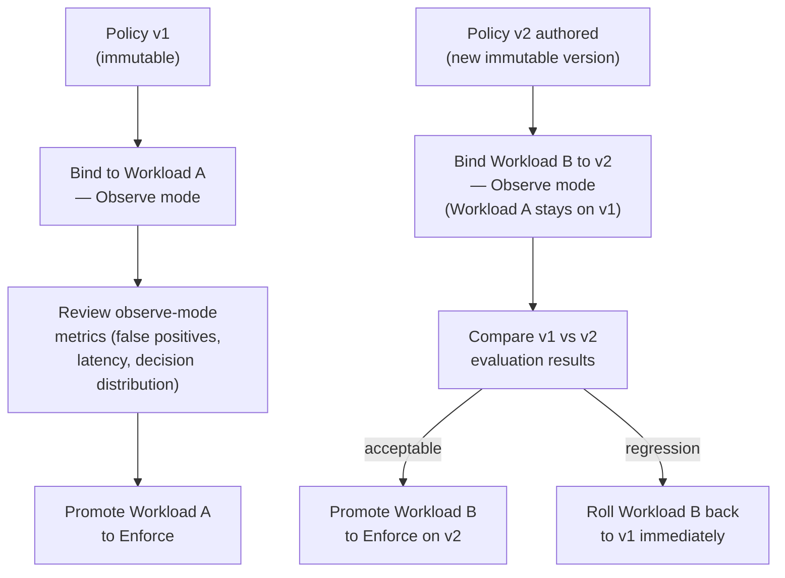

**AI Guardrails — Implementation Strategy**

**Authority level:** L3
**Status:** Draft
**Date:** 2026-07-24
**Derived from:** seed.md + AGREEMENTS.md

---

## Purpose and authority

This document defines **how** the AI Guardrails solution is built, in what order, and by whom — as distinct from **what** it is (the charter and scope) and **why phases are sequenced the way they are at a product level** (the roadmap). Specifically, it covers:

* The build sequence and dependency order underlying the five delivery phases.
* The precise Phase 1–2 core boundary — what "done" means for Phases 1–2 and their validation demonstration, per seed.md §16 and §17 ([DEC-008](../00-source-of-truth/DECISIONS.md#dec-008--supersede-the-mvp-bounded-scope-define-and-estimate-the-full-feature-set-across-five-phases)).
* The build-vs-buy strategy: Amazon Bedrock Guardrails as the bought first evaluation engine, versus the evaluation contract, policy model, connectors, and control plane, which are built.
* The integration order: the LiteLLM connector is delivered and validated first, with the generic HTTP Evaluation API/SDK delivered and validated second against the same contract.
* Platform dependencies that gate delivery — AWS services, account model, Bedrock Guardrails availability, and staffing/ownership dependencies.
* The adoption model — cooperative onboarding and observe-before-enforce — as an implementation concern, not only a product principle.
* The rollout strategy for policies — workload-scoped, immutable versions, and immediate rollback.

This is an **L3 (derived)** document. It must not contradict [`AGREEMENTS.md`](../00-source-of-truth/AGREEMENTS.md) or [`CONSTRAINTS.md`](../00-source-of-truth/CONSTRAINTS.md) (both L1 — authoritative). Where this document references a specific agreement, constraint, decision, or open question, the ID is given (`AGR-NNN`, `CON-NNN`, `DEC-NNN`, `OQ-NNN`) so the two can be cross-checked. Where seed.md does not supply a concrete figure (dates, durations, headcounts, SLA numbers), this document says **TBD** or describes the requirement qualitatively rather than inventing one.

This document does not restate the phase-by-phase objectives and deliverables already presented from a product perspective in [`../20-product/PRODUCT-ROADMAP.md`](../20-product/PRODUCT-ROADMAP.md), nor the scope boundary already fully enumerated in [`../10-charter/SCOPE.md`](../10-charter/SCOPE.md). It assumes both as inputs and adds the delivery-execution view: sequencing dependencies, build-vs-buy calls, integration order, platform dependencies, and rollout mechanics.

---

## Table of contents

- [1. Relationship to the roadmap and scope](#1-relationship-to-the-roadmap-and-scope)
- [2. Delivery phases and build sequence](#2-delivery-phases-and-build-sequence)
- [3. The Phase 1–2 core boundary](#3-the-phase-12-core-boundary)
- [4. Build-vs-buy strategy](#4-build-vs-buy-strategy)
- [5. Integration order: LiteLLM connector first, then generic HTTP API/SDK](#5-integration-order-litellm-connector-first-then-generic-http-apisdk)
- [6. Platform dependencies](#6-platform-dependencies)
- [7. Adoption model: cooperative onboarding, observe before enforce](#7-adoption-model-cooperative-onboarding-observe-before-enforce)
- [8. Rollout strategy: workload-scoped, immutable versions, immediate rollback](#8-rollout-strategy-workload-scoped-immutable-versions-immediate-rollback)
- [9. Sequencing risks and mitigations](#9-sequencing-risks-and-mitigations)
- [10. Summary](#10-summary)
- [11. Related documents](#11-related-documents)

---

## 1. Relationship to the roadmap and scope

Three documents together answer three different questions about delivery, and this document must be read as the third:

| Document | Question it answers |
| --- | --- |
| [`../10-charter/SCOPE.md`](../10-charter/SCOPE.md) | What is in scope, out of scope, or a non-goal for the solution? |
| [`../20-product/PRODUCT-ROADMAP.md`](../20-product/PRODUCT-ROADMAP.md) | What is each phase's objective, and what are its headline deliverables, from a product-facing view? |
| **This document** | In what order and by what build strategy are those deliverables actually constructed, what must exist before what, and how does the platform onboard and roll out policies once built? |

None of the three may contradict [`AGREEMENTS.md`](../00-source-of-truth/AGREEMENTS.md) or [`CONSTRAINTS.md`](../00-source-of-truth/CONSTRAINTS.md); where a conflict is found, the L1 registers win and the derived document is corrected. Consistent with [`PRODUCT-ROADMAP.md`](../20-product/PRODUCT-ROADMAP.md), every timing reference below is **sequencing, not scheduling** — dependency order is fixed by the agreements cited, but calendar dates, durations, and headcounts are not decided anywhere in the source-of-truth set and must not be inferred from this document. Per [DEC-008](../00-source-of-truth/DECISIONS.md#dec-008--supersede-the-mvp-bounded-scope-define-and-estimate-the-full-feature-set-across-five-phases), the solution is defined and estimated over the full five-phase feature set; effort and duration figures remain **TBD** until supplied.

---

## 2. Delivery phases and build sequence

Delivery proceeds through the five phases agreed in [AGR-020 — Five-phase delivery](../00-source-of-truth/AGREEMENTS.md#agr-020--five-phase-delivery) ([DEC-006](../00-source-of-truth/DECISIONS.md#dec-006--sequence-delivery-into-five-phases)). This section adds the **build-dependency view** underneath those phase objectives: what must exist before what, independent of which phase's headline it is filed under.

### 2.1 Phase-level dependency graph



Each phase's deliverables must be completed and validated before the next phase's scope is committed ([AGR-020](../00-source-of-truth/AGREEMENTS.md#agr-020--five-phase-delivery) implications) — this is a hard sequencing rule, not a preference. Phase 3 (Guarded Gateway) and Phase 4 (Customer-Managed Runtime) both build on the runtime and contract validated in Phases 1–2; neither substitutes for the other, and Phase 4 in particular reuses the same runtime source rather than re-implementing it (§2.3 below).

### 2.2 Build-order dependency graph inside Phase 1

Phase 1's objective — proving that guardrail policy and evaluation can be separated from LiteLLM and reused across multiple gateways — imposes an internal build order, not just a deliverable list:



Reading order matters here: the domain model and the evaluation contract must exist before any connector can be meaningfully built (a connector is only a client of that contract — [AGR-007](../00-source-of-truth/AGREEMENTS.md#agr-007--policies-are-separate-from-connectors)); the Bedrock Guardrails adapter and the deterministic evaluator must exist behind the same adapter pattern before the LiteLLM connector can invoke either through the Evaluation API; and Observe mode and basic auditing must exist before "internal deployment" can be considered complete, since an internally deployed Phase 1 with no non-blocking mode and no decision logging would not satisfy [AGR-011](../00-source-of-truth/AGREEMENTS.md#agr-011--observe-before-enforce-progression) or the Phase 1–2 validation demonstration ([`seed.md` §16](../../seed.md#16-mvp-definition); [DEC-008](../00-source-of-truth/DECISIONS.md#dec-008--supersede-the-mvp-bounded-scope-define-and-estimate-the-full-feature-set-across-five-phases)).

### 2.3 Cross-phase reuse: one runtime source, multiple packagings

The Guardrails Runtime is built once and packaged differently per deployment mode, rather than re-implemented per phase:



This is what makes the Phase 1–2 validation demonstration's final condition satisfiable: *"the runtime can later be packaged for customer-managed deployment without changing the connector contract"* ([`seed.md` §16](../../seed.md#16-mvp-definition); [DEC-008](../00-source-of-truth/DECISIONS.md#dec-008--supersede-the-mvp-bounded-scope-define-and-estimate-the-full-feature-set-across-five-phases)). Phase 4 is a packaging and deployment-automation exercise on the runtime already validated in Phases 1–3, not a rebuild — see [`../50-architecture/DEPLOYMENT-ARCHITECTURE.md`](../50-architecture/DEPLOYMENT-ARCHITECTURE.md) §9 for the full Phase 4 artifact list.

### 2.4 Core component-to-phase mapping (seed.md §16)

Seed.md §16 lists twelve core components without assigning each one to a phase; [`../20-product/PRODUCT-ROADMAP.md`](../20-product/PRODUCT-ROADMAP.md) already notes that these components span Phase 1 and the early part of Phase 2. This table makes that mapping explicit, as the build-sequencing detail [`../10-charter/SCOPE.md`](../10-charter/SCOPE.md) §3 defers to this document:

| # | Core component (seed.md §16) | Delivered in | Basis |
| --- | --- | --- | --- |
| 1 | Guardrail policy format | Phase 1 | Explicit Phase 1 deliverable ("Policy format," seed.md §18) |
| 2 | Policy storage | Phase 1 | Underlies the policy format; part of "internal deployment" (seed.md §11 service mapping) |
| 3 | Workload registration | Phase 2 | Explicit Phase 2 deliverable ("Tenant and workload registry," seed.md §18) |
| 4 | Policy-to-workload binding | Phase 2 | Explicit Phase 2 deliverable ("Policy bindings," seed.md §18) |
| 5 | Evaluation API | Phase 1 | Explicit Phase 1 deliverable ("Evaluation contract," seed.md §18), realized as the generic HTTP API (§5 below) |
| 6 | Amazon Bedrock Guardrails adapter | Phase 1 | Explicit Phase 1 deliverable (seed.md §18) |
| 7 | Basic deterministic evaluator | Phase 1 | Not separately named in seed.md §18, but built behind the same evaluator-adapter pattern as item 6 to satisfy the component list (seed.md §16) |
| 8 | LiteLLM pre-call connector | Phase 1 | Explicit Phase 1 deliverable ("LiteLLM connector," seed.md §18) |
| 9 | LiteLLM post-call connector | Phase 1 | Same |
| 10 | Observe and enforce modes | Observe: Phase 1; Enforce: Phase 2 | Observe mode is an explicit Phase 1 deliverable; enforce requires the promotion/rollback machinery that is an explicit Phase 2 deliverable ("Policy promotion and rollback," seed.md §18) |
| 11 | Decision metadata logging | Phase 1 | Explicit Phase 1 deliverable ("Basic auditing," seed.md §18) |
| 12 | Evaluation latency metrics | Phase 1 | Implied by the evaluation contract's latency field (see [`../50-architecture/INTEGRATION-ARCHITECTURE.md`](../50-architecture/INTEGRATION-ARCHITECTURE.md) §3.7) and by "basic auditing" |

This mapping is this document's own interpretive sequencing of seed.md §16 against seed.md §18, not a verbatim statement in either source section; it is presented here, rather than in [`../20-product/PRODUCT-ROADMAP.md`](../20-product/PRODUCT-ROADMAP.md) or [`../10-charter/SCOPE.md`](../10-charter/SCOPE.md), because it is a build-sequencing decision, not a scope or objective statement.

---

## 3. The Phase 1–2 core boundary

### 3.1 What Phases 1–2 exist to prove

Per seed.md §16, the Phase 1–2 core exists to prove one thing: **that one reusable policy can be applied consistently to multiple independent LiteLLM deployments.** Every component in §2.4 above is built in service of that single hypothesis, not as an independent feature list. Everything else — the generic HTTP API, workload registries, IAM authentication — exists to make that core proof credible and repeatable, not to pull later-phase capabilities forward: the full feature set is defined and estimated up front, but delivered in phase sequence ([DEC-008](../00-source-of-truth/DECISIONS.md#dec-008--supersede-the-mvp-bounded-scope-define-and-estimate-the-full-feature-set-across-five-phases)).

### 3.2 The Phase 1–2 validation demonstration is the phase gate

Per seed.md §16 and [DEC-008](../00-source-of-truth/DECISIONS.md#dec-008--supersede-the-mvp-bounded-scope-define-and-estimate-the-full-feature-set-across-five-phases), Phases 1–2 are not validated when the twelve components in §2.4 exist individually — they are validated only when **all** of the following hold simultaneously:

| # | Condition |
| --- | --- |
| 1 | Two separate LiteLLM instances consume the same policy. |
| 2 | Neither instance shares model-provider credentials with the guardrail platform. |
| 3 | Both receive consistent normalized decisions. |
| 4 | One workload can run in observe mode. |
| 5 | Another workload can run in enforce mode. |
| 6 | A policy can be upgraded and rolled back. |
| 7 | Raw content persistence can be disabled. |
| 8 | Evaluation failures follow a configured failure policy. |
| 9 | The runtime can later be packaged for customer-managed deployment without changing the connector contract. |

Delivery planning must produce **two genuinely independent LiteLLM deployments** to exercise condition 1 — not one deployment tested twice ([`seed.md` §16](../../seed.md#16-mvp-definition) implications). Condition 5 and condition 6 both depend on Phase 2's policy promotion/rollback capability (§2.4, item 10), which is why the demonstration does not pass at the end of Phase 1 alone.

### 3.3 What the solution explicitly will not attempt

Per seed.md §6.3 and [`../10-charter/SCOPE.md`](../10-charter/SCOPE.md) §5, the solution will not attempt to provide a general-purpose LLM gateway replacement, a complete AI governance platform, model training or fine-tuning, a proprietary prompt-injection or moderation model, a complete DLP platform, end-user authentication, business authorization, fully autonomous agent governance, organization-wide AWS enforcement, cross-cloud deployment, full compliance certification, or a general MCP security platform. These product-category exclusions were never part of the feature set and are not made in-scope by [DEC-008](../00-source-of-truth/DECISIONS.md#dec-008--supersede-the-mvp-bounded-scope-define-and-estimate-the-full-feature-set-across-five-phases); the full rationale for each exclusion is maintained in [`../10-charter/SCOPE.md`](../10-charter/SCOPE.md) §5 and is not repeated here.

Multi-region active-active availability was formerly part of this exclusion list; [DEC-019](../00-source-of-truth/DECISIONS.md#dec-019--multi-region-active-active-availability-committed-as-a-later-phase) (Proposed, pending owner ratification) explicitly supersedes that exclusion and expands the DEC-008 estimation basis, committing it as a later-phase capability ([`CAP-036`](../20-product/CAPABILITIES.md)) — not yet delivered, but no longer excluded.

### 3.4 What Phases 1–2 do not require even where related work is in scope

Per seed.md §17, the following are **not required** to declare Phases 1–2 validated, even though related, broader capabilities appear in scope elsewhere: a full administration portal, a policy-signing infrastructure, PrivateLink, three-account AWS separation, a billing platform, dedicated tenant runtime deployments, MCP tool authorization, organization-wide Bedrock enforcement, complex policy inheritance, streaming guardrail enforcement, air-gapped deployment, multi-cloud support, and a general-purpose AI governance inventory. A minimal management API and version-controlled configuration are explicitly acceptable substitutes during Phases 1–2 (seed.md §17). The full non-goal register, with tracked open questions, is maintained in [`../10-charter/SCOPE.md`](../10-charter/SCOPE.md) §6.

### 3.5 Scope-change discipline during implementation

Any proposed feature outside the boundaries in §3.3–§3.4 requires an explicit, recorded scope-change decision, never silent inclusion during implementation (seed.md §6.3; [DEC-008](../00-source-of-truth/DECISIONS.md#dec-008--supersede-the-mvp-bounded-scope-define-and-estimate-the-full-feature-set-across-five-phases)). Delivery milestones — however they are eventually tracked in [`MILESTONES.md`](MILESTONES.md) and gated in [`RELEASE-CRITERIA.md`](RELEASE-CRITERIA.md) — must be evaluated against this boundary before being marked complete, per the scope-change governance rule in [`../10-charter/SCOPE.md`](../10-charter/SCOPE.md) §8.

---

## 4. Build-vs-buy strategy

### 4.1 The core call: buy the engine, build the contract around it

Per seed.md §22 and [AGR-004](../00-source-of-truth/AGREEMENTS.md#agr-004--bedrock-guardrails-as-first-engine-vendor-independent-contract), the implementation strategy makes one build-vs-buy decision at the center of Phase 1: **buy** Amazon Bedrock Guardrails as the first managed evaluation engine, and **build** everything that keeps the platform's own contract independent of it — the evaluation contract, the policy model, the connectors, and the control plane.



### 4.2 Build-vs-buy table

| Capability | Build or buy | Rationale | Reference |
| --- | --- | --- | --- |
| Detection/evaluation engine | **Buy** — Amazon Bedrock Guardrails | Accelerates delivery of a working managed evaluator without building a proprietary detection model, which is an explicit product-category exclusion | AGR-004; seed.md §6.3 |
| Bedrock Guardrails adapter | **Build** (thin layer around the bought engine) | Normalizes Bedrock-native request/response formats into the platform's own decision structure before any result reaches a policy or connector; no Bedrock-specific field may leak past this boundary | AGR-004, CON-004 |
| Evaluation contract (request/decision structures, reason codes, stages, latency) | **Build** | Must remain vendor-independent and identical across Remote Evaluation, Guarded Gateway, and Customer-Managed Runtime; no external product defines a contract that spans all three modes and the platform's own domain model | AGR-005, AGR-006, CON-003, CON-005 |
| Policy model / schema (versioning, thresholds, failure behavior, compatibility metadata) | **Build** | Policy portability and the separation of policies from connectors both require a native, framework-independent format | AGR-005, AGR-007, CON-006 |
| Deterministic organization-rules evaluator | **Build** | First-party, non-ML detection logic, addable behind the same evaluator-adapter pattern as Bedrock Guardrails | AGR-005; seed.md §6.1, item 9 |
| LiteLLM connector (pre-call/post-call) | **Build** | LiteLLM is the first connector, not the product boundary; the connector is a thin, replaceable client of the Evaluation API | AGR-003, AGR-007 |
| Generic HTTP Evaluation API / SDK | **Build** | The framework-agnostic surface that proves the contract is not LiteLLM-specific; the LiteLLM connector itself is built on top of it | seed.md §6.1, item 7; see §5 below |
| Control plane (tenant, workload, policy, binding, rollout registries) | **Build** | Must be expressed natively in terms of the six-entity domain model; no external product owns this shape | AGR-017 |
| Audit pipeline / decision metadata store | **Build** | Vendor-independent audit metadata is required identically across all three deployment modes | AGR-006, AGR-014 |
| Underlying compute, storage, messaging, secrets, and encryption (ECS Fargate/EKS, DynamoDB/S3, SQS, KMS, Secrets Manager, CloudWatch, API Gateway/ALB, ECR) | **Buy** (consume AWS managed services) | Seed.md §11 directs using the minimum AWS architecture required to validate the product — consuming managed AWS services rather than building infrastructure primitives | seed.md §11; CON-001, CON-002 |

### 4.3 Why the boundary sits exactly here

The build-vs-buy line is not arbitrary: it sits precisely where "vendor-specific" ends and "platform contract" begins. Any capability that could only be expressed in Bedrock-specific or LiteLLM-specific terms is bought or adapted; any capability that must remain stable across vendors, gateways, and deployment modes is built natively by the AI Guardrails team ([AGR-005](../00-source-of-truth/AGREEMENTS.md#agr-005--policy-portability), [AGR-006](../00-source-of-truth/AGREEMENTS.md#agr-006--one-logical-evaluation-contract-across-all-modes)). Marketing and technical documentation must not describe Bedrock Guardrails as the product's permanent or exclusive detection engine ([AGR-004](../00-source-of-truth/AGREEMENTS.md#agr-004--bedrock-guardrails-as-first-engine-vendor-independent-contract)) — the build side of this table is what makes a future second or third engine addable without a contract change.

---

## 5. Integration order: LiteLLM connector first, then generic HTTP API/SDK

### 5.1 Both are Phase 1 scope; the build and validation order is not simultaneous

The generic HTTP Evaluation API is explicit Phase 1 scope alongside the LiteLLM integration ([`../10-charter/SCOPE.md`](../10-charter/SCOPE.md) §3, item 7) — this is not in dispute. What this document adds is the **implementation order**: the LiteLLM connector is delivered and validated first; the generic HTTP API/SDK is delivered and validated second, as a distinct client of the same, already-stabilized contract.



### 5.2 Why LiteLLM first

* The Phase 1–2 validation demonstration is defined in terms of LiteLLM specifically: *"two separate LiteLLM instances consume the same policy... both receive consistent normalized decisions"* ([`seed.md` §16](../../seed.md#16-mvp-definition); [DEC-008](../00-source-of-truth/DECISIONS.md#dec-008--supersede-the-mvp-bounded-scope-define-and-estimate-the-full-feature-set-across-five-phases)). Until the LiteLLM connector exists and is exercised against two independent instances, the core policy-reuse hypothesis is unproven, regardless of how many other clients exist.
* LiteLLM is the initial integration target named in the solution charter (`seed.md` front matter) and is where the platform's first internal deployment (Phase 1) is expected to run ([AGR-003](../00-source-of-truth/AGREEMENTS.md#agr-003--litellm-as-first-connector-not-the-product-boundary)).
* Building the LiteLLM connector first forces the evaluation contract to prove itself against a real, opinionated gateway's request/response shape before it is generalized — surfacing contract gaps earlier, against a bounded integration, rather than later against an unbounded "any HTTP client" surface.

### 5.3 Why the generic HTTP API/SDK comes second, not last

The generic HTTP Evaluation API is not deferred to a later phase — it remains explicit Phase 1 scope. It is sequenced second within Phase 1 because its purpose is specifically to **prove that the contract validated against LiteLLM is not, in fact, LiteLLM-specific** ([`../50-architecture/INTEGRATION-ARCHITECTURE.md`](../50-architecture/INTEGRATION-ARCHITECTURE.md) §5; [AGR-003](../00-source-of-truth/AGREEMENTS.md#agr-003--litellm-as-first-connector-not-the-product-boundary)). That claim can only be tested once there is a stabilized contract to test it against. Architecturally, the generic HTTP API is not a separate build — it is the same Evaluation API surface the LiteLLM connector already calls; the LiteLLM connector is, in fact, "built on top of it" (`../50-architecture/INTEGRATION-ARCHITECTURE.md` §5). Sequencing the generic-client validation second is therefore a proof-order decision, not a scope deferral.

### 5.4 Extension to future connectors

This same order — contract first, first opinionated client second, generic/framework-agnostic client third — is the intended pattern for any future connector or gateway integration in later phases ([AGR-007](../00-source-of-truth/AGREEMENTS.md#agr-007--policies-are-separate-from-connectors)): a new connector implements the invocation contract only (request mapping, evaluation invocation, action enforcement, correlation propagation, timeout handling, health telemetry), with no change to policy, decision, or reason-code semantics (`../50-architecture/INTEGRATION-ARCHITECTURE.md` §7).

---

## 6. Platform dependencies

Delivery of the Phase 1–2 core depends on a set of external and internal prerequisites that are not, themselves, deliverables of the AI Guardrails team. This section makes those dependencies explicit so they are staffed and provisioned ahead of the build sequence in §2, not discovered mid-build.

### 6.1 AWS platform dependencies

Per seed.md §11, Phases 1–2 use the minimum AWS architecture required to validate the product:

| Capability | Initial AWS service | Dependency type |
| --- | --- | --- |
| Evaluation runtime | ECS Fargate or EKS | Compute — must be provisioned before the Evaluation API can be deployed |
| Public or internal API | API Gateway or Application Load Balancer | Networking — must be provisioned before any connector can reach the runtime |
| Policy storage | DynamoDB or versioned S3 | Storage — must exist before the policy format (§2.4, item 1) can be persisted |
| Workload registry | DynamoDB | Storage — Phase 2 dependency, ahead of workload registration |
| Guardrail evaluation | Amazon Bedrock Guardrails | External managed service — see §6.2 |
| Runtime credentials | IAM roles | Identity — required before any AWS-facing component can run under least privilege (CON-010) |
| Secrets | AWS Secrets Manager | Required before any credential material is provisioned |
| Encryption | AWS KMS | Required before policy storage, workload registry, or audit archive can be encrypted at rest (CON-009) |
| Operational metrics | CloudWatch | Required before latency/timeout-rate metrics (seed.md §15) can be measured |
| Audit event buffering | Amazon SQS | Required before decision metadata logging (§2.4, item 11) can be durable |
| Audit archive | Amazon S3 | Required before audit records can be retained per tenant configuration |
| Container registry | Amazon ECR | Required before the runtime container can be built and deployed |

This mapping applies to the hosted side of the platform (Modes A and B, and the control plane behind Mode C); the full logical layout is maintained in [`../50-architecture/DEPLOYMENT-ARCHITECTURE.md`](../50-architecture/DEPLOYMENT-ARCHITECTURE.md) §7.

### 6.2 Bedrock Guardrails availability — an external vendor dependency

Because Amazon Bedrock Guardrails is bought rather than built (§4), its availability in the target AWS account and Region is an upstream dependency the AI Guardrails team does not control: Bedrock Guardrails must be enabled and reachable before the Bedrock Guardrails adapter (§2.4, item 6) can be validated, and before Phase 1's internal deployment can be considered complete. Any Bedrock Guardrails service change (quota, region availability, response format) is absorbed at the adapter boundary (§4.2) precisely so it does not propagate into the evaluation contract or into policies ([AGR-004](../00-source-of-truth/AGREEMENTS.md#agr-004--bedrock-guardrails-as-first-engine-vendor-independent-contract)).

### 6.3 Account model dependency

Per [AGR-013](../00-source-of-truth/AGREEMENTS.md#agr-013--aws-as-primary-cloud-minimal-mvp-account-model) and [CON-002](../00-source-of-truth/CONSTRAINTS.md#con-002--minimal-mvp-account-model), Phase 1's internal deployment depends only on the minimal two-account model — one non-production account and one production account — being provisioned with explicit IAM, storage, and environment boundaries. Additional account separation is a dependency only if and when a documented trigger is reached (external customers, compliance requirements, independent security ownership, immutable audit requirements, production scale, or dedicated tenant deployments); it must not be provisioned speculatively ahead of Phase 1 or Phase 2 (see [OQ-009](../00-source-of-truth/OPEN-QUESTIONS.md#oq-009--trigger-point-for-three-account-aws-separation)).

### 6.4 LiteLLM test-instance dependency

The Phase 1–2 validation demonstration requires **two genuinely independent LiteLLM instances** ([`seed.md` §16](../../seed.md#16-mvp-definition); [DEC-008](../00-source-of-truth/DECISIONS.md#dec-008--supersede-the-mvp-bounded-scope-define-and-estimate-the-full-feature-set-across-five-phases)) — this is a delivery-planning dependency, not only a validation step. Both instances must be available, separately owned or at minimum separately configured, before condition 1 of the demonstration (§3.2) can be exercised; a single instance tested twice does not satisfy it.

### 6.5 Ownership and staffing dependencies

Per [`../10-charter/CHARTER.md`](../10-charter/CHARTER.md) §11, the build sequence in §2 depends on four ownership groups being staffed and engaged at the point their contribution is needed, not only at general availability:

| Owner | What the build sequence depends on them for |
| --- | --- |
| AI Guardrails team | Product architecture, policy schemas, the evaluation contract, the guardrail runtime, the LiteLLM connector, the Bedrock Guardrails adapter, and supported deployment artifacts (§2, §4) |
| Platform operations | Hosted infrastructure provisioning (§6.1), runtime deployment, service monitoring, and production incident response, beginning no later than Phase 1's internal deployment |
| Security and governance | Organization-level policy requirements, policy approval, exception criteria, and retention requirements — needed before any policy can be authored for Phase 1, and before any workload can be promoted from observe to enforce (§7) |
| Consuming teams | Correct connector installation in cooperative mode and workload registration accuracy — needed starting with the first onboarded workload in Phase 1/2 (§7) |

---

## 7. Adoption model: cooperative onboarding, observe before enforce

### 7.1 Cooperative onboarding is the default trust posture for delivery

Per seed.md §8 and [AGR-018 — Trust and enforcement model](../00-source-of-truth/AGREEMENTS.md#agr-018--trust-and-enforcement-model), the implementation strategy adopts **cooperative integration** as the default onboarding posture for Phases 1–2: the consuming team installs and maintains the connector itself, and the connector can be disabled, removed, or misconfigured. This is appropriate while teams are trusted, guardrails are an engineering standard rather than a mandated control, and the goal is adoption and evaluation rather than bypass-proof enforcement.



A cooperative connector must never be represented as a hard security boundary ([AGR-018](../00-source-of-truth/AGREEMENTS.md#agr-018--trust-and-enforcement-model), CON-012) — this constrains not just how the platform is marketed but how the delivery team measures adoption: connector-health telemetry is a signal, never proof, of mandatory enforcement. Which posture the first external customers actually require, and by which phase that posture must be available, remains an open question ([OQ-001](../00-source-of-truth/OPEN-QUESTIONS.md#oq-001--enforcement-model-required-for-the-first-external-customers)); the current working assumption is that cooperative integration suffices through Phase 1–2, with platform-managed and network/IAM-enforced postures deferred until a specific customer or compliance driver is identified.

### 7.2 The canonical onboarding flow

Per seed.md §4 and [AGR-019 — Meaning of "import"](../00-source-of-truth/AGREEMENTS.md#agr-019--meaning-of-import), every workload's adoption path follows the same seven-step flow, which the delivery plan treats as the reference implementation of onboarding — not an approximation of it:

```text
Register workload
    │
    ▼
Select policy
    │
    ▼
Generate integration manifest
    │
    ▼
Install connector
    │
    ▼
Run in observe mode
    │
    ▼
Review evaluation results
    │
    ▼
Enable enforcement
```

This flow must never require copying the team's LiteLLM database, transferring model-provider credentials, exposing gateway administration endpoints, replacing the team's model-routing configuration, or granting the guardrail provider administrative access to the team's gateway ([AGR-019](../00-source-of-truth/AGREEMENTS.md#agr-019--meaning-of-import)). Implementing this flow is itself a delivery dependency: "Register workload" and "Select policy" depend on the control plane (§2.4, items 3–4, Phase 2); "Generate integration manifest" and "Install connector" depend on the LiteLLM connector (§2.4, items 8–9, Phase 1); "Run in observe mode" depends on Observe mode (§2.4, item 10, Phase 1); "Enable enforcement" depends on the promotion/rollback machinery (§8 below, Phase 2).

### 7.3 Observe before enforce, as a delivery gate

Per [AGR-011 — Observe-before-enforce progression](../00-source-of-truth/AGREEMENTS.md#agr-011--observe-before-enforce-progression), every policy must support a non-blocking evaluation mode and a defined five-state progression:

```text
Disabled → Observe → Warn → Redact → Block
```

For delivery purposes, this means: no workload binding may default to `Block` at onboarding, and no policy may be shipped to a workload without first passing through Observe. Promotion between states must be an explicit, auditable action taken deliberately by the workload owner and the security/governance function, informed by observe-mode metrics (false-positive rate, latency, decision distribution) — never an implicit side effect of another change ([AGR-011](../00-source-of-truth/AGREEMENTS.md#agr-011--observe-before-enforce-progression) implications). The specific, objective go/no-go criteria for promotion beyond "observe long enough and review the metrics" remain an open question ([OQ-014](../00-source-of-truth/OPEN-QUESTIONS.md#oq-014--gono-go-criteria-to-move-a-workload-from-observe-to-enforce)) that must be resolved before Phase 2 onboarding scales past a small pilot set of workloads.

---

## 8. Rollout strategy: workload-scoped, immutable versions, immediate rollback

### 8.1 The three mechanics that make rollout safe

Per seed.md §15 (Policy rollout) and the Phase 1–2 validation demonstration's condition that *"a policy can be upgraded and rolled back"* ([`seed.md` §16](../../seed.md#16-mvp-definition); [DEC-008](../00-source-of-truth/DECISIONS.md#dec-008--supersede-the-mvp-bounded-scope-define-and-estimate-the-full-feature-set-across-five-phases)), policy rollout rests on three mechanics that must all exist before any workload is promoted to enforce:

| Mechanic | What it guarantees |
| --- | --- |
| **Immutable versions** | Once published, a policy version's content never changes; a "change" is always a new version, never an in-place edit. This is what makes evaluation-result comparison between versions (§8.3) meaningful, and what makes rollback (§8.4) a well-defined operation rather than an attempt to reconstruct a prior, mutated state. |
| **Workload-scoped rollout** | A policy version is promoted to a specific workload's binding, not globally. Two workloads can run different policy versions simultaneously — one on the current version, one piloting a new version in Observe — without affecting each other. |
| **Immediate rollback** | A workload's binding can be pointed back at its prior policy version without delay, using the rollback version already recorded on the binding (per the Policy Binding domain entity, [AGR-017](../00-source-of-truth/AGREEMENTS.md#agr-017--core-domain-model)). |

### 8.2 Rollout flow



This diagram makes explicit that rollout is always **workload-scoped**: promoting or rolling back Workload B's binding never touches Workload A's binding, even though both may reference the same policy family. This is precisely the mechanism the Phase 1–2 validation demonstration exercises — one workload in observe mode, another in enforce mode, on policies that can be upgraded and rolled back independently ([`seed.md` §16](../../seed.md#16-mvp-definition)).

### 8.3 Compatibility validation and evaluation-result comparison

Per seed.md §15, policy rollout requires compatibility validation and evaluation-result comparison between versions before a version is trusted for promotion. Concretely: a candidate policy version is bound, in Observe mode, to at least one workload running alongside the currently enforced version, and its decisions are compared against the prior version's decisions for the same evaluated content class before promotion is considered. This comparison is what the false-positive rate, latency, and decision-distribution metrics required by seed.md §15 and tracked as reliability/effectiveness metrics (seed.md §19) are for — see [`../50-architecture/NON-FUNCTIONAL-REQUIREMENTS.md`](../50-architecture/NON-FUNCTIONAL-REQUIREMENTS.md) for the measurable targets (marked TBD where seed.md does not supply a figure).

### 8.4 Immediate rollback is a delivery requirement, not an aspiration

"Immediate rollback" means the rollback operation itself — repointing a workload's binding at its prior immutable version — must not depend on rebuilding, redeploying, or reconstructing anything; the prior version already exists, unchanged, in policy storage (§2.4, item 2). Any implementation that requires re-authoring or regenerating a "rolled back" policy version does not satisfy this requirement and must not be accepted as delivered.

### 8.5 Rollout in Customer-Managed Runtime (Mode C)

Workload-scoped rollout and immediate rollback apply identically inside a Customer-Managed Runtime, with one addition: because Mode C evaluates against a locally cached policy version and must execute without a synchronous control-plane connection ([AGR-015](../00-source-of-truth/AGREEMENTS.md#agr-015--customer-managed-runtime-executes-without-a-synchronous-control-plane-connection)), promotion and rollback are propagated to the customer's cache asynchronously, and the workload's failure-behavior configuration must define what happens if the cache is stale when a rollback is issued (per [AGR-012](../00-source-of-truth/AGREEMENTS.md#agr-012--failure-behavior-is-part-of-policy) and [`../50-architecture/DEPLOYMENT-ARCHITECTURE.md`](../50-architecture/DEPLOYMENT-ARCHITECTURE.md) §4.4). This is a Phase 4 concern; it does not change the rollout mechanics described in §8.1–§8.4, only where the cache that holds the "current" and "rolled-back-to" versions physically lives.

---

## 9. Sequencing risks and mitigations

The charter's risk register (seed.md §20; [`../70-governance/RISK-REGISTER.md`](../70-governance/RISK-REGISTER.md)) already names the platform's major risks. This section restates only the subset that is specifically a **sequencing** risk — one that could be created or worsened by building things in the wrong order — and how the build sequence in this document mitigates it.

| Risk | How the build sequence mitigates it |
| --- | --- |
| **Connector bypass** — a consumer may remove or misconfigure the LiteLLM connector | Cooperative onboarding is the deliberate default posture for Phase 1–2 (§7.1); platform-managed and network/IAM-enforced postures are sequenced later, only once a driver is identified ([OQ-001](../00-source-of-truth/OPEN-QUESTIONS.md#oq-001--enforcement-model-required-for-the-first-external-customers)) — building enforcement infrastructure before it is needed would itself be a form of over-expansion (see below). |
| **False confidence** — teams may treat successful evaluation as complete AI security | Building the LiteLLM connector and the generic API in sequence, against a stabilized contract (§5), rather than rushing multiple integrations in parallel, reduces the chance that an under-tested integration is presented as validated. |
| **Latency** — remote evaluation adds synchronous network and processing latency | The Bedrock adapter and deterministic evaluator are both built behind the same adapter pattern in Phase 1 (§2.2) specifically so latency-sensitive workloads can later be routed to local deterministic checks or to Customer-Managed Runtime (Phase 4) without a contract change. |
| **Hosted data exposure** — remote evaluation transmits tenant content to the hosted runtime | No-raw-retention-by-default (§2.4 dependencies on AGR-014/CON-014) is built into Phase 1's audit pipeline from the start, not added later, so the validation demonstration's "raw content persistence can be disabled" condition (§3.2, item 7) is satisfiable at first release rather than retrofitted. |
| **Policy fragmentation** — too many workload-specific overrides may weaken consistency | Workload-scoped rollout (§8) is deliberately bounded to promoting or rolling back one workload's binding at a time; it is not a mechanism for accumulating unbounded per-workload policy variants, and override governance remains tracked separately ([OQ-012](../00-source-of-truth/OPEN-QUESTIONS.md#oq-012--policy-signing-and-policy-inheritance-design)). |
| **Product over-expansion** — the solution may try to include gateway management, full governance, authorization, and compliance before validating the core integration | The build sequence in §2 deliberately defers every Phase 3–5 capability until Phases 1–2 are validated ([DEC-007](../00-source-of-truth/DECISIONS.md#dec-007--defer-advanced-isolation-distribution-security-agent-authorization-and-org-wide-enforcement)); the generic HTTP API is sequenced second, not built in parallel with the LiteLLM connector, precisely to avoid diluting focus on the core Phase 1–2 hypothesis (§3.1) before it is proven. |

---

## 10. Summary

* Delivery proceeds through five agreed phases ([AGR-020](../00-source-of-truth/AGREEMENTS.md#agr-020--five-phase-delivery)); within Phase 1, the domain model and evaluation contract must exist before any connector, and the Bedrock Guardrails adapter and deterministic evaluator must exist before the LiteLLM connector can invoke either.
* Phases 1–2's validation gate is the nine-condition demonstration in §3.2 ([`seed.md` §16](../../seed.md#16-mvp-definition); [DEC-008](../00-source-of-truth/DECISIONS.md#dec-008--supersede-the-mvp-bounded-scope-define-and-estimate-the-full-feature-set-across-five-phases)), not the mere existence of the twelve core components in seed.md §16 — two conditions (enforce mode, policy upgrade/rollback) depend on Phase 2, not Phase 1 alone.
* The build-vs-buy line sits precisely at the vendor boundary: **buy** Amazon Bedrock Guardrails as the first evaluation engine; **build** the evaluation contract, the policy model, the connectors, and the control plane, so that no vendor-specific shape leaks into the platform's own contract ([AGR-004](../00-source-of-truth/AGREEMENTS.md#agr-004--bedrock-guardrails-as-first-engine-vendor-independent-contract), [AGR-005](../00-source-of-truth/AGREEMENTS.md#agr-005--policy-portability)).
* The LiteLLM connector is built and validated first, because the Phase 1–2 validation demonstration is defined in terms of it; the generic HTTP API/SDK is built and validated second, against the same stabilized contract, specifically to prove the contract is not LiteLLM-specific ([AGR-003](../00-source-of-truth/AGREEMENTS.md#agr-003--litellm-as-first-connector-not-the-product-boundary)).
* Delivery depends on AWS platform services, Bedrock Guardrails availability, the minimal two-account model, two genuinely independent LiteLLM test instances, and the four ownership groups defined in the charter being engaged at the point their contribution is needed.
* Adoption follows the cooperative-onboarding, observe-before-enforce model as a delivery gate, not only a product principle: no workload binding defaults to Block, and promotion is an explicit, auditable action ([AGR-011](../00-source-of-truth/AGREEMENTS.md#agr-011--observe-before-enforce-progression), [AGR-018](../00-source-of-truth/AGREEMENTS.md#agr-018--trust-and-enforcement-model)).
* Policy rollout is workload-scoped, built on immutable versions, and supports immediate rollback by design — these three mechanics, not aspiration, are what make the validation demonstration's "a policy can be upgraded and rolled back" condition deliverable.

---

## 11. Related documents

| Document | Relationship |
| --- | --- |
| [`../00-source-of-truth/AGREEMENTS.md`](../00-source-of-truth/AGREEMENTS.md) | Authoritative (L1) agreements this strategy implements, especially AGR-003, AGR-004, AGR-005, AGR-006, AGR-007, AGR-011, AGR-012, AGR-013, AGR-014, AGR-015, AGR-017, AGR-018, AGR-019, AGR-020. |
| [`../00-source-of-truth/CONSTRAINTS.md`](../00-source-of-truth/CONSTRAINTS.md) | Non-negotiable boundaries (CON-001–CON-016) this strategy's build sequence and platform dependencies must respect. |
| [`../00-source-of-truth/DECISIONS.md`](../00-source-of-truth/DECISIONS.md) | Chronological decision log; see DEC-006 (five-phase sequencing), DEC-007 (deferral of advanced capabilities), DEC-008 (full-feature-set definition and estimation, superseding DEC-005). |
| [`../00-source-of-truth/OPEN-QUESTIONS.md`](../00-source-of-truth/OPEN-QUESTIONS.md) | Tracks unresolved timing/design questions this strategy references, especially OQ-001 (enforcement model), OQ-009 (three-account trigger), OQ-012 (policy signing/inheritance), OQ-014 (observe→enforce criteria). |
| [`../10-charter/CHARTER.md`](../10-charter/CHARTER.md) | Durable charter this strategy operationalizes into a build plan, especially §8 (import), §10 (operating model), §11 (ownership). |
| [`../10-charter/SCOPE.md`](../10-charter/SCOPE.md) | Full in-scope / out-of-scope / non-goal detail; explicitly defers the build sequence to this document. |
| [`../10-charter/PRINCIPLES.md`](../10-charter/PRINCIPLES.md) | Guiding principles (policy portability, one contract, policies vs. connectors, observe-before-enforce) this strategy applies operationally. |
| [`../10-charter/SUCCESS-CRITERIA.md`](../10-charter/SUCCESS-CRITERIA.md) | Measurable success indicators, including the Phase 1–2 validation demonstration this strategy is built to satisfy. |
| [`../20-product/PRODUCT-ROADMAP.md`](../20-product/PRODUCT-ROADMAP.md) | Phase-by-phase objectives and headline deliverables, from a product-facing view this document assumes as input. |
| [`../20-product/CAPABILITIES.md`](../20-product/CAPABILITIES.md) | Capability-level detail per deployment mode, built on the same in-scope list this strategy sequences. |
| [`../20-product/USE-CASES.md`](../20-product/USE-CASES.md) | Worked onboarding/import scenarios referenced by the adoption model in §7. |
| [`../50-architecture/INTEGRATION-ARCHITECTURE.md`](../50-architecture/INTEGRATION-ARCHITECTURE.md) | Full connector, evaluation-contract, and Bedrock adapter design this strategy sequences the build of. |
| [`../50-architecture/DEPLOYMENT-ARCHITECTURE.md`](../50-architecture/DEPLOYMENT-ARCHITECTURE.md) | Per-mode deployment topology and the Phase 4 packaging plan referenced in §2.3 and §8.5. |
| [`../50-architecture/NON-FUNCTIONAL-REQUIREMENTS.md`](../50-architecture/NON-FUNCTIONAL-REQUIREMENTS.md) | Measurable targets underlying the evaluation-result comparison described in §8.3. |
| [`../50-architecture/ARCHITECTURE-REPORT.md`](../50-architecture/ARCHITECTURE-REPORT.md) | Consolidated architecture view this strategy's build sequence must remain consistent with. |
| [`MILESTONES.md`](MILESTONES.md) | Delivery-facing milestone tracking for the five phases sequenced here. |
| [`RELEASE-CRITERIA.md`](RELEASE-CRITERIA.md) | Gate criteria that must evaluate delivery against the Phase 1–2 core boundary in §3. |
| [`VALIDATION-PLAN.md`](VALIDATION-PLAN.md) | Detailed test plan for the Phase 1–2 validation demonstration in §3.2. |
| [`../70-governance/RISK-REGISTER.md`](../70-governance/RISK-REGISTER.md) | Actively tracked risk register; §9 above restates only its sequencing-relevant subset. |
| [`../70-governance/CLAIMS-REGISTER.md`](../70-governance/CLAIMS-REGISTER.md) | Must reject any external claim that this strategy's build order implies a delivered capability ahead of its actual phase. |
