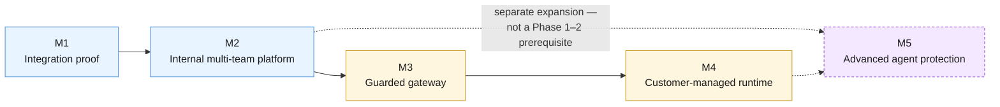

**AI Guardrails — Delivery Milestones**

**Authority level:** L3
**Status:** Draft
**Date:** 2026-07-24
**Derived from:** AGREEMENTS.md

---

> **Current local release (2026-10-08):** [DEC-022](../00-source-of-truth/DECISIONS.md#dec-022--define-a-separately-accepted-local-technical-proof), grounded in AGR-022 through AGR-024, defines a separately accepted local technical proof for internal application teams, operated through an API and CLI. AWS integration and service exposure to other teams are later milestones. This document retains its programme and hosted-phase obligations; cloud-specific requirements are not local-release exit gates, and local substitutes do not prove those controls. The current boundary and interview status are in [RELEASE-DEFINITION.md](RELEASE-DEFINITION.md).

## Purpose and authority

This document translates the five-phase delivery structure agreed in [`AGREEMENTS.md` AGR-020](../00-source-of-truth/AGREEMENTS.md#agr-020--five-phase-delivery) into **outcome-based milestones**: for each phase, a named milestone (M1–M5) paired with a checklist of completion criteria that must be independently verifiable — not a calendar plan. This is a delivery-facing (**L3**) document. It operationalizes, but must never contradict, the L1-authoritative [`AGREEMENTS.md`](../00-source-of-truth/AGREEMENTS.md) and [`CONSTRAINTS.md`](../00-source-of-truth/CONSTRAINTS.md), and it must stay consistent with the L2 [`SCOPE.md`](../10-charter/SCOPE.md) and [`SUCCESS-CRITERIA.md`](../10-charter/SUCCESS-CRITERIA.md). Where a conflict is ever found, those documents win and this one must be corrected.

This document **does not contain committed dates, quarters, durations, headcounts, or budgets**. Every reference to sequence below means *ordering and dependency*, not *scheduling*. Where `AGREEMENTS.md` and `CONSTRAINTS.md` do not supply a concrete figure (an SLA number, a latency target, a size limit), this document records **TBD** rather than inventing one, per source-of-truth policy. Per [DEC-008](../00-source-of-truth/DECISIONS.md#dec-008--supersede-the-mvp-bounded-scope-define-and-estimate-the-full-feature-set-across-five-phases), these milestones cover the **full feature set** — the Phase 1–2 core plus the later-phase capabilities — as committed-and-estimated scope; overall solution completion is reached only when all five milestones are delivered and validated.

The relationship between this document and its neighbors:

* [`20-product/PRODUCT-ROADMAP.md`](../20-product/PRODUCT-ROADMAP.md) — the product-facing narrative of the same five phases (objectives, headline deliverables, notes on the Phase 1–2 boundary). This document is its delivery-facing counterpart: the same phases, restated as checkable milestone completion criteria for tracking purposes.
* [`10-charter/SUCCESS-CRITERIA.md`](../10-charter/SUCCESS-CRITERIA.md) — the authoritative nine-criterion Phase 1–2 validation demonstration table (MVP-01 through MVP-09; the criterion IDs are retained for traceability) and the ongoing success metrics. This document maps each criterion to the milestone at which it first becomes demonstrable.
* [`10-charter/SCOPE.md`](../10-charter/SCOPE.md) — the authoritative in-scope / future-scope / out-of-scope / non-goal boundaries. Every milestone below is bounded by that document; nothing here expands scope.
* [`IMPLEMENTATION-STRATEGY.md`](IMPLEMENTATION-STRATEGY.md) — will define *how* each milestone's deliverables are built (build sequence, technical approach). This document defines *what "done" means*, not *how to get there*.
* [`RELEASE-CRITERIA.md`](RELEASE-CRITERIA.md) — will define the formal release gate that consumes these milestone completion criteria.
* [`VALIDATION-PLAN.md`](VALIDATION-PLAN.md) — will define the concrete verification method, environment, and sign-off owner for each checklist item below.

---

## Table of contents

<!-- BEGIN GENERATED: toc -->
- [Purpose and authority](#purpose-and-authority)
- [1. How to read this document — the spec pattern](#1-how-to-read-this-document--the-spec-pattern)
- [2. Milestone sequence overview](#2-milestone-sequence-overview)
- [3. M1 — Integration proof](#3-m1--integration-proof)
- [4. M2 — Internal multi-team platform](#4-m2--internal-multi-team-platform)
- [5. M3 — Guarded gateway](#5-m3--guarded-gateway)
- [6. M4 — Customer-managed runtime](#6-m4--customer-managed-runtime)
- [7. M5 — Advanced agent protection](#7-m5--advanced-agent-protection)
- [8. Milestone-to-validation-demonstration traceability](#8-milestone-to-validation-demonstration-traceability)
- [9. What this document deliberately does not say](#9-what-this-document-deliberately-does-not-say)
- [10. Related documents](#10-related-documents)
<!-- END GENERATED: toc -->
---

## 1. How to read this document — the spec pattern

Each milestone below follows the same fixed shape:

| Field | Meaning |
| --- | --- |
| **Milestone** | A short name (M1–M5) identifying the outcome, not a date. |
| **Maps to** | The corresponding phase from [AGR-020](../00-source-of-truth/AGREEMENTS.md#agr-020--five-phase-delivery) and [AGR-020](../00-source-of-truth/AGREEMENTS.md#agr-020--five-phase-delivery). |
| **Objective** | The single-sentence objective for the phase, taken verbatim from [AGR-020](../00-source-of-truth/AGREEMENTS.md#agr-020--five-phase-delivery). |
| **Primary deployment mode** | Which of the three modes ([AGR-002](../00-source-of-truth/AGREEMENTS.md#agr-002--three-deployment-modes)) this milestone principally exercises. |
| **Entry condition** | What must already be true (i.e., which prior milestone must be complete) before this milestone's work is committed. |
| **Completion criteria** | A checklist. A milestone is "done" only when every box in its checklist can be independently verified — not when most of them can, and not when the underlying code merely exists but is unverified. |
| **Explicitly not required** | Items that might sound like they belong to this milestone but are non-goals or future scope per [`SCOPE.md`](../10-charter/SCOPE.md) — listed to prevent silent scope creep. |

No milestone below carries a date. Sequencing is fixed by dependency (per AGR-020, each phase's deliverables must be completed and validated before the next phase's scope is committed); *when* that happens is a separate, not-yet-made decision.

---

## 2. Milestone sequence overview

| Milestone | Maps to phase | Relative to the Phase 1–2 validation gate | Primary deployment mode |
| --- | --- | --- | --- |
| [M1 — Integration proof](#3-m1--integration-proof) | Phase 1 | Phase 1–2 core delivery | Mode A (Remote Evaluation) |
| [M2 — Internal multi-team platform](#4-m2--internal-multi-team-platform) | Phase 2 | Completes the Phase 1–2 validation demonstration | Mode A |
| [M3 — Guarded gateway](#5-m3--guarded-gateway) | Phase 3 | Beyond the validation gate | Mode B (Guarded Gateway) |
| [M4 — Customer-managed runtime](#6-m4--customer-managed-runtime) | Phase 4 | Beyond the validation gate | Mode C (Customer-Managed Runtime) |
| [M5 — Advanced agent protection](#7-m5--advanced-agent-protection) | Phase 5 | **Separate product expansion — sequenced last; not a Phase 1–2 prerequisite** | All modes (extension) |

All five milestones are committed-and-estimated scope under [DEC-008](../00-source-of-truth/DECISIONS.md#dec-008--supersede-the-mvp-bounded-scope-define-and-estimate-the-full-feature-set-across-five-phases); the M2 validation demonstration is a phase-gate milestone, not the definition of overall solution success.

---

## 3. M1 — Integration proof

| Field | Detail |
| --- | --- |
| **Maps to** | Phase 1 ([AGR-020](../00-source-of-truth/AGREEMENTS.md#agr-020--five-phase-delivery)) |
| **Primary deployment mode** | Mode A — Remote Evaluation only |
| **Entry condition** | None — this is the delivery entry point. |

**Objective** ([AGR-020](../00-source-of-truth/AGREEMENTS.md#agr-020--five-phase-delivery)):

> Prove that guardrail policy and evaluation can be separated from LiteLLM and reused across multiple gateways.

**Completion criteria:**

- [ ] The evaluation contract is defined and published: request structure, decision structure, reason codes, and policy-version semantics, expressed independently of any single gateway or vendor ([AGR-006](../00-source-of-truth/AGREEMENTS.md#agr-006--one-logical-evaluation-contract-across-all-modes); [AGR-017](../00-source-of-truth/AGREEMENTS.md#agr-017--core-domain-model), [`CONTAINER-ARCHITECTURE.md`](../50-architecture/CONTAINER-ARCHITECTURE.md)).
- [ ] The guardrail policy format is defined as a versioned, vendor-independent schema (the Policy entity — [AGR-005](../00-source-of-truth/AGREEMENTS.md#agr-005--policy-portability), [AGR-017](../00-source-of-truth/AGREEMENTS.md#agr-017--core-domain-model)).
- [ ] The Amazon Bedrock Guardrails adapter is implemented, normalizing Bedrock-specific responses into the platform's own decision structure before they reach any policy or connector ([AGR-004](../00-source-of-truth/AGREEMENTS.md#agr-004--bedrock-guardrails-as-first-engine-vendor-independent-contract); [CON-004](../00-source-of-truth/CONSTRAINTS.md#con-004--no-coupling-to-bedrock-guardrails-response-formats)).
- [ ] A basic deterministic evaluator is implemented behind the same evaluator-adapter pattern used by the Bedrock adapter ([`SUCCESS-CRITERIA.md`](../10-charter/SUCCESS-CRITERIA.md), component 7).
- [ ] The LiteLLM pre-call connector is implemented, invoking input evaluation before model invocation ([AGR-003](../00-source-of-truth/AGREEMENTS.md#agr-003--litellm-as-first-connector-not-the-product-boundary)).
- [ ] The LiteLLM post-call connector is implemented, invoking output evaluation after model invocation and applying safe output fallbacks ([AGR-003](../00-source-of-truth/AGREEMENTS.md#agr-003--litellm-as-first-connector-not-the-product-boundary)).
- [ ] Connectors invoke the Evaluation API only — no policy logic, thresholds, or detection rules are embedded in the connector itself ([AGR-007](../00-source-of-truth/AGREEMENTS.md#agr-007--policies-are-separate-from-connectors); [CON-006](../00-source-of-truth/CONSTRAINTS.md#con-006--policies-separate-from-connectors)).
- [ ] Observe mode is implemented and is the default state for a new policy binding — no new binding defaults to a blocking mode ([AGR-011](../00-source-of-truth/AGREEMENTS.md#agr-011--observe-before-enforce-progression)).
- [ ] Basic auditing is implemented: decision metadata (tenant, workload, policy version, evaluation stage, decision, reason codes, evaluator versions, timestamp, correlation identifier, whether raw content was retained) is logged for every evaluation ([`NON-FUNCTIONAL-REQUIREMENTS.md`](../50-architecture/NON-FUNCTIONAL-REQUIREMENTS.md)).
- [ ] Evaluation latency is measured per evaluation (P50, P95, P99) ([`NON-FUNCTIONAL-REQUIREMENTS.md`](../50-architecture/NON-FUNCTIONAL-REQUIREMENTS.md)).
- [ ] The runtime is deployed internally, within the minimal MVP account model — one non-production account and one production account ([CON-002](../00-source-of-truth/CONSTRAINTS.md#con-002--minimal-mvp-account-model)).
- [ ] All runtime communication between connectors, the Evaluation API, and evaluation engines uses TLS ([CON-008](../00-source-of-truth/CONSTRAINTS.md#con-008--tls-for-all-runtime-communication)).
- [ ] At least two independently deployed LiteLLM instances each invoke the Evaluation API and resolve decisions from the same published policy version, with neither instance transmitting model-provider credentials to the guardrail platform, demonstrating **MVP-01, MVP-02, and MVP-03** ([SUCCESS-CRITERIA.md §1.2](../10-charter/SUCCESS-CRITERIA.md#12-criteria-table)).
- [ ] One of those two workloads runs in observe mode, demonstrating **MVP-04**.
- [ ] The other workload runs in enforce mode and a policy violation triggers the corresponding enforcement action (block or redact) on the request path, demonstrating **MVP-05**.
- [ ] Raw prompt/response persistence can be disabled for a workload and is verified absent from runtime storage, caches, and logs afterward, with decision metadata still persisted, demonstrating **MVP-07** ([AGR-014](../00-source-of-truth/AGREEMENTS.md#agr-014--no-raw-promptresponse-retention-by-default); [CON-014](../00-source-of-truth/CONSTRAINTS.md#con-014--no-raw-content-retention-by-default-in-the-hosted-runtime)).
- [ ] A forced detector or Evaluation-API failure condition (timeout or unavailability) executes the workload's configured failure behavior exactly as configured, and the failure path is captured in the audit record, demonstrating **MVP-08** ([AGR-012](../00-source-of-truth/AGREEMENTS.md#agr-012--failure-behavior-is-part-of-policy)).
- [ ] The evaluation runtime is validated as buildable and deployable as a standalone artifact (for example, a container) suitable for a future customer-managed environment, without the LiteLLM connector's invocation contract needing to change, demonstrating **MVP-09** ([AGR-006](../00-source-of-truth/AGREEMENTS.md#agr-006--one-logical-evaluation-contract-across-all-modes), [AGR-015](../00-source-of-truth/AGREEMENTS.md#agr-015--customer-managed-runtime-executes-without-a-synchronous-control-plane-connection)).

**Definition of done:** M1 is complete when every checklist item above is independently verified, which corresponds to **eight of the nine validation demonstration criteria (all except MVP-06 — policy upgrade and rollback)**. Per the phase boundary already established in [`PRODUCT-ROADMAP.md`](../20-product/PRODUCT-ROADMAP.md), MVP-06 depends on the policy-promotion-and-rollback capability delivered in M2, so the *full* Phase 1–2 validation demonstration does not pass at M1 alone — it passes at M2 (see [Section 4](#4-m2--internal-multi-team-platform)).

**Explicitly not required for M1** (per [`SCOPE.md`](../10-charter/SCOPE.md) and [`PRODUCT-ROADMAP.md`](../20-product/PRODUCT-ROADMAP.md)):

- A tenant/workload registry, IAM authentication of external consumers, or policy promotion/rollback workflows — these are M2 deliverables.
- Any Mode B (Guarded Gateway) or Mode C (Customer-Managed Runtime) capability — M1 operates exclusively in Mode A.
- Retrieval, tool-call, tool-result, or memory-write evaluation stages — Phase 5 scope, not scheduled before M5 ([`SCOPE.md` §4](../10-charter/SCOPE.md#4-later-phase-scope--committed-and-estimated-phases-35); [DEC-008](../00-source-of-truth/DECISIONS.md#dec-008--supersede-the-mvp-bounded-scope-define-and-estimate-the-full-feature-set-across-five-phases)).

---

## 4. M2 — Internal multi-team platform

| Field | Detail |
| --- | --- |
| **Maps to** | Phase 2 ([AGR-020](../00-source-of-truth/AGREEMENTS.md#agr-020--five-phase-delivery)) |
| **Primary deployment mode** | Mode A — Remote Evaluation |
| **Entry condition** | M1 complete (evaluation contract, policy format, Bedrock adapter, LiteLLM connector, observe mode, basic auditing, and internal deployment all verified). |

**Objective** ([AGR-020](../00-source-of-truth/AGREEMENTS.md#agr-020--five-phase-delivery)):

> Allow multiple internal teams to onboard and operate distinct workloads.

**Completion criteria:**

- [ ] A tenant and workload registry is implemented, exposing the Tenant and Workload domain entities as first-class, queryable records ([AGR-017](../00-source-of-truth/AGREEMENTS.md#agr-017--core-domain-model)).
- [ ] Policy bindings are implemented, associating a workload with a specific policy version and an explicit observe/enforce mode selection ([AGR-017](../00-source-of-truth/AGREEMENTS.md#agr-017--core-domain-model)).
- [ ] IAM-based authentication is implemented for platform consumers, using least-privilege, short-lived credentials rather than long-lived static secrets ([CON-010](../00-source-of-truth/CONSTRAINTS.md#con-010--iam-based-authentication-and-least-privilege-roles)).
- [ ] Per-tenant workload identities are issued and enforced; no workload identity is shared across tenants ([CON-011](../00-source-of-truth/CONSTRAINTS.md#con-011--per-tenant-workload-identities)).
- [ ] Quotas are implemented and enforced per tenant and per workload.
- [ ] Policy promotion is implemented: a new immutable policy version can be published and bound to a workload through a controlled, auditable promotion step ([`NON-FUNCTIONAL-REQUIREMENTS.md`](../50-architecture/NON-FUNCTIONAL-REQUIREMENTS.md), "Policy rollout").
- [ ] Policy rollback is implemented: a workload's binding can be reverted immediately to a prior immutable policy version, with prior evaluation behavior restored, and both transitions captured in audit metadata.
- [ ] Promotion between observe/warn/redact/block states is an explicit, auditable action for a given binding — never an implicit side effect of another change ([AGR-011](../00-source-of-truth/AGREEMENTS.md#agr-011--observe-before-enforce-progression)).
- [ ] Service-level monitoring is implemented, covering evaluation latency (P50/P95/P99), timeout rate, decision distribution, and policy-cache hit rate ([`NON-FUNCTIONAL-REQUIREMENTS.md`](../50-architecture/NON-FUNCTIONAL-REQUIREMENTS.md)).
- [ ] A basic administration workflow exists for tenant/workload/policy-binding management; a minimal management API and version-controlled configuration are acceptable substitutes for a full administration portal at this milestone ([`SCOPE.md` §6, non-goal 1](../10-charter/SCOPE.md#6-delivery-non-goals-phases-12)).
- [ ] At least two internal teams have independently registered a workload, bound it to the same shared policy version, and are operating it under distinct tenant/workload identities and distinct enforcement modes.
- [ ] A published policy version is upgraded for one of those workloads and then rolled back, with both the upgraded and restored behavior verified and both transitions present in the audit trail, demonstrating **MVP-06** ([SUCCESS-CRITERIA.md §1.2](../10-charter/SUCCESS-CRITERIA.md#12-criteria-table)).

**Definition of done:** M2 is complete when every checklist item above is independently verified. Because MVP-06 (policy upgrade and rollback) is the only validation demonstration criterion not yet demonstrable at the close of M1, **Phases 1–2 are validated at M2: the full Phase 1–2 validation demonstration — all nine criteria, MVP-01 through MVP-09, together, using two genuinely independent LiteLLM deployments — passes at M2**, per the gating rule in [`SUCCESS-CRITERIA.md`](../10-charter/SUCCESS-CRITERIA.md), [DEC-008](../00-source-of-truth/DECISIONS.md#dec-008--supersede-the-mvp-bounded-scope-define-and-estimate-the-full-feature-set-across-five-phases), and [`SUCCESS-CRITERIA.md` §1.3](../10-charter/SUCCESS-CRITERIA.md#13-gating-rule). No subset of criteria, and no single deployment exercised twice in place of two independent ones, satisfies this gate.

**Explicitly not required for M2** (per [`SCOPE.md`](../10-charter/SCOPE.md)):

- A full administration portal, policy-signing infrastructure, PrivateLink, or three-account AWS separation — all listed non-goals ([`SCOPE.md` §6](../10-charter/SCOPE.md#6-delivery-non-goals-phases-12)).
- A billing platform or commercial metering — future scope, tracked separately ([`SCOPE.md` §4, item 16](../10-charter/SCOPE.md#4-later-phase-scope--committed-and-estimated-phases-35)).
- Any Mode B or Mode C capability — those arrive at M3 and M4 respectively.

---

## 5. M3 — Guarded gateway

| Field | Detail |
| --- | --- |
| **Maps to** | Phase 3 ([AGR-020](../00-source-of-truth/AGREEMENTS.md#agr-020--five-phase-delivery)) |
| **Primary deployment mode** | Mode B — Guarded Gateway (introduced at this milestone) |
| **Entry condition** | M2 complete (full Phase 1–2 validation demonstration passed). Phase 3 lies beyond the Phase 1–2 validation gate and must not be resourced ahead of it. |

**Objective** ([AGR-020](../00-source-of-truth/AGREEMENTS.md#agr-020--five-phase-delivery)):

> Offer a fully hosted model and guardrail path for teams without their own gateway.

**Completion criteria:**

- [ ] A managed LiteLLM gateway (or equivalent) is operated end-to-end by the AI Guardrails provider, consistent with Mode B ([AGR-002](../00-source-of-truth/AGREEMENTS.md#agr-002--three-deployment-modes), Mode B).
- [ ] Model-provider configuration is implemented and operated by the provider, not the consuming team, for Guarded Gateway traffic.
- [ ] Per-tenant routing is implemented, directing each tenant's inference traffic to the correct model configuration.
- [ ] Cost and rate controls are implemented, covering rate limits and usage quotas for the managed gateway path ([AGR-002](../00-source-of-truth/AGREEMENTS.md#agr-002--three-deployment-modes), Mode B; [`NON-FUNCTIONAL-REQUIREMENTS.md`](../50-architecture/NON-FUNCTIONAL-REQUIREMENTS.md)).
- [ ] Managed credentials: the provider holds model-provider credentials for Mode B traffic; the consuming team does not need to supply or manage them.
- [ ] A unified availability objective spanning both model routing and guardrail evaluation is defined and documented for the Guarded Gateway path ([AGR-020](../00-source-of-truth/AGREEMENTS.md#agr-020--five-phase-delivery), Phase 3). Specific SLA figures are **TBD** until set by the accountable owner — this criterion requires the objective to be *defined*, not a specific number to be met.
- [ ] At least one workload is onboarded and operating end-to-end through the Guarded Gateway, with input guardrails, model routing, model invocation, output guardrails, and audit/usage reporting all functioning on the same request path ([AGR-002](../00-source-of-truth/AGREEMENTS.md#agr-002--three-deployment-modes), Mode B diagram).
- [ ] Content-exposure documentation for Mode B is published, explicitly separating operational ownership (the provider now runs the complete inference path) from data exposure, per [AGR-008](../00-source-of-truth/AGREEMENTS.md#agr-008--explicit-content-exposure-model-ownership-vs-exposure-are-separate-concerns).
- [ ] The same evaluation contract, decision structure, reason codes, and policy-version semantics used in M1/M2 (Mode A) are verified unchanged for Mode B traffic ([AGR-006](../00-source-of-truth/AGREEMENTS.md#agr-006--one-logical-evaluation-contract-across-all-modes)).

**Definition of done:** M3 is complete when every checklist item above is independently verified for at least one workload operating fully through the Guarded Gateway. M3 lies beyond the Phase 1–2 validation gate and does not gate or reopen the M1/M2 validation demonstration.

**Explicitly not required for M3** (per [`SCOPE.md`](../10-charter/SCOPE.md)):

- MCP tool authorization or organization-wide Bedrock/AWS enforcement — both remain out of scope or non-goals irrespective of Mode B's introduction ([`SCOPE.md` §5, item 10](../10-charter/SCOPE.md#5-out-of-scope-for-the-solution); [`SCOPE.md` §6, item 8](../10-charter/SCOPE.md#6-delivery-non-goals-phases-12)).
- A billing platform — Mode B needs only internal cost/rate telemetry for quota and rate-limit enforcement, not customer-facing billing ([`SCOPE.md` §6, item 5](../10-charter/SCOPE.md#6-delivery-non-goals-phases-12)).
- Any Mode C (Customer-Managed Runtime) capability — that arrives at M4.

---

## 6. M4 — Customer-managed runtime

| Field | Detail |
| --- | --- |
| **Maps to** | Phase 4 ([AGR-020](../00-source-of-truth/AGREEMENTS.md#agr-020--five-phase-delivery)) |
| **Primary deployment mode** | Mode C — Customer-Managed Runtime (introduced at this milestone) |
| **Entry condition** | M2 complete (full Phase 1–2 validation demonstration passed, including MVP-09's packaging validation). M4 does not require M3 to be complete — Modes B and C are independent extensions of the M2 baseline — but delivery sequencing per [AGR-020](../00-source-of-truth/AGREEMENTS.md#agr-020--five-phase-delivery) treats Phase 4 as following Phase 3. |

**Objective** ([AGR-020](../00-source-of-truth/AGREEMENTS.md#agr-020--five-phase-delivery)):

> Support workloads that require local evaluation and content isolation.

**Completion criteria:**

- [ ] A runtime container image is published as a supported deployment artifact.
- [ ] A Helm chart is published for Kubernetes-based customer deployment.
- [ ] An ECS deployment template is published for ECS-based customer deployment.
- [ ] An infrastructure module (IaC) is published for provisioning the customer-managed runtime.
- [ ] A local policy cache is implemented, enabling the runtime to continue executing policies without requiring a synchronous connection to the hosted control plane ([AGR-015](../00-source-of-truth/AGREEMENTS.md#agr-015--customer-managed-runtime-executes-without-a-synchronous-control-plane-connection)).
- [ ] Policy synchronization is implemented as an asynchronous process that never blocks the evaluation path ([AGR-015](../00-source-of-truth/AGREEMENTS.md#agr-015--customer-managed-runtime-executes-without-a-synchronous-control-plane-connection)).
- [ ] Degraded-mode behavior for a stale local policy cache is defined as an explicit part of the workload's failure behavior — not an undocumented fallback ([AGR-012](../00-source-of-truth/AGREEMENTS.md#agr-012--failure-behavior-is-part-of-policy)).
- [ ] Customer-controlled telemetry is implemented, spanning the full range from health status, product version, policy version, aggregated evaluation counts, reason-code totals, latency metrics, and sanitized decision metadata down to a fully supported "no telemetry" configuration ([AGR-016](../00-source-of-truth/AGREEMENTS.md#agr-016--customer-controlled-telemetry-for-the-customer-managed-runtime)).
- [ ] Raw prompt/response content is verified to never leave the customer-managed runtime unless the customer has explicitly configured that transmission ([CON-013](../00-source-of-truth/CONSTRAINTS.md#con-013--raw-content-must-not-leave-a-customer-managed-runtime-unless-explicitly-configured)).
- [ ] Upgrade compatibility checks are implemented, validating that a runtime version upgrade remains compatible with the policy versions currently bound to that deployment.
- [ ] At least one customer-managed runtime deployment is validated end-to-end inside a customer-controlled AWS account: local evaluation, policy cache behavior during a simulated control-plane outage, telemetry configuration (including "no telemetry"), and an upgrade compatibility check all function as specified ([AGR-002](../00-source-of-truth/AGREEMENTS.md#agr-002--three-deployment-modes), Mode C).
- [ ] The LiteLLM connector's invocation contract to the Evaluation API is verified unchanged between hosted (Mode A/B) and customer-managed (Mode C) deployments, completing in shipped form the packaging criterion validated architecturally at M1/M2 (**MVP-09**) ([AGR-006](../00-source-of-truth/AGREEMENTS.md#agr-006--one-logical-evaluation-contract-across-all-modes)).

**Definition of done:** M4 is complete when every checklist item above is independently verified for at least one real customer-managed deployment. M4 lies beyond the Phase 1–2 validation gate; it delivers the *shipped* customer-managed packaging that the validation demonstration (M2) only required to be *architecturally feasible*.

**Explicitly not required for M4** (per [`SCOPE.md`](../10-charter/SCOPE.md)):

- Air-gapped installation or dedicated per-tenant runtime deployments — neither is committed at M4 ([`SCOPE.md` §4, items 11–12](../10-charter/SCOPE.md#4-later-phase-scope--committed-and-estimated-phases-35); [DEC-007](../00-source-of-truth/DECISIONS.md#dec-007--defer-advanced-isolation-distribution-security-agent-authorization-and-org-wide-enforcement)).
- Three-account AWS separation — the minimal MVP account model continues to apply unless a documented trigger (external customers, compliance requirements, independent security ownership, immutable audit requirements, production scale, or dedicated tenant deployments) justifies otherwise ([CON-002](../00-source-of-truth/CONSTRAINTS.md#con-002--minimal-mvp-account-model)).
- PrivateLink or other private-connectivity infrastructure — Customer-Managed Runtime itself is the answer for teams whose real requirement is "no content leaves our network"; PrivateLink remains a separate, unscheduled item ([`SCOPE.md` §6, item 3](../10-charter/SCOPE.md#6-delivery-non-goals-phases-12)).

---

## 7. M5 — Advanced agent protection

| Field | Detail |
| --- | --- |
| **Maps to** | Phase 5 ([AGR-020](../00-source-of-truth/AGREEMENTS.md#agr-020--five-phase-delivery)) |
| **Primary deployment mode** | All modes (extension of existing evaluation stages, not a new deployment mode) |
| **Entry condition** | M4 complete and validated. Per [AGR-020](../00-source-of-truth/AGREEMENTS.md#agr-020--five-phase-delivery), Phase 5 is a separate product expansion — not a prerequisite for Phases 1–2 — and must not be scheduled or resourced as part of M1–M4 delivery; its scope is nonetheless defined and estimated as part of the full feature set ([DEC-008](../00-source-of-truth/DECISIONS.md#dec-008--supersede-the-mvp-bounded-scope-define-and-estimate-the-full-feature-set-across-five-phases)). |

**Objective** ([AGR-020](../00-source-of-truth/AGREEMENTS.md#agr-020--five-phase-delivery)):

> Extend guardrail coverage beyond prompt and response evaluation.

**Completion criteria** — committed-and-estimated scope per [DEC-008](../00-source-of-truth/DECISIONS.md#dec-008--supersede-the-mvp-bounded-scope-define-and-estimate-the-full-feature-set-across-five-phases), matching the Phase 5 deliverables in [AGR-020](../00-source-of-truth/AGREEMENTS.md#agr-020--five-phase-delivery) and [DEC-006](../00-source-of-truth/DECISIONS.md#dec-006--sequence-delivery-into-five-phases). Each item remains bounded by the product-category exclusions in [`SCOPE.md`](../10-charter/SCOPE.md) and the AGR-010 authorization boundary:

- [ ] Retrieval-content evaluation is available as an evaluator behind the existing adapter pattern, without requiring a redesign of the evaluation contract ([`SCOPE.md` §4, item 1](../10-charter/SCOPE.md#4-later-phase-scope--committed-and-estimated-phases-35)).
- [ ] Indirect prompt-injection detection is available as a new evaluator behind the same adapter pattern ([`SCOPE.md` §4, item 2](../10-charter/SCOPE.md#4-later-phase-scope--committed-and-estimated-phases-35)).
- [ ] Tool-call validation is available, using the `tool_call` evaluation stage without requiring a redesign of the evaluation contract ([`SCOPE.md` §4, item 4](../10-charter/SCOPE.md#4-later-phase-scope--committed-and-estimated-phases-35)).
- [ ] Tool-result evaluation is available, using the `tool_result` evaluation stage.
- [ ] Memory-write controls are available, using the `memory_write` evaluation stage fitted to the existing Evaluation/Decision entities ([`SCOPE.md` §4, item 6](../10-charter/SCOPE.md#4-later-phase-scope--committed-and-estimated-phases-35)).
- [ ] Human approval workflows exist for the `require_approval` decision action, which is reserved in the schema but has no owning workflow or UI before this milestone ([`SCOPE.md` §4, item 10](../10-charter/SCOPE.md#4-later-phase-scope--committed-and-estimated-phases-35)).
- [ ] Agent delegation restrictions are available.
- [ ] MCP integration is available, scoped narrowly to the platform's own tool-call evaluation and explicitly distinguished from a general-purpose MCP security platform, which remains out of scope ([AGR-010](../00-source-of-truth/AGREEMENTS.md#agr-010--guardrails-are-not-authorization); [`SCOPE.md` §5, item 14](../10-charter/SCOPE.md#5-out-of-scope-for-the-solution)).
- [ ] Advanced authorization integration is available, without redefining a guardrail decision as a business-authorization decision — content evaluation and authorization remain distinct even after this milestone ([AGR-010](../00-source-of-truth/AGREEMENTS.md#agr-010--guardrails-are-not-authorization)).

**Definition of done:** M5 is complete when every checklist item above is independently verified. Its completion closes the five-phase delivery: **overall solution completion is reached only when all five milestones (M1–M5) are delivered and validated** ([DEC-008](../00-source-of-truth/DECISIONS.md#dec-008--supersede-the-mvp-bounded-scope-define-and-estimate-the-full-feature-set-across-five-phases)). M5 work begins only after M4's completion criteria are verified, per the phase gating in [AGR-020](../00-source-of-truth/AGREEMENTS.md#agr-020--five-phase-delivery). The deferral recorded in [`DECISIONS.md` DEC-007](../00-source-of-truth/DECISIONS.md#dec-007--defer-advanced-isolation-distribution-security-agent-authorization-and-org-wide-enforcement) — advanced infrastructure isolation, policy-distribution security, and organization-wide enforcement, pending their documented triggers — remains in force and is not reopened by this milestone.

**Explicitly not required — ever, without a separate decision:**

- A general-purpose MCP security platform or fully autonomous agent governance — both remain product-category exclusions ([`SCOPE.md`](../10-charter/SCOPE.md)) and are not implied to be complete even if every M5 item above ships ([`SCOPE.md` §5, items 9 and 14](../10-charter/SCOPE.md#5-out-of-scope-for-the-solution)).
- Any redefinition of a guardrail decision as an authorization decision — this boundary does not move regardless of which M5 items ship ([AGR-010](../00-source-of-truth/AGREEMENTS.md#agr-010--guardrails-are-not-authorization)).

---

## 8. Milestone-to-validation-demonstration traceability

The table below shows, for each of the nine Phase 1–2 validation demonstration criteria (MVP-01 through MVP-09) defined in [`SUCCESS-CRITERIA.md` §1.2](../10-charter/SUCCESS-CRITERIA.md#12-criteria-table), the milestone at which it first becomes independently demonstrable. Per [`SUCCESS-CRITERIA.md`](../10-charter/SUCCESS-CRITERIA.md), [DEC-008](../00-source-of-truth/DECISIONS.md#dec-008--supersede-the-mvp-bounded-scope-define-and-estimate-the-full-feature-set-across-five-phases), and [`SUCCESS-CRITERIA.md` §1.3](../10-charter/SUCCESS-CRITERIA.md#13-gating-rule), the demonstration is not considered passed until **all nine** are shown together — this table traces *when each becomes possible*, not a claim that any subset is sufficient on its own.

| Criterion | Short description | First demonstrable at |
| --- | --- | --- |
| MVP-01 | Two separate LiteLLM instances consume the same policy. | M1 |
| MVP-02 | Neither instance shares model-provider credentials with the guardrail platform. | M1 |
| MVP-03 | Both receive consistent normalized decisions. | M1 |
| MVP-04 | One workload can run in observe mode. | M1 |
| MVP-05 | Another workload can run in enforce mode. | M1 |
| MVP-06 | A policy can be upgraded and rolled back. | **M2** |
| MVP-07 | Raw content persistence can be disabled. | M1 |
| MVP-08 | Evaluation failures follow a configured failure policy. | M1 |
| MVP-09 | The runtime can later be packaged for customer-managed deployment without changing the connector contract (architectural feasibility; shipped form completes at M4). | M1 (validated in shipped form at M4) |

Because MVP-06 is the only criterion not demonstrable until M2, **M2 is the milestone at which the full, all-nine-criteria Phase 1–2 validation demonstration passes** — not M1. This traceability table must be read together with, and must not be cited in isolation from, the gating rule in [`SUCCESS-CRITERIA.md` §1.3](../10-charter/SUCCESS-CRITERIA.md#13-gating-rule).

---

## 9. What this document deliberately does not say

Per source-of-truth policy, this document does not state:

- Calendar dates, quarters, or durations for any milestone — all sequencing is dependency-based only, not scheduled.
- Headcount, budget, or dollar figures for any milestone.
- M5 scheduling or resourcing inside M1–M4 delivery — M5's scope is committed and estimated per [DEC-008](../00-source-of-truth/DECISIONS.md#dec-008--supersede-the-mvp-bounded-scope-define-and-estimate-the-full-feature-set-across-five-phases), but Phase 5 must not be scheduled or resourced as part of M1–M4 delivery, and the deferral of adjacent capabilities in [`DECISIONS.md` DEC-007](../00-source-of-truth/DECISIONS.md#dec-007--defer-advanced-isolation-distribution-security-agent-authorization-and-org-wide-enforcement) remains in force.
- SLA numbers, latency targets, input-size limits, or timeout values — these are tracked qualitatively in [`CONSTRAINTS.md`](../00-source-of-truth/CONSTRAINTS.md), [`NON-FUNCTIONAL-REQUIREMENTS.md`](../50-architecture/NON-FUNCTIONAL-REQUIREMENTS.md) and [`CONSTRAINTS.md`](../00-source-of-truth/CONSTRAINTS.md) (CON-015, CON-016) and remain **TBD** until an accountable owner sets them.
- Verification methods, environments, or sign-off owners for individual checklist items — those belong in [`VALIDATION-PLAN.md`](VALIDATION-PLAN.md), not here.
- A formal release/go/no-go gate — that is the role of [`RELEASE-CRITERIA.md`](RELEASE-CRITERIA.md), which is expected to consume this document's checklists rather than duplicate them.

---

## 10. Related documents

| Document | Relationship |
| --- | --- |
| [`00-source-of-truth/AGREEMENTS.md`](../00-source-of-truth/AGREEMENTS.md) | Authoritative (L1) agreements this document derives from, especially AGR-020 (five-phase delivery). |
| [`00-source-of-truth/CONSTRAINTS.md`](../00-source-of-truth/CONSTRAINTS.md) | Authoritative (L1) boundary conditions every milestone's completion criteria must respect. |
| [`00-source-of-truth/DECISIONS.md`](../00-source-of-truth/DECISIONS.md) | DEC-006 (five-phase sequencing), DEC-007 (deferral of adjacent advanced capabilities), DEC-008 (full-feature-set definition and estimation, superseding DEC-005). |
| [`10-charter/CHARTER.md`](../10-charter/CHARTER.md) | Durable charter narrative; Section 12 states the success criteria this document's M1/M2 checklists operationalize. |
| [`10-charter/SCOPE.md`](../10-charter/SCOPE.md) | Authoritative in-scope / future-scope / out-of-scope / non-goal boundaries referenced throughout every milestone's "Explicitly not required" list. |
| [`10-charter/SUCCESS-CRITERIA.md`](../10-charter/SUCCESS-CRITERIA.md) | Authoritative Phase 1–2 validation demonstration criteria table (MVP-01–MVP-09) traced in [Section 8](#8-milestone-to-validation-demonstration-traceability). |
| [`10-charter/PRINCIPLES.md`](../10-charter/PRINCIPLES.md) | Guiding principles (portability, one contract, observe-before-enforce, failure behavior) that shape each milestone's completion criteria. |
| [`20-product/PRODUCT-ROADMAP.md`](../20-product/PRODUCT-ROADMAP.md) | Product-facing narrative view of the same five phases; companion document to this delivery-facing view. |
| [`20-product/CAPABILITIES.md`](../20-product/CAPABILITIES.md) | Capability-level detail per deployment mode, introduced progressively across M1–M4. |
| [`50-architecture/DEPLOYMENT-ARCHITECTURE.md`](../50-architecture/DEPLOYMENT-ARCHITECTURE.md) | Architecture detail for each deployment mode introduced at M1/M2 (Mode A), M3 (Mode B), and M4 (Mode C). |
| [`50-architecture/ARCHITECTURE-REPORT.md`](../50-architecture/ARCHITECTURE-REPORT.md) | Consolidated architecture reference supporting these milestones' technical completion criteria. |
| [`IMPLEMENTATION-STRATEGY.md`](IMPLEMENTATION-STRATEGY.md) | Build sequence and technical approach for delivering each milestone's checklist (to be authored). |
| [`RELEASE-CRITERIA.md`](RELEASE-CRITERIA.md) | Formal release gate expected to consume these milestone checklists (to be authored). |
| [`VALIDATION-PLAN.md`](VALIDATION-PLAN.md) | Concrete verification method, environment, and sign-off owner per checklist item (to be authored). |
| [`30-executive/EXPECTED-OUTCOMES.md`](../30-executive/EXPECTED-OUTCOMES.md) | Executive-facing framing of these same phased outcomes. |
| [`70-governance/CLAIMS-REGISTER.md`](../70-governance/CLAIMS-REGISTER.md) | Must reject any external claim that a milestone is complete unless verified against the checklist recorded here. |
