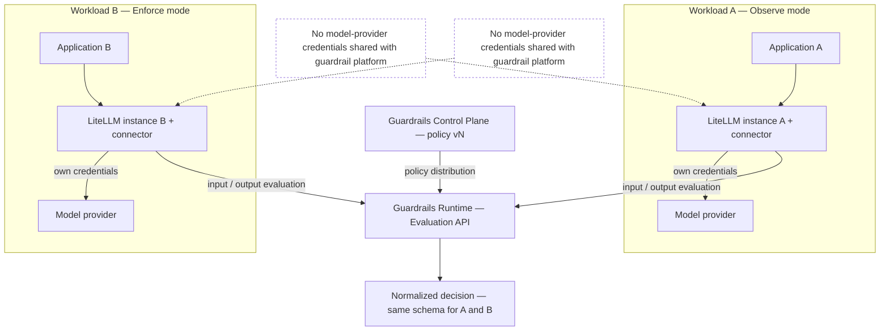
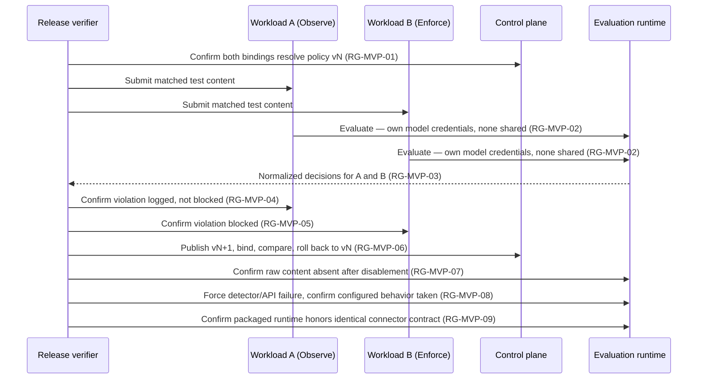
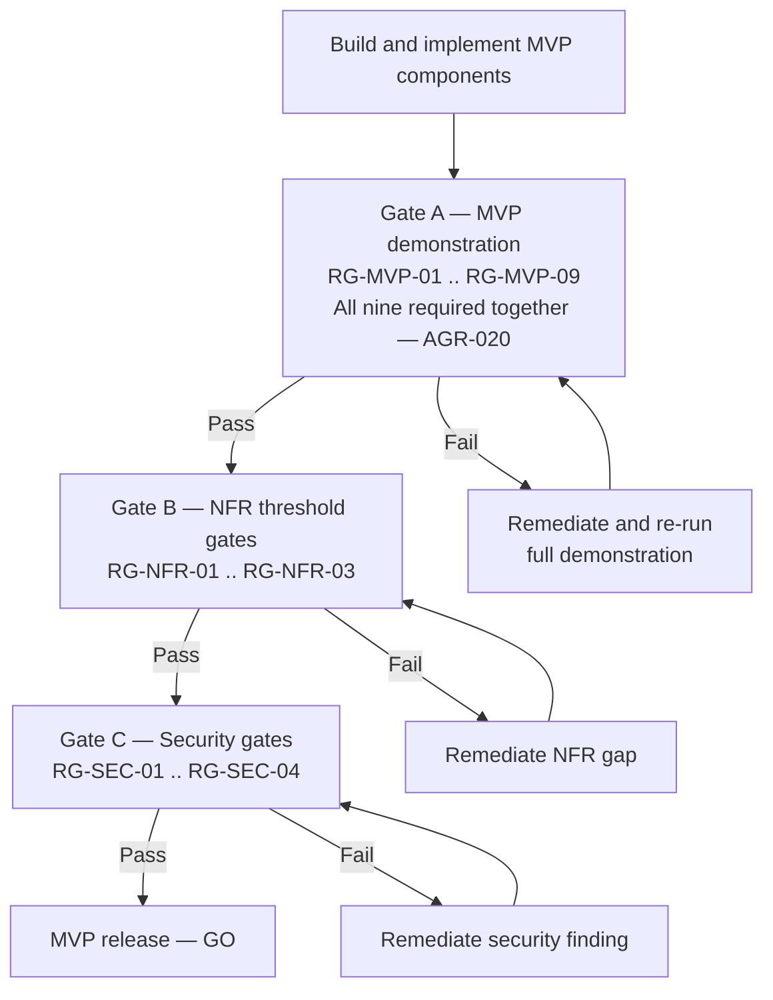

**AI Guardrails — Release Criteria (MVP Exit Gates)**

**Authority level:** L2
**Status:** Draft
**Date:** 2026-07-24
**Derived from:** seed.md + AGREEMENTS.md

---

## Purpose and authority

This document translates the MVP demonstration described in [`seed.md` §16](../../seed.md#16-mvp-definition) and the falsifiable success demonstration in [`AGREEMENTS.md` AGR-020](../00-source-of-truth/AGREEMENTS.md#agr-020--mvp-success-demonstration) into **pass/fail release gates**: checkable statements, each with a defined verification method and a single accountable owner. It also gates the release against the non-functional and security boundaries recorded in [`CONSTRAINTS.md`](../00-source-of-truth/CONSTRAINTS.md) and operationalized in [`NON-FUNCTIONAL-REQUIREMENTS.md`](../50-architecture/NON-FUNCTIONAL-REQUIREMENTS.md).

This is an **L2 — derived** document. It does not create new obligations; it operationalizes:

* [`AGREEMENTS.md`](../00-source-of-truth/AGREEMENTS.md) — in particular AGR-011 (observe-before-enforce), AGR-012 (failure behavior is part of policy), AGR-013 (minimal MVP account model), AGR-014 (no raw retention by default), AGR-019 (MVP scope boundaries), AGR-020 (MVP success demonstration).
* [`CONSTRAINTS.md`](../00-source-of-truth/CONSTRAINTS.md) — the checkable boundaries CON-001 through CON-016.
* [`SUCCESS-CRITERIA.md`](../10-charter/SUCCESS-CRITERIA.md) — which defines *what* success means (criteria MVP-01 through MVP-09); this document defines *how each is gated* for release, adding a verification method and an accountable owner to each.
* [`NON-FUNCTIONAL-REQUIREMENTS.md`](../50-architecture/NON-FUNCTIONAL-REQUIREMENTS.md) and [`OPERABILITY.md`](../50-architecture/OPERABILITY.md) — the measurable NFR and operability shape these gates draw their thresholds from.

Where anything below could be read as conflicting with an L1 document, the L1 document wins and this document must be corrected. Per source-of-truth policy, no invented metric, date, SLA, or dollar figure appears here — where seed.md does not supply a concrete number, the gate is marked **TBD** and is written so that it gates the *existence and visibility* of the measurement and behavior, not an unsupported figure.

---

## How to read a gate

Every gate in this document follows the same fixed shape:

```text
### RG-<CATEGORY>-<NN> — <short name>
Statement:       the pass/fail condition
How verified:    the concrete verification method and evidence
Owner:           the single accountable role
Source:          the AGR- / CON- / NFR- / MVP- reference this gate operationalizes
```

Three gate categories are defined:

| Category | Question it answers | Section |
| --- | --- | --- |
| **MVP demonstration gates** (`RG-MVP-##`) | Has the core reusable-policy hypothesis been proven end to end, exactly as specified in seed.md §16? | [Section 1](#1-mvp-demonstration-gates) |
| **NFR threshold gates** (`RG-NFR-##`) | Is the runtime measurably available, fast enough, and auditable enough to operate in production? | [Section 2](#2-nfr-threshold-gates) |
| **Security gates** (`RG-SEC-##`) | Does the release meet the non-negotiable transport, identity, telemetry, and supply-chain boundaries in `CONSTRAINTS.md`? | [Section 3](#3-security-gates) |

`RG-MVP-##` gate IDs correspond one-to-one with the `MVP-##` criteria already defined in [`SUCCESS-CRITERIA.md` §1.2](../10-charter/SUCCESS-CRITERIA.md#12-criteria-table); this document adds the verification method and owner that `SUCCESS-CRITERIA.md` leaves as **TBD**, per its §1.3 gating rule.

---

## Table of contents

- [1. MVP demonstration gates](#1-mvp-demonstration-gates)
  - [1.1 Demonstration topology](#11-demonstration-topology)
  - [1.2 Gate table](#12-gate-table)
  - [1.3 Verification sequence](#13-verification-sequence)
- [2. NFR threshold gates](#2-nfr-threshold-gates)
- [3. Security gates](#3-security-gates)
- [4. Release gating rule](#4-release-gating-rule)
- [5. Verification evidence and sign-off](#5-verification-evidence-and-sign-off)
- [6. Related documents](#6-related-documents)

---

## 1. MVP demonstration gates

The MVP exists to prove one hypothesis: **one reusable policy can be applied consistently to multiple independent LiteLLM deployments** ([`seed.md` §16](../../seed.md#16-mvp-definition)). Per [AGR-020](../00-source-of-truth/AGREEMENTS.md#agr-020--mvp-success-demonstration), all nine gates below must pass **together**, against two genuinely independent LiteLLM deployments — not a subset, and not one deployment exercised twice under different labels.

### 1.1 Demonstration topology



### 1.2 Gate table

| Gate | Statement | How verified | Owner | Source |
| --- | --- | --- | --- | --- |
| **RG-MVP-01** — Two instances, one policy | Two independently deployed LiteLLM instances (Workload A and Workload B), each with its own connector installation, are bound to the identical guardrail policy — same policy name and version — resolved from one control plane. | Compare the resolved policy identifier (name + version) returned to each instance's connector at evaluation time; confirm against both workloads' policy-binding records and audit metadata. | Delivery lead | MVP-01; AGR-020, AGR-017 |
| **RG-MVP-02** — No shared provider credentials | Neither LiteLLM instance's model-provider credentials (API keys, tokens) are held, stored, or transmitted to the guardrail platform at any point in the demonstration. | Credential/secrets audit of the guardrail control plane and Evaluation API confirming no model-provider credential is present for either workload, consistent with the connector's non-responsibilities ([`seed.md` §12](../../seed.md#12-litellm-integration)). | Security and governance lead | MVP-02; AGR-021, CON-011, CON-012 |
| **RG-MVP-03** — Consistent normalized decisions | For equivalent evaluated content submitted through both instances, the Evaluation API returns decisions using the identical normalized schema — action, allowed status, reason codes, policy name/version, evaluator metadata, correlation identifier, audit identifier, evaluation latency. | Side-by-side comparison of decision payloads for matched test content submitted to Workload A and Workload B; schema-conformance check against the Decision structure in [`seed.md` §9](../../seed.md#9-core-domain-model). | Technical lead | MVP-03; AGR-006, AGR-017 |
| **RG-MVP-04** — Observe-mode workload | Workload A's policy binding is set to Observe; evaluations execute and produce decisions, but no block/redact enforcement action is applied on the request path. | Binding-configuration review confirming Observe state; test traffic carrying a policy-violating input/output confirms the request completes unmodified while the decision and reason codes are still recorded. | Integration lead | MVP-04; AGR-011 |
| **RG-MVP-05** — Enforce-mode workload | Workload B's policy binding is set to Enforce (or a stricter state); a policy violation triggers the corresponding enforcement action (e.g., block) on the request path. | Binding-configuration review confirming Enforce state; the same test traffic used in RG-MVP-04 confirms the enforcement action is actually applied and recorded. | Integration lead | MVP-05; AGR-011 |
| **RG-MVP-06** — Policy upgrade and rollback | A new immutable policy version can be published and bound to a workload, producing a documented, verifiable behavior change; the binding can then be reverted to the prior version, restoring prior behavior, with both transitions captured in audit metadata. | Controlled test: publish version N+1, bind to a workload, confirm a decision-behavior change against a fixed test-content set; execute rollback to version N; confirm behavior reverts; confirm both the promotion and the rollback appear in audit records with version identifiers. | Policy owner | MVP-06; `seed.md` §15 (Policy rollout) |
| **RG-MVP-07** — Raw-content persistence disablement | With a tenant's retention configuration set to disable raw-content persistence, no raw prompt or response content is found in any runtime store, cache, or log after evaluation completes; decision metadata is still persisted. | Storage and log audit across the policy store, decision store, caches, and telemetry pipelines following a test evaluation batch run with raw-content persistence disabled, confirming absence of raw content and presence of decision metadata. | Security and governance lead | MVP-07; AGR-014, CON-014 |
| **RG-MVP-08** — Configured failure policy honored | When a detector or the Evaluation API is forced into a defined failure condition (timeout, unavailability), the workload's configured failure behavior executes exactly as configured, and the failure-behavior path taken is captured in the audit record. | Failure-injection test forcing each in-scope failure mode (detector unavailable, Evaluation API timeout) against a workload with an explicit configured behavior; confirm observed runtime behavior matches the configured behavior and that the audit record states which path was taken. | Technical lead | MVP-08; AGR-012 |
| **RG-MVP-09** — Repackageable for customer-managed deployment | The evaluation runtime can be packaged as a deployable artifact (e.g., a container) suitable for a customer-managed environment, while the LiteLLM connector's invocation contract (request/response shapes to the Evaluation API) remains unchanged from the hosted-mode contract exercised in RG-MVP-01–03. | A packaging exercise builds and runs the runtime as a standalone artifact outside hosted infrastructure; the same, unmodified connector is pointed at the packaged runtime and completes input/output evaluations using the identical contract. This gate validates packaging *feasibility* only — full Customer-Managed Runtime delivery (Helm chart, ECS template, policy synchronization) remains Phase 4 scope per [AGR-022](../00-source-of-truth/AGREEMENTS.md#agr-022--five-phase-delivery). | Architecture lead | MVP-09; AGR-006, AGR-015, AGR-022 |

### 1.3 Verification sequence

The sequence below shows how a release verifier exercises all nine gates in one coherent pass, rather than as nine unrelated tests.



---

## 2. NFR threshold gates

These gates operationalize the availability, performance, and auditability requirements in [`seed.md` §15](../../seed.md#15-operational-requirements) and [`NON-FUNCTIONAL-REQUIREMENTS.md`](../50-architecture/NON-FUNCTIONAL-REQUIREMENTS.md). Consistent with source-of-truth policy, no numeric threshold is invented where `seed.md` does not supply one: where a target is **TBD**, the gate requires that the objective be defined, published, and continuously measured — not that an unsupported figure be hit.

| Gate | Statement | How verified | Owner | Source |
| --- | --- | --- | --- | --- |
| **RG-NFR-01** — Availability objective defined and monitored | A documented availability objective for the hosted Evaluation API exists, has been published to pilot workload owners, and is continuously monitored. Numeric target: **TBD** — must be set and socialized with pilot workloads before this gate can pass; an unpublished or implicit expectation does not satisfy it. | Review confirming a written availability objective exists and has been communicated to pilot workload owners; confirm uptime monitoring is live and reporting against that objective. | Architecture lead (with Platform operations lead) | NFR-AVAIL-001; `seed.md` §15, §19; AGR-002; ASM-012 |
| **RG-NFR-02** — P95 evaluation latency measured and accepted | P95 end-to-end evaluation latency is measured continuously, per evaluation stage (input/output) and per deployment mode, and reported to workload owners during Observe mode before any workload is promoted to Enforce. Numeric ceiling: **TBD** — no source-defined figure exists; until one is set, the gate requires the metric to be measured, visible, and reviewed against each pilot workload's actual latency tolerance, not that a specific figure be hit. | Confirm P95 latency dashboards/reports exist and are attributable by workload, stage, and mode; confirm each pilot workload owner has reviewed and accepted observed P95 latency before its binding is promoted out of Observe. | Technical lead | NFR-PERF-002; `seed.md` §15, §19; ASM-011 |
| **RG-NFR-03** — Audit delivery success rate measured and failure behavior defined | The proportion of evaluations for which an audit record is successfully produced and delivered is measured continuously, per tenant and per deployment mode. Numeric target: **TBD**; regardless of the target, every workload must have an explicit, non-silent configured behavior for the case where audit delivery fails. | Confirm the audit-delivery-success-rate metric is live and reported; confirm, via configuration review and a failure-injection test, that every in-scope workload's audit-delivery-failure behavior is defined and is the behavior actually observed when delivery is forced to fail. | Platform operations lead | NFR-REL-003, NFR-AUDIT-002; `seed.md` §15, §19; AGR-012 |

---

## 3. Security gates

These gates operationalize the non-negotiable security requirements in [`seed.md` §14](../../seed.md#14-security-requirements) and [`CONSTRAINTS.md`](../00-source-of-truth/CONSTRAINTS.md) CON-008 through CON-016. Unlike the MVP demonstration gates, security gates are **recurring** — they must pass at every release, not only at the one-time MVP milestone.

| Gate | Statement | How verified | Owner | Source |
| --- | --- | --- | --- | --- |
| **RG-SEC-01** — TLS coverage | 100% of runtime communication paths — application-to-connector, connector-to-Evaluation-API, runtime-to-evaluation-engines, and runtime-to-control-plane — use TLS; zero unencrypted paths exist in the release topology. | Automated network/configuration scan confirming TLS termination on every listener and outbound connection in the released deployment topology; any plaintext path found is a release-blocking finding. | Security and governance lead | CON-008; NFR-SEC-001 |
| **RG-SEC-02** — IAM-based, least-privilege, short-lived authentication | 100% of AWS-facing consumers of the platform authenticate via IAM using least-privilege, short-lived credentials; zero long-lived static credentials are used for runtime authentication. | IAM policy and credential-lifetime audit of every runtime role in the release; CI check confirming no infrastructure-as-code artifact in the release provisions long-lived access keys for a runtime role. | Security and governance lead (with Platform operations lead) | CON-010; NFR-SEC-002 |
| **RG-SEC-03** — No secrets in telemetry | 100% of telemetry payloads emitted by the runtime — operational metrics, connector-health signals, and, for Customer-Managed Runtime, customer-selected telemetry categories — are free of secrets (credentials, API keys, tokens) by construction, not by post-hoc filtering alone. | Telemetry schema/payload review confirming secret-bearing fields cannot be populated in any telemetry shape shipped in the release; automated secret-pattern scan run against a sample of actually emitted telemetry as a secondary control. | Security and governance lead | CON-009, CON-013; NFR-PRIV-003 |
| **RG-SEC-04** — Container and dependency scan clean | 100% of runtime container images and declared dependencies included in the release are scanned for known vulnerabilities before deployment; no unresolved critical finding exists without an explicit, recorded exception. | CI/CD scan-gate result for the release build and every deployment artifact it includes (container image; for Customer-Managed Runtime, also the Helm chart and ECS template once those artifacts exist); release is blocked while a critical finding remains open without a recorded exception. | Platform operations lead | `seed.md` §14 (Dependency and container scanning); NFR-SEC-006 |

---

## 4. Release gating rule



Two distinct milestones are gated by the categories above, and they must not be conflated:

* **MVP completion** (declaring the MVP demonstration in [`seed.md` §16](../../seed.md#16-mvp-definition) satisfied, and thereby exiting Phase 1/2 per [AGR-022](../00-source-of-truth/AGREEMENTS.md#agr-022--five-phase-delivery)) is gated **only** by Gate A — all nine `RG-MVP-##` gates, passing together, per [AGR-020](../00-source-of-truth/AGREEMENTS.md#agr-020--mvp-success-demonstration). A subset passing, or one LiteLLM deployment exercised twice under different labels, does not satisfy this milestone.
* **Production release / promotion of any workload from Observe to Enforce** additionally requires Gate B (NFR threshold gates) and Gate C (security gates) to pass, and — because these gates are recurring, not one-time — they must be re-verified at every subsequent release, not only at the initial MVP milestone.

No release may be declared complete, and no external claim of MVP success may be made in sales, executive, or governance materials, unless every gate in the applicable milestone has passed and is recorded per [Section 5](#5-verification-evidence-and-sign-off). Any claim to the contrary must be rejected by [`CLAIMS-REGISTER.md`](../70-governance/CLAIMS-REGISTER.md).

---

## 5. Verification evidence and sign-off

| Gate category | Evidence artifact | Where recorded | Sign-off owner |
| --- | --- | --- | --- |
| MVP demonstration (`RG-MVP-##`) | Test-run transcripts, binding-configuration snapshots, audit-record excerpts, and policy-version history from the verification sequence in [Section 1.3](#13-verification-sequence). | [`VALIDATION-PLAN.md`](VALIDATION-PLAN.md) (planned) | Delivery lead, countersigned by Technical lead and Security and governance lead |
| NFR threshold gates (`RG-NFR-##`) | Availability/latency/audit-delivery dashboards and reports, pilot workload owner acceptance records. | [`NON-FUNCTIONAL-REQUIREMENTS.md`](../50-architecture/NON-FUNCTIONAL-REQUIREMENTS.md) summary table; [`OPERABILITY.md`](../50-architecture/OPERABILITY.md) runbook | Architecture lead, countersigned by Platform operations lead |
| Security gates (`RG-SEC-##`) | Network/TLS scan output, IAM/credential audit, telemetry schema review, CI/CD container and dependency scan results. | Security review record referenced by `SECURITY-ARCHITECTURE.md` (planned) | Security and governance lead |

A gate is considered **passed** only when its evidence artifact exists, is attributable to the specific release under review, and has been reviewed by the named sign-off owner(s) — a gate is never passed on the basis of a prior release's evidence or an unrecorded verbal confirmation.

---

## 6. Related documents

| Document | Relationship |
| --- | --- |
| [`../00-source-of-truth/AGREEMENTS.md`](../00-source-of-truth/AGREEMENTS.md) | L1 agreements this document gates against, notably AGR-011, AGR-012, AGR-013, AGR-014, AGR-019, AGR-020, AGR-022. |
| [`../00-source-of-truth/CONSTRAINTS.md`](../00-source-of-truth/CONSTRAINTS.md) | L1 checkable boundaries (CON-008 through CON-016) that Section 3's security gates restate as pass/fail conditions. |
| [`../00-source-of-truth/ASSUMPTIONS.md`](../00-source-of-truth/ASSUMPTIONS.md) | Unvalidated beliefs (ASM-003, ASM-011, ASM-012, ASM-013) that must be resolved before the corresponding gates in Sections 1–2 can be considered durably passed rather than provisionally passed. |
| [`../10-charter/SUCCESS-CRITERIA.md`](../10-charter/SUCCESS-CRITERIA.md) | Defines the MVP-01 through MVP-09 criteria that Section 1's gates operationalize; also the ongoing success metrics this document's NFR gates draw thresholds from. |
| [`../10-charter/SCOPE.md`](../10-charter/SCOPE.md) | MVP scope boundaries that define what these gates may assume is in scope (and must not silently gate on an out-of-scope or future-scope capability). |
| [`../50-architecture/NON-FUNCTIONAL-REQUIREMENTS.md`](../50-architecture/NON-FUNCTIONAL-REQUIREMENTS.md) | Source of the NFR-AVAIL-001, NFR-PERF-002, NFR-REL-003, NFR-AUDIT-002, and NFR-SEC-00x requirements Section 2 and Section 3 gate against. |
| [`../50-architecture/OPERABILITY.md`](../50-architecture/OPERABILITY.md) | Operational runbook and failure-path detail that the verification methods in Sections 1–2 exercise directly (timeout, retry, cached-policy, degraded-mode, circuit-breaker behavior). |
| [`../50-architecture/DEPLOYMENT-ARCHITECTURE.md`](../50-architecture/DEPLOYMENT-ARCHITECTURE.md) | Per-mode infrastructure that RG-MVP-09 and the account-model constraints (CON-001, CON-002) depend on. |
| [`../50-architecture/INTEGRATION-ARCHITECTURE.md`](../50-architecture/INTEGRATION-ARCHITECTURE.md) | Connector contract that RG-MVP-01, RG-MVP-03, and RG-MVP-09 verify has not changed between hosted and packaged deployment. |
| [`VALIDATION-PLAN.md`](VALIDATION-PLAN.md) | Should define the concrete test environments and data sets used to execute every gate in this document (planned). |
| [`MILESTONES.md`](MILESTONES.md) | Should sequence delivery of the two independent LiteLLM deployments needed to exercise Section 1 (planned). |
| [`IMPLEMENTATION-STRATEGY.md`](IMPLEMENTATION-STRATEGY.md) | Build sequence for the MVP components these gates verify once built (planned). |
| [`../70-governance/RISK-REGISTER.md`](../70-governance/RISK-REGISTER.md) | Tracks the connector-bypass, false-confidence, latency, and hosted-data-exposure risks these gates exist to surface before release. |
| [`../70-governance/CLAIMS-REGISTER.md`](../70-governance/CLAIMS-REGISTER.md) | Must reject any external claim of MVP success or release readiness that is not backed by a passed gate recorded here. |
