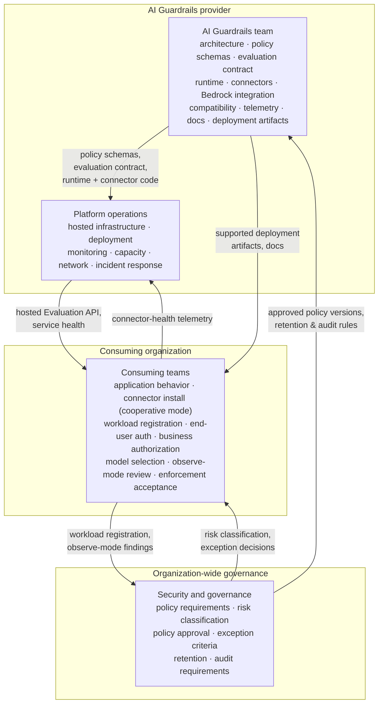

**AI Guardrails — Team and Ownership Boundaries**

**Authority level:** L3
**Status:** Draft
**Date:** 2026-07-24
**Derived from:** seed.md + AGREEMENTS.md

---

## Purpose of this document

This document defines who is responsible for what across the AI Guardrails solution, as recorded in seed.md §21 ("Ownership boundaries"). It exists so that delivery planning, onboarding, incident response, and policy exceptions all resolve to the same set of boundaries rather than each team assuming responsibility lies elsewhere.

Seed.md §21 names four ownership groups:

1. **AI Guardrails team** — builds and evolves the product.
2. **Platform operations** — runs the AI Guardrails provider's hosted infrastructure.
3. **Security and governance** — sets and approves organization-level policy requirements.
4. **Consuming teams** — own the applications and workloads that bind to guardrail policies.

This is an **L3 (delivery-tier)** document. It must not contradict [`AGREEMENTS.md`](../00-source-of-truth/AGREEMENTS.md) or [`CONSTRAINTS.md`](../00-source-of-truth/CONSTRAINTS.md) (both L1). Where a figure or threshold would be useful but is not present in seed.md, this document says **TBD** rather than inventing one.

### A note on terminology — do not conflate with TARGET-USERS.md's stakeholder groups

[`../20-product/TARGET-USERS.md`](../20-product/TARGET-USERS.md) describes seed.md §7's four *stakeholder* groups (Platform teams, Application teams, Security and compliance teams, Product operators) — who benefits and what they need. This document describes seed.md §21's four *ownership* groups — who does the work. The two lenses overlap but are not identical, and two naming collisions are easy to make:

* **"Platform operations" (this document, §21) ≠ "Platform teams" (TARGET-USERS.md, §7).** Platform operations is the AI Guardrails **provider's own** operations function, running the provider's hosted infrastructure. Platform teams (§7) is an internal function **inside a consuming organization** that runs that organization's own shared LiteLLM or gateway infrastructure — the group named in seed.md §8 as operating "platform-managed enforcement." These are different people in different organizations. Where this document discusses enforcement postures (§5 below), the acting party is the **Consuming teams** ownership group, not Platform operations.
* **"Security and governance" (this document, §21) corresponds most closely to "Security and compliance teams" (TARGET-USERS.md, §7).** Seed.md does not state whether this function sits inside the AI Guardrails provider or inside the enterprise that hosts both the provider and the consuming teams. This document does not assume either placement — see §2.3 below.

---

## 1. The four ownership groups at a glance

| Group | One-line mandate | Not to be confused with |
|---|---|---|
| AI Guardrails team | Builds and evolves the product: architecture, policy schemas, evaluation contract, runtime, connectors, integrations, compatibility, telemetry, documentation, deployment artifacts | — |
| Platform operations | Runs the AI Guardrails provider's own hosted infrastructure day to day | Seed.md §8's "platform team" inside a *consuming* organization (see terminology note above) |
| Security and governance | Sets organization-level policy requirements and approves policy, risk, retention, and audit rules | "Security and compliance teams" in TARGET-USERS.md §7 |
| Consuming teams | Own the applications/workloads bound to guardrail policies, including any internal gateway or platform function they themselves operate | "Application teams" in TARGET-USERS.md §7 (and "Platform teams" where a consuming organization runs its own shared gateway) |

---

## 2. Detailed responsibilities per group

### 2.1 AI Guardrails team

Per seed.md §21, responsible for:

* Product architecture.
* Policy schemas.
* Evaluation contract.
* Guardrail runtime.
* LiteLLM connector.
* Bedrock integration.
* Policy compatibility.
* Runtime telemetry.
* Documentation.
* Supported deployment artifacts.

This is the group that must hold the line on the product's structural agreements: policy portability (AGR-005), one evaluation contract across all three modes (AGR-006), and the policy/connector separation (AGR-007). It owns the logical architecture's control-plane and runtime components — policy resolver, decision engine, evaluator adapters, audit producer (see [`../50-architecture/SYSTEM-CONTEXT.md`](../50-architecture/SYSTEM-CONTEXT.md) and [`../50-architecture/CONTAINER-ARCHITECTURE.md`](../50-architecture/CONTAINER-ARCHITECTURE.md)) — and it owns every deployment artifact the product ships, including the runtime container, Helm chart, ECS deployment template, and infrastructure module scoped for Phase 4 (customer-managed runtime).

### 2.2 Platform operations

Per seed.md §21, responsible for:

* Hosted infrastructure.
* Runtime deployment.
* Service monitoring.
* Capacity management.
* Network configuration.
* Production incident response.

This group's scope is the AI Guardrails **provider's own** hosted footprint — the infrastructure listed in [`../50-architecture/DEPLOYMENT-ARCHITECTURE.md`](../50-architecture/DEPLOYMENT-ARCHITECTURE.md), the AWS services in seed.md §11 (ECS Fargate/EKS, API Gateway/ALB, DynamoDB, Secrets Manager, KMS, CloudWatch, SQS, S3, ECR), and the availability, timeout, retry, degraded-mode, and circuit-breaker behaviors required by seed.md §15. It does **not** extend into a consuming team's own LiteLLM deployment (Mode A) or their own AWS account (Mode C) unless that team has purchased optional managed support, per seed.md §3's Mode C list ("Runtime upgrades unless managed support is purchased").

### 2.3 Security and governance

Per seed.md §21, responsible for:

* Organization-level policy requirements.
* Risk classifications.
* Policy approval.
* Exception criteria.
* Retention requirements.
* Audit requirements.

Seed.md does not state whether this function sits inside the AI Guardrails provider's own organization or inside the wider enterprise that both the provider and every consuming team belong to. This document does not assume either placement; wherever the function sits, its decisions are binding on both the AI Guardrails team (which must build to approved schemas and retention/audit rules) and on consuming teams (which must operate within approved risk classifications and exception criteria). This is the group whose approval is the gate referenced by the observe-to-enforce progression (AGR-011) and by the policy-fragmentation mitigation in seed.md §20 ("Require ownership for exceptions").

### 2.4 Consuming teams

Per seed.md §21, responsible for:

* Application behavior.
* Correct connector installation in cooperative mode.
* Workload registration accuracy.
* End-user authentication.
* Business authorization.
* Model selection where applicable.
* Review of observe-mode findings.
* Acceptance of enforcement behavior.

"Consuming teams" is a single ownership group in §21 regardless of internal structure — it covers both the application team building the workload and, where the organization has one, its own internal platform/infrastructure function that operates a shared gateway (the "platform team" of seed.md §8). End-user authentication and business authorization are explicitly **not** guardrail responsibilities (AGR-010): a guardrail decision that a tool call appears safe never substitutes for the consuming team's own authentication, authorization, tenant isolation, resource ownership, transaction-limit, and approval-workflow logic. "Model selection where applicable" is qualified because model selection is not equally available in every mode — see §4 below.

---

## 3. Responsibility matrix (lightweight RACI)

Legend: **R** = Responsible (does the work) · **A** = Accountable (owns the outcome) · **C** = Consulted · **I** = Informed. Most rows show a single group holding both R and A, consistent with seed.md §21's framing of single-owner "responsible for" lists rather than a distributed-accountability model.

Columns: **AIG** = AI Guardrails team · **POps** = Platform operations · **SecGov** = Security and governance · **Cons** = Consuming teams.

### 3.1 Product, policy, and runtime

| Activity | AIG | POps | SecGov | Cons |
|---|---|---|---|---|
| Product architecture and roadmap | R/A | C | C | I |
| Policy schema definition | R/A | I | C | I |
| Evaluation contract (requests, decisions, reason codes) | R/A | I | C | I |
| Guardrail runtime software | R/A | C | I | I |
| LiteLLM connector implementation | R/A | I | I | C |
| Bedrock Guardrails adapter | R/A | I | I | I |
| Cross-mode / cross-version policy compatibility | R/A | I | C | I |
| Audit-event schema and audit producer | R/A | C | C | I |
| Runtime telemetry design (latency metrics, decision metadata) | R/A | C | C | I |
| Product documentation | R/A | C | C | C |
| Supported deployment artifacts (container, Helm chart, ECS template, IaC module) | R/A | C | I | C |

### 3.2 Hosted operations (provider-side)

| Activity | AIG | POps | SecGov | Cons |
|---|---|---|---|---|
| Hosted infrastructure provisioning | C | R/A | I | I |
| Runtime deployment (hosted modes) | C | R/A | I | I |
| Service and health monitoring | C | R/A | I | I |
| Capacity management | C | R/A | I | I |
| Network configuration (hosted runtime) | C | R/A | C | I |
| Production incident response (hosted modes) | C | R/A | I | I |

### 3.3 Governance and compliance

| Activity | AIG | POps | SecGov | Cons |
|---|---|---|---|---|
| Organization-level policy requirements | C | I | R/A | I |
| Workload / tenant risk classification | I | I | R/A | C |
| Policy approval (org sign-off on a policy version) | C | I | R/A | I |
| Exception criteria and override approval | C | I | R/A | C |
| Retention requirements | C | I | R/A | I |
| Audit requirements definition | C | I | R/A | I |

### 3.4 Consuming-team application and onboarding

| Activity | AIG | POps | SecGov | Cons |
|---|---|---|---|---|
| Application behavior | I | I | I | R/A |
| Connector installation and configuration (cooperative mode) | C | I | I | R/A |
| Workload registration accuracy | C | I | I | R/A |
| End-user authentication | I | I | I | R/A |
| Business authorization | I | I | I | R/A |
| Model selection (where permitted by mode/policy) | C | I | I | R/A |
| Review of observe-mode findings | C | I | C | R/A |
| Promotion of a specific workload's binding from observe to enforce | I | I | C | R/A |

The last row is deliberately distinct from "policy approval" in §3.3: Security and governance approves a **policy version** as fit for use across the platform; the consuming team then decides, and accepts responsibility, for promoting **its own workload's binding** to that approved policy from observe to enforce — an explicit, auditable action per AGR-011.

---

## 4. Ownership shifts by deployment mode

Seed.md §3 attributes ownership at the level of "the consuming team" versus "the AI Guardrails provider" as a whole. §21 further divides the provider's side into the AI Guardrails team (software, policy, contract) and Platform operations (hosted infrastructure, monitoring, incident response). The table below combines both views. Security and governance's responsibilities are presented as constant across modes — seed.md does not vary them by deployment mode.

| Ownership item | Mode A — Remote Evaluation | Mode B — Guarded Gateway | Mode C — Customer-Managed Runtime |
|---|---|---|---|
| Gateway/runtime infrastructure & availability | Consuming teams (own LiteLLM) | Platform operations (provider-run gateway) | Consuming teams (own AWS account) |
| Model-provider credentials & routing | Consuming teams | Platform operations (provider credentials or delegated AWS access) | Consuming teams |
| Retry / fallback / capacity / model-provider cost | Consuming teams | Platform operations | Consuming teams |
| Guardrail policy execution, detection engines, decision normalization | AI Guardrails team (logic) + Platform operations (hosted API infra) | AI Guardrails team (logic, embedded in the gateway) | AI Guardrails team (runtime software shipped to the customer) |
| Runtime software, policy schemas, compatibility, updates, docs | AI Guardrails team | AI Guardrails team | AI Guardrails team |
| Local audit storage / audit archive | Platform operations (hosted archive) | Platform operations (audit & usage reporting) | Consuming teams (local audit integration) |
| Runtime upgrades | AI Guardrails team ships; Platform operations applies (hosted API) | AI Guardrails team ships; Platform operations applies | Consuming teams, unless managed support is purchased |
| Optional hosted policy management / support | — | — | AI Guardrails team (optional service) |
| Org policy requirements, risk classification, policy approval, exception criteria, retention, audit requirements | Security and governance | Security and governance | Security and governance |

Narrative notes:

* **Mode A** does not reduce provider-side data exposure — prompts, responses, and other evaluated content still reach the hosted Evaluation API (AGR-009) — even though the consuming team retains full gateway ownership. Ownership and exposure are tracked as separate concerns per AGR-008; see [`../50-architecture/DATA-ARCHITECTURE.md`](../50-architecture/DATA-ARCHITECTURE.md).
* **Mode B** is the only mode in which Platform operations (provider-side) operates the model-inference path itself, which is why it carries "the largest operational, security, and compliance scope for the provider" (seed.md §3). Consuming-team ownership narrows to application behavior, workload-specific configuration, policy selection where permitted, end-user authorization, and business-level approval flows — model selection itself is constrained to what the provider has integrated and routed.
* **Mode C** shifts almost all infrastructure and credential ownership to the consuming team, while the AI Guardrails team retains ownership of everything that keeps the runtime consistent with the rest of the product (schemas, compatibility, deployment artifacts). Platform operations has no role in Mode C unless the consuming team purchases optional managed support.

---

## 5. Ownership under each enforcement posture

Seed.md §8 describes three enforcement postures — cooperative integration, platform-managed enforcement, and network/IAM-enforced gateway. All three describe controls that live **inside the consuming organization's own environment**; per the terminology note above, none of them shift ownership to this document's "Platform operations" group, which is the AI Guardrails provider's own hosted-infrastructure function. What shifts is *which part of* the Consuming teams ownership group is accountable for preventing bypass.

| Posture | Who inside Consuming teams is accountable | Bypass resistance | AI Guardrails team's role | Security and governance's role |
|---|---|---|---|---|
| Cooperative integration | Individual application team installing/maintaining the connector | Connector can be disabled, removed, or misconfigured; must never be represented as a hard security boundary (AGR-018) | Ships the connector and documentation | Sets the requirement that bypass risk be disclosed, not resolved |
| Platform-managed enforcement | The consuming organization's own internal platform/infrastructure function (seed.md §8's "platform team"), via read-only config, GitOps-managed deployment, restricted IAM, connector-health telemetry | Stronger — application teams cannot change mandatory guardrail settings — but still operated by the consuming organization, not the AI Guardrails provider | Supplies configuration-validation tooling and connector-health signals | Sets which settings must be mandatory |
| Network and IAM-enforced gateway | The consuming organization's central platform/security function, via egress policy, IAM restriction to the gateway role, and centrally managed guardrail configuration | Strongest — no direct provider credentials or connectivity for applications | Supplies the runtime and connector; does not operate the enforced path | Defines when this posture is required (seed.md §8: bypass prevention required, compliance evidence required, direct provider access prohibited) |

Mode B (Guarded Gateway) is architecturally similar in spirit to the network/IAM-enforced posture, since the provider inherently operates the entire inference path in that mode — but §3 (modes) and §8 (postures) are described as separate axes in seed.md, and this document does not merge them into a single rule.

---

## 6. Explicit boundary clarifications — what each group does not own

Derived from seed.md §12 (connector responsibilities) and the guardrails-are-not-authorization principle (§5.5 / AGR-010):

* The **LiteLLM connector**, owned by the AI Guardrails team, is explicitly **not** responsible for: defining organization policy, implementing detection models, managing model credentials, persisting audit records, performing user authorization, or managing policy versions.
* **Guardrail decisions are not authorization decisions** (AGR-010). Even where a guardrail evaluates a tool call as safe, the consuming team remains solely responsible for authentication, business authorization, tenant isolation, resource ownership, transaction limits, and approval workflows. This boundary does not shift by deployment mode or enforcement posture.
* **"Import" does not mean gateway control** (AGR-021). A consuming team importing a policy adopts a versioned policy, a workload identity, an integration manifest, a connector configuration, and an enforcement mode. It never grants the AI Guardrails provider administrative access to the consuming team's gateway, nor does it require transferring model-provider credentials or copying the team's LiteLLM database.
* **Policies and connectors remain separate ownership artifacts** (AGR-007). A connector must never embed policy logic, thresholds, or detection rules, regardless of which group builds or operates it.

---

## 7. Exceptions and escalation

Policy bindings (seed.md §9) may define workload-specific overrides, an effective date, a rollback version, and runtime compatibility requirements. Where a consuming team requests an override to an assigned policy:

1. The consuming team documents the requested override and its business justification.
2. Security and governance evaluates the request against its exception criteria and either approves, denies, or scopes the override (§21; seed.md §20 "Require ownership for exceptions").
3. The AI Guardrails team implements the override as a binding-level configuration, not a connector-level or policy-content change, preserving the policy/connector separation (AGR-007).
4. Platform operations is informed where the override affects hosted runtime behavior it must monitor or support.

Unresolved exception or override requests, and any open questions about where this boundary set does not yet have a clear answer, should be tracked in [`../00-source-of-truth/OPEN-QUESTIONS.md`](../00-source-of-truth/OPEN-QUESTIONS.md) rather than resolved informally.

---

## 8. Ownership across delivery phases

Seed.md §18 (Five-phase delivery, AGR-022) implies a changing balance of ownership as the product moves from an integration proof toward a fully hosted and customer-managed platform. This document does not restate the phase deliverables in full — see [`../20-product/PRODUCT-ROADMAP.md`](../20-product/PRODUCT-ROADMAP.md) — but the ownership emphasis shifts as follows:

| Phase | Ownership emphasis |
|---|---|
| Phase 1 — Integration proof | AI Guardrails team dominant (contract, policy format, Bedrock adapter, connector, observe mode, basic auditing); Platform operations footprint limited to internal deployment |
| Phase 2 — Internal multi-team platform | Platform operations and Security and governance become fully active (tenant/workload registry, IAM authentication, quotas, service-level monitoring, policy promotion/rollback) |
| Phase 3 — Guarded gateway | Platform operations' scope expands significantly — the provider now operates the managed gateway, model-provider configuration, and per-tenant routing described in Mode B |
| Phase 4 — Customer-managed runtime | Consuming teams' infrastructure ownership expands to match Mode C; the AI Guardrails team adds packaging responsibilities (runtime container, Helm chart, ECS deployment template, infrastructure module) |
| Phase 5 — Advanced agent protection | Out of scope for MVP ownership planning; treated as a separate product expansion (AGR-022), not scheduled against any group's current capacity |

---

## Related documents

* [`../00-source-of-truth/AGREEMENTS.md`](../00-source-of-truth/AGREEMENTS.md) — AGR-002 (three deployment modes), AGR-007 (policy/connector separation), AGR-008 (ownership vs. exposure), AGR-010 (guardrails are not authorization), AGR-011 (observe-before-enforce), AGR-018 (trust and enforcement model), AGR-021 (meaning of "import"), AGR-022 (five-phase delivery).
* [`../20-product/TARGET-USERS.md`](../20-product/TARGET-USERS.md) — the corresponding stakeholder-needs view (seed.md §7); see the terminology note above before cross-referencing group names.
* [`../10-charter/CHARTER.md`](../10-charter/CHARTER.md) and [`../10-charter/SCOPE.md`](../10-charter/SCOPE.md) — the three deployment modes and MVP scope boundaries this ownership model operates within.
* [`../50-architecture/DEPLOYMENT-ARCHITECTURE.md`](../50-architecture/DEPLOYMENT-ARCHITECTURE.md) — the infrastructure Platform operations runs and the packaging the AI Guardrails team ships for Mode C.
* [`../50-architecture/DATA-ARCHITECTURE.md`](../50-architecture/DATA-ARCHITECTURE.md) — the content-exposure model that AGR-008 requires to be tracked separately from operational ownership.
* [`../20-product/PRODUCT-ROADMAP.md`](../20-product/PRODUCT-ROADMAP.md) — full detail behind the five delivery phases referenced in §8 above.
* [`../70-governance/RISK-REGISTER.md`](../70-governance/RISK-REGISTER.md) — the connector-bypass and policy-fragmentation risks (seed.md §20) that this document's escalation path (§7) and enforcement-posture table (§5) are designed to mitigate.
* [`IMPLEMENTATION-STRATEGY.md`](IMPLEMENTATION-STRATEGY.md), [`RELEASE-CRITERIA.md`](RELEASE-CRITERIA.md), [`MILESTONES.md`](MILESTONES.md) — sibling delivery-tier documents that sequence work against the ownership boundaries defined here.
