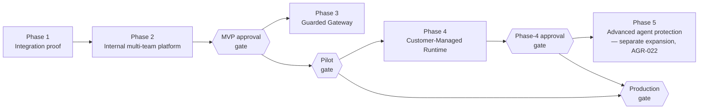
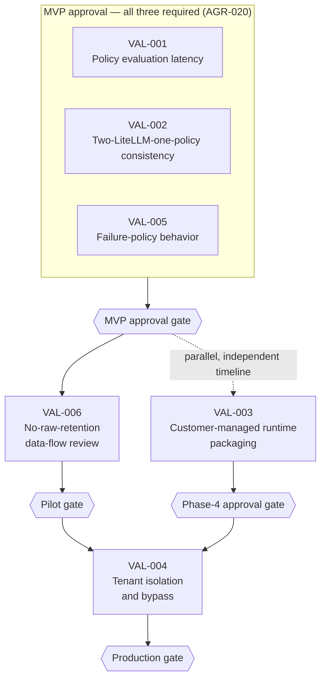
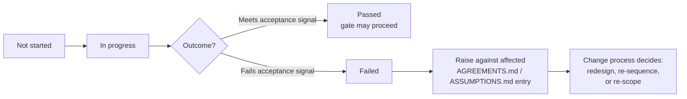

**AI Guardrails — Validation Plan**

**Authority level:** L3
**Status:** Draft
**Date:** 2026-07-24
**Derived from:** seed.md + AGREEMENTS.md

---

## Purpose and authority

This document is the **spec-level validation plan** for the AI Guardrails program: it maps the platform's load-bearing claims and unvalidated assumptions to concrete validation activities, each with a named owner and a required completion gate. It exists so that no claim in [`PROOF-POINTS.md`](../40-sales-deck/PROOF-POINTS.md) and no assumption in [`ASSUMPTIONS.md`](../00-source-of-truth/ASSUMPTIONS.md) advances toward a delivery gate — MVP approval, a pilot, Phase 4, or production — without an explicit, falsifiable check attached to it.

This is an **L3 — derived** document. It must not contradict [`AGREEMENTS.md`](../00-source-of-truth/AGREEMENTS.md) or [`CONSTRAINTS.md`](../00-source-of-truth/CONSTRAINTS.md) (both L1 — authoritative). Where this plan references a specific agreement or constraint, the ID is given (`AGR-NNN`, `CON-NNN`) so the two can be cross-checked. It also does not duplicate the detailed proof-of-concept scopes already defined in [`../50-architecture/FEASIBILITY-ASSESSMENT.md`](../50-architecture/FEASIBILITY-ASSESSMENT.md#4-required-proofs-of-concept) (PoC 1–PoC 5); where a validation activity below corresponds to one of those PoCs, this document cites it by number rather than restating its scope, and adds what the feasibility assessment does not: the delivery **gate** each activity must clear before the program is allowed to proceed past it.

Per source-of-truth policy, no validation activity below is paired with an invented metric, threshold, date, or dollar figure. Where seed.md does not yet supply a number (a latency budget, an availability objective, a specific timeout value), the activity's job is described as *producing* that number, not assuming one exists already.

---

## Table of contents

- [How to read this plan](#how-to-read-this-plan)
- [Gate definitions](#gate-definitions)
- [Owner-role mapping](#owner-role-mapping)
- [Master validation table](#master-validation-table)
- [VAL-001 — Policy evaluation latency](#val-001--policy-evaluation-latency)
- [VAL-002 — Two-LiteLLM-one-policy consistency](#val-002--two-litellm-one-policy-consistency)
- [VAL-003 — Customer-managed runtime packaging](#val-003--customer-managed-runtime-packaging)
- [VAL-004 — Tenant isolation and bypass](#val-004--tenant-isolation-and-bypass)
- [VAL-005 — Failure-policy behavior](#val-005--failure-policy-behavior)
- [VAL-006 — No-raw-retention](#val-006--no-raw-retention)
- [Validation sequencing](#validation-sequencing)
- [Assumptions-register coverage crosswalk](#assumptions-register-coverage-crosswalk)
- [Lifecycle and status](#lifecycle-and-status)
- [Related documents](#related-documents)

---

## How to read this plan

Each validation item below follows one shape:

| Field | Meaning |
| --- | --- |
| **ID** | Stable identifier, `VAL-NNN`, referenced by [`RELEASE-CRITERIA.md`](RELEASE-CRITERIA.md) *(planned)* and [`MILESTONES.md`](MILESTONES.md) *(planned)* as a phase-gate precondition. |
| **Claim / assumption under test** | The specific proof point (`PP-###`) or assumption (`ASM-###`) this activity is designed to confirm or refute. |
| **Validation method** | The concrete activity — a prototype, a test, a proof of concept, a review — not a restated hope that the claim is true. |
| **Owner** | The accountable role, using the naming in [Owner-role mapping](#owner-role-mapping) below. |
| **Required before** | The delivery gate this activity must clear ahead of, per [Gate definitions](#gate-definitions). |
| **Acceptance signal** | The observable outcome that lets the item be marked Passed rather than merely "run." |
| **Linked sources** | AGR / CON / ASM / PP IDs, and the corresponding PoC number in `FEASIBILITY-ASSESSMENT.md` where one exists. |

No item in this plan is currently marked **Passed** — see [Lifecycle and status](#lifecycle-and-status). This is a plan for what will be validated and when, not a record of results, since none of these activities has been executed against real infrastructure or real pilot teams as of this document's date.

---

## Gate definitions

Four delivery gates are referenced throughout this plan. None introduces a new phase or milestone beyond what [`AGREEMENTS.md`](../00-source-of-truth/AGREEMENTS.md) already establishes — each gate is an existing checkpoint, named here so validation items can point at it precisely.

| Gate | Definition | Source |
| --- | --- | --- |
| **MVP approval** | The point at which the MVP success demonstration in [AGR-020](../00-source-of-truth/AGREEMENTS.md#agr-020--mvp-success-demonstration) is declared satisfied in full (not a subset) — nested within Phase 1 (Integration proof) and Phase 2 (Internal multi-team platform) of the five-phase sequence in [AGR-022](../00-source-of-truth/AGREEMENTS.md#agr-022--five-phase-delivery). Phase 3 (Guarded Gateway) must not be resourced ahead of this gate. |
| **Pilot** | The point at which a first real (non-synthetic) workload is onboarded to a hosted deployment mode — Mode A or Mode B — beyond the internal Phase 1/2 proof rigs, following the register → select policy → generate manifest → install connector → **observe** → review → enforce onboarding flow in seed.md §4. |
| **Phase-4 approval** | The point at which Customer-Managed Runtime (Mode C) deliverables — runtime container, Helm chart, ECS deployment template, infrastructure module, local policy cache, policy synchronization, customer-controlled telemetry, upgrade compatibility checks — are declared complete per the Phase 4 exit in [AGR-022](../00-source-of-truth/AGREEMENTS.md#agr-022--five-phase-delivery). |
| **Production** | General availability of a deployment mode or enforcement posture for real tenant traffic, including any move from cooperative integration toward platform-managed or network/IAM-enforced enforcement per [AGR-018](../00-source-of-truth/AGREEMENTS.md#agr-018--trust-and-enforcement-model). Production is the strictest gate in this plan and may follow, not precede, both MVP approval and any relevant pilot. |

---

## Owner-role mapping

This plan uses the same short owner labels the program uses day to day. Each maps onto the formal ownership boundaries in seed.md §21 and the role naming already used in [`AGREEMENTS.md`](../00-source-of-truth/AGREEMENTS.md) and [`ASSUMPTIONS.md`](../00-source-of-truth/ASSUMPTIONS.md), so accountability is traceable rather than a new vocabulary.

| Short label (used below) | Formal role(s) | Ownership basis |
| --- | --- | --- |
| **Guardrails team** | AI Guardrails team (Technical lead, Integration lead) | Owns product architecture, policy schemas, the evaluation contract, the guardrail runtime, and the LiteLLM connector (seed.md §21). |
| **Platform team** | Technical lead, with Platform operations lead for instrumentation and infrastructure | Owns guardrail runtime telemetry and evaluation-path engineering (seed.md §21: "Runtime telemetry"); partners with Platform operations, who own hosted infrastructure and service monitoring. |
| **Cloud team** | Platform operations lead, with the AI Guardrails team for artifact design | Platform operations owns hosted infrastructure, runtime deployment, and network configuration (seed.md §21); the AI Guardrails team owns the supported deployment artifacts (container, Helm chart, ECS template) being packaged. |
| **Security** | Security and governance lead | Owns organization-level policy requirements, risk classifications, retention requirements, and audit requirements (seed.md §21). |

---

## Master validation table

| ID | Item | Validation method | Owner | Required before |
| --- | --- | --- | --- | --- |
| [VAL-001](#val-001--policy-evaluation-latency) | Policy evaluation latency | Performance prototype (per-evaluator latency measurement) | Platform team | MVP approval |
| [VAL-002](#val-002--two-litellm-one-policy-consistency) | Two-LiteLLM-one-policy consistency | Integration test (two independent LiteLLM instances, one shared policy) | Guardrails team | MVP approval |
| [VAL-003](#val-003--customer-managed-runtime-packaging) | Customer-managed runtime packaging | AWS sandbox proof of concept | Cloud team | Phase-4 approval |
| [VAL-004](#val-004--tenant-isolation-and-bypass) | Tenant isolation and bypass | Threat model + security review | Security | Production |
| [VAL-005](#val-005--failure-policy-behavior) | Failure-policy behavior | Fault-injection test | Platform team | MVP approval |
| [VAL-006](#val-006--no-raw-retention) | No-raw-retention | Data-flow review | Security | Pilot |

---

## VAL-001 — Policy evaluation latency

**Claim / assumption under test:** [ASM-011](../00-source-of-truth/ASSUMPTIONS.md#c-performance-and-operational-nfr-assumptions) — that the added synchronous latency of remote input/output evaluation is acceptable to pilot workloads, even though no numeric latency budget has yet been set.

**Validation method:** A performance prototype instrumenting the Evaluation API to record per-evaluator start/end timestamps, run against representative input and output payloads through Amazon Bedrock Guardrails alone, the deterministic evaluator alone, and both in sequence, across a range of payload sizes up to the (TBD) input-size ceiling. This is the same activity scoped in detail as **PoC 2 — Per-evaluator latency measurement** in [`FEASIBILITY-ASSESSMENT.md`](../50-architecture/FEASIBILITY-ASSESSMENT.md#poc-2--per-evaluator-latency-measurement); this plan does not re-derive its scope, only its gate.

**Owner:** Platform team.

**Required before:** MVP approval. Latency data from this prototype also feeds the Phase 2 exit criteria implied by [AGR-011](../00-source-of-truth/AGREEMENTS.md#agr-011--observe-before-enforce-progression) (a team must be able to measure latency before enabling blocking behavior), which sits inside the MVP approval gate per [Gate definitions](#gate-definitions).

**Acceptance signal:** P50/P95/P99 latency recorded per evaluator and combined (feeding [NFR-PERF-001 through NFR-PERF-003](../50-architecture/NON-FUNCTIONAL-REQUIREMENTS.md#performance)); a defensible stage-specific timeout candidate proposed from the data (feeding [CON-016](../00-source-of-truth/CONSTRAINTS.md#con-016--timeout-limits)); no evaluator shows unbounded or unexplained tail latency.

**Linked sources:** [PP-005](../40-sales-deck/PROOF-POINTS.md#pp-005--observe-mode-measures-effectiveness-before-blocking-becomes-possible) (Observe mode depends on measured latency to gate promotion); [ASM-011](../00-source-of-truth/ASSUMPTIONS.md#c-performance-and-operational-nfr-assumptions), [ASM-012](../00-source-of-truth/ASSUMPTIONS.md#c-performance-and-operational-nfr-assumptions); [AGR-011](../00-source-of-truth/AGREEMENTS.md#agr-011--observe-before-enforce-progression); [CON-016](../00-source-of-truth/CONSTRAINTS.md#con-016--timeout-limits); [NFR-PERF-001–007](../50-architecture/NON-FUNCTIONAL-REQUIREMENTS.md#performance); `FEASIBILITY-ASSESSMENT.md` PoC 2.

**If unresolved:** No stage-specific timeout can be set (CON-016 remains open), and no workload can be honestly promoted from Observe to Enforce, since AGR-011 requires latency to be measured first. Pilot teams could reject or bypass the connector as "slow" (seed.md §20, Latency risk), creating pressure to prioritize Customer-Managed Runtime ahead of its Phase 4 sequencing.

---

## VAL-002 — Two-LiteLLM-one-policy consistency

**Claim / assumption under test:** [PP-006](../40-sales-deck/PROOF-POINTS.md#pp-006--mvp-demonstration-one-policy-two-independent-gateways-no-shared-credentials) and [ASM-002](../00-source-of-truth/ASSUMPTIONS.md#a-demand-adoption-and-trust-assumptions) / [ASM-003](../00-source-of-truth/ASSUMPTIONS.md#a-demand-adoption-and-trust-assumptions) — that one versioned policy can be bound to two organizationally independent LiteLLM instances and produce consistent normalized decisions, without either instance sharing model-provider credentials with the guardrail platform.

**Validation method:** An integration test standing up two separate LiteLLM instances with distinct configuration and credentials, binding the same policy version to both, running one in Observe mode and one in Enforce mode, and comparing normalized decisions against identical test inputs. This is the same activity scoped in detail as **PoC 1 — Two LiteLLM instances, one policy** in [`FEASIBILITY-ASSESSMENT.md`](../50-architecture/FEASIBILITY-ASSESSMENT.md#poc-1--two-litellm-instances-one-policy); this plan does not re-derive its scope, only its gate.

**Owner:** Guardrails team.

**Required before:** MVP approval. This is, per [AGR-020](../00-source-of-truth/AGREEMENTS.md#agr-020--mvp-success-demonstration), the literal, falsifiable condition the MVP must satisfy — it cannot be inferred from a single-instance test or declared complete on the basis of individual components working in isolation.

**Acceptance signal:** Identical policy version produces consistent decisions across both instances; no model-provider credential or LiteLLM configuration is exchanged with the guardrail platform; the Observe-mode instance logs findings without blocking; the Enforce-mode instance blocks/redacts per policy.

**Linked sources:** [PP-006](../40-sales-deck/PROOF-POINTS.md#pp-006--mvp-demonstration-one-policy-two-independent-gateways-no-shared-credentials); [ASM-002](../00-source-of-truth/ASSUMPTIONS.md#a-demand-adoption-and-trust-assumptions), [ASM-003](../00-source-of-truth/ASSUMPTIONS.md#a-demand-adoption-and-trust-assumptions); [AGR-020](../00-source-of-truth/AGREEMENTS.md#agr-020--mvp-success-demonstration); [AGR-021](../00-source-of-truth/AGREEMENTS.md#agr-021--meaning-of-import) (no credential/database transfer required to execute the test); `FEASIBILITY-ASSESSMENT.md` PoC 1.

**Important distinction:** Securing two **named, real, organizationally independent** teams willing to participate (a Delivery-lead-owned commercial/organizational task, tracked as a blocking decision in `FEASIBILITY-ASSESSMENT.md` §12) is a precondition for this test's full retirement of ASM-002/ASM-003, but is separate from the engineering execution of the test itself, which the Guardrails team owns regardless of whether the two instances are the two real teams or a simulated stand-in used to de-risk the connector and contract first.

**If unresolved:** The MVP cannot be declared complete under AGR-019/AGR-020, and the core "reusable policy across independent gateways" hypothesis the entire program depends on (seed.md §22) remains unproven.

---

## VAL-003 — Customer-managed runtime packaging

**Claim / assumption under test:** [PP-002](../40-sales-deck/PROOF-POINTS.md#pp-002--one-policy-portable-across-three-deployment-modes) and [PP-004](../40-sales-deck/PROOF-POINTS.md#pp-004--content-need-not-leave-a-customer-managed-runtime) — that the same runtime code serving Remote Evaluation and Guarded Gateway can be packaged and run inside a separate AWS account, with a local policy cache, without changing the connector contract; and [ASM-004](../00-source-of-truth/ASSUMPTIONS.md#a-demand-adoption-and-trust-assumptions) / [ASM-013](../00-source-of-truth/ASSUMPTIONS.md#c-performance-and-operational-nfr-assumptions) on Mode C demand and cache-staleness tolerance.

**Validation method:** An AWS sandbox proof of concept: package the evaluation runtime as a container image, deploy it into a second, isolated AWS account (or namespace) with a local policy cache seeded from a one-time sync, disconnect it from the control plane and confirm it continues evaluating from the cached policy, then reconnect and confirm asynchronous policy sync resumes without blocking evaluation. This is the same activity scoped in detail as **PoC 4 — Customer-managed runtime packaging** in [`FEASIBILITY-ASSESSMENT.md`](../50-architecture/FEASIBILITY-ASSESSMENT.md#poc-4--customer-managed-runtime-packaging); this plan does not re-derive its scope, only its gate.

**Owner:** Cloud team.

**Required before:** Phase-4 approval. Per the feasibility assessment's recommendation, this proof of concept should run early — previewing packaging risk before Phase 4 rather than discovering a blocker after Phases 1–3 have already been built around hosted-only assumptions — but the Phase-4 approval gate is where its results must be conclusively satisfied.

**Acceptance signal:** The same connector (unmodified) can invoke either the hosted runtime or the customer-managed runtime; evaluation continues correctly during simulated control-plane unavailability; policy sync is confirmed asynchronous; telemetry configuration (including "no telemetry") is confirmed to withhold raw content **by construction**, not by operator discipline.

**Linked sources:** [PP-002](../40-sales-deck/PROOF-POINTS.md#pp-002--one-policy-portable-across-three-deployment-modes), [PP-004](../40-sales-deck/PROOF-POINTS.md#pp-004--content-need-not-leave-a-customer-managed-runtime); [ASM-004](../00-source-of-truth/ASSUMPTIONS.md#a-demand-adoption-and-trust-assumptions), [ASM-013](../00-source-of-truth/ASSUMPTIONS.md#c-performance-and-operational-nfr-assumptions); [AGR-015](../00-source-of-truth/AGREEMENTS.md#agr-015--customer-managed-runtime-executes-without-a-synchronous-control-plane-connection), [AGR-016](../00-source-of-truth/AGREEMENTS.md#agr-016--customer-controlled-telemetry-for-the-customer-managed-runtime); [CON-013](../00-source-of-truth/CONSTRAINTS.md#con-013--raw-content-must-not-leave-a-customer-managed-runtime-unless-explicitly-configured); [NFR-PORT-002](../50-architecture/NON-FUNCTIONAL-REQUIREMENTS.md#portability), [NFR-PORT-003](../50-architecture/NON-FUNCTIONAL-REQUIREMENTS.md#portability), [NFR-SCALE-002](../50-architecture/NON-FUNCTIONAL-REQUIREMENTS.md#scalability); `FEASIBILITY-ASSESSMENT.md` PoC 4.

**If unresolved:** Phase 4 cannot deliver a customer-managed runtime consistent with AGR-015 (control-plane-independent execution) or AGR-016 (customer-controlled telemetry) without redesigning the runtime after Phases 1–3 are already built — the most expensive point at which to discover a packaging blocker, per the feasibility assessment's own recommendation.

---

## VAL-004 — Tenant isolation and bypass

**Claim / assumption under test:** [CON-011](../00-source-of-truth/CONSTRAINTS.md#con-011--per-tenant-workload-identities) (per-tenant workload identities enforce isolation), [CON-012](../00-source-of-truth/CONSTRAINTS.md#con-012--no-exclusive-reliance-on-weak-security-proxies), and [ASM-005](../00-source-of-truth/ASSUMPTIONS.md#a-demand-adoption-and-trust-assumptions) — that a removable, non-bypass-proof cooperative connector is an acceptable enforcement posture for the teams it is initially offered to, and that the per-tenant identity boundary actually holds under adversarial conditions, not only under normal operation.

**Validation method:** A threat model of the connector-bypass surface (seed.md §20) and the per-tenant identity boundary (CON-011), paired with a security review confirming none of the four weak proxies named in [CON-012](../00-source-of-truth/CONSTRAINTS.md#con-012--no-exclusive-reliance-on-weak-security-proxies) — API keys in LiteLLM configuration, unauthenticated tenant-supplied identifiers, unauthenticated client-provided policy versions, or connector telemetry — is relied on exclusively as a security or enforcement-evidence control anywhere in the implementation. The review must also confirm the enforcement-posture distinction in [AGR-018](../00-source-of-truth/AGREEMENTS.md#agr-018--trust-and-enforcement-model) (cooperative vs. platform-managed vs. network/IAM-enforced) is recorded per workload, not assumed.

**Owner:** Security.

**Required before:** Production. A network/IAM-enforced gateway posture is explicitly **not** an MVP requirement (seed.md §8, §17; AGR-018), so this validation activity does not block MVP approval — but no workload may be promoted to production traffic under a claimed enforcement posture that has not been threat-modeled and reviewed against that claim.

**Acceptance signal:** A documented threat model exists for the connector-bypass surface and the tenant-identity boundary; the security review confirms no exclusive reliance on any CON-012 weak proxy; each workload's recorded enforcement posture (cooperative, platform-managed, or network/IAM-enforced) matches what is actually implemented and what is described in any customer-facing material, per [AGR-018](../00-source-of-truth/AGREEMENTS.md#agr-018--trust-and-enforcement-model).

**Linked sources:** [PP-008](../40-sales-deck/PROOF-POINTS.md#pp-008--guardrails-are-not-authorization) (a related but distinct boundary — this item addresses tenant/identity isolation, not authorization scope); [ASM-005](../00-source-of-truth/ASSUMPTIONS.md#a-demand-adoption-and-trust-assumptions); [AGR-018](../00-source-of-truth/AGREEMENTS.md#agr-018--trust-and-enforcement-model); [CON-011](../00-source-of-truth/CONSTRAINTS.md#con-011--per-tenant-workload-identities), [CON-012](../00-source-of-truth/CONSTRAINTS.md#con-012--no-exclusive-reliance-on-weak-security-proxies); seed.md §8 (Trust and enforcement model), §20 (Connector bypass risk).

**If unresolved:** The connector-bypass risk (seed.md §20) materializes without a documented mitigation path, and — more seriously — the platform risks the "false confidence" risk also named in seed.md §20: a cooperative connector could be represented, explicitly or by omission, as a hard security boundary it was never designed to be, which AGR-018 expressly prohibits.

---

## VAL-005 — Failure-policy behavior

**Claim / assumption under test:** [PP-007](../40-sales-deck/PROOF-POINTS.md#pp-007--no-undocumented-fallback-failure-behavior-is-explicit) — that the runtime actually executes a workload's configured failure behavior, deterministically and auditably, when the Evaluation API times out, a detector is unavailable, the policy cannot be resolved, the control plane is unavailable, or audit delivery fails — rather than an implicit or undocumented default.

**Validation method:** A fault-injection test: configure a policy with an explicit failure-behavior section, then artificially induce each failure mode in turn (kill or delay the Bedrock Guardrails call past the stage timeout, disconnect the policy resolver from storage, fail audit delivery) and confirm the runtime takes exactly the configured path, recording which path was taken. This is the same activity scoped in detail as **PoC 5 — Failure-policy behavior under timeout** in [`FEASIBILITY-ASSESSMENT.md`](../50-architecture/FEASIBILITY-ASSESSMENT.md#poc-5--failure-policy-behavior-under-timeout); this plan does not re-derive its scope, only its gate.

**Owner:** Platform team.

**Required before:** MVP approval. [AGR-020](../00-source-of-truth/AGREEMENTS.md#agr-020--mvp-success-demonstration) explicitly lists "evaluation failures follow a configured failure policy" as one of the MVP's falsifiable success conditions.

**Acceptance signal:** Every failure mode named in [AGR-012](../00-source-of-truth/AGREEMENTS.md#agr-012--failure-behavior-is-part-of-policy) — API timeout, detector unavailable, policy unresolved, control-plane unavailable, audit-delivery failure, unsafe response transform — produces the configured, not an implicit, outcome; a policy missing a required failure-behavior section is rejected or flagged rather than silently defaulted; audit metadata records the failure path taken (feeding [NFR-AUDIT-002](../50-architecture/NON-FUNCTIONAL-REQUIREMENTS.md#auditability)).

**Linked sources:** [PP-007](../40-sales-deck/PROOF-POINTS.md#pp-007--no-undocumented-fallback-failure-behavior-is-explicit); [AGR-012](../00-source-of-truth/AGREEMENTS.md#agr-012--failure-behavior-is-part-of-policy), [AGR-020](../00-source-of-truth/AGREEMENTS.md#agr-020--mvp-success-demonstration); [CON-016](../00-source-of-truth/CONSTRAINTS.md#con-016--timeout-limits); [NFR-OPS-001–005](../50-architecture/NON-FUNCTIONAL-REQUIREMENTS.md#operability), [NFR-AUDIT-002](../50-architecture/NON-FUNCTIONAL-REQUIREMENTS.md#auditability); `FEASIBILITY-ASSESSMENT.md` PoC 5.

**If unresolved:** AGR-012's central requirement — "there must be no undocumented fallback behavior" — remains a schema-level promise rather than a proven runtime property, and the MVP cannot be declared complete under AGR-020 even if VAL-001 and VAL-002 pass.

---

## VAL-006 — No-raw-retention

**Claim / assumption under test:** [PP-004](../40-sales-deck/PROOF-POINTS.md#pp-004--content-need-not-leave-a-customer-managed-runtime) and [CON-014](../00-source-of-truth/CONSTRAINTS.md#con-014--no-raw-content-retention-by-default-in-the-hosted-runtime) — that the hosted runtime processes prompt and response content only for evaluation and does not incidentally persist raw content in logs, caches, or telemetry pipelines, even though it is not designed to do so by default.

**Validation method:** A data-flow review tracing every point at which prompt or response content is handled by the hosted runtime — evaluation, logging, caching, telemetry emission, audit-record production — and confirming no raw-content field reaches persistent storage or an outbound telemetry payload outside of an explicit, tenant-level retention configuration. The review should be piloted with security/governance reviewers against at least one representative workload before broader Mode A rollout, consistent with [ASM-016](../00-source-of-truth/ASSUMPTIONS.md#e-security-compliance-and-policy-governance-assumptions).

**Owner:** Security.

**Required before:** Pilot. This review must be complete before the first real workload is onboarded under the Pilot gate, since it is the concrete check behind the content-exposure documentation ([CON-007](../00-source-of-truth/CONSTRAINTS.md#con-007--explicit-content-exposure-documentation-per-deployment)) that security and compliance stakeholders will use to approve — or decline — Mode A for that workload.

**Acceptance signal:** A storage and telemetry audit confirms zero raw-content fields exist in default-configuration persistence stores; the audit metadata field recording "whether raw content was retained" matches the tenant's actual configuration on sampling; the reviewing stakeholders for the pilot workload accept the content-exposure documentation without requiring escalation to Customer-Managed Runtime.

**Linked sources:** [PP-004](../40-sales-deck/PROOF-POINTS.md#pp-004--content-need-not-leave-a-customer-managed-runtime); [ASM-016](../00-source-of-truth/ASSUMPTIONS.md#e-security-compliance-and-policy-governance-assumptions); [AGR-014](../00-source-of-truth/AGREEMENTS.md#agr-014--no-raw-promptresponse-retention-by-default); [CON-007](../00-source-of-truth/CONSTRAINTS.md#con-007--explicit-content-exposure-documentation-per-deployment), [CON-014](../00-source-of-truth/CONSTRAINTS.md#con-014--no-raw-content-retention-by-default-in-the-hosted-runtime); [NFR-PRIV-001](../50-architecture/NON-FUNCTIONAL-REQUIREMENTS.md#privacy), [NFR-PRIV-002](../50-architecture/NON-FUNCTIONAL-REQUIREMENTS.md#privacy), [NFR-PRIV-003](../50-architecture/NON-FUNCTIONAL-REQUIREMENTS.md#privacy).

**If unresolved:** Security/governance reviewers may reject Mode A for workloads the product team expected to onboard cooperatively (the exact failure mode ASM-016 names), shrinking the addressable Phase 1/2 pilot population and increasing pressure to accelerate Customer-Managed Runtime ahead of its Phase 4 sequencing.

---

## Validation sequencing

The diagram below shows how the six items compose against the gates in [Gate definitions](#gate-definitions). VAL-001, VAL-002, and VAL-005 gate MVP approval jointly — all three, not a subset, per AGR-020's requirement that the demonstration be evaluated on its complete condition list. VAL-006 gates the Pilot checkpoint that follows. VAL-003 gates Phase-4 approval independently, on its own timeline, per AGR-022's phase sequencing. VAL-004 is the only item gating Production directly, since a network/IAM-enforced posture is explicitly not required for MVP.

---

## Assumptions-register coverage crosswalk

[`ASSUMPTIONS.md`](../00-source-of-truth/ASSUMPTIONS.md) states that this plan "owns the concrete validation activities referenced in the Validation needed column" of its register. The table below closes that loop: every assumption entry is mapped either to one of the six items above, or — where its validation activity is organizational/commercial rather than technical — to the document that actually owns it, so no assumption is silently left untracked.

| Assumption | Covered by | Notes |
| --- | --- | --- |
| ASM-001 (workload/tenant volume unknown) | Not a VAL item | Owned by a workload/tenant intake survey per `ASSUMPTIONS.md`; feeds VAL-001's throughput dimension once real volume is known. |
| ASM-002 (teams already own a gateway) | [VAL-002](#val-002--two-litellm-one-policy-consistency) | Partially retired by executing the integration test with real, named teams. |
| ASM-003 (two independent teams available) | [VAL-002](#val-002--two-litellm-one-policy-consistency) | Full retirement additionally requires the Delivery-lead-owned commercial commitment named in `FEASIBILITY-ASSESSMENT.md` §12, item 1. |
| ASM-004 (Mode C demand exists) | [VAL-003](#val-003--customer-managed-runtime-packaging) | The packaging PoC de-risks feasibility; demand itself is a separate, Product-lead-owned sizing exercise per `ASSUMPTIONS.md`. |
| ASM-005 (cooperative posture is acceptable to Phase 1/2 teams) | [VAL-004](#val-004--tenant-isolation-and-bypass) | Threat model and review confirm the posture is honestly described; per-workload trust classification remains a Security-owned registration-time step. |
| ASM-006 (account provisioning timeline) | Not a VAL item | Organizational/procurement task tracked in `FEASIBILITY-ASSESSMENT.md` §12, item 6; not a technical validation activity. |
| ASM-007 (AWS skills available) | Not a VAL item | Skills-gap assessment, tracked in `FEASIBILITY-ASSESSMENT.md` §9 and §12, item 2/3. |
| ASM-008 (Bedrock Guardrails regional availability) | Not a VAL item | Covered by `FEASIBILITY-ASSESSMENT.md` PoC 3 (Bedrock adapter mapping), which this plan does not restate since it is not one of the six items in scope here. |
| ASM-009 (no premature account-separation trigger) | Not a VAL item | Reviewed at each phase gate against the AGR-013 trigger list; not a discrete test. |
| ASM-010 (storage performs at real volume) | Feeds [VAL-001](#val-001--policy-evaluation-latency) | Policy-resolution latency is part of the same evaluation-latency path VAL-001 measures. |
| ASM-011 (latency budget acceptable) | [VAL-001](#val-001--policy-evaluation-latency) | Direct match. |
| ASM-012 (availability objective acceptable) | Feeds [VAL-001](#val-001--policy-evaluation-latency) | Availability objective is set from VAL-001's latency data plus separate socialization with pilot teams. |
| ASM-013 (cache-staleness tolerance) | [VAL-003](#val-003--customer-managed-runtime-packaging) | Partially retired; full retirement needs real Mode C customer input, not only the sandbox PoC. |
| ASM-014 (budget sufficient for two-account MVP) | Not a VAL item | Funding confirmation, tracked in `FEASIBILITY-ASSESSMENT.md` §12, item 5. |
| ASM-015 (stakeholders accept five-phase sequencing) | Not a VAL item | Communication/governance discipline, not a technical validation activity. |
| ASM-016 (content-exposure documentation is sufficient for Mode A) | [VAL-006](#val-006--no-raw-retention) | Direct match. |
| ASM-017 (detection quality is adequate) | Not a VAL item | Evaluated against risk-specific datasets during Observe mode per `ASSUMPTIONS.md`; a policy-content and detection-quality question, not covered by any of the six items here. |
| ASM-018 (limited overrides do not block adoption) | Not a VAL item | Tracked via override-request review during Phase 1/2 onboarding, per `ASSUMPTIONS.md`. |

---

## Lifecycle and status

Every validation item in this plan moves through the same lifecycle as the assumptions it retires. No item may be marked **Passed** on the basis of a component working in isolation — the acceptance signal defined for each item above is the bar.

As of this document's date, **all six items are Not started.** None has been executed against real infrastructure, real independent LiteLLM instances, or a real pilot workload. This plan records what will be validated and against what bar — not a result already obtained. Status must be updated in place as each item is executed; this document should not read "Not started" for an item whose required-before gate has already passed.

---

## Related documents

- [`../00-source-of-truth/AGREEMENTS.md`](../00-source-of-truth/AGREEMENTS.md) — the authoritative agreement register; especially AGR-011, AGR-012, AGR-015, AGR-016, AGR-018, AGR-020, AGR-022.
- [`../00-source-of-truth/CONSTRAINTS.md`](../00-source-of-truth/CONSTRAINTS.md) — the non-negotiable boundaries this plan validates compliance against (notably CON-007, CON-011 through CON-016).
- [`../00-source-of-truth/ASSUMPTIONS.md`](../00-source-of-truth/ASSUMPTIONS.md) — the unvalidated beliefs this plan is designed to retire; see the [coverage crosswalk](#assumptions-register-coverage-crosswalk) above.
- [`../40-sales-deck/PROOF-POINTS.md`](../40-sales-deck/PROOF-POINTS.md) — the evidence register whose "Architectural hypothesis" claims (PP-002, PP-004, PP-005, PP-006, and the mechanism behind PP-007) graduate toward "Confirmed" status as items in this plan pass.
- [`../50-architecture/FEASIBILITY-ASSESSMENT.md`](../50-architecture/FEASIBILITY-ASSESSMENT.md) — the source of PoC 1, PoC 2, PoC 4, and PoC 5's detailed scope and success criteria, referenced rather than duplicated in VAL-001, VAL-002, VAL-003, and VAL-005.
- [`../50-architecture/NON-FUNCTIONAL-REQUIREMENTS.md`](../50-architecture/NON-FUNCTIONAL-REQUIREMENTS.md) — the measurable targets (many TBD) that VAL-001, VAL-003, VAL-005, and VAL-006 supply data toward.
- [`../50-architecture/DATA-ARCHITECTURE.md`](../50-architecture/DATA-ARCHITECTURE.md) — the content-handling design VAL-006's data-flow review is checked against.
- [`RELEASE-CRITERIA.md`](RELEASE-CRITERIA.md) *(planned)* — should gate MVP, pilot, Phase-4, and production readiness on the status of the items in this plan.
- [`MILESTONES.md`](MILESTONES.md) *(planned)* — should sequence delivery milestones around the "Required before" gates defined here.
- [`IMPLEMENTATION-STRATEGY.md`](IMPLEMENTATION-STRATEGY.md) *(planned)* — should reflect VAL-001 through VAL-006 as delivery-plan inputs, not afterthoughts.
- [`../70-governance/RISK-REGISTER.md`](../70-governance/RISK-REGISTER.md) *(planned)* — each "If unresolved" consequence above corresponds to a named risk in seed.md §20 (latency, connector bypass, hosted data exposure, false confidence) that should be tracked there.
- [`../30-executive/EXPECTED-OUTCOMES.md`](../30-executive/EXPECTED-OUTCOMES.md) — executive framing of the MVP demonstration that VAL-001, VAL-002, and VAL-005 collectively substantiate.

---

*This plan should be reviewed at every phase gate defined in seed.md §18 and [AGR-022](../00-source-of-truth/AGREEMENTS.md#agr-022--five-phase-delivery). New validation items surfaced during delivery should be appended with the next sequential `VAL-###` ID rather than renumbering existing entries.*
