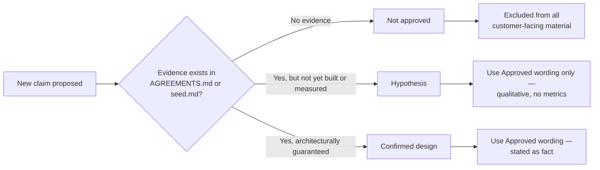

**AI Guardrails — Claims Register**

**Authority level:** L2
**Status:** Draft
**Date:** 2026-07-24
**Derived from:** seed.md + AGREEMENTS.md

---

## Purpose and authority

This register is the single source of truth for how AI Guardrails may be described in sales, executive, marketing, and public-facing technical materials. It exists so that every external claim about the product traces to a specific piece of evidence — an accepted agreement in [`AGREEMENTS.md`](../00-source-of-truth/AGREEMENTS.md) (L1) or an explicit statement in the solution charter (`seed.md`) — rather than to enthusiasm, aspiration, or assumption.

**Authority order:** `AGREEMENTS.md` (L1) is authoritative over this register. This register (L2) is authoritative over every sales deck, executive brief, product page, or technical document that makes a claim about AI Guardrails. If any derived document (sales deck, executive brief, product overview, etc.) contains wording that conflicts with a row below, this register wins and the derived document must be corrected.

**Scope:** This register governs *external and semi-external wording* — anything a customer, prospect, executive sponsor, auditor, or partner might read or hear. It does not replace the underlying architecture or delivery documentation; it governs how that reality may be *phrased*.

Related documents:

* Charter and principles — [`CHARTER.md`](../10-charter/CHARTER.md), [`PRINCIPLES.md`](../10-charter/PRINCIPLES.md), [`SCOPE.md`](../10-charter/SCOPE.md)
* Product materials — [`PRODUCT-OVERVIEW.md`](../20-product/PRODUCT-OVERVIEW.md), [`CAPABILITIES.md`](../20-product/CAPABILITIES.md)
* Executive materials — [`EXPECTED-OUTCOMES.md`](../30-executive/EXPECTED-OUTCOMES.md)
* Sales materials — [`DECK-BRIEF.md`](../40-sales-deck/DECK-BRIEF.md)
* Architecture — [`ARCHITECTURE-REPORT.md`](../50-architecture/ARCHITECTURE-REPORT.md), [`DEPLOYMENT-ARCHITECTURE.md`](../50-architecture/DEPLOYMENT-ARCHITECTURE.md), [`DATA-ARCHITECTURE.md`](../50-architecture/DATA-ARCHITECTURE.md), [`INTEGRATION-ARCHITECTURE.md`](../50-architecture/INTEGRATION-ARCHITECTURE.md), [`OPERABILITY.md`](../50-architecture/OPERABILITY.md)
* A dedicated risk register (`RISK-REGISTER.md`, planned) and glossary (`GLOSSARY.md`, planned) are referenced by several agreements below but have not yet been authored in this document set; once published they should be cross-linked from this register.

---

## Table of contents

- [How to read this register](#how-to-read-this-register)
- [Governance process](#governance-process)
- [Section 1 — Required core claims](#section-1--required-core-claims)
- [Section 2 — Adoption and onboarding claims](#section-2--adoption-and-onboarding-claims)
- [Section 3 — Deployment-model claims](#section-3--deployment-model-claims)
- [Section 4 — Policy and contract portability claims](#section-4--policy-and-contract-portability-claims)
- [Section 5 — Content exposure and data-handling claims](#section-5--content-exposure-and-data-handling-claims)
- [Section 6 — Enforcement posture claims](#section-6--enforcement-posture-claims)
- [Section 7 — Safety and detection claims](#section-7--safety-and-detection-claims)
- [Section 8 — Maturity and certification claims](#section-8--maturity-and-certification-claims)
- [Section 9 — Validation-demonstration proof and metrics claims](#section-9--validation-demonstration-proof-and-metrics-claims)
- [Section 10 — Import semantics claims](#section-10--import-semantics-claims)
- [Review cadence and change control](#review-cadence-and-change-control)

---

## How to read this register

Each row has five fields:

| Field | Meaning |
| --- | --- |
| **Claim** | The underlying statement of fact or benefit being evaluated. |
| **Status** | One of three values, defined below. |
| **Evidence** | The agreement (`AGR-XXX`) and/or `seed.md` section that supports or constrains the claim. No row may exist without a citable evidence source. |
| **Approved wording** | Language that may be used in customer-facing, sales, or executive material, as written or adapted without changing its meaning. |
| **Restricted wording** | Language that must **not** be used, regardless of audience, because it overstates, misattributes, or contradicts the evidence. |

### Status definitions

| Status | Definition | Permitted in external material? |
| --- | --- | --- |
| **Hypothesis** | A plausible, design-intended benefit that has not yet been measured or demonstrated. May be described qualitatively as an intent or design goal. Must never be quantified. | Yes — qualitative form only, using the Approved wording. |
| **Confirmed design** | A property that is architecturally guaranteed by an accepted agreement in `AGREEMENTS.md` or an explicit charter statement, and can therefore be stated as a fact about the current design. | Yes — as stated in the Approved wording. |
| **Not approved** | A claim that is unsubstantiated, premature, overstated, or directly contradicted by an accepted agreement or the charter's explicit scope boundaries. | No, under any wording, for any audience. |

---

## Governance process

1. **No claim ships without a row.** Any new sales, executive, or marketing statement about AI Guardrails must map to an existing row in this register, or a new row must be added first.
2. **Evidence precedes wording.** A new row may only be added if it cites a specific `AGR-XXX` agreement or `seed.md` section. If no such evidence exists, the claim is provisionally logged as **Not approved** pending evidence, not published.
3. **Conservative default.** When in doubt between two statuses, the lower-confidence status is used (prefer Hypothesis over Confirmed design; prefer Not approved over Hypothesis).
4. **No invented figures.** This register will not carry percentages, dollar amounts, dates, SLAs, or performance numbers unless those numbers appear in `seed.md`. Where a figure is genuinely needed and absent, the Approved wording says **TBD** or describes the property qualitatively.
5. **Conflict resolution.** If a derived document's wording conflicts with this register, this register wins and the derived document is corrected. If this register conflicts with `AGREEMENTS.md`, `AGREEMENTS.md` wins and this register is corrected.
6. **Ownership.** Product lead and Security/Governance lead jointly own additions and status changes to this register (mirroring the ownership pattern used for `AGREEMENTS.md` entries).

---

## Section 1 — Required core claims

The seven claims below are the register's mandatory baseline, requested explicitly for sales and executive use. Sections 2–10 extend this baseline with additional claims that follow the same evidentiary standard.

| Claim | Status | Evidence | Approved wording | Restricted wording |
| --- | --- | --- | --- | --- |
| Reduces onboarding effort | **Hypothesis** | `seed.md` §7 (application teams need "a simple onboarding process," "minimal application changes"); §4 (conceptual onboarding flow); §19 lists "time required to onboard a workload" only as a metric to be *tracked*, not a result already achieved. | "AI Guardrails is designed to reduce onboarding effort by separating policy adoption from gateway administration — a team imports a versioned policy, workload identity, integration manifest, and connector configuration without exposing gateway internals." | "Reduces onboarding effort by X%," "onboards in minutes/hours," "cuts onboarding time in half," or any other quantified onboarding-time or effort-reduction figure. |
| Supports multiple deployment modes | **Confirmed design** | AGR-002; `seed.md` §1, §3. | "AI Guardrails supports three deployment modes — Remote Evaluation, Guarded Gateway, and Customer-Managed Runtime — so a team can choose the operational-ownership and data-residency posture appropriate to its workload." | Implying the modes are interchangeable or equivalent in data exposure or operational scope (they are not — see AGR-008/AGR-009); "deploys anywhere" (the platform is AWS-based, per AGR-013, not cross-cloud). |
| Portable policy across gateways/providers | **Confirmed design** | AGR-003, AGR-004, AGR-005; `seed.md` §2, §5.1, §12. | "Guardrail policies are defined independently of LiteLLM, Bedrock Guardrails, or any specific model provider or application framework, and are portable across supported gateways and deployment modes." | "Works with every LLM provider" or "no integration work required" for gateways that do not yet have a built connector — new connectors still require implementing the invocation contract (AGR-007). |
| Content need not leave a customer-managed runtime | **Confirmed design** — for **Customer-Managed Runtime (Mode C) only** | AGR-015, AGR-016; `seed.md` §3 (Mode C), §13 ("Raw content must never leave a customer-managed runtime unless explicitly configured."). | "In Customer-Managed Runtime, prompts and responses are evaluated inside the customer's own AWS account and are not required to leave that environment; telemetry sent to the hosted control plane is customer-configurable, down to no telemetry at all." | Applying this claim to **Remote Evaluation** or **Guarded Gateway** in any form. In both of those modes tenant content is transmitted to a provider-operated service by design (AGR-009). Never say "your data never leaves your environment" without naming Customer-Managed Runtime specifically. |
| Observe-before-enforce | **Confirmed design** | AGR-011; `seed.md` §5.6. | "Every policy supports a graduated rollout — Disabled, Observe, Warn, Redact, Block — so a team can measure false positives, latency, and business impact before enabling blocking behavior. New workload bindings default to Observe, not Block." | "Enforces automatically from day one," "blocks by default," or any wording implying enforcement precedes measurement. |
| Enterprise-ready / production-proven / compliance-certified | **Not approved** | `seed.md` charter status is "Draft"; §6.3 lists "full compliance certification" as a standing product-category exclusion (reaffirmed by DEC-008); §17 non-goals; no production track record or certification is documented anywhere in `seed.md`. | "AI Guardrails is in active development, with delivery sequenced across five phases" (see [`SCOPE.md`](../10-charter/SCOPE.md) for current boundaries); specific delivered capabilities may be described functionally (for example, "supports tenant-specific retention configuration") without asserting a certification. | "Enterprise-ready," "production-proven," "battle-tested," "SOC 2 certified," "HIPAA compliant," "compliance-certified," or naming any specific certification or standard not documented as attained. |
| Blocks all prompt injection / guarantees safety | **Not approved** | `seed.md` §6.3 (no proprietary prompt-injection or moderation model — a standing product-category exclusion, reaffirmed by DEC-008); §6.2 (indirect prompt-injection detection is later-phase scope, not built); §20 "False confidence" risk explicitly warns against teams treating guardrail evaluation as complete AI security. | "AI Guardrails evaluates input and output content against configured policies and can flag, redact, or block detected violations; detection coverage and categories are documented per policy and evaluator. Guardrails are one control among several needed for AI safety, alongside authorization, data isolation, and application security that the customer retains." | "Blocks all prompt injection," "stops every jailbreak," "guarantees safety," "eliminates AI risk," "makes your AI safe," or any absolute/100%-style detection or safety claim. |

---

## Section 2 — Adoption and onboarding claims

| Claim | Status | Evidence | Approved wording | Restricted wording |
| --- | --- | --- | --- | --- |
| Onboarding follows a predictable, repeatable flow | **Confirmed design** | `seed.md` §4 conceptual onboarding flow (register workload → select policy → generate integration manifest → install connector → observe → review → enforce); AGR-019. | "Onboarding follows a defined sequence: register the workload, select a policy, generate an integration manifest, install the connector, run in observe mode, review results, then enable enforcement." | Describing onboarding as "one-click," "instant," or "zero-configuration" — the charter describes a multi-step, reviewed flow, not an automated or instantaneous one. |
| Onboarding requires minimal application changes | **Hypothesis** | `seed.md` §7 (application teams need "minimal application changes"); no measurement of actual change volume exists in `seed.md`. | "The platform is designed so that onboarding a workload requires minimal changes to the consuming application, primarily connector installation and configuration rather than application rewrites." | Claiming "no code changes" or "drop-in, zero-change integration" — the charter does not state this, only that changes should be minimal. |

---

## Section 3 — Deployment-model claims

| Claim | Status | Evidence | Approved wording | Restricted wording |
| --- | --- | --- | --- | --- |
| Remote Evaluation is a private-data or data-local model | **Not approved** | AGR-009; `seed.md` §3 Mode A: "It must not be described as a private-data or data-local deployment model." | "Remote Evaluation lets a team bring its own gateway while consuming a hosted guardrail runtime. Its primary benefit is reduced operational ownership of the inference path, not reduced data exposure — prompts, responses, and evaluated content are transmitted to the hosted Evaluation API." | "Keeps your data local," "private by design," "on-prem," "your data never leaves your environment" — as applied to Remote Evaluation (Mode A). These phrases are approved only when describing Customer-Managed Runtime (Mode C) specifically. |
| Guarded Gateway is the lowest-operational-burden option | **Confirmed design** | `seed.md` §3 Mode B; the provider owns gateway availability, credentials, routing, and guardrail execution. | "Guarded Gateway is a fully managed inference and guardrail service for teams that do not operate their own LLM gateway; the provider owns gateway and guardrail operations end to end." | Describing Guarded Gateway as reducing the *provider's* security/compliance scope — the charter states the opposite: Mode B creates the largest operational, security, and compliance scope for the provider. |
| Deployment modes offer identical operational ownership | **Not approved** | `seed.md` §3, §5.4; AGR-008 (ownership and data exposure are separate concerns that must be documented per mode, not assumed equal). | "Each deployment mode defines a distinct division of ownership between the consuming team and the provider; the applicable ownership table should be reviewed per mode before selecting one." | Any statement implying "choose any mode, the experience is the same" with respect to ownership or data exposure. |
| Multi-region availability with per-tenant region pinning | **Confirmed design** | DEC-018; AGR-013 (amended); `CAP-035` ([`CAPABILITIES.md`](../20-product/CAPABILITIES.md)). | "AI Guardrails offers multi-region availability from GA; each tenant's evaluation traffic is pinned to a single processing region. This does not add AWS accounts beyond the existing two-account model. It is not active-active — see the separate multi-region active-active claim below." | "Guarantees data residency" or "enforces regional data boundaries" as an already-delivered property (per-tenant residency enforcement is later-phase — committed, not yet delivered, per CAP-035); "active-active," "automatic cross-region failover," or "always-on across regions" applied to this claim. |
| Multi-region active-active (live cross-region failover/replication) availability | **Hypothesis** (committed later-phase scope; not yet delivered) | DEC-019 (supersedes the `seed.md` §6.3 exclusion of this capability); `CAP-036` ([`CAPABILITIES.md`](../20-product/CAPABILITIES.md)); AGR-002, AGR-006. | "Multi-region active-active availability — live cross-region failover and replication beyond the single-region-per-tenant model — is committed as a later-phase capability. It is not yet delivered; the multi-region behavior available today is single-region-per-tenant (see the row above)." | Describing active-active as already delivered, as a current property of the platform, or with any specific date/SLA; **and** describing it as excluded, out of scope, or "never planned" — it is committed (CAP-036, DEC-019), neither delivered nor excluded. |

---

## Section 4 — Policy and contract portability claims

| Claim | Status | Evidence | Approved wording | Restricted wording |
| --- | --- | --- | --- | --- |
| One evaluation contract across all three deployment modes | **Confirmed design** | AGR-006; `seed.md` §5.2. | "Remote, gateway, and customer-managed deployments use the same logical evaluation contract — policy definitions, request/decision structures, reason codes, enforcement actions, and audit metadata — regardless of where the runtime is deployed." | "Identical performance across all modes" — contract equivalence is a functional/semantic guarantee, not a latency or throughput guarantee. |
| Bedrock Guardrails is AI Guardrails' permanent or exclusive detection engine | **Not approved** | AGR-004: "Marketing and technical documentation must not describe Bedrock Guardrails as the product's permanent or exclusive detection engine." | "Amazon Bedrock Guardrails is the first managed evaluation engine adopted by the platform; the public evaluation contract is vendor-independent, and additional engines can be added behind the same adapter pattern." | "Powered exclusively by Bedrock," "our proprietary detection model" (no proprietary prompt-injection or moderation model exists per `seed.md` §6.3), or any wording that permanently ties the product to one vendor's engine. |
| Policies and connectors are separable and independently reusable | **Confirmed design** | AGR-007; `seed.md` §5.3. | "A policy defines what must be evaluated and how violations are handled; a connector defines how a specific gateway invokes and enforces that policy. New connectors can be added without modifying existing policies." | Describing a connector as containing "the policy logic" or a policy as "gateway-specific." |

---

## Section 5 — Content exposure and data-handling claims

| Claim | Status | Evidence | Approved wording | Restricted wording |
| --- | --- | --- | --- | --- |
| No raw prompt/response retention by default (hosted runtime) | **Confirmed design** | AGR-014; `seed.md` §13. | "By default, the hosted runtime processes prompts and responses only for evaluation and does not persist raw content. Decision metadata is retained, user/conversation identifiers are hashed where possible, and tenant-specific retention can be configured." | "We never store your data" — retention is configurable, not absolute; a tenant may opt into raw-content retention. "Fully anonymized" — `seed.md` commits to hashing identifiers where possible, not full anonymization. |
| Customer-managed runtime supports customer-controlled telemetry | **Confirmed design** | AGR-016; `seed.md` §13 (customer-managed telemetry section). | "Customer-managed runtimes let the customer choose what the hosted control plane receives — from health status and aggregated evaluation counts down to no telemetry at all. Raw content never leaves the runtime unless explicitly configured." | Implying telemetry is mandatory, or that any telemetry tier could carry raw prompt/response content — the platform must ship a fully supported "no telemetry" configuration. |
| Customer-managed runtime operates without a live dependency on the hosted control plane | **Confirmed design** | AGR-015; `seed.md` §3 ("must be capable of executing policies without requiring a synchronous connection to the hosted control plane"). | "The customer-managed runtime maintains a local policy cache and can continue evaluating during control-plane unavailability; policy synchronization is asynchronous and does not block evaluation." | "Fully offline" or "air-gapped out of the box" — air-gapped installation is listed in `seed.md` §6.2 as later-phase scope (DEC-008), not a currently delivered capability. |
| Every deployment discloses exactly where content is processed and what leaves the runtime | **Confirmed design** | AGR-008; `seed.md` §5.4. | "Each deployment mode documents where prompts and responses are processed, whether retrieved documents or tool arguments are transmitted, whether content is persisted, what telemetry leaves the runtime, and which AWS accounts and Regions are involved." | Presenting operational-ownership statements ("we manage the gateway for you") as if they answer data-exposure questions, or vice versa — the two must always be addressed separately, per AGR-008. |

---

## Section 6 — Enforcement posture claims

| Claim | Status | Evidence | Approved wording | Restricted wording |
| --- | --- | --- | --- | --- |
| Guardrails are not authorization | **Confirmed design** | AGR-010; `seed.md` §5.5. | "A guardrail decision evaluates content safety; it does not determine whether a user is authorized to perform an action or access a resource. Authentication, business authorization, tenant isolation, resource ownership, transaction limits, and approval workflows remain the consuming application's responsibility." | "AI Guardrails handles authorization," "access control," "permission enforcement," or any phrasing implying the product makes authentication, authorization, or tenant-isolation decisions. Tool/agent authorization is not a delivered capability — tool-call validation sits in Phase 5, and business authorization remains a standing exclusion (`seed.md` §5.5, §6.3). |
| Cooperative connector is a hard or bypass-proof security boundary | **Not approved** | AGR-018; `seed.md` §8: "A cooperative connector must not be represented as a hard security boundary." | "In cooperative-integration mode, the consuming team installs and maintains the connector as an engineering standard. Bypass-resistant enforcement requires platform-managed or network/IAM-enforced gateway posture, which is recorded per workload." | "Bypass-proof," "cannot be disabled," "guaranteed enforcement," or any phrasing that describes a cooperative-mode connector as a mandatory control. |
| Enforcement posture is explicit and auditable per workload | **Confirmed design** | AGR-018; `seed.md` §8. | "Every workload's enforcement posture — cooperative integration, platform-managed enforcement, or network/IAM-enforced gateway — is recorded and visible, not assumed." | Implying a single enforcement posture applies uniformly across an organization without per-workload verification. |

---

## Section 7 — Safety and detection claims

| Claim | Status | Evidence | Approved wording | Restricted wording |
| --- | --- | --- | --- | --- |
| AI Guardrails is a complete AI governance platform or general MCP security platform | **Not approved** | `seed.md` §6.3: "a complete AI governance platform" and "a general MCP security platform" are standing product-category exclusions (reaffirmed by DEC-008); §19 in-scope vs. later-phase distinction. The out-of-boundary and exclusion map in [`../20-product/GUARDRAIL-CATALOG.md`](../20-product/GUARDRAIL-CATALOG.md) names the external owner for each excluded control family (AGR-021). | "AI Guardrails is a policy and enforcement layer for LLM prompt/response evaluation, with architecture that permits — but does not yet deliver — extension toward retrieval, tool-call, and MCP-related evaluation (Phase 5, delivered only after the earlier phases are validated per AGR-020)." | "Complete AI governance platform," "full MCP security solution," "governs all your AI agents," or any claim implying delivered coverage of retrieval, tool-call, memory-write, or MCP authorization capabilities. |
| AI Guardrails covers all eighteen guardrail categories / offers complete AI-risk coverage | **Not approved** | The guardrail-category catalog ([`../20-product/GUARDRAIL-CATALOG.md`](../20-product/GUARDRAIL-CATALOG.md), `GR-001`–`GR-018`, per AGR-021/DEC-009) is a classification and vision taxonomy: most entries carry status `Later phase — committed`, `Vision — uncommitted`, or `Out-of-boundary`; delivered coverage is defined solely by [`CAPABILITIES.md`](../20-product/CAPABILITIES.md) (`CAP-001`–`CAP-017` for Phases 1–2). | "AI Guardrails classifies AI-risk controls in an eighteen-category catalog; the architecture permits — but does not yet deliver — extension into most categories, and delivered coverage per category is documented in the capability catalog. Categories owned by the consuming application (such as identity and authorization) are named as such, never claimed." | "Covers all guardrail categories," "complete AI-risk coverage," "protects against all eighteen categories," presenting a `Vision — uncommitted` or `Out-of-boundary` catalog entry as delivered or planned capability, or citing the catalog's breadth as evidence of product breadth. |
| Guardrail category as a first-class audit/metric dimension (per-category metrics, catalog→decision traceability) | **Confirmed design** — architecture only; delivered per-category reporting not yet available | DEC-013; ADR-0003 (Proposed); AGR-006, AGR-017, AGR-021. | "The evaluation contract's reason-code taxonomy is category-namespaced (`GR-0NN:<evaluator-family>:<code>`), and the decision record carries `guardrail_category` as a first-class field. This makes per-category metrics and catalog-to-decision traceability implementable; it is not a claim of complete guardrail-category coverage, and per-category dashboards or reports are not yet a delivered capability." | "Full per-category reporting," "complete category coverage," "we report on all eighteen categories," or any wording presenting per-category metrics or dashboards as already delivered — the reporting/aggregation capability itself is tracked separately as later-phase, pending ratification, and must not be implied as available. This taxonomy does not expand delivered coverage claimed in the row above. |
| Evaluation reduces certain categories of AI risk | **Hypothesis** | `seed.md` §19 Effectiveness metrics (confirmed harmful-input detection rate, confirmed sensitive-output prevention rate) are listed as metrics to be tracked, not values already achieved; §20 False-confidence risk. | "AI Guardrails is designed to reduce certain classes of AI-related risk through policy-driven evaluation of prompts and responses; effectiveness metrics are tracked per policy and reported once measured." | Any stated detection rate, false-positive rate, or risk-reduction percentage not present in `seed.md` and not yet measured. |

---

## Section 8 — Maturity and certification claims

| Claim | Status | Evidence | Approved wording | Restricted wording |
| --- | --- | --- | --- | --- |
| Delivery has passed the MVP stage / is generally available | **Not approved** (as of this document's date) | `seed.md` header: "Status: Draft"; §16–§18 describe the phased delivery plan (AGR-020; DEC-008) that has not yet been reported complete in this document set. | "AI Guardrails is being delivered through a five-phase plan whose Phase 1–2 core covers reusable policy import, input/output evaluation, LiteLLM integration, and observe/enforce modes (see [`CHARTER.md`](../10-charter/CHARTER.md) §16–§18)." | "Generally available," "GA," "fully launched," or any wording implying delivery is complete ahead of an explicit, dated release announcement. |
| The product carries a specific compliance certification (e.g., SOC 2, ISO 27001, HIPAA) | **Not approved** | `seed.md` §6.3 lists "full compliance certification" as a standing product-category exclusion (reaffirmed by DEC-008); no certification is named anywhere in `seed.md`. The specific controls in the approved wording are sourced from `seed.md` §13 (encrypt data in transit and at rest; tenant-specific retention configuration), §14 (least-privilege runtime roles, KMS encryption), and §15 (audit metadata), and from [`CONSTRAINTS.md`](../00-source-of-truth/CONSTRAINTS.md). | "The platform is designed with compliance-relevant controls — encryption in transit and at rest, tenant-specific retention configuration, audit metadata, least-privilege IAM — that support a customer's own compliance program." | Naming any specific certification or standard (SOC 2, ISO 27001, HIPAA, FedRAMP, PCI DSS, or similar) as attained, in progress, or implied, unless and until it is actually documented as attained in a future revision of this register. |

---

## Section 9 — Validation-demonstration proof and metrics claims

| Claim | Status | Evidence | Approved wording | Restricted wording |
| --- | --- | --- | --- | --- |
| Two independent LiteLLM instances have successfully shared one policy (a completed demonstration result) | **Hypothesis** (until executed and recorded) | `seed.md` §16 and [`60-delivery/VALIDATION-PLAN.md`](../60-delivery/VALIDATION-PLAN.md) describe the *target* criteria for the Phase 1–2 validation demonstration (a delivery milestone per DEC-008), not a result already achieved as of this document's date. | "The Phase 1–2 validation demonstration is designed to show that one reusable policy can be applied consistently across two independent LiteLLM deployments, with neither instance sharing model-provider credentials with the guardrail platform, one workload running in observe mode and another in enforce mode, and a policy upgrade/rollback exercised successfully." | Stating this demonstration as already completed, or citing any specific reliability, adoption, or effectiveness figure from it, until the demonstration has actually run and its result is recorded in this register with a dated source. |
| Specific evaluation latency figures (e.g., "sub-100ms," a named P95 value) | **Not approved** | `seed.md` §15 lists P50/P95/P99 evaluation latency, throughput, and timeout rate as things the platform "must measure" — no target or achieved value is given anywhere in `seed.md`. | "Evaluation latency is measured per detector and per stage (P50/P95/P99); specific figures are TBD pending benchmarking and will be published once measured and approved." | Any specific millisecond, percentage, or throughput figure not present in `seed.md` or a subsequently measured and approved source. |
| Adoption, ROI, or cost-savings figures (e.g., "X workloads onboarded," "$Y saved," "Z% fewer incidents") | **Not approved** | `seed.md` §19 lists adoption, reliability, effectiveness, and portability metric *categories* to track — no values are stated. | "The platform defines adoption, reliability, effectiveness, and portability metrics it will track (for example: onboarded workloads, evaluation-API availability, false-positive review rate, percentage of policy definitions that are deployment-mode independent). Values are TBD pending measurement." | Any invented percentage, workload count, dollar figure, or ROI claim not sourced from `seed.md` or a later measured and approved figure. |

---

## Section 10 — Import semantics claims

| Claim | Status | Evidence | Approved wording | Restricted wording |
| --- | --- | --- | --- | --- |
| "Importing" a policy means AI Guardrails can access, clone, or remotely control another team's LiteLLM instance | **Not approved** | AGR-019; `seed.md` §4. | "Importing means adopting a versioned guardrail policy, a workload identity, an integration manifest, a connector configuration, and an enforcement mode. It never means cloning, registering, or remotely controlling another team's LiteLLM instance, and never requires transferring model-provider credentials or gateway administration access." | Any description of "import" that implies credential transfer, database copying, gateway administration access, or remote control of a consuming team's gateway. |

---

## Review cadence and change control

* This register must be reviewed whenever `AGREEMENTS.md` changes, whenever a new phase in the five-phase delivery plan (AGR-020) completes, and whenever the Phase 1–2 validation demonstration (`seed.md` §16; [`60-delivery/VALIDATION-PLAN.md`](../60-delivery/VALIDATION-PLAN.md)) actually executes and produces a result.
* Status upgrades (Hypothesis → Confirmed design) require a dated evidence update citing the specific measurement, agreement, or delivered capability that justifies the change; the row's Evidence field must be updated accordingly, not silently reworded.
* No row in this register may be deleted; superseded rows are marked **Superseded** in the Status column with a pointer to the replacing row, preserving an audit trail of what was previously claimable.
* Product Lead and Security/Governance Lead jointly approve all additions and status changes, consistent with the ownership pattern in [`AGREEMENTS.md`](../00-source-of-truth/AGREEMENTS.md).
