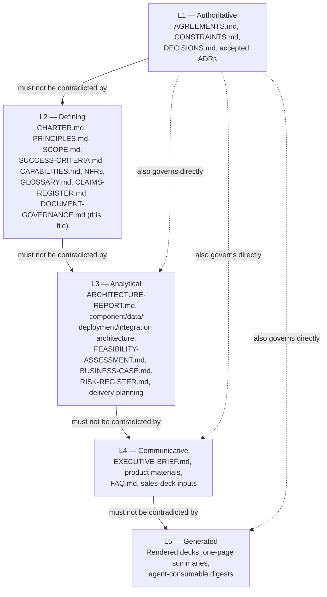
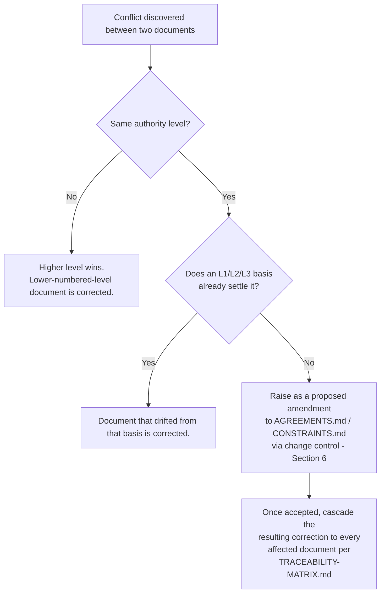
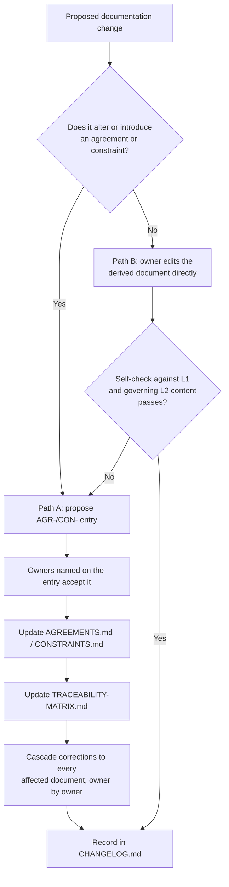
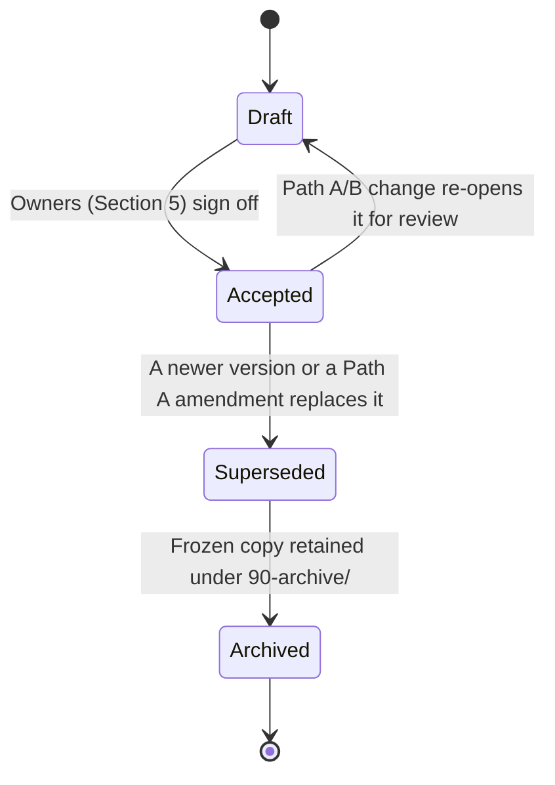

**AI Guardrails — Document Governance**

**Authority level:** L2
**Status:** Draft
**Date:** 2026-07-24
**Derived from:** seed.md + AGREEMENTS.md

---

> This document governs the `solution-docs/` set itself — not the AI Guardrails product. It defines the L1–L5 authority model, the non-contradiction rule and how conflicts resolve, ownership per documentation area, the change-control process, review cadence, and how [`TRACEABILITY-MATRIX.md`](../00-source-of-truth/TRACEABILITY-MATRIX.md) and [`CHANGELOG.md`](CHANGELOG.md) keep the set from drifting away from [`AGREEMENTS.md`](../00-source-of-truth/AGREEMENTS.md). It is itself an **L2 — Defining** document: durable and structural, like the [charter](../10-charter/CHARTER.md), but subordinate to [`AGREEMENTS.md`](../00-source-of-truth/AGREEMENTS.md) and [`CONSTRAINTS.md`](../00-source-of-truth/CONSTRAINTS.md). Where this document and either L1 register could be read as conflicting, the L1 register wins and this document must be corrected.

---

## Table of contents

- [1. Purpose and scope](#1-purpose-and-scope)
- [2. The L1–L5 authority model](#2-the-l1l5-authority-model)
- [3. Precedence and conflict resolution](#3-precedence-and-conflict-resolution)
- [4. Documentation set map](#4-documentation-set-map)
- [5. Ownership per area](#5-ownership-per-area)
- [6. Change-control process](#6-change-control-process)
- [7. Review cadence](#7-review-cadence)
- [8. Traceability and drift prevention](#8-traceability-and-drift-prevention)
- [9. Change history — CHANGELOG.md](#9-change-history--changelogmd)
- [10. Document lifecycle and archival](#10-document-lifecycle-and-archival)
- [11. Related documents](#11-related-documents)

---

## 1. Purpose and scope

The AI Guardrails solution is described by a layered set of documents under `solution-docs/`, ranging from authoritative agreements to generated sales collateral. Without an explicit governance model, a set this size will drift: an executive brief will assert something the architecture no longer does, a sales deck will overstate a security boundary, or two derived documents will quietly disagree with each other.

This document exists to prevent that by defining, once, for the whole set:

* The **authority levels** (L1–L5) every document in `solution-docs/` belongs to, and what each level is and is not allowed to do.
* The **precedence rule**: derived documents must never contradict [`AGREEMENTS.md`](../00-source-of-truth/AGREEMENTS.md) or [`CONSTRAINTS.md`](../00-source-of-truth/CONSTRAINTS.md), and conflicts between any two documents resolve **up** the hierarchy, never sideways by convenience.
* **Ownership** of each documentation area, so that every change has an accountable owner.
* The **change-control process** used to propose, review, and land a change — including the distinction between amending an L1 register and editing a derived view.
* The **review cadence** appropriate to each level.
* How [`TRACEABILITY-MATRIX.md`](../00-source-of-truth/TRACEABILITY-MATRIX.md) and [`CHANGELOG.md`](CHANGELOG.md) are used together to detect and correct drift.

**Scope.** This document governs every file under `solution-docs/`, plus [`../seed.md`](../../seed.md) as the frozen origin material those files are derived from. It does not govern the AI Guardrails product itself — that is what the rest of the set describes.

**Relationship to `seed.md`.** `seed.md` is the raw solution charter: the original, full source-of-truth material every document in this set is derived from. It is treated as a **frozen historical input**, not as a live, editable member of the L1–L5 hierarchy — it is never edited to reflect later decisions. [`AGREEMENTS.md`](../00-source-of-truth/AGREEMENTS.md) is the **accepted, currently governing** distillation of `seed.md` into discrete, numbered agreements (`AGR-001`…`AGR-022`). Where a later, accepted agreement narrows or supersedes something `seed.md` said more loosely, `AGREEMENTS.md` governs going forward; `seed.md` remains available as historical context and is cited in every document's `Derived from:` line for that reason.

---

## 2. The L1–L5 authority model

Every document in `solution-docs/` declares its authority level in its header field `**Authority level:**`, as one of `L1` through `L5`. The five levels are:

| Level | Name | What belongs here | What it may do | What it must never do |
| --- | --- | --- | --- | --- |
| **L1** | **Authoritative** | Agreements ([`AGREEMENTS.md`](../00-source-of-truth/AGREEMENTS.md)), constraints ([`CONSTRAINTS.md`](../00-source-of-truth/CONSTRAINTS.md)), the decision log ([`DECISIONS.md`](../00-source-of-truth/DECISIONS.md)), the assumptions and open-questions registers, and any Architecture Decision Record whose `Status` is **Accepted**. | Record negotiated, accepted ground truth. Be cited by every other level. | Be silently overridden, reinterpreted, or "corrected" by a lower level. Any change here is a change-controlled amendment (§6), not an edit. |
| **L2** | **Defining** | The solution charter and its companions ([`PRINCIPLES.md`](../10-charter/PRINCIPLES.md), [`SCOPE.md`](../10-charter/SCOPE.md), [`SUCCESS-CRITERIA.md`](../10-charter/SUCCESS-CRITERIA.md)), product capability definitions ([`CAPABILITIES.md`](../20-product/CAPABILITIES.md)), non-functional requirements ([`NON-FUNCTIONAL-REQUIREMENTS.md`](../50-architecture/NON-FUNCTIONAL-REQUIREMENTS.md)), the canonical glossary, the claims register, and this document. | Give durable, boundary-setting structure and definitions derived from L1. Be cited by L3–L5. | Introduce a decision that is not already backed by an L1 agreement or constraint. |
| **L3** | **Analytical** | The architecture report and component/system/data/deployment/integration/container architecture, feasibility assessment, operability plan, the business case, investment summary, the risk register, and delivery/implementation planning. | Explain, analyze, model trade-offs, and justify a design or plan in terms of L1/L2. Be fully re-derivable from L1/L2 at any time. | State something L1/L2 does not support as if it were settled; invent figures not present in `seed.md` (must say **TBD**). |
| **L4** | **Communicative** | The executive brief, expected outcomes, decision request, product-facing materials (overview, use cases, target users, value proposition, differentiators, problem statement, roadmap), the FAQ, and every sales-deck input. | Simplify and tailor L1–L3 content for a specific audience (executives, prospects, application teams). | Add a claim, number, or nuance not traceable to L1–L3; imply a security or data-exposure posture stronger than what L1/L3 actually state (see [AGR-009](../00-source-of-truth/AGREEMENTS.md#agr-009--remote-evaluation-is-not-a-private-data-or-data-local-model), [AGR-018](../00-source-of-truth/AGREEMENTS.md#agr-018--trust-and-enforcement-model)). |
| **L5** | **Generated** | Rendered slide decks, one-page summaries, and any machine-generated digest produced for another AI agent or a point-in-time audience (for example, material staged under [`80-agent-inputs/`](../80-agent-inputs/)). | Be regenerated on demand from L1–L4 whenever those change. | Be hand-edited as if it were a new source of truth, or treated as authoritative for anything not already stated at L1–L4. |

A document's level is a statement about **how much new ground truth it may introduce**, not about its importance to a reader. The executive brief (L4) matters enormously to its audience; it is nonetheless required to add nothing beyond what L1–L3 already established.

---

## 3. Precedence and conflict resolution

The rule stated in [`AGREEMENTS.md`](../00-source-of-truth/AGREEMENTS.md)'s preamble and repeated throughout this set applies without exception:

> Derived documents must not contradict any agreement recorded in `AGREEMENTS.md`. When a conflict is discovered between a derived document and this register, the register wins, and the derived document must be corrected.

Operationally, this means:

1. **Cross-level conflict.** If two documents at different levels disagree, the **lower-numbered level wins** (L1 over L2, L2 over L3, and so on). The higher-numbered document is corrected — it is never "reconciled" by editing the lower-numbered one to match it.
2. **Same-level conflict.** If two documents at the *same* level disagree (for example, two L4 product-facing documents describing Mode A differently), the disagreement is resolved by checking the L1–L3 material both should derive from. If that check does not settle it, the owners of both documents (§5) resolve it jointly and record the resolution — as an amendment if it turns out an L1 register was ambiguous or silent, or as a correction to whichever document had drifted if the L1/L2/L3 basis was already clear.
3. **No silent upward correction.** A derived document may never be used as the justification for editing [`AGREEMENTS.md`](../00-source-of-truth/AGREEMENTS.md) or [`CONSTRAINTS.md`](../00-source-of-truth/CONSTRAINTS.md) to fit it. If a derived document reveals that an L1 register is genuinely missing something or wrong, that is raised as a **proposed amendment** through the change-control process (§6) — the derived document is not treated as already correct in the meantime.
4. **Claims discipline is level-independent.** Certain statements — for example, that Mode A is "private" or "data-local" ([AGR-009](../00-source-of-truth/AGREEMENTS.md#agr-009--remote-evaluation-is-not-a-private-data-or-data-local-model)), or that a cooperative connector is a hard security boundary ([AGR-018](../00-source-of-truth/AGREEMENTS.md#agr-018--trust-and-enforcement-model)) — are rejected at *every* level, not only at L1. [`CLAIMS-REGISTER.md`](CLAIMS-REGISTER.md) enumerates these rejected and approved claim patterns so that L3–L5 authors do not have to re-derive them from first principles each time.

---

## 4. Documentation set map

The table below maps every directory in `solution-docs/` to the authority level(s) actually present in it today, based on each file's own header. Directories marked "planned" are reserved by the information architecture but not yet populated.

| Directory | Levels present | Representative documents | Owning role(s) (§5) |
| --- | --- | --- | --- |
| [`00-source-of-truth/`](../00-source-of-truth/) | **L1** | `AGREEMENTS.md`, `CONSTRAINTS.md`, `DECISIONS.md`, `ASSUMPTIONS.md`, `OPEN-QUESTIONS.md`, and (planned) `TRACEABILITY-MATRIX.md` | Product lead + Technical lead + Security and governance lead (joint) |
| [`10-charter/`](../10-charter/) | **L2** | `CHARTER.md`, `PRINCIPLES.md`, `SCOPE.md`, `SUCCESS-CRITERIA.md` | Product lead + Technical lead |
| [`20-product/`](../20-product/) | **L2** (`CAPABILITIES.md`) / **L4** (all others) | `PRODUCT-OVERVIEW.md`, `USE-CASES.md`, `TARGET-USERS.md`, `VALUE-PROPOSITION.md`, `DIFFERENTIATORS.md`, `PROBLEM-STATEMENT.md`, `PRODUCT-ROADMAP.md`, `FAQ.md` | Product lead |
| [`30-executive/`](../30-executive/) | **L3** (`BUSINESS-CASE.md`, `INVESTMENT-SUMMARY.md`, `RISKS-AND-DEPENDENCIES.md`) / **L4** (`EXECUTIVE-BRIEF.md`, `EXPECTED-OUTCOMES.md`, `DECISION-REQUEST.md`) | as listed | Product lead, with Technical lead review on L3 items |
| [`40-sales-deck/`](../40-sales-deck/) | **L4** | `DECK-BRIEF.md`, `SLIDE-OUTLINE.md`, `SALES-NARRATIVE.md`, `OBJECTION-HANDLING.md`, `PROOF-POINTS.md`, `CUSTOMER-PAIN-POINTS.md`, `AUDIENCE-AND-PERSONAS.md`, `BENEFITS-AND-OUTCOMES.md`, `CALL-TO-ACTION.md`, `VISUAL-DIRECTION.md` | Product lead (accuracy); sales/marketing enablement consumes but does not own |
| [`50-architecture/`](../50-architecture/) | **L2** (`NON-FUNCTIONAL-REQUIREMENTS.md`) / **L3** (`ARCHITECTURE-REPORT.md`, `SYSTEM-CONTEXT.md`, `COMPONENT-ARCHITECTURE.md`, `CONTAINER-ARCHITECTURE.md`, `DATA-ARCHITECTURE.md`, `DEPLOYMENT-ARCHITECTURE.md`, `INTEGRATION-ARCHITECTURE.md`, `OPERABILITY.md`, `FEASIBILITY-ASSESSMENT.md`) / **L1 once accepted** (`adrs/*`) | as listed | Technical lead + Architecture lead |
| [`60-delivery/`](../60-delivery/) *(planned)* | **L3** | `IMPLEMENTATION-STRATEGY.md`, `MILESTONES.md`, `RELEASE-CRITERIA.md`, `VALIDATION-PLAN.md` — referenced by [`AGREEMENTS.md`](../00-source-of-truth/AGREEMENTS.md) and [`DECISIONS.md`](../00-source-of-truth/DECISIONS.md) but not yet authored | Delivery lead + Technical lead |
| [`70-governance/`](.) | **L2** (`DOCUMENT-GOVERNANCE.md` — this file, `CLAIMS-REGISTER.md`, `GLOSSARY.md`) / **L3** (`RISK-REGISTER.md`) / cross-cutting (`CHANGELOG.md`) | as listed | Product lead + Technical lead + Security and governance lead (joint) |
| [`80-agent-inputs/`](../80-agent-inputs/) *(planned)* | **L5** | Machine-consumable extracts/digests of this set, regenerated from L1–L4 for agent consumption | Technical lead |
| [`90-archive/`](../90-archive/) *(planned)* | Frozen copy of whatever level the document had when archived | Superseded or retired document versions | Owned passively by the role that owned the live document before archival (§10) |

---

## 5. Ownership per area

Documentation ownership follows the same stakeholder groups the solution charter already defines for the *product* (seed.md §21, "Ownership boundaries") and the specific role names already used as `Owners:` on every entry in [`AGREEMENTS.md`](../00-source-of-truth/AGREEMENTS.md): **Product lead, Technical lead, Architecture lead, Integration lead, Security and governance lead, Platform operations lead,** and **Delivery lead**.

| Documentation area | Owning role(s) | Basis |
| --- | --- | --- |
| L1 registers (`00-source-of-truth/`) | Product lead, Technical lead, Security and governance lead — joint sign-off required for any amendment | Mirrors the multi-role `Owners:` field on every `AGR-NNN` entry |
| Charter (`10-charter/`) | Product lead, Technical lead | seed.md §21 — "AI Guardrails team" owns product architecture and roadmap |
| Product materials (`20-product/`) | Product lead | seed.md §21 — AI Guardrails team; consuming-team needs (seed.md §7) inform but do not override content |
| Executive materials (`30-executive/`) | Product lead, with Technical lead review of L3 analytical content | Product lead owns the narrative; technical accuracy of feasibility/business-case content is reviewed by Technical lead |
| Sales-deck inputs (`40-sales-deck/`) | Product lead | AGR-009/AGR-018 claims discipline applies regardless of audience; Product lead is accountable even though sales/marketing enablement consumes the material |
| Architecture (`50-architecture/`) | Technical lead, Architecture lead | seed.md §21 — AI Guardrails team owns "product architecture," "the evaluation contract," "the guardrail runtime" |
| ADRs (`50-architecture/adrs/`) | Technical lead, Architecture lead (drafting); becomes L1 only once formally **Accepted**, at which point it is treated with the same change-control rigor as an agreement | seed.md §21; AGREEMENTS.md preamble |
| Delivery planning (`60-delivery/`, planned) | Delivery lead, Technical lead | AGREEMENTS.md `Owners:` fields on AGR-013, AGR-019, AGR-020, AGR-022 |
| Governance (`70-governance/`, this document, `CLAIMS-REGISTER.md`, `RISK-REGISTER.md`, `GLOSSARY.md`, `CHANGELOG.md`) | Product lead, Technical lead, Security and governance lead — joint | Cross-cutting concern; mirrors L1 joint-ownership pattern since these documents enforce the hierarchy for the whole set |
| Agent-input extracts (`80-agent-inputs/`, planned) | Technical lead | Tooling/automation output; treated as L5, never as a new source of truth |
| Archive (`90-archive/`, planned) | Whoever owned the document immediately before it was superseded | §10 below |
| Hosted infrastructure content wherever it appears (e.g., deployment architecture, operability) | Platform operations lead (co-review) | seed.md §21 — "Platform operations" owns hosted infrastructure, deployment, monitoring, incident response |
| Consuming-team-facing accuracy (onboarding flow, connector behavior as documented) | Reviewed against seed.md §21 "Consuming teams" responsibilities before publication | Ensures documentation does not imply consuming teams are relieved of authentication, authorization, or workload-registration responsibilities |

Two things do **not** change ownership:

* **Consumption is not ownership.** Sales, marketing, and executive audiences consume L4 material; they do not become its owner of record. The Product lead remains accountable for every claim in it.
* **Level does not imply seniority.** An L1 register can be edited only through change control regardless of who requests it; an L4 document can be corrected quickly by its owner precisely because it is not supposed to contain anything not already settled upstream.

---

## 6. Change-control process

Every change to `solution-docs/` follows one of two paths, depending on whether it touches L1.

### 6.1 Path A — Amending an L1 register

Used whenever a change would alter the substance of an existing agreement or constraint, or introduce a new one.

1. **Propose.** The change is written up as a proposed new or amended `AGR-NNN` (in [`AGREEMENTS.md`](../00-source-of-truth/AGREEMENTS.md)) or `CON-NNN` (in [`CONSTRAINTS.md`](../00-source-of-truth/CONSTRAINTS.md)), following the existing entry shape (Status, Date, Owners, Agreement, Rationale, Implications, Affected documents).
2. **Review and accept.** The role(s) named as `Owners:` on the entry sign off. An amendment to an existing, already-Accepted agreement is a new act of acceptance, not a silent overwrite — the entry's `Status`/`Date` reflects this.
3. **Update the L1 register.** The entry lands in [`AGREEMENTS.md`](../00-source-of-truth/AGREEMENTS.md) or [`CONSTRAINTS.md`](../00-source-of-truth/CONSTRAINTS.md), including its `Affected documents` list.
4. **Cascade via the matrix.** [`TRACEABILITY-MATRIX.md`](../00-source-of-truth/TRACEABILITY-MATRIX.md) is updated so every affected document is flagged for review (§8).
5. **Correct affected documents.** Each affected document's owner (§5) updates their document to reflect the new or amended agreement, and must not reintroduce the prior, now-superseded position.
6. **Log it.** An entry is added to [`CHANGELOG.md`](CHANGELOG.md) (§9) recording the amendment and which documents were cascaded.

An **Accepted** ADR follows the same path: it is drafted by Technical lead/Architecture lead, but it does not become L1 — and therefore binding on every downstream document — until its `Status` is `Accepted`, at which point it is change-controlled exactly like an agreement.

### 6.2 Path B — Editing a derived document (L2–L5) without contradicting L1

Used for the overwhelming majority of day-to-day documentation work: clarifying language, adding a cross-link, expanding a rationale, refreshing a roadmap date, tailoring a sales narrative.

1. The document's owner (§5) makes the edit directly.
2. The owner self-checks the edit against every L1 entry and, where relevant, the L2 documents above it in the hierarchy — using [`TRACEABILITY-MATRIX.md`](../00-source-of-truth/TRACEABILITY-MATRIX.md) to find which agreements/constraints govern that section.
3. If the edit is purely additive and non-contradictory, it merges directly.
4. If the edit turns out to require saying something L1 does not currently support, it is **not** made — it is redirected to Path A.
5. The change is logged in [`CHANGELOG.md`](CHANGELOG.md).

### 6.3 What change control does not cover

Regenerating an L5 artifact (a rendered deck, a one-page summary, an agent digest) from already-current L1–L4 content is not a change-controlled event in itself — the underlying content already went through Path A or B. Only the act of *hand-editing* an L5 artifact independently of its source would require going back through Path B (correcting the source, not the generated copy) or Path A.

---

## 7. Review cadence

`seed.md` and [`AGREEMENTS.md`](../00-source-of-truth/AGREEMENTS.md) do not specify a fixed calendar cadence (e.g., "quarterly") for reviewing documentation, so none is invented here. Instead, cadence is **event-triggered**, consistent with how [`OPEN-QUESTIONS.md`](../00-source-of-truth/OPEN-QUESTIONS.md) already ties its own review points to phase-gate transitions:

| Level | Review trigger | Notes |
| --- | --- | --- |
| L1 | Only on a proposed amendment (§6.1). No periodic re-approval of already-Accepted entries. | Stability is the point of L1; it should change rarely and deliberately. |
| L2 | At each delivery phase-gate transition (Phase 1 → 2 → 3 → 4 → 5 per [AGR-022](../00-source-of-truth/AGREEMENTS.md#agr-022--five-phase-delivery)), and whenever an L1 change affects it. | Charter-level documents are expected to hold across a phase, not change within one. |
| L3 | Whenever the architecture, feasibility, or business assumptions it analyzes change, and at minimum once per delivery phase. | Analytical content should stay re-derivable from current L1/L2 at all times. |
| L4 | Before each external or executive use (a sales engagement, an executive briefing, a decision request), and whenever the L1–L3 content it summarizes changes. | Communicative material is refreshed most frequently because it is audience-facing and time-sensitive. |
| L5 | Not independently reviewed — regenerated from current L1–L4 whenever needed. If a generated artifact cannot be regenerated (its source has moved on), it is treated as stale and withheld from use until regenerated. | Never patched by hand; patching would make it a second, uncontrolled source of truth. |

A fixed periodic cadence (for example, a mandatory quarterly pass over all L3/L4 material) remains an open documentation-operations question; if the organization wants one, it should be proposed and recorded as its own entry in [`OPEN-QUESTIONS.md`](../00-source-of-truth/OPEN-QUESTIONS.md) rather than assumed here.

---

## 8. Traceability and drift prevention

[`TRACEABILITY-MATRIX.md`](../00-source-of-truth/TRACEABILITY-MATRIX.md) is the mechanism that keeps §3's precedence rule enforceable in practice rather than aspirational. It formalizes, in one place, the `Affected documents` lists already attached to every entry in [`AGREEMENTS.md`](../00-source-of-truth/AGREEMENTS.md) and [`CONSTRAINTS.md`](../00-source-of-truth/CONSTRAINTS.md), and extends the same tracking to open questions ([`OPEN-QUESTIONS.md`](../00-source-of-truth/OPEN-QUESTIONS.md) already references it for this purpose).

**What it contains.** One row per `AGR-NNN` / `CON-NNN` / accepted-ADR entry, cross-referenced against every document (down to a section anchor where practical) that is expected to reflect it, with a status per row:

| Status | Meaning |
| --- | --- |
| `Reflected` | The affected document currently states something consistent with the L1 entry. |
| `Pending` | The L1 entry is new or recently amended; the affected document has not yet been updated (§6.1, step 5). |
| `Stale` | An audit found the affected document no longer matches the L1 entry — drift has occurred and a correction is owed. |

**How it prevents drift, specifically:**

* **On amendment (Path A, §6.1).** Every affected document for a new or changed `AGR-NNN`/`CON-NNN` is added to the matrix as `Pending` the moment the entry is accepted. Nothing is "cascaded" from memory — the matrix is the checklist.
* **On routine edits (Path B, §6.2).** Before editing any L2–L5 document, its owner consults the matrix to see which L1 entries govern the section being changed, so a well-intentioned wording tweak does not accidentally reintroduce a rejected claim (e.g., re-describing Mode A as data-local).
* **On periodic audit.** Independent of any specific change, the matrix can be walked row by row to verify each `Reflected` status is still true. Rows found to have silently drifted are flagged `Stale` and routed back through Path B (or Path A, if the drift reveals a genuine gap in L1).
* **Complementary registers.** [`CLAIMS-REGISTER.md`](CLAIMS-REGISTER.md) and [`RISK-REGISTER.md`](RISK-REGISTER.md) both depend on the matrix's linkage to stay current: the claims register cannot certify an external-facing statement as approved unless the matrix shows the L1 basis for it is still `Reflected` wherever that statement appears.

Without the matrix, "derived documents must not contradict agreements" is a principle with no enforcement path. With it, every L1 entry has a known, checkable blast radius, and every derived document has a known, checkable set of obligations.

---

## 9. Change history — CHANGELOG.md

[`CHANGELOG.md`](CHANGELOG.md), maintained in this same directory, is the chronological ledger of edits made to the **documentation set itself** — which file changed, on what date, what kind of change it was (Path A amendment vs. Path B correction/addition), and which [`CHANGELOG.md`](CHANGELOG.md) entry or `AGR-NNN` it traces to.

This is deliberately distinct from [`DECISIONS.md`](../00-source-of-truth/DECISIONS.md), which logs **product, organizational, and delivery decisions** (`DEC-NNN`), not document edits — a single accepted decision in `DECISIONS.md` can, and typically will, trigger many rows in `CHANGELOG.md` as each affected document is corrected.

Each `CHANGELOG.md` entry is expected to record, at minimum:

| Field | Meaning |
| --- | --- |
| Date | When the documentation change landed |
| Document(s) | Which file(s) under `solution-docs/` changed |
| Change type | Path A (amendment-driven correction) or Path B (direct edit) |
| Trigger | The `AGR-NNN`/`CON-NNN`/`DEC-NNN` that caused it, or "editorial" if neither |
| Owner | The role (§5) that made or approved the change |

`CHANGELOG.md` is additive-only: entries are appended, not rewritten, so the history of how the documentation set evolved remains itself traceable — the same principle [`AGREEMENTS.md`](../00-source-of-truth/AGREEMENTS.md) applies to the product decisions it records.

---

## 10. Document lifecycle and archival

Every document in `solution-docs/` moves through the same lifecycle, tracked via its `Status` header field:

* **Draft.** The current status of every document in this set as of this writing. A Draft document is still governed by the L1–L5 rules above — "Draft" describes its review state, not its authority level.
* **Accepted.** Reached when the owners named in §5 sign off. From this point, the review-cadence triggers in §7 apply.
* **Superseded.** A document (or a specific L1 entry within it) is superseded when a Path A amendment or a new version replaces its content. The superseding change is what makes it superseded — it is never left ambiguous which version currently governs.
* **Archived.** The superseded version is moved to [`90-archive/`](../90-archive/) as a frozen, historical copy. Archived copies are never edited; they exist only so that "what did we say before" remains answerable. The live path (e.g., `50-architecture/DATA-ARCHITECTURE.md`) is the only one change control continues to apply to.

Accepted ADRs follow this same lifecycle at L1 rigor: an ADR can itself be superseded by a later ADR, but only through Path A, since it is changing an L1-level decision.

---

## 11. Related documents

| Document | Relationship |
| --- | --- |
| [`AGREEMENTS.md`](../00-source-of-truth/AGREEMENTS.md) | Authoritative (L1) source of truth this document's precedence rule enforces. |
| [`CONSTRAINTS.md`](../00-source-of-truth/CONSTRAINTS.md) | Authoritative (L1) boundary conditions; governed by the same non-contradiction rule. |
| [`DECISIONS.md`](../00-source-of-truth/DECISIONS.md) | Chronological log of product/delivery decisions — distinct from `CHANGELOG.md` (§9). |
| [`ASSUMPTIONS.md`](../00-source-of-truth/ASSUMPTIONS.md) | Register of load-bearing assumptions; subject to the same L1 discipline. |
| [`OPEN-QUESTIONS.md`](../00-source-of-truth/OPEN-QUESTIONS.md) | Tracks undecided items and already references `TRACEABILITY-MATRIX.md` for status tracking. |
| [`TRACEABILITY-MATRIX.md`](../00-source-of-truth/TRACEABILITY-MATRIX.md) | The drift-prevention mechanism described in §8 (planned; not yet authored). |
| [`CHANGELOG.md`](CHANGELOG.md) | Chronological ledger of documentation-set edits, described in §9 (planned; not yet authored). |
| [`CLAIMS-REGISTER.md`](CLAIMS-REGISTER.md) | Approved/rejected external-facing claim patterns; enforces §3's claims discipline (planned; not yet authored). |
| [`RISK-REGISTER.md`](RISK-REGISTER.md) | Actively tracked product risk register (L3); referenced in §4/§5 (planned; not yet authored). |
| [`GLOSSARY.md`](GLOSSARY.md) | Canonical terminology (L2), including "import" and the core domain-model terms (planned; not yet authored). |
| [`CHARTER.md`](../10-charter/CHARTER.md) | The L2 document this one is styled after and works alongside. |
| [`ARCHITECTURE-REPORT.md`](../50-architecture/ARCHITECTURE-REPORT.md) | Representative L3 document referenced in §2/§4. |
| [`EXECUTIVE-BRIEF.md`](../30-executive/EXECUTIVE-BRIEF.md) | Representative L4 document referenced in §2/§4. |
| [`50-architecture/adrs/`](../50-architecture/adrs/) | Where Accepted ADRs live once they reach L1 status. |
