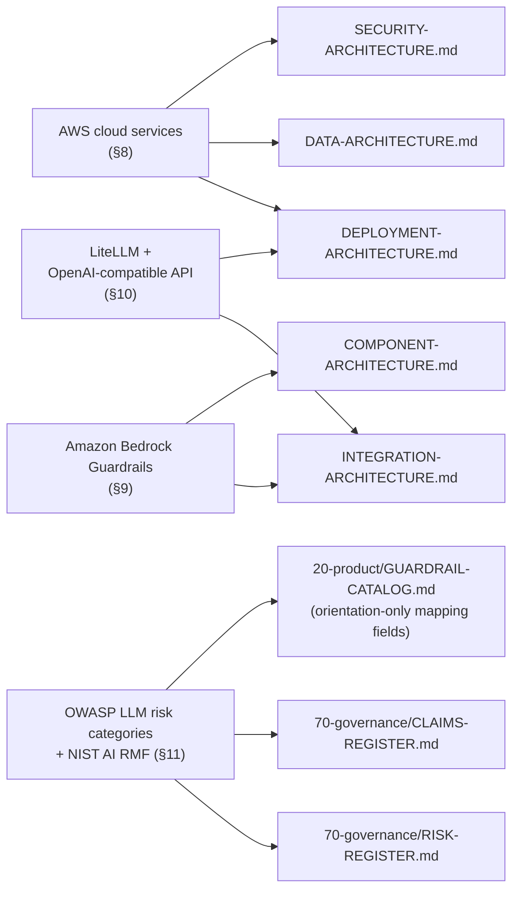
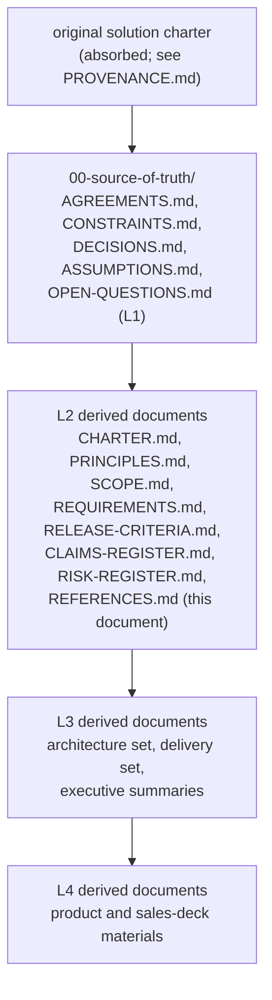

**AI Guardrails — References**

**Authority level:** L2
**Status:** Draft
**Date:** 2026-07-24
**Derived from:** AGREEMENTS.md

---

> This document is a navigational and citation register, not a source of new agreements, requirements, or claims. It collects, in one place, every internal document in this solution-docs set and every external product, service, or industry framework that other documents in this set cite, integrate with, or depend on. It creates no new obligations. Where this register and [`AGREEMENTS.md`](../00-source-of-truth/AGREEMENTS.md) or [`CONSTRAINTS.md`](../00-source-of-truth/CONSTRAINTS.md) could be read as conflicting, those two registers are authoritative (L1) and win; this document must be corrected to match them, not the reverse.

---

## Table of contents

<!-- BEGIN GENERATED: toc -->
- [1. Purpose and scope](#1-purpose-and-scope)
- [2. How to read this register](#2-how-to-read-this-register)
- [3. Internal references: source-of-truth register (L1)](#3-internal-references-source-of-truth-register-l1)
- [4. Internal references: charter and principles (L2)](#4-internal-references-charter-and-principles-l2)
- [5. Internal references: product, executive, and sales-deck materials](#5-internal-references-product-executive-and-sales-deck-materials)
- [6. Internal references: architecture set](#6-internal-references-architecture-set)
- [7. Internal references: delivery and governance sets](#7-internal-references-delivery-and-governance-sets)
- [8. External references: AWS cloud platform and services](#8-external-references-aws-cloud-platform-and-services)
- [9. External references: Amazon Bedrock Guardrails](#9-external-references-amazon-bedrock-guardrails)
- [10. External references: LiteLLM and the OpenAI-compatible API concept](#10-external-references-litellm-and-the-openai-compatible-api-concept)
- [11. External references: OWASP LLM risk categories and NIST AI RMF (conceptual references)](#11-external-references-owasp-llm-risk-categories-and-nist-ai-rmf-conceptual-references)
- [Reference map](#reference-map)
- [12. Reference maintenance](#12-reference-maintenance)
- [Related documents](#related-documents)
<!-- END GENERATED: toc -->
---

## 1. Purpose and scope

This register exists so that any reader of the AI Guardrails solution-docs set — a new team member, a reviewer, an auditor, a security assessor — can find, in one place:

* Every internal document that makes up this solution-docs set, organized by directory and authority level, so a claim or requirement can be traced back to its source.
* Every external product, AWS service, and industry framework that the platform integrates with, adapts to, or is described in relation to, without those descriptions being scattered and re-derived inconsistently across the architecture, product, and sales layers.

It is deliberately **not** the place to introduce new metrics, commitments, SLAs, or vendor claims. Where the source material or `AGREEMENTS.md` does not state a figure, this register says **TBD** rather than inventing one, consistent with how [`60-delivery/DEPENDENCIES.md`](../60-delivery/DEPENDENCIES.md) and [`00-source-of-truth/ASSUMPTIONS.md`](../00-source-of-truth/ASSUMPTIONS.md) already handle unconfirmed figures.

This register also complements, and must stay consistent with:

* [`70-governance/CLAIMS-REGISTER.md`](CLAIMS-REGISTER.md) — governs what the product is *allowed to claim* about external services and its own capabilities; this document governs *what those external services are and where they are cited*.
* [`70-governance/RISK-REGISTER.md`](RISK-REGISTER.md) — tracks risk that arises from dependency on external services and unproven detection coverage; this document is the neutral catalog those risk entries point back to.

---

## 2. How to read this register

Each reference table below carries the following columns, used consistently throughout this document:

| Column | Meaning |
| --- | --- |
| **Document / Reference** | The file (internal) or product/service/framework name (external) being cataloged. |
| **Authority** | For internal documents, the authority level asserted in that document's own header (`L1` authoritative, `L2`–`L4` derived, decreasing in binding force). For external references, marked `n/a` — external references are descriptive, not authoritative over this solution-docs set. |
| **Role / Description** | A one-line, qualitative description of what the document or external reference is and why it is relevant to AI Guardrails. No metrics, dates, or figures are stated unless they already appear in `AGREEMENTS.md` or `CONSTRAINTS.md`. |
| **Link status** | `Linked` for files that exist in this repository today — which is every document named in this set as of this revision. `Planned — not yet authored` is reserved for genuinely-future artifacts (for example ADRs beyond `ADR-0001`, which are backlog items) and, when used, such documents are shown as plain code paths rather than clickable links so a broken link is never silently introduced. |

External references are additionally marked with a **canonical URL** cell reading `TBD — add canonical URL`, per this document set's policy against inventing external URLs. Whoever adds a verified canonical link should replace that placeholder in place, not append a new row.

---

## 3. Internal references: source-of-truth register (L1)

The root source material and the authoritative agreements/constraints/decisions register. Every other document in this set, including this one, is a derived view of these.

<!-- BEGIN GENERATED: references-index:00-source-of-truth -->
| Document / Reference | Authority | Role / Description | Link status |
| --- | --- | --- | --- |
| [`00-source-of-truth/PROVENANCE.md`](../00-source-of-truth/PROVENANCE.md) | Provenance record | Map of where the original solution charter's content now lives (purpose, vision, deployment modes, domain model, AWS direction, security and operational requirements, delivery phases, risks) that every derived document in this set traces back to. | Linked |
| [`00-source-of-truth/AGREEMENTS.md`](../00-source-of-truth/AGREEMENTS.md) | L1 (Authoritative) | The 30 accepted agreements (AGR-001–AGR-030) that no derived document may contradict. The single most-cited document in this set. | Linked |
| [`00-source-of-truth/CONSTRAINTS.md`](../00-source-of-truth/CONSTRAINTS.md) | L1 | Non-negotiable, checkable technical and security boundaries (CON-001–CON-016) — cloud placement, contract independence, transport/cryptographic security, identity, content handling, resource limits. | Linked |
| [`00-source-of-truth/DECISIONS.md`](../00-source-of-truth/DECISIONS.md) | L1 | The product/organizational/delivery decision log, distinct from architecture-level ADRs. | Linked |
| [`00-source-of-truth/ASSUMPTIONS.md`](../00-source-of-truth/ASSUMPTIONS.md) | L1 | The register of unvalidated beliefs (demand/adoption, technical/infrastructure feasibility, security/governance, and other categories) underlying scope and delivery-dependency status. | Linked |
| [`00-source-of-truth/OPEN-QUESTIONS.md`](../00-source-of-truth/OPEN-QUESTIONS.md) | L1 | Open governance and design questions not yet resolved into an agreement or decision (e.g., promotion-governance process). | Linked |
<!-- END GENERATED: references-index:00-source-of-truth -->
---

## 4. Internal references: charter and principles (L2)

The durable, boundary-setting layer derived directly from `AGREEMENTS.md` and `CONSTRAINTS.md`.

<!-- BEGIN GENERATED: references-index:10-charter -->
| Document / Reference | Authority | Role / Description | Link status |
| --- | --- | --- | --- |
| [`10-charter/CHARTER.md`](../10-charter/CHARTER.md) | L2 | The solution charter: purpose, problem addressed, vision, the three-mode architectural decision, and pointers to every other layer. | Linked |
| [`10-charter/PRINCIPLES.md`](../10-charter/PRINCIPLES.md) | L2 | The product principles — policy portability, one contract across modes, policies separate from connectors, explicit content-exposure model, guardrails-are-not-authorization, observe-before-enforce, failure behavior as policy. | Linked |
| [`10-charter/SCOPE.md`](../10-charter/SCOPE.md) | L2 | In-scope, later-phase, and out-of-scope boundaries for the full feature set (DEC-008). | Linked |
| [`10-charter/SUCCESS-CRITERIA.md`](../10-charter/SUCCESS-CRITERIA.md) | L2 | Success criteria for the platform, grounded in adoption, reliability, effectiveness, and portability metrics named in [`SUCCESS-CRITERIA.md`](../10-charter/SUCCESS-CRITERIA.md). | Linked |
<!-- END GENERATED: references-index:10-charter -->
---

## 5. Internal references: product, executive, and sales-deck materials

Audience-specific derived views. These must not contradict the charter, principles, or `AGREEMENTS.md`, and in particular must respect [AGR-009](../00-source-of-truth/AGREEMENTS.md#agr-009--remote-evaluation-is-not-a-private-data-or-data-local-model) and [AGR-018](../00-source-of-truth/AGREEMENTS.md#agr-018--trust-and-enforcement-model) when describing deployment modes or enforcement posture.

### 5.1 Product (`20-product/`)

<!-- BEGIN GENERATED: references-index:20-product -->
| Document / Reference | Authority | Role / Description | Link status |
| --- | --- | --- | --- |
| [`20-product/CAPABILITIES.md`](../20-product/CAPABILITIES.md) | L2 | The capability catalog describing what the platform does, mapped to the in-scope capability list. | Linked |
| [`20-product/GUARDRAIL-CATALOG.md`](../20-product/GUARDRAIL-CATALOG.md) | L2 | The guardrail-category taxonomy (`GR-001`–`GR-018`, per AGR-021/DEC-009) — classification and directional vision, never scope commitment; each entry carries enforcement layer, control types, and phase status. | Linked |
| [`20-product/PRODUCT-OVERVIEW.md`](../20-product/PRODUCT-OVERVIEW.md) | L4 | Narrative overview of the product for a product-facing audience. | Linked |
| [`20-product/PRODUCT-ROADMAP.md`](../20-product/PRODUCT-ROADMAP.md) | L4 | The five-phase delivery roadmap ([AGR-020](../00-source-of-truth/AGREEMENTS.md#agr-020--five-phase-delivery)) presented for a product audience. | Linked |
| [`20-product/PROBLEM-STATEMENT.md`](../20-product/PROBLEM-STATEMENT.md) | L4 | The reuse/portability problem the product addresses. | Linked |
| [`20-product/VALUE-PROPOSITION.md`](../20-product/VALUE-PROPOSITION.md) | L4 | The value proposition derived from the product vision. | Linked |
| [`20-product/DIFFERENTIATORS.md`](../20-product/DIFFERENTIATORS.md) | L4 | What distinguishes AI Guardrails from adjacent approaches. | Linked |
| [`20-product/TARGET-USERS.md`](../20-product/TARGET-USERS.md) | L4 | Platform teams, application teams, security/compliance teams, and product operators, per [`TARGET-USERS.md`](../20-product/TARGET-USERS.md). | Linked |
| [`20-product/USE-CASES.md`](../20-product/USE-CASES.md) | L4 | Representative use cases, including the canonical "import" onboarding flow ([AGR-019](../00-source-of-truth/AGREEMENTS.md#agr-019--meaning-of-import)). | Linked |
| [`20-product/FAQ.md`](../20-product/FAQ.md) | L4 | Frequently asked questions, including clarifications of "import" and deployment-mode data exposure. | Linked |
| [`20-product/SERVING-MODEL.md`](../20-product/SERVING-MODEL.md) | L4 | How the product is served and consumed; the onboarding surface and governance classes. | Linked |
<!-- END GENERATED: references-index:20-product -->
### 5.2 Executive (`30-executive/`)

<!-- BEGIN GENERATED: references-index:30-executive -->
| Document / Reference | Authority | Role / Description | Link status |
| --- | --- | --- | --- |
| [`30-executive/EXECUTIVE-BRIEF.md`](../30-executive/EXECUTIVE-BRIEF.md) | L4 | Condensed executive framing of the solution. | Linked |
| [`30-executive/BUSINESS-CASE.md`](../30-executive/BUSINESS-CASE.md) | L3 | The business rationale for investment. | Linked |
| [`30-executive/INVESTMENT-SUMMARY.md`](../30-executive/INVESTMENT-SUMMARY.md) | L3 | Investment framing (qualitative; no figures beyond what the L1 registers state). | Linked |
| [`30-executive/EXPECTED-OUTCOMES.md`](../30-executive/EXPECTED-OUTCOMES.md) | L4 | Expected outcomes tied to the [Phase 1–2 validation demonstration](../60-delivery/VALIDATION-PLAN.md). | Linked |
| [`30-executive/DECISION-REQUEST.md`](../30-executive/DECISION-REQUEST.md) | L4 | The decision(s) being asked of executive stakeholders. | Linked |
| [`30-executive/RISKS-AND-DEPENDENCIES.md`](../30-executive/RISKS-AND-DEPENDENCIES.md) | L3 | Executive-facing summary of principal risks and dependencies, expanded at delivery level in [`60-delivery/DEPENDENCIES.md`](../60-delivery/DEPENDENCIES.md). | Linked |
<!-- END GENERATED: references-index:30-executive -->
### 5.3 Sales deck (`40-sales-deck/`)

<!-- BEGIN GENERATED: references-index:40-sales-deck -->
| Document / Reference | Authority | Role / Description | Link status |
| --- | --- | --- | --- |
| [`40-sales-deck/DECK-BRIEF.md`](../40-sales-deck/DECK-BRIEF.md) | L4 | The brief governing the sales deck's content and tone. | Linked |
| [`40-sales-deck/SALES-NARRATIVE.md`](../40-sales-deck/SALES-NARRATIVE.md) | L4 | The narrative arc used in sales conversations. | Linked |
| [`40-sales-deck/SLIDE-OUTLINE.md`](../40-sales-deck/SLIDE-OUTLINE.md) | L4 | Slide-by-slide outline. | Linked |
| [`40-sales-deck/AUDIENCE-AND-PERSONAS.md`](../40-sales-deck/AUDIENCE-AND-PERSONAS.md) | L4 | Target sales audiences and personas. | Linked |
| [`40-sales-deck/CUSTOMER-PAIN-POINTS.md`](../40-sales-deck/CUSTOMER-PAIN-POINTS.md) | L4 | Pain points the product addresses. | Linked |
| [`40-sales-deck/BENEFITS-AND-OUTCOMES.md`](../40-sales-deck/BENEFITS-AND-OUTCOMES.md) | L4 | Benefits and outcomes messaging. | Linked |
| [`40-sales-deck/PROOF-POINTS.md`](../40-sales-deck/PROOF-POINTS.md) | L4 | Proof points, constrained to what the Phase 1–2 validation demonstration and charter actually support. | Linked |
| [`40-sales-deck/OBJECTION-HANDLING.md`](../40-sales-deck/OBJECTION-HANDLING.md) | L4 | Objection handling, including the [AGR-009](../00-source-of-truth/AGREEMENTS.md#agr-009--remote-evaluation-is-not-a-private-data-or-data-local-model) and [AGR-018](../00-source-of-truth/AGREEMENTS.md#agr-018--trust-and-enforcement-model) boundaries on what can be claimed. | Linked |
| [`40-sales-deck/CALL-TO-ACTION.md`](../40-sales-deck/CALL-TO-ACTION.md) | L4 | The call to action closing the deck. | Linked |
| [`40-sales-deck/VISUAL-DIRECTION.md`](../40-sales-deck/VISUAL-DIRECTION.md) | L4 | Visual and design direction for the deck. | Linked |
| [`40-sales-deck/DECK-QA.md`](../40-sales-deck/DECK-QA.md) | L4 | Per-slide question and response preparation, plus the register of questions that have no answer in the source material today. | Linked |
| [`40-sales-deck/DECK-VARIANTS.md`](../40-sales-deck/DECK-VARIANTS.md) | L4 | Governs the architecture-review, security-review, and team-enablement decks the same way DECK-BRIEF.md governs the internal pitch. | Linked |
<!-- END GENERATED: references-index:40-sales-deck -->
---

## 6. Internal references: architecture set

The `50-architecture/` set, including its Architecture Decision Records subfolder. These are the primary technical grounding for the external references cataloged in Sections 8–11.

<!-- BEGIN GENERATED: references-index:50-architecture -->
| Document / Reference | Authority | Role / Description | Link status |
| --- | --- | --- | --- |
| [`50-architecture/ARCHITECTURE-REPORT.md`](../50-architecture/ARCHITECTURE-REPORT.md) | L3 | Consolidated technical report tying the architecture set together. | Linked |
| [`50-architecture/SYSTEM-CONTEXT.md`](../50-architecture/SYSTEM-CONTEXT.md) | L3 | C4 Level 1 system context. | Linked |
| [`50-architecture/CONTAINER-ARCHITECTURE.md`](../50-architecture/CONTAINER-ARCHITECTURE.md) | L3 | Container-level architecture. | Linked |
| [`50-architecture/COMPONENT-ARCHITECTURE.md`](../50-architecture/COMPONENT-ARCHITECTURE.md) | L3 | C4 Level 3 component architecture, including the Bedrock Guardrails adapter and evaluator-adapter pattern ([AGR-004](../00-source-of-truth/AGREEMENTS.md#agr-004--bedrock-guardrails-as-first-engine-vendor-independent-contract)). | Linked |
| [`50-architecture/INTEGRATION-ARCHITECTURE.md`](../50-architecture/INTEGRATION-ARCHITECTURE.md) | L3 | The evaluation contract, the LiteLLM connector, the generic HTTP Evaluation API/SDK, and the Bedrock Guardrails adapter — the primary document cited for the LiteLLM and Bedrock external references below. | Linked |
| [`50-architecture/DEPLOYMENT-ARCHITECTURE.md`](../50-architecture/DEPLOYMENT-ARCHITECTURE.md) | L3 | The three deployment-mode topologies, the AWS implementation direction, and the MVP account model — the primary document cited for the AWS service references below. | Linked |
| [`50-architecture/DATA-ARCHITECTURE.md`](../50-architecture/DATA-ARCHITECTURE.md) | L3 | The domain entity model, storage architecture, data-handling policy, and audit metadata. | Linked |
| [`50-architecture/SECURITY-ARCHITECTURE.md`](../50-architecture/SECURITY-ARCHITECTURE.md) | L3 | Security principles, the trust and enforcement model, the security control catalog, and the threat model. | Linked |
| [`50-architecture/NON-FUNCTIONAL-REQUIREMENTS.md`](../50-architecture/NON-FUNCTIONAL-REQUIREMENTS.md) | L2 | Availability, performance, and security NFRs, including dependency/container-scanning requirements. | Linked |
| [`50-architecture/REQUIREMENTS.md`](../50-architecture/REQUIREMENTS.md) | L2 | Functional requirements. | Linked |
| [`50-architecture/OPERABILITY.md`](../50-architecture/OPERABILITY.md) | L3 | Operational requirements — failure behavior, policy rollout, auditing. | Linked |
| [`50-architecture/EXTENSIBILITY-ARCHITECTURE.md`](../50-architecture/EXTENSIBILITY-ARCHITECTURE.md) | L3 | The growth model — four extension seams (stage, engine, action, connector), category attachment, and the catalog graduation process (AGR-021). | Linked |
| [`50-architecture/FEASIBILITY-ASSESSMENT.md`](../50-architecture/FEASIBILITY-ASSESSMENT.md) | L3 | Technical feasibility assessment. | Linked |
| [`50-architecture/TECHNICAL-RISKS.md`](../50-architecture/TECHNICAL-RISKS.md) | L3 | Technical risks distinct from the product/business risks in [`30-executive/RISKS-AND-DEPENDENCIES.md`](../30-executive/RISKS-AND-DEPENDENCIES.md). | Linked |
| [`50-architecture/TRADE-OFFS.md`](../50-architecture/TRADE-OFFS.md) | L3 | Architectural trade-offs considered across the three deployment modes. | Linked |
| [`50-architecture/adrs/README.md`](../50-architecture/adrs/README.md) | L1 (process doc) | The ADR index: process, template, lifecycle, and the current ADR list. | Linked |
| [`50-architecture/adrs/ADR-0001-example-decision.md`](../50-architecture/adrs/ADR-0001-example-decision.md) | L1 (Accepted) | The worked-example ADR: standalone platform, not embedded in the internal LiteLLM instance ([AGR-001](../00-source-of-truth/AGREEMENTS.md#agr-001--standalone-platform-not-embedded-in-the-internal-litellm)). | Linked |
| [`50-architecture/adrs/ADR-0002-guardrail-category-catalog-and-extension-model.md`](../50-architecture/adrs/ADR-0002-guardrail-category-catalog-and-extension-model.md) | Accepted, pending owner ratification (L1 on ratification) | Records the taxonomy behind GUARDRAIL-CATALOG and the extension seams behind EXTENSIBILITY-ARCHITECTURE. | Linked |
| [`50-architecture/adrs/ADR-0003-reason-code-taxonomy-and-category-audit-dimension.md`](../50-architecture/adrs/ADR-0003-reason-code-taxonomy-and-category-audit-dimension.md) | Proposed (L1 once Accepted) | Makes per-category metrics and traceability reachable from decision records without an external mapping table. | Linked |
| [`50-architecture/adrs/ADR-0004-enforcement-ladder-states-and-decision-actions.md`](../50-architecture/adrs/ADR-0004-enforcement-ladder-states-and-decision-actions.md) | Proposed (L1 once Accepted) | Makes the ladder state a ceiling held on the binding and reported as an additive `enforcement_state` field. | Linked |
| [`50-architecture/adrs/ADR-0005-evaluation-contract-wire-format.md`](../50-architecture/adrs/ADR-0005-evaluation-contract-wire-format.md) | Proposed (L1 once Accepted) | The versionable artifact AGR-006's compatibility discipline operates on; cited wherever the contract's shape or stability is discussed. | Linked |
| [`50-architecture/adrs/ADR-0006-integration-manifest-format-and-contents.md`](../50-architecture/adrs/ADR-0006-integration-manifest-format-and-contents.md) | Proposed (L1 once Accepted) | Defines the artifact a consuming team actually receives at onboarding. | Linked |
| [`50-architecture/adrs/ADR-0007-connector-identity-verification-and-liveness.md`](../50-architecture/adrs/ADR-0007-connector-identity-verification-and-liveness.md) | Proposed (L1 once Accepted) | Makes a half-wired connector detectable; its staleness signal must never be described as evidence of bypass. | Linked |
| [`50-architecture/adrs/ADR-0008-connector-distribution-and-integrity.md`](../50-architecture/adrs/ADR-0008-connector-distribution-and-integrity.md) | Proposed (L1 once Accepted) | Gives the connector the supply chain the Mode C runtime container already has. | Linked |
| [`50-architecture/adrs/ADR-0009-policy-document-schema-and-mandatory-failure-behavior.md`](../50-architecture/adrs/ADR-0009-policy-document-schema-and-mandatory-failure-behavior.md) | Proposed (L1 once Accepted) | The record that makes AGR-012's no-undocumented-fallback rule and AGR-005's vendor neutrality checkable at publication. | Linked |
| [`50-architecture/adrs/ADR-0010-policy-storage-split.md`](../50-architecture/adrs/ADR-0010-policy-storage-split.md) | Proposed (L1 once Accepted) | Ratifies the standing storage recommendation in TRADE-OFFS as an architectural decision. | Linked |
| [`50-architecture/adrs/ADR-0011-policy-distribution-and-caching.md`](../50-architecture/adrs/ADR-0011-policy-distribution-and-caching.md) | Proposed (L1 once Accepted) | Chooses pull over push and defines what immediate rollback means in practice. | Linked |
| [`50-architecture/adrs/ADR-0012-client-bootstrap-configuration.md`](../50-architecture/adrs/ADR-0012-client-bootstrap-configuration.md) | Proposed (L1 once Accepted) | Closes the client-side half of the configuration-distribution gap ADR-0005 named in its own scope boundaries. | Linked |
| [`50-architecture/adrs/ADR-0013-runtime-capability-manifest.md`](../50-architecture/adrs/ADR-0013-runtime-capability-manifest.md) | Proposed (L1 once Accepted) | Activates the binding's previously unused runtime-compatibility attribute. | Linked |
| [`50-architecture/adrs/ADR-0014-audit-coverage-rejections-and-client-synthesized-decisions.md`](../50-architecture/adrs/ADR-0014-audit-coverage-rejections-and-client-synthesized-decisions.md) | Proposed (L1 once Accepted) | Keeps self-reported client records distinguishable from platform observations. | Linked |
| [`50-architecture/adrs/ADR-0015-runtime-deployment-target.md`](../50-architecture/adrs/ADR-0015-runtime-deployment-target.md) | Proposed (L1 once Accepted) | Argues a single packaging path from the Phase 4 requirement to ship this runtime into customer accounts. | Linked |
<!-- END GENERATED: references-index:50-architecture -->
---

## 7. Internal references: delivery and governance sets

### 7.1 Delivery (`60-delivery/`)

<!-- BEGIN GENERATED: references-index:60-delivery -->
| Document / Reference | Authority | Role / Description | Link status |
| --- | --- | --- | --- |
| [`60-delivery/IMPLEMENTATION-STRATEGY.md`](../60-delivery/IMPLEMENTATION-STRATEGY.md) | L3 | How the five phases ([AGR-020](../00-source-of-truth/AGREEMENTS.md#agr-020--five-phase-delivery)) will be executed. | Linked |
| [`60-delivery/MILESTONES.md`](../60-delivery/MILESTONES.md) | L3 | Delivery milestones organized by phase. | Linked |
| [`60-delivery/DEPENDENCIES.md`](../60-delivery/DEPENDENCIES.md) | L3 | The delivery dependency register (AWS account provisioning, Bedrock Guardrails regional access, consuming-team LiteLLM cooperation, security review sign-off, KMS/Secrets Manager setup, CI scanning) — the most detailed cross-reference to the external AWS and Bedrock dependencies cataloged in Sections 8–9 below. | Linked |
| [`60-delivery/RELEASE-DEFINITION.md`](../60-delivery/RELEASE-DEFINITION.md) | L2 | The current local-release definition and acceptance matrix derived from AGR-022 through AGR-030 and DEC-022 through DEC-024; implementation acceptance remains unverified. | Linked |
| [`60-delivery/RELEASE-CRITERIA.md`](../60-delivery/RELEASE-CRITERIA.md) | L2 | Phase 1–2 exit gates, tied to the validation demonstration ([`SUCCESS-CRITERIA.md`](../10-charter/SUCCESS-CRITERIA.md); DEC-008). | Linked |
| [`60-delivery/VALIDATION-PLAN.md`](../60-delivery/VALIDATION-PLAN.md) | L3 | How the Phase 1–2 validation demonstration is executed and validated. | Linked |
| [`60-delivery/TEAM-AND-OWNERSHIP.md`](../60-delivery/TEAM-AND-OWNERSHIP.md) | L3 | Ownership boundaries across the AI Guardrails team, platform operations, security/governance, and consuming teams ([`TEAM-AND-OWNERSHIP.md`](../60-delivery/TEAM-AND-OWNERSHIP.md)). | Linked |
| [`60-delivery/FEATURE-BACKLOG.md`](../60-delivery/FEATURE-BACKLOG.md) | L3 | A backlog cross-referenced to the registers; explicitly not itself scope. | Linked |
<!-- END GENERATED: references-index:60-delivery -->
### 7.2 Governance (`70-governance/`, this document's own folder)

<!-- BEGIN GENERATED: references-index:70-governance -->
| Document / Reference | Authority | Role / Description | Link status |
| --- | --- | --- | --- |
| [`70-governance/CLAIMS-REGISTER.md`](../70-governance/CLAIMS-REGISTER.md) | L2 | What the product may and may not claim — the register this document defers to for anything resembling a marketing or capability claim about an external service. | Linked |
| [`70-governance/RISK-REGISTER.md`](../70-governance/RISK-REGISTER.md) | L2 | The consolidated risk register (connector bypass, false confidence, latency, hosted data exposure, policy fragmentation, product over-expansion, per [`RISK-REGISTER.md`](RISK-REGISTER.md)). | Linked |
| [`70-governance/GLOSSARY.md`](../70-governance/GLOSSARY.md) | L2 | Named as an affected document under [AGR-017](../00-source-of-truth/AGREEMENTS.md#agr-017--core-domain-model) and [AGR-019](../00-source-of-truth/AGREEMENTS.md#agr-019--meaning-of-import); intended to define domain-model and product terminology (tenant, workload, policy, binding, evaluation, decision, "import") consistently across this set. | Linked |
| [`70-governance/DOCUMENT-GOVERNANCE.md`](../70-governance/DOCUMENT-GOVERNANCE.md) | L2 | The governing document for this set; read before changing any file under solution-docs/. | Linked |
<!-- END GENERATED: references-index:70-governance -->
---

### 7.3 Agent inputs (`80-agent-inputs/`)

The instruction sets that drive documentation-generation agents. Each is bound by the registers it cites and introduces no ground truth of its own.

<!-- BEGIN GENERATED: references-index:80-agent-inputs -->
| Document / Reference | Authority | Role / Description | Link status |
| --- | --- | --- | --- |
| [`80-agent-inputs/ARCHITECTURE-REVIEW-AGENT.md`](../80-agent-inputs/ARCHITECTURE-REVIEW-AGENT.md) | L4 | Drives architecture drift review; may trigger ADRs but decides nothing itself. | Linked |
| [`80-agent-inputs/CHARTER-AGENT.md`](../80-agent-inputs/CHARTER-AGENT.md) | L4 | Drives charter generation; bound by the registers it cites, never a source itself. | Linked |
| [`80-agent-inputs/EXECUTIVE-BRIEF-AGENT.md`](../80-agent-inputs/EXECUTIVE-BRIEF-AGENT.md) | L4 | Drives executive-brief generation; bound by CLAIMS-REGISTER wording. | Linked |
| [`80-agent-inputs/OUTPUT-CONTRACTS.md`](../80-agent-inputs/OUTPUT-CONTRACTS.md) | L4 | The binding output contract for every generation agent in this directory. | Linked |
| [`80-agent-inputs/README.md`](../80-agent-inputs/README.md) | L4 | Scope statement for the generation-agent instruction sets. | Linked |
| [`80-agent-inputs/SALES-DECK-AGENT.md`](../80-agent-inputs/SALES-DECK-AGENT.md) | L4 | Drives deck generation; must halt rather than ship unapproved claims. | Linked |
<!-- END GENERATED: references-index:80-agent-inputs -->
### 7.4 Archive (`90-archive/`)

Superseded documents, retained for audit trail and never citable as current fact.

<!-- BEGIN GENERATED: references-index:90-archive -->
| Document / Reference | Authority | Role / Description | Link status |
| --- | --- | --- | --- |
| [`90-archive/00-source-of-truth--TRACEABILITY-MATRIX--archived-2026-07-26.md`](../90-archive/00-source-of-truth--TRACEABILITY-MATRIX--archived-2026-07-26.md) | L1 |  | Linked |
| [`90-archive/README.md`](../90-archive/README.md) | L5 | Operationalizes the document lifecycle settled in DOCUMENT-GOVERNANCE §10. | Linked |
<!-- END GENERATED: references-index:90-archive -->
---

### 7.5 Root-level navigation (repository root)

The entry points and change history that sit above the numbered directories.

<!-- BEGIN GENERATED: references-index:. -->
| Document / Reference | Authority | Role / Description | Link status |
| --- | --- | --- | --- |
| [`CHANGELOG.md`](../CHANGELOG.md) | L4 | Records when the documentation came to reflect a decision; never rewritten, only appended to. | Linked |
| [`DOCUMENT-MAP.md`](../DOCUMENT-MAP.md) | L4 | Navigational companion to README; routes each reader profile to its starting document. | Linked |
| [`README.md`](../README.md) | L4 | The start-here navigational document; introduces no new agreement, requirement, or claim. | Linked |
<!-- END GENERATED: references-index:. -->
---

## 8. External references: AWS cloud platform and services

Amazon Web Services is the platform's primary and initial cloud ([AGR-013](../00-source-of-truth/AGREEMENTS.md#agr-013--aws-as-primary-cloud-minimal-mvp-account-model); [CON-001](../00-source-of-truth/CONSTRAINTS.md#con-001--aws-as-primary-cloud)). The table below reproduces the capability-to-service mapping from [`DEPLOYMENT-ARCHITECTURE.md`](../50-architecture/DEPLOYMENT-ARCHITECTURE.md) ("AWS implementation direction"), elaborated in [`50-architecture/DEPLOYMENT-ARCHITECTURE.md`](../50-architecture/DEPLOYMENT-ARCHITECTURE.md) §7.

| AWS service | Capability in AI Guardrails | Cited in (internal) | Canonical AWS documentation |
| --- | --- | --- | --- |
| Amazon ECS (Fargate) or Amazon EKS | Evaluation runtime — hosts the Guardrails Runtime (Evaluation API, policy resolver, decision engine, evaluator adapters). | [`DEPLOYMENT-ARCHITECTURE.md`](../50-architecture/DEPLOYMENT-ARCHITECTURE.md), [`CONTAINER-ARCHITECTURE.md`](../50-architecture/CONTAINER-ARCHITECTURE.md) | TBD — add canonical URL |
| Amazon API Gateway or Application Load Balancer (ALB) | Public or internal entry point to the Evaluation API. | [`DEPLOYMENT-ARCHITECTURE.md`](../50-architecture/DEPLOYMENT-ARCHITECTURE.md), [`INTEGRATION-ARCHITECTURE.md`](../50-architecture/INTEGRATION-ARCHITECTURE.md) | TBD — add canonical URL |
| Amazon DynamoDB | Policy storage (alternative to versioned S3) and the workload registry. | [`DATA-ARCHITECTURE.md`](../50-architecture/DATA-ARCHITECTURE.md) | TBD — add canonical URL |
| Amazon S3 | Versioned policy storage (alternative to DynamoDB) and the audit archive. | [`DATA-ARCHITECTURE.md`](../50-architecture/DATA-ARCHITECTURE.md) | TBD — add canonical URL |
| Amazon SQS | Audit event buffering ahead of archival. | [`DATA-ARCHITECTURE.md`](../50-architecture/DATA-ARCHITECTURE.md) | TBD — add canonical URL |
| Amazon CloudWatch | Operational metrics — evaluation latency percentiles, throughput, timeout rate, decision distribution, policy-cache hit rate ([`NON-FUNCTIONAL-REQUIREMENTS.md`](../50-architecture/NON-FUNCTIONAL-REQUIREMENTS.md)). | [`OPERABILITY.md`](../50-architecture/OPERABILITY.md), [`NON-FUNCTIONAL-REQUIREMENTS.md`](../50-architecture/NON-FUNCTIONAL-REQUIREMENTS.md) | TBD — add canonical URL |
| Amazon ECR | Container registry for the Guardrails Runtime image, including the customer-managed deployment artifact. | [`CONTAINER-ARCHITECTURE.md`](../50-architecture/CONTAINER-ARCHITECTURE.md), [`DEPLOYMENT-ARCHITECTURE.md`](../50-architecture/DEPLOYMENT-ARCHITECTURE.md) | TBD — add canonical URL |
| AWS IAM | Runtime credentials, IAM-based authentication for AWS consumers, least-privilege roles ([CON-010](../00-source-of-truth/CONSTRAINTS.md#con-010--iam-based-authentication-and-least-privilege-roles)). | [`SECURITY-ARCHITECTURE.md`](../50-architecture/SECURITY-ARCHITECTURE.md) | TBD — add canonical URL |
| AWS Secrets Manager | Storage for runtime credentials and other secrets. | [`SECURITY-ARCHITECTURE.md`](../50-architecture/SECURITY-ARCHITECTURE.md), [`DEPENDENCIES.md`](../60-delivery/DEPENDENCIES.md) | TBD — add canonical URL |
| AWS KMS | Encryption at rest and in transit ([CON-009](../00-source-of-truth/CONSTRAINTS.md#con-009--kms-encryption-in-transit-and-at-rest)). | [`SECURITY-ARCHITECTURE.md`](../50-architecture/SECURITY-ARCHITECTURE.md), [`DATA-ARCHITECTURE.md`](../50-architecture/DATA-ARCHITECTURE.md) | TBD — add canonical URL |

The initial delivery uses a minimal two-account model (one non-production, one production); additional account separation is introduced only when justified by the triggers named in [AGR-013](../00-source-of-truth/AGREEMENTS.md#agr-013--aws-as-primary-cloud-minimal-mvp-account-model). No AWS pricing, SLA percentage, or capacity figure is stated here beyond what the L1 registers state (none, for these services) — see [`60-delivery/DEPENDENCIES.md`](../60-delivery/DEPENDENCIES.md) for the current provisioning status of the underlying accounts.

---

## 9. External references: Amazon Bedrock Guardrails

Amazon Bedrock Guardrails is adopted as the platform's **first managed evaluation engine**, normalized behind a vendor-independent decision contract so that the public evaluation contract never depends on Bedrock's own response format ([AGR-004](../00-source-of-truth/AGREEMENTS.md#agr-004--bedrock-guardrails-as-first-engine-vendor-independent-contract)). It sits behind the evaluator-adapter pattern in [`COMPONENT-ARCHITECTURE.md`](../50-architecture/COMPONENT-ARCHITECTURE.md), alongside deterministic organization rules and PII evaluators ([`CONTAINER-ARCHITECTURE.md`](../50-architecture/CONTAINER-ARCHITECTURE.md)).

| Reference | Authority | Role / Description | Canonical documentation |
| --- | --- | --- | --- |
| Amazon Bedrock Guardrails | n/a (external managed service) | AWS's managed guardrail evaluation engine; the first of potentially several evaluation engines the platform normalizes behind its own decision structure. Must never be described in this document set as the platform's permanent or exclusive detection engine ([AGR-004](../00-source-of-truth/AGREEMENTS.md#agr-004--bedrock-guardrails-as-first-engine-vendor-independent-contract)). | TBD — add canonical URL |

Cited from: [`50-architecture/INTEGRATION-ARCHITECTURE.md`](../50-architecture/INTEGRATION-ARCHITECTURE.md) §6 ("Bedrock Guardrails adapter"), [`50-architecture/COMPONENT-ARCHITECTURE.md`](../50-architecture/COMPONENT-ARCHITECTURE.md), [`60-delivery/DEPENDENCIES.md`](../60-delivery/DEPENDENCIES.md) §3.2 (regional availability as an External-type delivery dependency), [`70-governance/CLAIMS-REGISTER.md`](CLAIMS-REGISTER.md).

---

## 10. External references: LiteLLM and the OpenAI-compatible API concept

| Reference | Authority | Role / Description | Canonical documentation |
| --- | --- | --- | --- |
| LiteLLM | n/a (external open-source gateway project) | The platform's **first supported gateway connector**, and optionally the substrate for the managed Guarded Gateway mode — explicitly **not** the product boundary ([AGR-003](../00-source-of-truth/AGREEMENTS.md#agr-003--litellm-as-first-connector-not-the-product-boundary)). The consuming team's LiteLLM instance is the integration point in Mode A (Remote Evaluation); a provider-operated LiteLLM instance may underlie Mode B (Guarded Gateway). | TBD — add canonical URL |
| OpenAI-compatible API (concept) | n/a (industry convention, not a single vendor) | The widely adopted request/response schema convention that LiteLLM and many model gateways expose, allowing client applications to call different model providers through one consistent interface. Referenced conceptually because [AGR-002](../00-source-of-truth/AGREEMENTS.md#agr-002--three-deployment-modes) (Mode B) describes the Guarded Gateway as offering teams "a managed OpenAI-compatible endpoint." This document set treats it as a general industry convention, not as an endorsement of or dependency on any single vendor's product. | TBD — add canonical URL |

Cited from: [`50-architecture/INTEGRATION-ARCHITECTURE.md`](../50-architecture/INTEGRATION-ARCHITECTURE.md) §4 ("The LiteLLM connector"), [`50-architecture/DEPLOYMENT-ARCHITECTURE.md`](../50-architecture/DEPLOYMENT-ARCHITECTURE.md) (Mode A and Mode B topologies), [`60-delivery/DEPENDENCIES.md`](../60-delivery/DEPENDENCIES.md) §3.4 (consuming-team LiteLLM availability and willingness).

---

## 11. External references: OWASP LLM risk categories and NIST AI RMF (conceptual references)

| Reference | Authority | Role / Description | Canonical documentation |
| --- | --- | --- | --- |
| OWASP risk categories for LLM applications | n/a (external, community-maintained taxonomy) | A conceptual external reference framework for describing categories of LLM-specific risk (for example, prompt injection, which the L1 registers name directly under both in-scope deterministic detection and future-scope "indirect prompt-injection detection," §6.1–§6.2). Used only as an orientation point for discussing detection coverage and gaps — **not** as a claim that AI Guardrails fully covers, certifies against, or has been benchmarked against any specific published category list. | TBD — add canonical URL |
| NIST AI Risk Management Framework (AI RMF) | n/a (external, U.S. government-published framework) | A conceptual external reference framework whose lifecycle functions (Govern, Map, Measure, Manage) are used **for orientation only** in the guardrail-category catalog's "External mapping" fields. Its use carries the same discipline as the OWASP row: orientation, never a conformance, certification, or coverage claim — "full compliance certification" remains a standing exclusion ([`SCOPE.md`](../10-charter/SCOPE.md)). | TBD — add canonical URL |

These references exist specifically to support the **false-confidence risk mitigation** named in [`RISK-REGISTER.md`](RISK-REGISTER.md): "Document unsupported risk categories," "Maintain risk-specific evaluation datasets," and "Avoid marketing guardrails as a complete security boundary." Both are the source of the **"External mapping (orientation only)"** column in [`20-product/GUARDRAIL-CATALOG.md`](../20-product/GUARDRAIL-CATALOG.md) — every such cell inherits the orientation-only caveat stated here. Any statement in this document set that maps a specific AI Guardrails detection capability to a specific OWASP- or NIST-named category must be verified against [`70-governance/CLAIMS-REGISTER.md`](CLAIMS-REGISTER.md) before publication, and any resulting coverage gap must be tracked in [`70-governance/RISK-REGISTER.md`](RISK-REGISTER.md).

Cited from: [`70-governance/RISK-REGISTER.md`](RISK-REGISTER.md) ("false confidence" risk), [`70-governance/CLAIMS-REGISTER.md`](CLAIMS-REGISTER.md), [`50-architecture/SECURITY-ARCHITECTURE.md`](../50-architecture/SECURITY-ARCHITECTURE.md) §10 ("Threat model"), [`20-product/GUARDRAIL-CATALOG.md`](../20-product/GUARDRAIL-CATALOG.md) ("External mapping" fields).

---

## Reference map

The following diagram summarizes which internal documents are the primary citation point for each external reference category cataloged above.

And the authority flow that governs how internal references in Sections 3–7 relate to one another:

---

## 12. Reference maintenance

* **Adding an internal document.** When a new file is added anywhere under `solution-docs/`, add one row to the relevant table in Sections 3–7, using the authority level stated in that document's own header. Do not mark it `Linked` until the file exists in the repository.
* **Adding an external reference.** When a new external product, AWS service, or framework is introduced into any document in this set, add a row to the appropriate table in Sections 8–11 (or a new subsection if it does not fit an existing category), and mark its canonical URL `TBD — add canonical URL` until a reviewer has verified and inserted the real link. Do not insert a URL from memory.
* **Previously-planned documents.** [`70-governance/GLOSSARY.md`](GLOSSARY.md) was named as an affected document in `AGREEMENTS.md` ahead of being authored. Both now exist; their rows in Sections 3 and 7.2 are marked **Linked**, with markdown links in place of the earlier plain code paths.
* **Conflicts.** If any row in this register appears to imply something [`AGREEMENTS.md`](../00-source-of-truth/AGREEMENTS.md) or [`CONSTRAINTS.md`](../00-source-of-truth/CONSTRAINTS.md) does not support — for example, a claim of data-locality for Mode A, or a description of a cooperative connector as a hard security boundary — the agreement or constraint wins, and this register (and the offending source document) must be corrected.

---

## Related documents

- [`../00-source-of-truth/PROVENANCE.md`](../00-source-of-truth/PROVENANCE.md) — where the original solution charter's content now lives.
- [`00-source-of-truth/AGREEMENTS.md`](../00-source-of-truth/AGREEMENTS.md) — the authoritative agreements register (L1) this document must never contradict.
- [`00-source-of-truth/CONSTRAINTS.md`](../00-source-of-truth/CONSTRAINTS.md) — authoritative, checkable technical and security boundaries (L1).
- [`70-governance/CLAIMS-REGISTER.md`](CLAIMS-REGISTER.md) — what the product may and may not claim about the external services and frameworks cataloged here.
- [`70-governance/RISK-REGISTER.md`](RISK-REGISTER.md) — risks arising from dependency on the external services and detection frameworks cataloged here.
- [`50-architecture/adrs/README.md`](../50-architecture/adrs/README.md) — the sibling index document for architecture decision records, structured similarly to this register.
- [`60-delivery/DEPENDENCIES.md`](../60-delivery/DEPENDENCIES.md) — the delivery-dependency register for the AWS and Bedrock Guardrails external dependencies cataloged in Sections 8–9.
