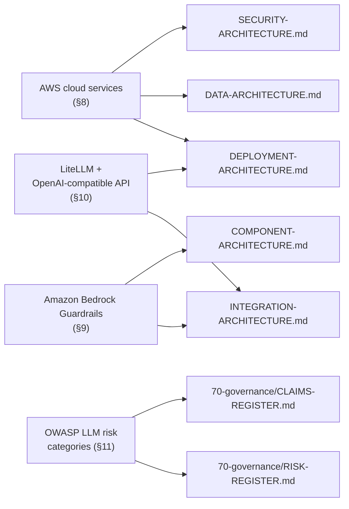
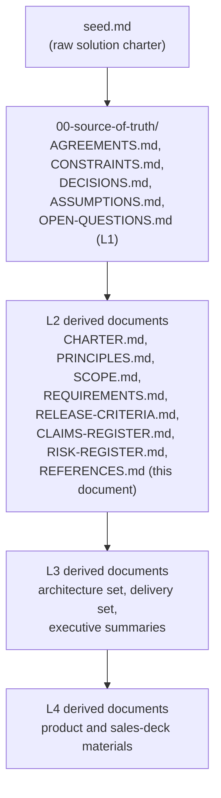

**AI Guardrails — References**

**Authority level:** L2
**Status:** Draft
**Date:** 2026-07-24
**Derived from:** seed.md + AGREEMENTS.md

---

> This document is a navigational and citation register, not a source of new agreements, requirements, or claims. It collects, in one place, every internal document in this solution-docs set and every external product, service, or industry framework that other documents in this set cite, integrate with, or depend on. It creates no new obligations. Where this register and [`AGREEMENTS.md`](../00-source-of-truth/AGREEMENTS.md) or [`CONSTRAINTS.md`](../00-source-of-truth/CONSTRAINTS.md) could be read as conflicting, those two registers are authoritative (L1) and win; this document must be corrected to match them, not the reverse.

---

## Table of contents

- [1. Purpose and scope](#1-purpose-and-scope)
- [2. How to read this register](#2-how-to-read-this-register)
- [3. Internal references: source-of-truth register (L1)](#3-internal-references-source-of-truth-register-l1)
- [4. Internal references: charter and principles (L2)](#4-internal-references-charter-and-principles-l2)
- [5. Internal references: product, executive, and sales-deck materials](#5-internal-references-product-executive-and-sales-deck-materials)
- [6. Internal references: architecture set](#6-internal-references-architecture-set)
- [7. Internal references: delivery and governance sets](#7-internal-references-delivery-and-governance-sets)
- [8. External references: AWS cloud platform and services](#8-external-references-aws-cloud-platform-and-services)
- [9. External references: Amazon Bedrock Guardrails](#9-external-references-amazon-bedrock-guardrails)
- [10. External references: LiteLLM and the OpenAI-compatible API concept](#10-external-references-litellm-and-the-openai-compatible-api-concept)
- [11. External references: OWASP LLM risk categories (conceptual reference)](#11-external-references-owasp-llm-risk-categories-conceptual-reference)
- [12. Reference maintenance](#12-reference-maintenance)
- [Related documents](#related-documents)

---

## 1. Purpose and scope

This register exists so that any reader of the AI Guardrails solution-docs set — a new team member, a reviewer, an auditor, a security assessor — can find, in one place:

* Every internal document that makes up this solution-docs set, organized by directory and authority level, so a claim or requirement can be traced back to its source.
* Every external product, AWS service, and industry framework that the platform integrates with, adapts to, or is described in relation to, without those descriptions being scattered and re-derived inconsistently across the architecture, product, and sales layers.

It is deliberately **not** the place to introduce new metrics, commitments, SLAs, or vendor claims. Where the seed material or `AGREEMENTS.md` does not state a figure, this register says **TBD** rather than inventing one, consistent with how [`60-delivery/DEPENDENCIES.md`](../60-delivery/DEPENDENCIES.md) and [`00-source-of-truth/ASSUMPTIONS.md`](../00-source-of-truth/ASSUMPTIONS.md) already handle unconfirmed figures.

This register also complements, and must stay consistent with:

* [`70-governance/CLAIMS-REGISTER.md`](CLAIMS-REGISTER.md) — governs what the product is *allowed to claim* about external services and its own capabilities; this document governs *what those external services are and where they are cited*.
* [`70-governance/RISK-REGISTER.md`](RISK-REGISTER.md) — tracks risk that arises from dependency on external services and unproven detection coverage; this document is the neutral catalog those risk entries point back to.

---

## 2. How to read this register

Each reference table below carries the following columns, used consistently throughout this document:

| Column | Meaning |
| --- | --- |
| **Document / Reference** | The file (internal) or product/service/framework name (external) being cataloged. |
| **Authority** | For internal documents, the authority level asserted in that document's own header (`L1` authoritative, `L2`–`L4` derived, decreasing in binding force). For external references, marked `n/a` — external references are descriptive, not authoritative over this solution-docs set. |
| **Role / Description** | A one-line, qualitative description of what the document or external reference is and why it is relevant to AI Guardrails. No metrics, dates, or figures are stated unless they already appear in `seed.md` or `AGREEMENTS.md`. |
| **Link status** | `Linked` for files that exist in this repository today; `Planned — not yet authored` for files named as future or sibling documents elsewhere in this set that do not yet exist. Planned documents are shown as plain code paths, not as clickable links, so a broken link is never silently introduced. |

External references are additionally marked with a **canonical URL** cell reading `TBD — add canonical URL`, per this document set's policy against inventing external URLs. Whoever adds a verified canonical link should replace that placeholder in place, not append a new row.

---

## 3. Internal references: source-of-truth register (L1)

The root source material and the authoritative agreements/constraints/decisions register. Every other document in this set, including this one, is a derived view of these.

| Document / Reference | Authority | Role / Description | Link status |
| --- | --- | --- | --- |
| [`seed.md`](../../seed.md) | Source material | The raw solution charter — the full source-of-truth narrative (purpose, vision, deployment modes, domain model, AWS direction, security and operational requirements, delivery phases, risks) that every derived document in this set traces back to. | Linked |
| [`00-source-of-truth/AGREEMENTS.md`](../00-source-of-truth/AGREEMENTS.md) | L1 (Authoritative) | The 22 accepted agreements (AGR-001–AGR-022) that no derived document may contradict. The single most-cited document in this set. | Linked |
| [`00-source-of-truth/CONSTRAINTS.md`](../00-source-of-truth/CONSTRAINTS.md) | L1 | Non-negotiable, checkable technical and security boundaries (CON-001–CON-016) — cloud placement, contract independence, transport/cryptographic security, identity, content handling, resource limits. | Linked |
| [`00-source-of-truth/DECISIONS.md`](../00-source-of-truth/DECISIONS.md) | L1 | The product/organizational/delivery decision log, distinct from architecture-level ADRs. | Linked |
| [`00-source-of-truth/ASSUMPTIONS.md`](../00-source-of-truth/ASSUMPTIONS.md) | L1 | The register of unvalidated beliefs (demand/adoption, technical/infrastructure feasibility, security/governance, and other categories) underlying scope and delivery-dependency status. | Linked |
| [`00-source-of-truth/OPEN-QUESTIONS.md`](../00-source-of-truth/OPEN-QUESTIONS.md) | L1 | Open governance and design questions not yet resolved into an agreement or decision (e.g., promotion-governance process). | Linked |
| `00-source-of-truth/TRACEABILITY-MATRIX.md` | L1 (planned) | Named as an affected document under [AGR-006](../00-source-of-truth/AGREEMENTS.md#agr-006--one-logical-evaluation-contract-across-all-modes) and [AGR-017](../00-source-of-truth/AGREEMENTS.md#agr-017--core-domain-model); intended to trace agreements/constraints through to their implementing architecture and delivery artifacts. | Planned — not yet authored |

---

## 4. Internal references: charter and principles (L2)

The durable, boundary-setting layer derived directly from `seed.md` and `AGREEMENTS.md`.

| Document / Reference | Authority | Role / Description | Link status |
| --- | --- | --- | --- |
| [`10-charter/CHARTER.md`](../10-charter/CHARTER.md) | L2 | The solution charter: purpose, problem addressed, vision, the three-mode architectural decision, and pointers to every other layer. | Linked |
| [`10-charter/PRINCIPLES.md`](../10-charter/PRINCIPLES.md) | L2 | The product principles — policy portability, one contract across modes, policies separate from connectors, explicit content-exposure model, guardrails-are-not-authorization, observe-before-enforce, failure behavior as policy. | Linked |
| [`10-charter/SCOPE.md`](../10-charter/SCOPE.md) | L2 | In-scope, future-scope, and out-of-scope-for-the-MVP boundaries. | Linked |
| [`10-charter/SUCCESS-CRITERIA.md`](../10-charter/SUCCESS-CRITERIA.md) | L2 | Success criteria for the platform, grounded in adoption, reliability, effectiveness, and portability metrics named in `seed.md` §19. | Linked |

---

## 5. Internal references: product, executive, and sales-deck materials

Audience-specific derived views. These must not contradict the charter, principles, or `AGREEMENTS.md`, and in particular must respect [AGR-009](../00-source-of-truth/AGREEMENTS.md#agr-009--remote-evaluation-is-not-a-private-data-or-data-local-model) and [AGR-018](../00-source-of-truth/AGREEMENTS.md#agr-018--trust-and-enforcement-model) when describing deployment modes or enforcement posture.

### 5.1 Product (`20-product/`)

| Document / Reference | Authority | Role / Description | Link status |
| --- | --- | --- | --- |
| [`20-product/CAPABILITIES.md`](../20-product/CAPABILITIES.md) | L2 | The capability catalog describing what the platform does, mapped to the MVP in-scope list. | Linked |
| [`20-product/PRODUCT-OVERVIEW.md`](../20-product/PRODUCT-OVERVIEW.md) | L4 | Narrative overview of the product for a product-facing audience. | Linked |
| [`20-product/PRODUCT-ROADMAP.md`](../20-product/PRODUCT-ROADMAP.md) | L4 | The five-phase delivery roadmap ([AGR-022](../00-source-of-truth/AGREEMENTS.md#agr-022--five-phase-delivery)) presented for a product audience. | Linked |
| [`20-product/PROBLEM-STATEMENT.md`](../20-product/PROBLEM-STATEMENT.md) | L4 | The reuse/portability problem the product addresses. | Linked |
| [`20-product/VALUE-PROPOSITION.md`](../20-product/VALUE-PROPOSITION.md) | L4 | The value proposition derived from the product vision. | Linked |
| [`20-product/DIFFERENTIATORS.md`](../20-product/DIFFERENTIATORS.md) | L4 | What distinguishes AI Guardrails from adjacent approaches. | Linked |
| [`20-product/TARGET-USERS.md`](../20-product/TARGET-USERS.md) | L4 | Platform teams, application teams, security/compliance teams, and product operators, per `seed.md` §7. | Linked |
| [`20-product/USE-CASES.md`](../20-product/USE-CASES.md) | L4 | Representative use cases, including the canonical "import" onboarding flow ([AGR-021](../00-source-of-truth/AGREEMENTS.md#agr-021--meaning-of-import)). | Linked |
| [`20-product/FAQ.md`](../20-product/FAQ.md) | L4 | Frequently asked questions, including clarifications of "import" and deployment-mode data exposure. | Linked |

### 5.2 Executive (`30-executive/`)

| Document / Reference | Authority | Role / Description | Link status |
| --- | --- | --- | --- |
| [`30-executive/EXECUTIVE-BRIEF.md`](../30-executive/EXECUTIVE-BRIEF.md) | L4 | Condensed executive framing of the solution. | Linked |
| [`30-executive/BUSINESS-CASE.md`](../30-executive/BUSINESS-CASE.md) | L3 | The business rationale for investment. | Linked |
| [`30-executive/INVESTMENT-SUMMARY.md`](../30-executive/INVESTMENT-SUMMARY.md) | L3 | Investment framing (qualitative; no figures beyond what `seed.md` states). | Linked |
| [`30-executive/EXPECTED-OUTCOMES.md`](../30-executive/EXPECTED-OUTCOMES.md) | L4 | Expected outcomes tied to the [MVP success demonstration](../00-source-of-truth/AGREEMENTS.md#agr-020--mvp-success-demonstration). | Linked |
| [`30-executive/DECISION-REQUEST.md`](../30-executive/DECISION-REQUEST.md) | L4 | The decision(s) being asked of executive stakeholders. | Linked |
| [`30-executive/RISKS-AND-DEPENDENCIES.md`](../30-executive/RISKS-AND-DEPENDENCIES.md) | L3 | Executive-facing summary of principal risks and dependencies, expanded at delivery level in [`60-delivery/DEPENDENCIES.md`](../60-delivery/DEPENDENCIES.md). | Linked |

### 5.3 Sales deck (`40-sales-deck/`)

| Document / Reference | Authority | Role / Description | Link status |
| --- | --- | --- | --- |
| [`40-sales-deck/DECK-BRIEF.md`](../40-sales-deck/DECK-BRIEF.md) | L4 | The brief governing the sales deck's content and tone. | Linked |
| [`40-sales-deck/SALES-NARRATIVE.md`](../40-sales-deck/SALES-NARRATIVE.md) | L4 | The narrative arc used in sales conversations. | Linked |
| [`40-sales-deck/SLIDE-OUTLINE.md`](../40-sales-deck/SLIDE-OUTLINE.md) | L4 | Slide-by-slide outline. | Linked |
| [`40-sales-deck/AUDIENCE-AND-PERSONAS.md`](../40-sales-deck/AUDIENCE-AND-PERSONAS.md) | L4 | Target sales audiences and personas. | Linked |
| [`40-sales-deck/CUSTOMER-PAIN-POINTS.md`](../40-sales-deck/CUSTOMER-PAIN-POINTS.md) | L4 | Pain points the product addresses. | Linked |
| [`40-sales-deck/BENEFITS-AND-OUTCOMES.md`](../40-sales-deck/BENEFITS-AND-OUTCOMES.md) | L4 | Benefits and outcomes messaging. | Linked |
| [`40-sales-deck/PROOF-POINTS.md`](../40-sales-deck/PROOF-POINTS.md) | L4 | Proof points, constrained to what the MVP demonstration and charter actually support. | Linked |
| [`40-sales-deck/OBJECTION-HANDLING.md`](../40-sales-deck/OBJECTION-HANDLING.md) | L4 | Objection handling, including the [AGR-009](../00-source-of-truth/AGREEMENTS.md#agr-009--remote-evaluation-is-not-a-private-data-or-data-local-model) and [AGR-018](../00-source-of-truth/AGREEMENTS.md#agr-018--trust-and-enforcement-model) boundaries on what can be claimed. | Linked |
| [`40-sales-deck/CALL-TO-ACTION.md`](../40-sales-deck/CALL-TO-ACTION.md) | L4 | The call to action closing the deck. | Linked |
| [`40-sales-deck/VISUAL-DIRECTION.md`](../40-sales-deck/VISUAL-DIRECTION.md) | L4 | Visual and design direction for the deck. | Linked |

---

## 6. Internal references: architecture set

The `50-architecture/` set, including its Architecture Decision Records subfolder. These are the primary technical grounding for the external references cataloged in Sections 8–11.

| Document / Reference | Authority | Role / Description | Link status |
| --- | --- | --- | --- |
| [`50-architecture/ARCHITECTURE-REPORT.md`](../50-architecture/ARCHITECTURE-REPORT.md) | L3 | Consolidated technical report tying the architecture set together. | Linked |
| [`50-architecture/SYSTEM-CONTEXT.md`](../50-architecture/SYSTEM-CONTEXT.md) | L3 | C4 Level 1 system context. | Linked |
| [`50-architecture/CONTAINER-ARCHITECTURE.md`](../50-architecture/CONTAINER-ARCHITECTURE.md) | L3 | Container-level architecture. | Linked |
| [`50-architecture/COMPONENT-ARCHITECTURE.md`](../50-architecture/COMPONENT-ARCHITECTURE.md) | L3 | C4 Level 3 component architecture, including the Bedrock Guardrails adapter and evaluator-adapter pattern ([AGR-004](../00-source-of-truth/AGREEMENTS.md#agr-004--bedrock-guardrails-as-first-engine-vendor-independent-contract)). | Linked |
| [`50-architecture/INTEGRATION-ARCHITECTURE.md`](../50-architecture/INTEGRATION-ARCHITECTURE.md) | L3 | The evaluation contract, the LiteLLM connector, the generic HTTP Evaluation API/SDK, and the Bedrock Guardrails adapter — the primary document cited for the LiteLLM and Bedrock external references below. | Linked |
| [`50-architecture/DEPLOYMENT-ARCHITECTURE.md`](../50-architecture/DEPLOYMENT-ARCHITECTURE.md) | L3 | The three deployment-mode topologies, the AWS implementation direction, and the MVP account model — the primary document cited for the AWS service references below. | Linked |
| [`50-architecture/DATA-ARCHITECTURE.md`](../50-architecture/DATA-ARCHITECTURE.md) | L3 | The domain entity model, storage architecture, data-handling policy, and audit metadata. | Linked |
| [`50-architecture/SECURITY-ARCHITECTURE.md`](../50-architecture/SECURITY-ARCHITECTURE.md) | L3 | Security principles, the trust and enforcement model, the security control catalog, and the threat model. | Linked |
| [`50-architecture/NON-FUNCTIONAL-REQUIREMENTS.md`](../50-architecture/NON-FUNCTIONAL-REQUIREMENTS.md) | L2 | Availability, performance, and security NFRs, including dependency/container-scanning requirements. | Linked |
| [`50-architecture/REQUIREMENTS.md`](../50-architecture/REQUIREMENTS.md) | L2 | Functional requirements. | Linked |
| [`50-architecture/OPERABILITY.md`](../50-architecture/OPERABILITY.md) | L3 | Operational requirements — failure behavior, policy rollout, auditing. | Linked |
| [`50-architecture/FEASIBILITY-ASSESSMENT.md`](../50-architecture/FEASIBILITY-ASSESSMENT.md) | L3 | Technical feasibility assessment. | Linked |
| [`50-architecture/TECHNICAL-RISKS.md`](../50-architecture/TECHNICAL-RISKS.md) | L3 | Technical risks distinct from the product/business risks in [`30-executive/RISKS-AND-DEPENDENCIES.md`](../30-executive/RISKS-AND-DEPENDENCIES.md). | Linked |
| [`50-architecture/TRADE-OFFS.md`](../50-architecture/TRADE-OFFS.md) | L3 | Architectural trade-offs considered across the three deployment modes. | Linked |
| [`50-architecture/adrs/README.md`](../50-architecture/adrs/README.md) | L1 (process doc) | The ADR index: process, template, lifecycle, and the current ADR list. | Linked |
| [`50-architecture/adrs/ADR-0001-example-decision.md`](../50-architecture/adrs/ADR-0001-example-decision.md) | L1 (Accepted) | The worked-example ADR: standalone platform, not embedded in the internal LiteLLM instance ([AGR-001](../00-source-of-truth/AGREEMENTS.md#agr-001--standalone-platform-not-embedded-in-the-internal-litellm)). | Linked |

---

## 7. Internal references: delivery and governance sets

### 7.1 Delivery (`60-delivery/`)

| Document / Reference | Authority | Role / Description | Link status |
| --- | --- | --- | --- |
| [`60-delivery/IMPLEMENTATION-STRATEGY.md`](../60-delivery/IMPLEMENTATION-STRATEGY.md) | L3 | How the five phases ([AGR-022](../00-source-of-truth/AGREEMENTS.md#agr-022--five-phase-delivery)) will be executed. | Linked |
| [`60-delivery/MILESTONES.md`](../60-delivery/MILESTONES.md) | L3 | Delivery milestones organized by phase. | Linked |
| [`60-delivery/DEPENDENCIES.md`](../60-delivery/DEPENDENCIES.md) | L3 | The delivery dependency register (AWS account provisioning, Bedrock Guardrails regional access, consuming-team LiteLLM cooperation, security review sign-off, KMS/Secrets Manager setup, CI scanning) — the most detailed cross-reference to the external AWS and Bedrock dependencies cataloged in Sections 8–9 below. | Linked |
| [`60-delivery/RELEASE-CRITERIA.md`](../60-delivery/RELEASE-CRITERIA.md) | L2 | MVP exit gates, tied to [AGR-020](../00-source-of-truth/AGREEMENTS.md#agr-020--mvp-success-demonstration). | Linked |
| [`60-delivery/VALIDATION-PLAN.md`](../60-delivery/VALIDATION-PLAN.md) | L3 | How the MVP success demonstration is validated. | Linked |
| [`60-delivery/TEAM-AND-OWNERSHIP.md`](../60-delivery/TEAM-AND-OWNERSHIP.md) | L3 | Ownership boundaries across the AI Guardrails team, platform operations, security/governance, and consuming teams (`seed.md` §21). | Linked |

### 7.2 Governance (`70-governance/`, this document's own folder)

| Document / Reference | Authority | Role / Description | Link status |
| --- | --- | --- | --- |
| [`70-governance/CLAIMS-REGISTER.md`](CLAIMS-REGISTER.md) | L2 | What the product may and may not claim — the register this document defers to for anything resembling a marketing or capability claim about an external service. | Linked |
| [`70-governance/RISK-REGISTER.md`](RISK-REGISTER.md) | L2 | The consolidated risk register (connector bypass, false confidence, latency, hosted data exposure, policy fragmentation, product over-expansion, per `seed.md` §20). | Linked |
| `70-governance/REFERENCES.md` | L2 | This document. | Linked (self) |
| `70-governance/GLOSSARY.md` | L2 (planned) | Named as an affected document under [AGR-017](../00-source-of-truth/AGREEMENTS.md#agr-017--core-domain-model) and [AGR-021](../00-source-of-truth/AGREEMENTS.md#agr-021--meaning-of-import); intended to define domain-model and product terminology (tenant, workload, policy, binding, evaluation, decision, "import") consistently across this set. | Planned — not yet authored |

---

## 8. External references: AWS cloud platform and services

Amazon Web Services is the platform's primary and initial cloud (`seed.md` header; [AGR-013](../00-source-of-truth/AGREEMENTS.md#agr-013--aws-as-primary-cloud-minimal-mvp-account-model); [CON-001](../00-source-of-truth/CONSTRAINTS.md#con-001--aws-as-primary-cloud)). The table below reproduces the capability-to-service mapping from `seed.md` §11 ("AWS implementation direction"), elaborated in [`50-architecture/DEPLOYMENT-ARCHITECTURE.md`](../50-architecture/DEPLOYMENT-ARCHITECTURE.md) §7.

| AWS service | Capability in AI Guardrails | Cited in (internal) | Canonical AWS documentation |
| --- | --- | --- | --- |
| Amazon ECS (Fargate) or Amazon EKS | Evaluation runtime — hosts the Guardrails Runtime (Evaluation API, policy resolver, decision engine, evaluator adapters). | [`DEPLOYMENT-ARCHITECTURE.md`](../50-architecture/DEPLOYMENT-ARCHITECTURE.md), [`CONTAINER-ARCHITECTURE.md`](../50-architecture/CONTAINER-ARCHITECTURE.md) | TBD — add canonical URL |
| Amazon API Gateway or Application Load Balancer (ALB) | Public or internal entry point to the Evaluation API. | [`DEPLOYMENT-ARCHITECTURE.md`](../50-architecture/DEPLOYMENT-ARCHITECTURE.md), [`INTEGRATION-ARCHITECTURE.md`](../50-architecture/INTEGRATION-ARCHITECTURE.md) | TBD — add canonical URL |
| Amazon DynamoDB | Policy storage (alternative to versioned S3) and the workload registry. | [`DATA-ARCHITECTURE.md`](../50-architecture/DATA-ARCHITECTURE.md) | TBD — add canonical URL |
| Amazon S3 | Versioned policy storage (alternative to DynamoDB) and the audit archive. | [`DATA-ARCHITECTURE.md`](../50-architecture/DATA-ARCHITECTURE.md) | TBD — add canonical URL |
| Amazon SQS | Audit event buffering ahead of archival. | [`DATA-ARCHITECTURE.md`](../50-architecture/DATA-ARCHITECTURE.md) | TBD — add canonical URL |
| Amazon CloudWatch | Operational metrics — evaluation latency percentiles, throughput, timeout rate, decision distribution, policy-cache hit rate (`seed.md` §15). | [`OPERABILITY.md`](../50-architecture/OPERABILITY.md), [`NON-FUNCTIONAL-REQUIREMENTS.md`](../50-architecture/NON-FUNCTIONAL-REQUIREMENTS.md) | TBD — add canonical URL |
| Amazon ECR | Container registry for the Guardrails Runtime image, including the customer-managed deployment artifact. | [`CONTAINER-ARCHITECTURE.md`](../50-architecture/CONTAINER-ARCHITECTURE.md), [`DEPLOYMENT-ARCHITECTURE.md`](../50-architecture/DEPLOYMENT-ARCHITECTURE.md) | TBD — add canonical URL |
| AWS IAM | Runtime credentials, IAM-based authentication for AWS consumers, least-privilege roles ([CON-010](../00-source-of-truth/CONSTRAINTS.md#con-010--iam-based-authentication-and-least-privilege-roles)). | [`SECURITY-ARCHITECTURE.md`](../50-architecture/SECURITY-ARCHITECTURE.md) | TBD — add canonical URL |
| AWS Secrets Manager | Storage for runtime credentials and other secrets. | [`SECURITY-ARCHITECTURE.md`](../50-architecture/SECURITY-ARCHITECTURE.md), [`DEPENDENCIES.md`](../60-delivery/DEPENDENCIES.md) | TBD — add canonical URL |
| AWS KMS | Encryption at rest and in transit ([CON-009](../00-source-of-truth/CONSTRAINTS.md#con-009--kms-encryption-in-transit-and-at-rest)). | [`SECURITY-ARCHITECTURE.md`](../50-architecture/SECURITY-ARCHITECTURE.md), [`DATA-ARCHITECTURE.md`](../50-architecture/DATA-ARCHITECTURE.md) | TBD — add canonical URL |

The MVP uses a minimal two-account model (one non-production, one production); additional account separation is introduced only when justified by the triggers named in [AGR-013](../00-source-of-truth/AGREEMENTS.md#agr-013--aws-as-primary-cloud-minimal-mvp-account-model). No AWS pricing, SLA percentage, or capacity figure is stated here beyond what `seed.md` itself states (none, for these services) — see [`60-delivery/DEPENDENCIES.md`](../60-delivery/DEPENDENCIES.md) for the current provisioning status of the underlying accounts.

---

## 9. External references: Amazon Bedrock Guardrails

Amazon Bedrock Guardrails is adopted as the platform's **first managed evaluation engine**, normalized behind a vendor-independent decision contract so that the public evaluation contract never depends on Bedrock's own response format ([AGR-004](../00-source-of-truth/AGREEMENTS.md#agr-004--bedrock-guardrails-as-first-engine-vendor-independent-contract)). It sits behind the evaluator-adapter pattern in [`COMPONENT-ARCHITECTURE.md`](../50-architecture/COMPONENT-ARCHITECTURE.md), alongside deterministic organization rules and PII evaluators (`seed.md` §10).

| Reference | Authority | Role / Description | Canonical documentation |
| --- | --- | --- | --- |
| Amazon Bedrock Guardrails | n/a (external managed service) | AWS's managed guardrail evaluation engine; the first of potentially several evaluation engines the platform normalizes behind its own decision structure. Must never be described in this document set as the platform's permanent or exclusive detection engine ([AGR-004](../00-source-of-truth/AGREEMENTS.md#agr-004--bedrock-guardrails-as-first-engine-vendor-independent-contract)). | TBD — add canonical URL |

Cited from: [`50-architecture/INTEGRATION-ARCHITECTURE.md`](../50-architecture/INTEGRATION-ARCHITECTURE.md) §6 ("Bedrock Guardrails adapter"), [`50-architecture/COMPONENT-ARCHITECTURE.md`](../50-architecture/COMPONENT-ARCHITECTURE.md), [`60-delivery/DEPENDENCIES.md`](../60-delivery/DEPENDENCIES.md) §3.2 (regional availability as an External-type delivery dependency), [`70-governance/CLAIMS-REGISTER.md`](CLAIMS-REGISTER.md).

---

## 10. External references: LiteLLM and the OpenAI-compatible API concept

| Reference | Authority | Role / Description | Canonical documentation |
| --- | --- | --- | --- |
| LiteLLM | n/a (external open-source gateway project) | The platform's **first supported gateway connector**, and optionally the substrate for the managed Guarded Gateway mode — explicitly **not** the product boundary ([AGR-003](../00-source-of-truth/AGREEMENTS.md#agr-003--litellm-as-first-connector-not-the-product-boundary)). The consuming team's LiteLLM instance is the integration point in Mode A (Remote Evaluation); a provider-operated LiteLLM instance may underlie Mode B (Guarded Gateway). | TBD — add canonical URL |
| OpenAI-compatible API (concept) | n/a (industry convention, not a single vendor) | The widely adopted request/response schema convention that LiteLLM and many model gateways expose, allowing client applications to call different model providers through one consistent interface. Referenced conceptually because `seed.md` §3 (Mode B) describes the Guarded Gateway as offering teams "a managed OpenAI-compatible endpoint." This document set treats it as a general industry convention, not as an endorsement of or dependency on any single vendor's product. | TBD — add canonical URL |

Cited from: [`50-architecture/INTEGRATION-ARCHITECTURE.md`](../50-architecture/INTEGRATION-ARCHITECTURE.md) §4 ("The LiteLLM connector"), [`50-architecture/DEPLOYMENT-ARCHITECTURE.md`](../50-architecture/DEPLOYMENT-ARCHITECTURE.md) (Mode A and Mode B topologies), [`60-delivery/DEPENDENCIES.md`](../60-delivery/DEPENDENCIES.md) §3.4 (consuming-team LiteLLM availability and willingness).

---

## 11. External references: OWASP LLM risk categories (conceptual reference)

| Reference | Authority | Role / Description | Canonical documentation |
| --- | --- | --- | --- |
| OWASP risk categories for LLM applications | n/a (external, community-maintained taxonomy) | A conceptual external reference framework for describing categories of LLM-specific risk (for example, prompt injection, which `seed.md` names directly under both in-scope deterministic detection and future-scope "indirect prompt-injection detection," §6.1–§6.2). Used only as an orientation point for discussing detection coverage and gaps — **not** as a claim that AI Guardrails fully covers, certifies against, or has been benchmarked against any specific published category list. | TBD — add canonical URL |

This reference exists specifically to support the **false-confidence risk mitigation** named in `seed.md` §20: "Document unsupported risk categories," "Maintain risk-specific evaluation datasets," and "Avoid marketing guardrails as a complete security boundary." Any statement in this document set that maps a specific AI Guardrails detection capability to a specific OWASP-named category must be verified against [`70-governance/CLAIMS-REGISTER.md`](CLAIMS-REGISTER.md) before publication, and any resulting coverage gap must be tracked in [`70-governance/RISK-REGISTER.md`](RISK-REGISTER.md).

Cited from: [`70-governance/RISK-REGISTER.md`](RISK-REGISTER.md) ("false confidence" risk), [`70-governance/CLAIMS-REGISTER.md`](CLAIMS-REGISTER.md), [`50-architecture/SECURITY-ARCHITECTURE.md`](../50-architecture/SECURITY-ARCHITECTURE.md) §10 ("Threat model").

---

## Reference map

The following diagram summarizes which internal documents are the primary citation point for each external reference category cataloged above.

And the authority flow that governs how internal references in Sections 3–7 relate to one another:

---

## 12. Reference maintenance

* **Adding an internal document.** When a new file is added anywhere under `solution-docs/`, add one row to the relevant table in Sections 3–7, using the authority level stated in that document's own header. Do not mark it `Linked` until the file exists in the repository.
* **Adding an external reference.** When a new external product, AWS service, or framework is introduced into any document in this set, add a row to the appropriate table in Sections 8–11 (or a new subsection if it does not fit an existing category), and mark its canonical URL `TBD — add canonical URL` until a reviewer has verified and inserted the real link. Do not insert a URL from memory.
* **Planned documents.** `00-source-of-truth/TRACEABILITY-MATRIX.md` and `70-governance/GLOSSARY.md` are named as affected documents in `AGREEMENTS.md` but do not yet exist. They are listed in Sections 3 and 7.2 as **Planned — not yet authored**, as plain code paths rather than links, so this register does not silently claim they exist. When either is authored, update its row to `Linked` and convert the path to a markdown link.
* **Conflicts.** If any row in this register appears to imply something [`AGREEMENTS.md`](../00-source-of-truth/AGREEMENTS.md) or [`CONSTRAINTS.md`](../00-source-of-truth/CONSTRAINTS.md) does not support — for example, a claim of data-locality for Mode A, or a description of a cooperative connector as a hard security boundary — the agreement or constraint wins, and this register (and the offending source document) must be corrected.

---

## Related documents

- [`seed.md`](../../seed.md) — the raw solution charter; the ultimate source for every reference cataloged here.
- [`00-source-of-truth/AGREEMENTS.md`](../00-source-of-truth/AGREEMENTS.md) — the authoritative agreements register (L1) this document must never contradict.
- [`00-source-of-truth/CONSTRAINTS.md`](../00-source-of-truth/CONSTRAINTS.md) — authoritative, checkable technical and security boundaries (L1).
- [`70-governance/CLAIMS-REGISTER.md`](CLAIMS-REGISTER.md) — what the product may and may not claim about the external services and frameworks cataloged here.
- [`70-governance/RISK-REGISTER.md`](RISK-REGISTER.md) — risks arising from dependency on the external services and detection frameworks cataloged here.
- [`50-architecture/adrs/README.md`](../50-architecture/adrs/README.md) — the sibling index document for architecture decision records, structured similarly to this register.
- [`60-delivery/DEPENDENCIES.md`](../60-delivery/DEPENDENCIES.md) — the delivery-dependency register for the AWS and Bedrock Guardrails external dependencies cataloged in Sections 8–9.
