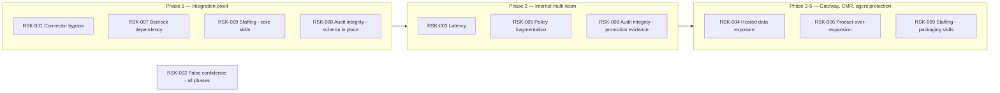
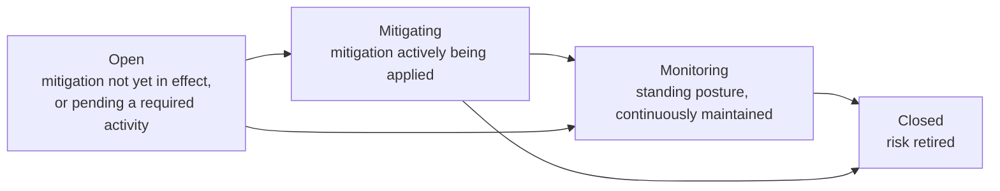

**AI Guardrails — Risk Register**

**Authority level:** L2
**Status:** Draft
**Date:** 2026-07-24
**Derived from:** AGREEMENTS.md

---

## Purpose and scope

This is the governance-owned, fuller risk register that [`30-executive/RISKS-AND-DEPENDENCIES.md`](../30-executive/RISKS-AND-DEPENDENCIES.md) and [`50-architecture/FEASIBILITY-ASSESSMENT.md`](../50-architecture/FEASIBILITY-ASSESSMENT.md) both anticipate and link to. Where those documents summarize risk for an executive or feasibility audience, this register is the single place status, ownership, and mitigation state are tracked for every named risk across the program's life.

This document is **L2 — derived, governance-authoritative for risk tracking**. It must not contradict [`AGREEMENTS.md`](../00-source-of-truth/AGREEMENTS.md) or [`CONSTRAINTS.md`](../00-source-of-truth/CONSTRAINTS.md) (both L1). Where a risk here touches an accepted agreement or constraint, that AGR/CON entry is cited and wins in the event of any apparent conflict. Unvalidated beliefs a mitigation depends on are tracked in full in [`ASSUMPTIONS.md`](../00-source-of-truth/ASSUMPTIONS.md) and cited by ID (`ASM-NNN`).

This register covers:

* The **six risks named explicitly in the charter** ([original charter §20](../00-source-of-truth/PROVENANCE.md#3-section-by-section-map)): connector bypass, false confidence, latency, hosted data exposure, policy fragmentation, and product over-expansion.
* **Three additional delivery and security risks** not given their own heading in [original charter §20](../00-source-of-truth/PROVENANCE.md#3-section-by-section-map) but grounded in other charter sections, the accepted agreements, and the constraint register: Bedrock vendor dependency, audit-integrity failure, and staffing/skills gap.

No dollar figures, probabilities, dates, or SLA numbers are stated for any risk below unless the source material or an accepted agreement already supplies one. Where a number would normally appear, it is marked **TBD**, consistent with source-of-truth policy across this document set.

---

## Table of contents

- [1. How to read this register](#1-how-to-read-this-register)
- [2. Risk register](#2-risk-register)
- [3. Risk detail](#3-risk-detail)
- [4. Where each risk bites hardest](#4-where-each-risk-bites-hardest)
- [5. Review cadence and lifecycle](#5-review-cadence-and-lifecycle)
- [Related documents](#related-documents)

---

## 1. How to read this register

| Field | Meaning |
|---|---|
| **ID** | Stable identifier, `RSK-NNN`, referenced by other documents. New risks discovered during delivery are appended with the next sequential ID — existing IDs are never renumbered or reused. |
| **Risk** | Short name of the risk. |
| **Category** | The governance domain the risk sits in (trust/enforcement, data protection, policy governance, vendor dependency, audit/compliance, delivery/resourcing, scope discipline, performance). |
| **Likelihood** | A qualitative judgment (**High / Medium / Low**) grounded in the source material, not a modeled probability — none exists yet in the source material (see [`ASSUMPTIONS.md`](../00-source-of-truth/ASSUMPTIONS.md)). |
| **Impact** | A qualitative judgment (**High / Medium / Low**) of consequence to the program if the risk materializes and is not mitigated — again qualitative, not a dollar or SLA figure. |
| **Mitigation** | The load-bearing mitigation(s) from [original charter §20](../00-source-of-truth/PROVENANCE.md#3-section-by-section-map), an accepted agreement, or a constraint. Full mitigation lists are in [Section 3](#3-risk-detail). |
| **Owner** | The accountable role, using role names consistent with [`AGREEMENTS.md`](../00-source-of-truth/AGREEMENTS.md) §21 (Ownership boundaries) and [`TEAM-AND-OWNERSHIP.md`](../60-delivery/TEAM-AND-OWNERSHIP.md). |
| **Status** | Current mitigation state: **Open** (mitigation not yet in effect or pending a required activity), **Mitigating** (mitigation partially applied / actively in progress), **Monitoring** (mitigation is a standing posture that must be continuously maintained, not a one-time fix), or **Closed** (risk retired — none are closed as of this draft). |

Likelihood and impact ratings in this register are governance judgments made against the source material as it stands today (AGREEMENTS.md, CONSTRAINTS.md, ASSUMPTIONS.md, and the FEASIBILITY-ASSESSMENT.md). They are not derived from incident history, modeled failure rates, or a quantified risk-scoring methodology, because none exists yet for this program. They should be revisited — and may change — once the proofs of concept in [`FEASIBILITY-ASSESSMENT.md` §4](../50-architecture/FEASIBILITY-ASSESSMENT.md#4-required-proofs-of-concept) produce real data.

---

## 2. Risk register

| ID | Risk | Category | Likelihood | Impact | Mitigation | Owner | Status |
|---|---|---|---|---|---|---|---|
| **RSK-001** | **Connector bypass** — a consuming team removes, disables, or misconfigures its LiteLLM connector, since a cooperative connector is not a hard security boundary. | Trust & enforcement | Medium | High | Match enforcement posture to trust level: cooperative onboarding for trusted teams now; configuration validation; managed-gateway deployment; restricted model credentials; IAM/network enforcement once bypass prevention is a formal requirement. | Security and governance lead | Monitoring |
| **RSK-002** | **False confidence** — teams interpret successful guardrail evaluation as complete AI security, or as authorization to act. | Governance / product positioning | Medium | High | Clearly separate content evaluation, authorization, data isolation, and application security in every product and sales statement; document unsupported risk categories; maintain risk-specific evaluation datasets; never market guardrails as a complete security boundary. | Product lead / Security and governance lead | Monitoring |
| **RSK-003** | **Latency** — synchronous input/output evaluation adds network and processing delay to every request. | Performance / technical | High | Medium | Measure per-evaluator latency; apply only relevant evaluators; support local deterministic checks; route latency-sensitive workloads to Customer-Managed Runtime; define stage-specific timeouts. | Technical lead / Architecture lead | Open |
| **RSK-004** | **Hosted data exposure** — Remote Evaluation and Guarded Gateway modes transmit tenant prompts and responses to the hosted runtime. | Data protection / security | High | High | Explicit data-flow documentation per deployment; no raw-content retention by default; regional deployments; private connectivity when justified; Customer-Managed Runtime for content that must stay in-account. | Security and governance lead / Architecture lead | Monitoring |
| **RSK-005** | **Policy fragmentation** — excessive workload-specific policy overrides erode organizational consistency. | Policy governance | Medium | Medium | Limit override categories; require named ownership for every exception; version policy packs; track effective policy per workload. | Policy owner / Security and governance lead | Open |
| **RSK-006** | **Product over-expansion** — the platform absorbs gateway management, full AI governance, authorization, agent orchestration, or compliance certification before the core hypothesis is validated. | Scope discipline | Medium | High | Hold the five-phase sequencing and the [`SCOPE.md`](../10-charter/SCOPE.md) product-category exclusions strictly; treat every later-phase capability as gated on validation of the preceding phase; route any scope change through an explicit decision (DEC-008); measure adoption and policy effectiveness before expanding scope. | Product lead / Delivery lead | Monitoring |
| **RSK-007** | **Bedrock vendor dependency** — the product's first and only evaluation engine is a single-vendor managed service whose response format, regional availability, and feature parity are outside the platform's control. | Vendor / technical dependency | Medium | High | Normalize Bedrock-specific responses into the platform's own decision structure via an adapter before reaching policies, connectors, or audit records; keep the public contract vendor-independent; design additional evaluation engines to plug into the same adapter pattern; verify regional availability before architecture sign-off; never describe Bedrock Guardrails as the product's permanent or exclusive detection engine. | Technical lead / Architecture lead | Open |
| **RSK-008** | **Audit-integrity failure** — audit events are lost, delayed, tampered with, or delivered without required fields, undermining the evidentiary basis for enforcement, compliance, and policy-effectiveness claims. | Audit & compliance | Low | High | Explicit, mandatory audit-metadata schema (tenant, workload, policy version, stage, decision, reason codes, evaluator versions, timestamp, correlation ID, raw-content-retention flag); KMS encryption of audit buffers and archives; a named, non-silent failure-behavior path for audit-delivery failure; audit delivery success rate tracked as a reliability metric; never rely on connector telemetry alone as enforcement evidence. | Security and governance lead / Technical lead | Open |
| **RSK-009** | **Staffing / skills gap** — the delivery team lacks, or has not confirmed it has, the AWS, Bedrock Guardrails, LiteLLM, and policy/contract-design skills the Phase 1–2 core architecture requires. | Delivery / resourcing | Medium | Medium | Run an explicit skills-gap assessment against the [`DEPLOYMENT-ARCHITECTURE.md`](../50-architecture/DEPLOYMENT-ARCHITECTURE.md) service list before Phase 1 planning is finalized; confirm funding commitment through Phase 1–2; simplify service choices toward tooling the team already knows if gaps are found; defer Phase-4-specific skills (Helm, ECS packaging) until Phase 4 is resourced. | Technical lead / Platform operations lead | Open |
| **RSK-010** | **Guardrail catalog misread as commitment / taxonomy drift** — the eighteen-category catalog (AGR-021) is read externally or internally as delivered or committed coverage, or its statuses drift from the capability registers. | Scope discipline / claims | Medium | Medium | Four-value status vocabulary on every catalog entry; Path A change control on categories and statuses; the dedicated Not-approved claims row ("covers all guardrail categories"); catalog↔CAPABILITIES consistency review at every graduation; out-of-boundary entries carry a named external owner and are never phrased as future work. | Product lead / Security and governance lead | Monitoring |

---

## 3. Risk detail

### RSK-001 — Connector bypass

**What can go wrong.** In the cooperative-integration posture, the consuming team installs and maintains its own connector. The connector can be disabled, removed, or misconfigured, and [AGR-018](../00-source-of-truth/AGREEMENTS.md#agr-018--trust-and-enforcement-model) is explicit that a cooperative connector "must not be represented as a hard security boundary." This posture is appropriate only while teams are trusted, guardrails are treated as an engineering standard rather than a formal control, and bypass prevention is not yet a compliance requirement.

**Mitigation, by trust level ([original charter §20](../00-source-of-truth/PROVENANCE.md#3-section-by-section-map); [AGR-018](../00-source-of-truth/AGREEMENTS.md#agr-018--trust-and-enforcement-model)):**

* Cooperative onboarding for trusted teams (current default posture, Phases 1–2).
* Configuration validation.
* Managed gateway deployment (platform-managed enforcement, [AGR-018](../00-source-of-truth/AGREEMENTS.md#agr-018--trust-and-enforcement-model)).
* Restricted model credentials.
* IAM and network enforcement for environments where bypass prevention is a formal requirement (network/IAM-enforced gateway, [AGR-018](../00-source-of-truth/AGREEMENTS.md#agr-018--trust-and-enforcement-model)) — not required for the initial cooperative phases (Phases 1–2).

**Standing discipline.** Each workload's enforcement posture must be recorded and visible, never assumed ([AGR-018](../00-source-of-truth/AGREEMENTS.md#agr-018--trust-and-enforcement-model)); sales and executive materials must never claim bypass-proof enforcement for cooperative-mode deployments. This is why status is **Monitoring** rather than a one-time fix: the mitigation is a matched posture per workload, re-evaluated as trust levels change, not a control that is installed once.

---

### RSK-002 — False confidence

**What can go wrong.** Teams may treat a successful guardrail evaluation as proof of complete AI security, or treat a guardrail's "this looks safe" decision as authorization to execute a tool call. [AGR-010](../00-source-of-truth/AGREEMENTS.md#agr-010--guardrails-are-not-authorization) is explicit that guardrails are not authorization: a guardrail may determine content or a tool call appears safe without determining whether the current user is permitted to execute that action against a given resource. [AGR-010](../00-source-of-truth/AGREEMENTS.md#agr-010--guardrails-are-not-authorization) makes this a standing agreement, not just a risk note.

**Mitigation ([original charter §20](../00-source-of-truth/PROVENANCE.md#3-section-by-section-map); AGR-010):**

* Clearly separate content evaluation, authorization, data isolation, and application security in every product and sales statement.
* Document unsupported risk categories rather than implying complete coverage.
* Maintain risk-specific evaluation datasets to demonstrate what is and is not detected.
* Never market guardrails as a complete security boundary.
* The consuming application remains fully responsible for authentication, business authorization, tenant isolation, resource ownership, transaction limits, and approval workflows ([AGR-010](../00-source-of-truth/AGREEMENTS.md#agr-010--guardrails-are-not-authorization)).

**Where the gap is widest.** [AGR-010](../00-source-of-truth/AGREEMENTS.md#agr-010--guardrails-are-not-authorization) excludes tool and agent authorization from current guardrail scope entirely (tool-call validation arrives no earlier than Phase 5), so the gap between "evaluated" and "authorized" is largest exactly where agentic, tool-calling workloads are most tempted to assume coverage. This risk sharpens, rather than diminishes, as agentic use cases grow — it is tracked as **Monitoring** because the mitigation is a continuous communication and documentation discipline, not a feature to be built once.

---

### RSK-003 — Latency

**What can go wrong.** Remote input and output evaluation (Modes A and B) adds synchronous network and processing latency to every evaluated request, sitting directly on the consuming application's request path.

**Mitigation ([original charter §20](../00-source-of-truth/PROVENANCE.md#3-section-by-section-map); [`OPERABILITY.md`](../50-architecture/OPERABILITY.md)):**

* Measure per-evaluator latency (P50/P95/P99, per [`NON-FUNCTIONAL-REQUIREMENTS.md`](../50-architecture/NON-FUNCTIONAL-REQUIREMENTS.md)).
* Apply only the evaluators relevant to a given policy and stage.
* Support local deterministic checks that do not require a network round trip.
* Route latency-sensitive workloads to Customer-Managed Runtime (Mode C), which avoids the hosted network hop by design.
* Define stage-specific timeouts as part of the workload's failure behavior ([AGR-012](../00-source-of-truth/AGREEMENTS.md#agr-012--failure-behavior-is-part-of-policy); [CON-016](../00-source-of-truth/CONSTRAINTS.md#con-016--timeout-limits)).

**Why status is Open, not Monitoring.** No numeric latency budget exists yet in the source material ([ASM-011](../00-source-of-truth/ASSUMPTIONS.md#c-performance-and-operational-nfr-assumptions)). [`FEASIBILITY-ASSESSMENT.md` PoC 2](../50-architecture/FEASIBILITY-ASSESSMENT.md#poc-2--per-evaluator-latency-measurement) is the mechanism that will produce the first real per-evaluator numbers; until that runs, the mitigation cannot be confirmed as sufficient, only as directionally correct.

---

### RSK-004 — Hosted data exposure

**What can go wrong.** Remote Evaluation (Mode A) and Guarded Gateway (Mode B) both transmit tenant prompts, responses, and any additional evaluated content to a provider-operated runtime by construction. Per [AGR-009](../00-source-of-truth/AGREEMENTS.md#agr-009--remote-evaluation-is-not-a-private-data-or-data-local-model), Mode A in particular must never be described as a private-data or data-local model — content still reaches the hosted Evaluation API.

**Mitigation ([original charter §20](../00-source-of-truth/PROVENANCE.md#3-section-by-section-map); [AGR-008](../00-source-of-truth/AGREEMENTS.md#agr-008--explicit-content-exposure-model-ownership-vs-exposure-are-separate-concerns), [AGR-014](../00-source-of-truth/AGREEMENTS.md#agr-014--no-raw-promptresponse-retention-by-default), [CON-007](../00-source-of-truth/CONSTRAINTS.md#con-007--explicit-content-exposure-documentation-per-deployment), [CON-014](../00-source-of-truth/CONSTRAINTS.md#con-014--no-raw-content-retention-by-default-in-the-hosted-runtime)):**

* Explicit data-flow documentation per deployment mode — where prompts and responses are processed, what is transmitted, what is persisted.
* No raw-content retention by default in the hosted runtime; decision metadata only, with hashed identifiers where possible.
* Regional deployments, chosen deliberately rather than defaulted.
* Private connectivity when justified by a customer's risk profile.
* Customer-Managed Runtime (Mode C) offered as the option that keeps raw content in-account by default.

**Standing discipline.** Operational ownership and data exposure must always be communicated as separate concerns ([AGR-008](../00-source-of-truth/AGREEMENTS.md#agr-008--explicit-content-exposure-model-ownership-vs-exposure-are-separate-concerns)) — reduced operational ownership must never be implied to mean reduced data exposure. Status is **Monitoring** because this discipline must hold for every new deployment and every new piece of sales or product collateral, not just at initial launch.

---

### RSK-005 — Policy fragmentation

**What can go wrong.** As more workloads onboard, workload-specific policy overrides can accumulate to the point that "one reusable policy" (the core reusable-policy hypothesis, [`SUCCESS-CRITERIA.md`](../10-charter/SUCCESS-CRITERIA.md)) becomes fiction in practice — every workload effectively runs its own policy variant.

**Mitigation ([original charter §20](../00-source-of-truth/PROVENANCE.md#3-section-by-section-map)):**

* Limit override categories rather than allowing arbitrary per-workload customization.
* Require named ownership for every exception granted.
* Version policy packs so that drift is visible and traceable.
* Track effective policy per workload so the actual (not nominal) policy in force is always knowable.

**Why status is Open.** Which override categories (if any) workloads may request against a shared policy has not yet been decided ([`FEASIBILITY-ASSESSMENT.md` §12, blocking decision 8](../50-architecture/FEASIBILITY-ASSESSMENT.md#12-blocking-decisions); [ASM-018](../00-source-of-truth/ASSUMPTIONS.md#e-security-compliance-and-policy-governance-assumptions)). This risk scales with the number of onboarded workloads and active bindings, so it becomes materially more acute from Phase 2 onward as onboarding volume grows.

---

### RSK-006 — Product over-expansion

**What can go wrong.** The solution may attempt to absorb gateway management, a complete AI governance platform, authorization, fully autonomous agent governance, or full compliance certification before the core reusable-policy hypothesis ([`SUCCESS-CRITERIA.md`](../10-charter/SUCCESS-CRITERIA.md)) has been validated — all of which are standing product-category exclusions ([`SCOPE.md`](../10-charter/SCOPE.md)), reaffirmed by [DEC-008](../00-source-of-truth/DECISIONS.md#dec-008--supersede-the-mvp-bounded-scope-define-and-estimate-the-full-feature-set-across-five-phases).

**Mitigation ([original charter §20](../00-source-of-truth/PROVENANCE.md#3-section-by-section-map); [`SCOPE.md`](../10-charter/SCOPE.md) exclusions; [AGR-020](../00-source-of-truth/AGREEMENTS.md#agr-020--five-phase-delivery); [DEC-008](../00-source-of-truth/DECISIONS.md#dec-008--supersede-the-mvp-bounded-scope-define-and-estimate-the-full-feature-set-across-five-phases) scope-change governance):**

* Maintain the five-phase sequencing and the [`SCOPE.md`](../10-charter/SCOPE.md) product-category exclusions; any proposed scope change requires an explicit recorded decision (per DEC-008's governance), not silent inclusion.
* Treat every later-phase capability ([`SCOPE.md`](../10-charter/SCOPE.md)) as gated on validation of the preceding phase (AGR-020) — Phase 5 (advanced agent protection) in particular must not be pulled forward ahead of its phase.
* Measure adoption and policy effectiveness ([`SUCCESS-CRITERIA.md`](../10-charter/SUCCESS-CRITERIA.md)) before expanding scope.

**Standing discipline.** This is a leadership discipline as much as a delivery one: the mitigation depends on stakeholders consistently declining to pull later-phase scope forward under pressure ([ASM-015](../00-source-of-truth/ASSUMPTIONS.md#d-budget-and-delivery-sequencing-assumptions)). Status is **Monitoring** — it is a phase-boundary review responsibility rather than a task that completes once.

**Relationship to the guardrail-category catalog.** The catalog ([`../20-product/GUARDRAIL-CATALOG.md`](../20-product/GUARDRAIL-CATALOG.md), per [AGR-021](../00-source-of-truth/AGREEMENTS.md#agr-021--guardrail-category-taxonomy-and-extension-model) and [DEC-009](../00-source-of-truth/DECISIONS.md#dec-009--adopt-the-guardrail-category-catalog-as-directional-vision)) is a mitigation **channel** for this risk: expansion ideas are parked as `Vision — uncommitted` entries instead of entering the roadmap, and can only become scope through the recorded graduation process ([`../50-architecture/EXTENSIBILITY-ARCHITECTURE.md`](../50-architecture/EXTENSIBILITY-ARCHITECTURE.md) §10). The catalog's own failure mode — being misread as commitment — is tracked separately as [RSK-010](#rsk-010--guardrail-catalog-misread-as-commitment--taxonomy-drift).

---

### RSK-007 — Bedrock vendor dependency

**What can go wrong.** Amazon Bedrock Guardrails is adopted as the platform's first and, in Phases 1–2, only managed evaluation engine ([`DEPLOYMENT-ARCHITECTURE.md`](../50-architecture/DEPLOYMENT-ARCHITECTURE.md), [AGR-001](../00-source-of-truth/AGREEMENTS.md#agr-001--standalone-platform-not-embedded-in-the-internal-litellm)). This creates two related exposures: (1) a functional dependency — if Bedrock Guardrails is unavailable or feature-limited in the organization's target Region, the adapter cannot be used as designed ([ASM-008](../00-source-of-truth/ASSUMPTIONS.md#b-technical-and-infrastructure-feasibility)); and (2) a contract-coupling risk — if Bedrock's response format leaks into the public evaluation contract, the platform loses the vendor independence [AGR-004](../00-source-of-truth/AGREEMENTS.md#agr-004--bedrock-guardrails-as-first-engine-vendor-independent-contract) and [CON-004](../00-source-of-truth/CONSTRAINTS.md#con-004--no-coupling-to-bedrock-guardrails-response-formats) require.

**Mitigation:**

* Normalize every Bedrock-specific response field (category, confidence/severity, filtered content, action taken) into the platform's own decision structure via an adapter, before it reaches any policy, connector, or audit record ([CON-004](../00-source-of-truth/CONSTRAINTS.md#con-004--no-coupling-to-bedrock-guardrails-response-formats)).
* Design the adapter pattern so additional evaluation engines (deterministic rules already in Phase 1–2 scope; future third-party engines) can be added without changing policy semantics ([AGR-004](../00-source-of-truth/AGREEMENTS.md#agr-004--bedrock-guardrails-as-first-engine-vendor-independent-contract)).
* Verify Bedrock Guardrails' regional availability and feature parity in the organization's target deployment Region(s) before architecture sign-off ([ASM-008](../00-source-of-truth/ASSUMPTIONS.md#b-technical-and-infrastructure-feasibility); [`FEASIBILITY-ASSESSMENT.md` PoC 3](../50-architecture/FEASIBILITY-ASSESSMENT.md#poc-3--bedrock-guardrails-adapter-mapping)).
* Never describe Bedrock Guardrails, in marketing or technical documentation, as the product's permanent or exclusive detection engine ([AGR-004](../00-source-of-truth/AGREEMENTS.md#agr-004--bedrock-guardrails-as-first-engine-vendor-independent-contract)).

**Why this is tracked separately from "Hosted data exposure."** RSK-004 is about *where content goes*; RSK-007 is about *what happens if the single detection engine the early phases depend on is unavailable, feature-limited, or its output shape is allowed to leak into the contract*. [`FEASIBILITY-ASSESSMENT.md` §1](../50-architecture/FEASIBILITY-ASSESSMENT.md#1-overall-assessment) names this normalization work as "a real design risk, not just an execution risk," because Phase 1 will design the adapter against only one evaluation engine. Status is **Open** pending PoC 3.

---

### RSK-008 — Audit-integrity failure

**What can go wrong.** The platform's evidentiary claims — that a policy was applied, that a decision was made for a stated reason, that enforcement actually occurred — all depend on audit records being complete, accurate, and delivered. Audit-event integrity is named directly as a security requirement ([`CONSTRAINTS.md`](../00-source-of-truth/CONSTRAINTS.md)), and audit delivery success rate is tracked as a reliability success metric ([`SUCCESS-CRITERIA.md`](../10-charter/SUCCESS-CRITERIA.md)). If audit events are lost, delayed past a usable window, delivered without required fields, or delivered from an untrustworthy pipeline, the platform cannot substantiate its own decision history to security, compliance, or leadership.

**Mitigation:**

* A mandatory audit-metadata schema — tenant, workload, policy version, evaluation stage, decision, reason codes, evaluator versions, timestamp, correlation identifier, and whether raw content was retained ([`NON-FUNCTIONAL-REQUIREMENTS.md`](../50-architecture/NON-FUNCTIONAL-REQUIREMENTS.md); [`OPERABILITY.md` §5](../50-architecture/OPERABILITY.md#5-auditing-metadata)) — applied to every evaluation regardless of outcome.
* KMS encryption in transit and at rest for audit event buffers (Amazon SQS) and archives (Amazon S3) ([CON-009](../00-source-of-truth/CONSTRAINTS.md#con-009--kms-encryption-in-transit-and-at-rest); [`DEPLOYMENT-ARCHITECTURE.md`](../50-architecture/DEPLOYMENT-ARCHITECTURE.md)).
* An explicit, named failure-behavior path for audit-delivery failure specifically — "allow and log" or "block the request," depending on audit criticality — rather than silent event loss ([AGR-012](../00-source-of-truth/AGREEMENTS.md#agr-012--failure-behavior-is-part-of-policy); [`OPERABILITY.md` §7](../50-architecture/OPERABILITY.md#7-failure-behavior-is-explicit--no-undocumented-fallback)).
* Audit delivery success rate tracked as a first-class reliability metric, not inferred ([`SUCCESS-CRITERIA.md`](../10-charter/SUCCESS-CRITERIA.md)).
* Never rely on connector telemetry alone as evidence of mandatory enforcement ([CON-012](../00-source-of-truth/CONSTRAINTS.md#con-012--no-exclusive-reliance-on-weak-security-proxies); [AGR-018](../00-source-of-truth/AGREEMENTS.md#agr-018--trust-and-enforcement-model)) — audit records, not telemetry, are the evidentiary source of truth.

**Why likelihood is rated Low but impact High.** No individual mechanism above is novel — SQS-to-S3 buffered delivery, KMS encryption, and structured audit schemas are all mature, well-understood patterns ([`FEASIBILITY-ASSESSMENT.md` §2](../50-architecture/FEASIBILITY-ASSESSMENT.md#2-confirmed-capabilities)). What is not yet proven is that the runtime *actually enforces* the configured failure-behavior path under real induced failure, rather than merely documenting it — this is precisely what [`FEASIBILITY-ASSESSMENT.md` PoC 5](../50-architecture/FEASIBILITY-ASSESSMENT.md#poc-5--failure-policy-behavior-under-timeout) is designed to confirm. If audit integrity fails, the consequence is high: every downstream claim about policy effectiveness, enforcement posture, and compliance evidence ([`TARGET-USERS.md`](../20-product/TARGET-USERS.md), security and compliance team needs) becomes unsubstantiated. Status is **Open** pending PoC 5.

---

### RSK-009 — Staffing / skills gap

**What can go wrong.** The Phase 1–2 core architecture requires a conventional AWS platform-engineering skill set (ECS Fargate or EKS, API Gateway/ALB, DynamoDB, IAM, KMS, SQS, S3, CloudWatch, ECR — [`DEPLOYMENT-ARCHITECTURE.md`](../50-architecture/DEPLOYMENT-ARCHITECTURE.md)) plus working familiarity with Bedrock Guardrails and LiteLLM's hook architecture specifically, and API/contract-design discipline sufficient to hold a vendor-neutral evaluation contract stable across all three deployment modes ([AGR-006](../00-source-of-truth/AGREEMENTS.md#agr-006--one-logical-evaluation-contract-across-all-modes)). Whether the current delivery team already has this skill set — not what skills are needed — is the open question ([ASM-007](../00-source-of-truth/ASSUMPTIONS.md#b-technical-and-infrastructure-feasibility)).

**Mitigation:**

* Run an explicit skills-gap assessment against the [`DEPLOYMENT-ARCHITECTURE.md`](../50-architecture/DEPLOYMENT-ARCHITECTURE.md) service list before Phase 1 planning is finalized ([ASM-007](../00-source-of-truth/ASSUMPTIONS.md#b-technical-and-infrastructure-feasibility); [`FEASIBILITY-ASSESSMENT.md` §9](../50-architecture/FEASIBILITY-ASSESSMENT.md#9-skills-and-staffing-requirements)).
* Confirm budget is sufficient to fund the delivery team through Phase 1–2, not just infrastructure spend ([ASM-014](../00-source-of-truth/ASSUMPTIONS.md#d-budget-and-delivery-sequencing-assumptions)).
* If gaps are found, simplify service choices toward tooling the team already knows, rather than defaulting to external hiring or contracting as the first response.
* Defer Phase-4-specific skills — container packaging, Helm charts, ECS deployment templates for the Customer-Managed Runtime — until Phase 4 is actually resourced, rather than staffing for them upfront ([`FEASIBILITY-ASSESSMENT.md` §9](../50-architecture/FEASIBILITY-ASSESSMENT.md#9-skills-and-staffing-requirements)).

**Why this is a named risk distinct from ordinary delivery risk.** A poorly designed first evaluation contract is expensive to fix once connectors already depend on it ([`FEASIBILITY-ASSESSMENT.md` §9](../50-architecture/FEASIBILITY-ASSESSMENT.md#9-skills-and-staffing-requirements)), so contract/API design skill specifically — not just AWS operating skill — is called out as load-bearing. Status is **Open** pending the skills-gap assessment.

---

### RSK-010 — Guardrail catalog misread as commitment / taxonomy drift

**What can go wrong.** The guardrail-category catalog ([`../20-product/GUARDRAIL-CATALOG.md`](../20-product/GUARDRAIL-CATALOG.md), `GR-001`–`GR-018`, adopted as directional vision by [AGR-021](../00-source-of-truth/AGREEMENTS.md#agr-021--guardrail-category-taxonomy-and-extension-model)/[DEC-009](../00-source-of-truth/DECISIONS.md#dec-009--adopt-the-guardrail-category-catalog-as-directional-vision)) deliberately describes far more than the product delivers. Two failure modes follow: (1) **misreading** — a stakeholder, sales conversation, or derived document treats a `Vision — uncommitted` or `Out-of-boundary` entry as delivered or planned capability, recreating the false-confidence risk (RSK-002) at catalog scale and violating the claims discipline; (2) **drift** — catalog statuses quietly diverge from [`CAPABILITIES.md`](../20-product/CAPABILITIES.md)/[`REQUIREMENTS.md`](../50-architecture/REQUIREMENTS.md), or an out-of-boundary entry's wording softens toward "future work," contradicting [`SCOPE.md`](../10-charter/SCOPE.md) and [AGR-010](../00-source-of-truth/AGREEMENTS.md#agr-010--guardrails-are-not-authorization).

**Mitigation:**

* Every catalog entry carries one of exactly four statuses (`Core (Phases 1–2)` / `Later phase — committed` / `Vision — uncommitted` / `Out-of-boundary → owner`); status changes are register-level (Path A) changes, never editorial edits ([`DOCUMENT-GOVERNANCE.md`](DOCUMENT-GOVERNANCE.md) §6).
* The dedicated **Not-approved** claims row — "covers all eighteen guardrail categories / complete AI-risk coverage" ([`CLAIMS-REGISTER.md`](CLAIMS-REGISTER.md) §7) — polices the external form; the approved substitute wording uses the "architecture permits — but does not yet deliver" framing only.
* Out-of-boundary entries name an external owner (the catalog's out-of-boundary and exclusion map) and have no graduation path; re-scoping one requires amending the underlying exclusion, not editing the catalog.
* Catalog↔CAPABILITIES consistency is re-checked at every graduation exercise, in the same change set ([`../50-architecture/EXTENSIBILITY-ARCHITECTURE.md`](../50-architecture/EXTENSIBILITY-ARCHITECTURE.md) §10); the technical form of this risk is tracked as [`TECHNICAL-RISKS.md`](../50-architecture/TECHNICAL-RISKS.md) §4.9.

**Standing discipline.** Like RSK-006, this is a review posture, not a completable task: no mechanism prevents a derived-document edit from softening a status's wording without technically changing it, so periodic claims-register review is the standing detection mechanism. Status is **Monitoring**.

---

## 4. Where each risk bites hardest

Risk exposure is not uniform across the three deployment modes or the five delivery phases. This view is qualitative and intended to guide *when* a mitigation must be operational, not to rank risks by severity.

| Risk | Most acute in | Why |
|---|---|---|
| RSK-001 Connector bypass | Mode A, cooperative posture, Phases 1–2 | Cooperative integration is the only posture in scope before an external-customer or compliance trigger is identified ([AGR-018](../00-source-of-truth/AGREEMENTS.md#agr-018--trust-and-enforcement-model)). |
| RSK-002 False confidence | All modes; sharpens with agentic/tool-call use cases | Tool and agent authorization is excluded from current scope entirely ([AGR-010](../00-source-of-truth/AGREEMENTS.md#agr-010--guardrails-are-not-authorization)), widening the "evaluated" vs. "authorized" gap fastest where agentic workloads assume coverage. |
| RSK-003 Latency | Mode A and Mode B (any hosted, synchronous evaluation path) | Mode C avoids the network hop to a hosted service by design; Modes A and B do not. |
| RSK-004 Hosted data exposure | Mode A and Mode B | Both transmit tenant content to a provider-operated boundary by construction ([AGR-009](../00-source-of-truth/AGREEMENTS.md#agr-009--remote-evaluation-is-not-a-private-data-or-data-local-model)); only Mode C keeps content local by default. |
| RSK-005 Policy fragmentation | Phase 2 onward, as onboarded-workload count grows | Risk scales with the number of workload-specific bindings and overrides in active use. |
| RSK-006 Product over-expansion | Phase 3–5 scope decisions | Highest at each phase boundary, where Phase 5 or other later-phase items could be pulled forward under stakeholder pressure ([AGR-020](../00-source-of-truth/AGREEMENTS.md#agr-020--five-phase-delivery)). |
| RSK-007 Bedrock vendor dependency | Phase 1 (adapter design) and any future Region-expansion decision | The adapter is designed against only one evaluation engine during Phase 1; a Region-expansion or second-engine decision is when the vendor-independence commitment is next tested. |
| RSK-008 Audit-integrity failure | All modes and phases; sharpens at Observe→Enforce promotion and at any external-customer or compliance sign-off | Audit evidence is what security/compliance review and the observe-before-enforce promotion decision ([AGR-011](../00-source-of-truth/AGREEMENTS.md#agr-011--observe-before-enforce-progression)) both depend on. |
| RSK-009 Staffing/skills gap | Phase 1 kickoff (core AWS/Bedrock/LiteLLM skills) and Phase 4 resourcing (packaging-specific skills) | Core skills gate the start of build work; packaging-specific skills (Helm, ECS templates) are a distinct, later gate for Customer-Managed Runtime. |

---

## 5. Review cadence and lifecycle

Every risk in this register is reviewed at each phase gate defined in [AGR-020](../00-source-of-truth/AGREEMENTS.md#agr-020--five-phase-delivery) and [AGR-020](../00-source-of-truth/AGREEMENTS.md#agr-020--five-phase-delivery). A risk's status changes only through this cycle:

* A risk moves to **Monitoring** only when its mitigation is a standing posture that must be continuously maintained (for example, RSK-001, RSK-002, RSK-004, RSK-006) rather than a one-time engineering task.
* A risk remains **Open** while a specific, named activity — a proof of concept, a skills-gap assessment, a policy decision on override categories — has not yet run. Section 3 above names the specific activity for each currently open risk.
* No risk in this register is **Closed** as of this draft. A risk should be closed only when its mitigating activity has run, its outcome is recorded against the linked [`ASSUMPTIONS.md`](../00-source-of-truth/ASSUMPTIONS.md) entry (where one exists), and the change is reflected in this register with a dated update.
* New risks discovered during delivery are appended with the next sequential `RSK-NNN` ID, never inserted by renumbering existing entries.

Ownership of moving a risk through this lifecycle sits with the **Owner** named in Section 2. Where a risk's mitigation depends on an unvalidated belief, that dependency is named explicitly in Section 3 by its `ASM-NNN` ID so that refuting the assumption automatically reopens the linked risk for review.

---

## Related documents

* [`00-source-of-truth/AGREEMENTS.md`](../00-source-of-truth/AGREEMENTS.md) — authoritative agreement register (L1); cited throughout for the mitigations each risk depends on.
* [`00-source-of-truth/CONSTRAINTS.md`](../00-source-of-truth/CONSTRAINTS.md) — non-negotiable technical and security boundaries (L1) that several mitigations operationalize (CON-004, CON-007, CON-009, CON-012, CON-014).
* [`00-source-of-truth/ASSUMPTIONS.md`](../00-source-of-truth/ASSUMPTIONS.md) — unvalidated beliefs each open risk's mitigation depends on, cited by `ASM-NNN`.
* [`00-source-of-truth/OPEN-QUESTIONS.md`](../00-source-of-truth/OPEN-QUESTIONS.md) — decisions not yet made that could change risk exposure or mitigation timing.
* [`30-executive/RISKS-AND-DEPENDENCIES.md`](../30-executive/RISKS-AND-DEPENDENCIES.md) — the executive-facing summary this register expands; the six charter risks there map directly to RSK-001–RSK-006 here.
* [`30-executive/EXECUTIVE-BRIEF.md`](../30-executive/EXECUTIVE-BRIEF.md) — the primary executive decision document the risk summary supports.
* [`50-architecture/FEASIBILITY-ASSESSMENT.md`](../50-architecture/FEASIBILITY-ASSESSMENT.md) — the proofs of concept (PoC 1–5) and blocking decisions that retire several of the "Open" risks above.
* [`50-architecture/OPERABILITY.md`](../50-architecture/OPERABILITY.md) — the operational contract (failure behavior, auditing metadata, timeouts) that RSK-003 and RSK-008 depend on.
* [`50-architecture/SECURITY-ARCHITECTURE.md`](../50-architecture/SECURITY-ARCHITECTURE.md) — implements the identity, transport, and weak-proxy constraints relevant to RSK-001 and RSK-008.
* [`50-architecture/DATA-ARCHITECTURE.md`](../50-architecture/DATA-ARCHITECTURE.md) — implements the content-exposure and retention constraints relevant to RSK-004.
* [`50-architecture/INTEGRATION-ARCHITECTURE.md`](../50-architecture/INTEGRATION-ARCHITECTURE.md) — implements the vendor-independence contract relevant to RSK-007.
* [`20-product/PRODUCT-ROADMAP.md`](../20-product/PRODUCT-ROADMAP.md) — phase-level roadmap referenced by the RSK-006 mitigation.
* `60-delivery/VALIDATION-PLAN.md` — should incorporate the PoCs that retire RSK-003, RSK-007, RSK-008 as scheduled activities.
* `60-delivery/RELEASE-CRITERIA.md` — should gate phase exit on the mitigation status recorded here.
* [original charter §20](../00-source-of-truth/PROVENANCE.md#3-section-by-section-map) — original charter statement of the six named risks and their full mitigation lists.
