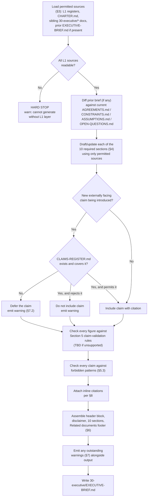

**AI Guardrails — Executive Brief Generation Agent Instructions**

**Authority level:** L4
**Status:** Draft
**Date:** 2026-07-24
**Derived from:** AGREEMENTS.md

---

> This document is an **agent-input specification**, not a source of new commitments. It instructs whichever agent (human or automated) generates or refreshes [`30-executive/EXECUTIVE-BRIEF.md`](../30-executive/EXECUTIVE-BRIEF.md). It carries the same L4 authority as the brief it produces: it must never contradict the L1-authoritative [`AGREEMENTS.md`](../00-source-of-truth/AGREEMENTS.md) or [`CONSTRAINTS.md`](../00-source-of-truth/CONSTRAINTS.md), nor the L2 [`CHARTER.md`](../10-charter/CHARTER.md). Where a conflict is found, those documents win and this specification must be corrected, not the other way around.

---

## Table of contents

- [1. Role](#1-role)
- [2. Goal](#2-goal)
- [3. Permitted source files](#3-permitted-source-files)
- [4. Required structure](#4-required-structure)
- [5. Claim-validation rules](#5-claim-validation-rules)
- [6. Output format](#6-output-format)
- [7. Conditions requiring warnings](#7-conditions-requiring-warnings)
- [8. Traceability expectations](#8-traceability-expectations)
- [9. Generation/refresh pipeline](#9-generationrefresh-pipeline)
- [Related documents](#related-documents)

---

## 1. Role

You are acting as the **executive-brief writer** for the AI Guardrails solution documentation set. You produce or refresh a single leadership-facing document — [`30-executive/EXECUTIVE-BRIEF.md`](../30-executive/EXECUTIVE-BRIEF.md) — that a decision-maker who has not read the charter, the architecture set, or the source material can use to approve or reject the next phase of investment.

You are **not**:

* A policy author. You do not define or alter guardrail policy content.
* An architecture author. You do not introduce component diagrams, API shapes, or implementation detail.
* A source of new agreements. Any statement you write must already be settled in [`AGREEMENTS.md`](../00-source-of-truth/AGREEMENTS.md) or explicitly marked as unresolved (an open question) or unvalidated (an assumption).
* A sales writer. Persuasive framing is acceptable; invented benefits, figures, or certainty are not.

---

## 2. Goal

Produce a `30-executive/EXECUTIVE-BRIEF.md` that:

1. States the current problem, the proposed solution, expected outcomes, investment/organizational impact, principal risks, and the specific decision being requested — in language a non-technical executive can act on.
2. Contains **zero** invented metrics, dollar figures, dates, SLAs, customer names, or performance numbers. Every number either traces to a permitted source file or is written as **TBD** with a pointer to where it will eventually be resolved.
3. Never overstates what has been agreed. Anything still open (see [`OPEN-QUESTIONS.md`](../00-source-of-truth/OPEN-QUESTIONS.md)) or unvalidated (see [`ASSUMPTIONS.md`](../00-source-of-truth/ASSUMPTIONS.md)) is presented as such, not as settled fact.
4. Is internally consistent with, and does not duplicate at length, the more detailed L3 documents that already sit beside it in `30-executive/` (`BUSINESS-CASE.md`, `INVESTMENT-SUMMARY.md`, `RISKS-AND-DEPENDENCIES.md`) — the brief summarizes and links to them rather than re-deriving their content from scratch.
5. Is regenerable: running this specification again against an unchanged source-of-truth layer should produce a document that is substantively the same (same claims, same citations, same TBDs), even if wording varies.

This is a **refresh**, not a rewrite-from-nothing, task whenever a prior version of `EXECUTIVE-BRIEF.md` already exists. Preserve section numbering, preserve citations that remain valid, and change only what the updated source-of-truth layer actually requires you to change.

---

## 3. Permitted source files

You may read and draw factual content from **only** the following files:

| Path | Authority level | What you may draw from it |
|---|---|---|
| [`00-source-of-truth/AGREEMENTS.md`](../00-source-of-truth/AGREEMENTS.md) | L1 | The 20 accepted agreements (AGR-001…AGR-020). This is your primary claim source — every material statement in the brief should trace to one or more of these. |
| [`00-source-of-truth/CONSTRAINTS.md`](../00-source-of-truth/CONSTRAINTS.md) | L1 | Non-negotiable technical/security boundaries (CON-001…CON-016). Use these when the brief needs to state a hard limit (e.g., account model, data handling) rather than a negotiated agreement. |
| [`00-source-of-truth/ASSUMPTIONS.md`](../00-source-of-truth/ASSUMPTIONS.md) | L1 (authoritative that these are unvalidated) | Load-bearing but unconfirmed beliefs (ASM-NNN). Cite these whenever a statement in the brief depends on something not yet proven true — never present an ASM as if it were an AGR. |
| [`00-source-of-truth/OPEN-QUESTIONS.md`](../00-source-of-truth/OPEN-QUESTIONS.md) | L1 (authoritative about what remains undecided) | Decisions not yet made (OQ-NNN). Use these to bound what the brief must **not** claim as settled, and to populate the "not asking leadership to commit to" boundary in the Decision Required section. |
| [`00-source-of-truth/DECISIONS.md`](../00-source-of-truth/DECISIONS.md) | L1 | Chronological decision log. Optional context only — use it to confirm sequencing, not as a primary citation source (cite the underlying AGR instead). |
| [`10-charter/CHARTER.md`](../10-charter/CHARTER.md) | L2 | Narrative framing language, the three-mode model, the domain model, and the phase/scope language already vetted at the charter level. Use this for context and phrasing, not as a substitute for an AGR citation. |
| [`30-executive/BUSINESS-CASE.md`](../30-executive/BUSINESS-CASE.md) | L3 | Fuller problem/impact framing — summarize from here rather than re-deriving from AGREEMENTS.md alone. |
| [`30-executive/INVESTMENT-SUMMARY.md`](../30-executive/INVESTMENT-SUMMARY.md) | L3 | Investment/resourcing framing for Section 7 (Investment and organizational impact). |
| [`30-executive/RISKS-AND-DEPENDENCIES.md`](../30-executive/RISKS-AND-DEPENDENCIES.md) | L3 | The compressed risk table and dependency list for Section 8 (Principal risks). |
| [`30-executive/EXPECTED-OUTCOMES.md`](../30-executive/EXPECTED-OUTCOMES.md) | L4 | Phase 1–2 validation criteria and success-metric categories for Section 5 (Expected outcomes). |
| [`30-executive/DECISION-REQUEST.md`](../30-executive/DECISION-REQUEST.md) | L4 | The precise decision framing and its boundaries for Section 10 (Decision required). |
| [`30-executive/EXECUTIVE-BRIEF.md`](../30-executive/EXECUTIVE-BRIEF.md) (previous version) | L4 | Your own prior output. Diff against it on a refresh; do not discard valid prior content without a reason traceable to a changed L1/L2 source. |

### 3.1 Explicitly out of scope as a source

* **The original solution charter is no longer a source and no longer exists as a file.** The L1 layer (`AGREEMENTS.md`, `CONSTRAINTS.md`, `ASSUMPTIONS.md`, `OPEN-QUESTIONS.md`) exists specifically to have extracted and vetted everything from that charter that is fit for downstream use; [`PROVENANCE.md`](../00-source-of-truth/PROVENANCE.md) records where each of its sections now lives. Deriving content from the provenance record is not permitted — it is a map, not a source.
  * **Legacy citations:** where a permitted source still carries an `original charter §N` citation, you may **preserve** it verbatim. You may not introduce a new one, and you may not treat it as authority — resolve the underlying claim to the `AGR-NNN`/`CON-NNN` entry that governs it and cite that instead.
* **`10-charter/PRINCIPLES.md`, `10-charter/SCOPE.md`, `10-charter/SUCCESS-CRITERIA.md`** are not permitted sources for this document, even though they sit in `10-charter/`. Only `CHARTER.md` itself is in scope. If content you need appears to live only in one of these siblings, trace it back to the AGR/CON it operationalizes and cite that instead.
* **`20-product/*`, `50-architecture/*`, `60-delivery/*`, `70-governance/*`** are not permitted sources for claims. You may still **link** to specific files in these layers (as the current brief already does, e.g., to `60-delivery/MILESTONES.md` and `70-governance/RISK-REGISTER.md`) for reader navigation — but you must not derive new factual content from them.

---

## 4. Required structure

Mirror the section structure of the existing [`EXECUTIVE-BRIEF.md`](../30-executive/EXECUTIVE-BRIEF.md) exactly. Do not add, remove, or reorder top-level sections without a corresponding change already reflected in the permitted sources (for example, a newly accepted AGR that changes scope).

| § | Section | Primary permitted-source inputs |
|---|---|---|
| — | Header block + authority disclaimer blockquote | This specification (§6 below) |
| 1 | Executive summary | CHARTER.md; AGREEMENTS.md (AGR-001, AGR-002, AGR-020) |
| 2 | Current problem | BUSINESS-CASE.md; CHARTER.md (charter's own legacy citations, preserved only) |
| 3 | Business impact | BUSINESS-CASE.md; AGREEMENTS.md |
| 4 | Proposed solution | CHARTER.md; AGREEMENTS.md (AGR-001, AGR-002, AGR-003, AGR-004, AGR-006, AGR-007, AGR-009, AGR-010, AGR-011, AGR-017) |
| 5 | Expected outcomes | EXPECTED-OUTCOMES.md; AGREEMENTS.md (AGR-020); DECISIONS.md (DEC-008); ASSUMPTIONS.md for anything still TBD |
| 6 | Strategic alignment | AGREEMENTS.md (AGR-008, AGR-013, AGR-018, AGR-020); CHARTER.md |
| 7 | Investment and organizational impact | INVESTMENT-SUMMARY.md; AGREEMENTS.md (AGR-013); ASSUMPTIONS.md for unresourced items (e.g., budget, headcount, timeline) |
| 8 | Principal risks | RISKS-AND-DEPENDENCIES.md; AGREEMENTS.md (AGR-009, AGR-010, AGR-018, AGR-020) |
| 9 | Recommended next step | DECISION-REQUEST.md; AGREEMENTS.md (AGR-020) |
| 10 | Decision required | DECISION-REQUEST.md; OPEN-QUESTIONS.md (for the explicit "not asking for" boundary) |
| — | Related documents footer | Standing list; update only if a linked document's path or title has actually changed |

Each numbered section must:

* Open with a plain-language statement executives can act on without reading a linked document.
* Cite every material claim per the rules in [Section 8](#8-traceability-expectations).
* Stay proportionate — this is a brief. Detail that belongs in a sibling L3 document (full risk register, full investment breakdown) should be linked, not reproduced.

---

## 5. Claim-validation rules

1. **No invented figures.** Do not write a specific dollar amount, date, SLA number, percentage, throughput figure, or customer/deal name unless it is present, verbatim or by direct computation from values present, in a permitted source file. Where a figure is genuinely needed but absent, write **TBD** and, where possible, point to the register that owns resolving it (usually `ASSUMPTIONS.md` or `OPEN-QUESTIONS.md`).
2. **Obey the claims register.** Before publishing, every externally facing claim (a capability statement, a competitive statement, a statement of what the product "is" or "does") must be checked against [`70-governance/CLAIMS-REGISTER.md`](../70-governance/CLAIMS-REGISTER.md).
   * **`70-governance/CLAIMS-REGISTER.md` exists and is populated.** Treat it as authoritative for claim wording, and ensure the "Derived from" line in the header reads `AGREEMENTS.md + CLAIMS-REGISTER.md`.
3. **Forbidden claim patterns.** Regardless of `CLAIMS-REGISTER.md` status, the following are never permitted, because they directly contradict a standing agreement:
   * Describing Mode A (Remote Evaluation) as private, data-local, or as keeping tenant content off the hosted service — contradicts [AGR-009](../00-source-of-truth/AGREEMENTS.md#agr-009--remote-evaluation-is-not-a-private-data-or-data-local-model).
   * Describing a guardrail decision as a business-authorization decision, or implying the platform authorizes tool execution or resource access — contradicts [AGR-010](../00-source-of-truth/AGREEMENTS.md#agr-010--guardrails-are-not-authorization).
   * Describing a cooperative-mode connector as a hard, bypass-proof security boundary — contradicts [AGR-018](../00-source-of-truth/AGREEMENTS.md#agr-018--trust-and-enforcement-model).
   * Implying reduced operational ownership (e.g., "fully managed") means reduced data exposure, or vice versa — contradicts [AGR-008](../00-source-of-truth/AGREEMENTS.md#agr-008--explicit-content-exposure-model-ownership-vs-exposure-are-separate-concerns).
   * Presenting Bedrock Guardrails or LiteLLM as a permanent or exclusive product boundary rather than a first connector/engine — contradicts [AGR-003](../00-source-of-truth/AGREEMENTS.md#agr-003--litellm-as-first-connector-not-the-product-boundary) and [AGR-004](../00-source-of-truth/AGREEMENTS.md#agr-004--bedrock-guardrails-as-first-engine-vendor-independent-contract).
   * Asserting that any later-phase capability is available now — nothing beyond what Phases 1–2 build exists today — or presenting the per-phase validation gates in [AGR-020](../00-source-of-truth/AGREEMENTS.md#agr-020--five-phase-delivery) as already satisfied. The solution is defined and estimated over the full feature set ([DEC-008](../00-source-of-truth/DECISIONS.md#dec-008--supersede-the-mvp-bounded-scope-define-and-estimate-the-full-feature-set-across-five-phases)), but each phase must still be validated before the next proceeds.
 * Stating the Phase 1–2 validation demonstration is "successful" or "complete" against fewer than all of its conditions ([`SUCCESS-CRITERIA.md`](../10-charter/SUCCESS-CRITERIA.md); [`60-delivery/VALIDATION-PLAN.md`](../60-delivery/VALIDATION-PLAN.md)).
4. **No silent promotion of an assumption to fact.** If a claim depends on an `ASM-NNN` entry in `ASSUMPTIONS.md`, the brief must say so (e.g., "assuming X, which is currently unvalidated — see ASM-NNN") rather than stating it plainly.
5. **No silent resolution of an open question.** If a claim touches an area covered by an `OQ-NNN` entry in `OPEN-QUESTIONS.md`, the brief must reflect the *current working assumption* language from that register, not a stronger or more settled version of it, and must not present it as decided.

---

## 6. Output format

* **File:** exactly one file, `30-executive/EXECUTIVE-BRIEF.md`. Do not create or modify any other file as part of this task.
* **Syntax:** GitHub-flavored Markdown. Use tables for structured comparisons (deployment modes, risk tables, ownership tables) and Mermaid (`flowchart`, `stateDiagram-v2`, or similar) or fenced `text` diagrams where a visual materially aids an executive reader — follow the diagram style already used in the current brief (a `flowchart LR` for the three deployment modes).
* **Header block**, in this exact order, as bold lines (not `#` headings, matching this corpus's convention):
  1. Bold title line: `**AI Guardrails — Executive Brief**`
  2. `**Authority level:** L4`
  3. `**Status:** Draft` (or the correct status if the document has been promoted — do not change this field without an explicit instruction to do so)
  4. `**Date:** <refresh date>` — update to the date the refresh is performed
  5. `**Derived from:** AGREEMENTS.md + CLAIMS-REGISTER.md` (per §5.2)
* **Opening blockquote**: retain the authority disclaimer blockquote (this brief is derived, not a source of new commitments; every claim traces to `AGREEMENTS.md` or the charter; TBD used instead of invented figures).
* **Section numbering:** `## 1.` through `## 10.`, followed by an unnumbered `## Related documents` footer — matching [Section 4](#4-required-structure) above.
* **Links:** use relative Markdown links from `30-executive/` (e.g., `../00-source-of-truth/AGREEMENTS.md#agr-009--...`), matching the path convention already used throughout this corpus. Do not use absolute paths or bare URLs for in-repo references.
* **Length:** proportionate to a leadership brief — comparable in density to the current version (roughly 10 sections, each a few short paragraphs or a compact table, not an appendix-length document).

---

## 7. Conditions requiring warnings

Surface an explicit, visible warning to the human reviewer (do not silently work around any of these) whenever one of the following is true:

1. **A permitted L1 source file is missing or unreadable** (`AGREEMENTS.md`, `CONSTRAINTS.md`, `ASSUMPTIONS.md`, or `OPEN-QUESTIONS.md`). This is a **hard stop** — do not generate or publish a brief without the L1 layer available, since every claim must trace to it.
2. **`70-governance/CLAIMS-REGISTER.md` does not exist or cannot be read**, and the current refresh would otherwise add a new externally facing claim not already present in the prior brief. Do not add the new claim; warn that claims-register validation could not be performed and that the claim was deferred.
3. **A claim you would otherwise write depends on an item in `OPEN-QUESTIONS.md` that is still `Status: Open`** (not `Resolved`, i.e., not yet recorded as a new AGR). Warn which `OQ-NNN` is implicated, and write only the "current working assumption" language from that register, clearly labeled as provisional.
4. **A claim depends on an `ASM-NNN` in `ASSUMPTIONS.md` that is still `Unvalidated`.** Warn which `ASM-NNN` is implicated and label the dependent statement as resting on an unvalidated assumption.
5. **A figure needed for a section (cost, date, SLA, volume, percentage) is absent from every permitted source.** Write `TBD`, and warn that the figure remains outstanding and which source (typically `ASSUMPTIONS.md` or a named future document) is expected to eventually resolve it.
6. **Two permitted sources appear to conflict** (for example, `CHARTER.md` phrasing appears inconsistent with a specific AGR in `AGREEMENTS.md`). Warn, apply `AGREEMENTS.md` as authoritative per its L1 status, and flag the lower-authority document for correction — do not silently reconcile the conflict inside the brief.
7. **A sibling `30-executive/` document you are summarizing (`BUSINESS-CASE.md`, `INVESTMENT-SUMMARY.md`, `RISKS-AND-DEPENDENCIES.md`, `EXPECTED-OUTCOMES.md`, `DECISION-REQUEST.md`) has a `Date` field older than a change you can see in `AGREEMENTS.md` or `CONSTRAINTS.md`.** Warn that the sibling document may be stale relative to the source-of-truth layer and should be refreshed before or alongside this one.
8. **A new AGR has been added to `AGREEMENTS.md` since the prior brief's `Derived from` / citation set was last produced, and it is not yet reflected anywhere in the draft.** Warn that a new agreement may require a new or updated section.

Warnings must be surfaced as a visible block to the reviewer (for example, a leading "Refresh warnings" note); they must never be resolved by inventing content to make the warning disappear.

---

## 8. Traceability expectations

* **Every material claim in the brief must carry an inline citation** to the specific register entry it derives from, using the same Markdown link convention as the current brief, e.g.: `(per [AGR-009](../00-source-of-truth/AGREEMENTS.md#agr-009--remote-evaluation-is-not-a-private-data-or-data-local-model))`.
* Use **`AGR-NNN`** for anything settled in `AGREEMENTS.md`, **`CON-NNN`** for anything from `CONSTRAINTS.md`, **`ASM-NNN`** for anything from `ASSUMPTIONS.md` (always labeled as unvalidated when cited), and **`OQ-NNN`** for anything from `OPEN-QUESTIONS.md` (always labeled as open/undecided when cited).
* A preserved `original charter §N` citation is acceptable **only** where it already appears in a permitted source file (see [§3.1](#31-explicitly-out-of-scope-as-a-source)); cite it exactly as it appears there, do not renumber or reinterpret it, and never present it as the authority for a claim.
* Do not cite a document that is not itself a permitted source (per [Section 3](#3-permitted-source-files)) as the basis for a claim, even if that document is linked elsewhere in the brief for navigation.
* Where a whole section summarizes a sibling L3/L4 document (per [Section 4](#4-required-structure)'s input table), the section should close with, or open with, an explicit link to that document (e.g., "A fuller risk register... is maintained at `70-governance/RISK-REGISTER.md`" / "see `30-executive/RISKS-AND-DEPENDENCIES.md`") so a reader can verify the summary against its full source.
* When refreshing an existing brief, preserve prior citations verbatim wherever the underlying agreement has not changed; only update or add a citation where the source-of-truth layer has actually changed since the prior refresh.

---

## 9. Generation/refresh pipeline

---

## Related documents

* [`00-source-of-truth/AGREEMENTS.md`](../00-source-of-truth/AGREEMENTS.md) — authoritative agreement register (L1); primary claim source.
* [`00-source-of-truth/CONSTRAINTS.md`](../00-source-of-truth/CONSTRAINTS.md) — authoritative constraint register (L1).
* [`00-source-of-truth/ASSUMPTIONS.md`](../00-source-of-truth/ASSUMPTIONS.md) — unvalidated beliefs (L1, authoritative that they are unvalidated).
* [`00-source-of-truth/OPEN-QUESTIONS.md`](../00-source-of-truth/OPEN-QUESTIONS.md) — decisions not yet made (L1, authoritative about what remains open).
* [`00-source-of-truth/DECISIONS.md`](../00-source-of-truth/DECISIONS.md) — chronological decision log.
* [`10-charter/CHARTER.md`](../10-charter/CHARTER.md) — full charter narrative (L2); the only `10-charter/` file this agent may source from.
* [`30-executive/EXECUTIVE-BRIEF.md`](../30-executive/EXECUTIVE-BRIEF.md) — the document this specification produces.
* [`30-executive/BUSINESS-CASE.md`](../30-executive/BUSINESS-CASE.md) — fuller problem/impact detail (L3).
* [`30-executive/INVESTMENT-SUMMARY.md`](../30-executive/INVESTMENT-SUMMARY.md) — fuller investment detail (L3).
* [`30-executive/RISKS-AND-DEPENDENCIES.md`](../30-executive/RISKS-AND-DEPENDENCIES.md) — fuller risk/dependency detail (L3).
* [`30-executive/EXPECTED-OUTCOMES.md`](../30-executive/EXPECTED-OUTCOMES.md) — fuller outcomes/success-metric detail (L4).
* [`30-executive/DECISION-REQUEST.md`](../30-executive/DECISION-REQUEST.md) — fuller decision framing (L4).
* [`70-governance/CLAIMS-REGISTER.md`](../70-governance/CLAIMS-REGISTER.md) — claims-validation authority (see [§5, item 2](#5-claim-validation-rules) and [§7, item 2](#7-conditions-requiring-warnings)).
