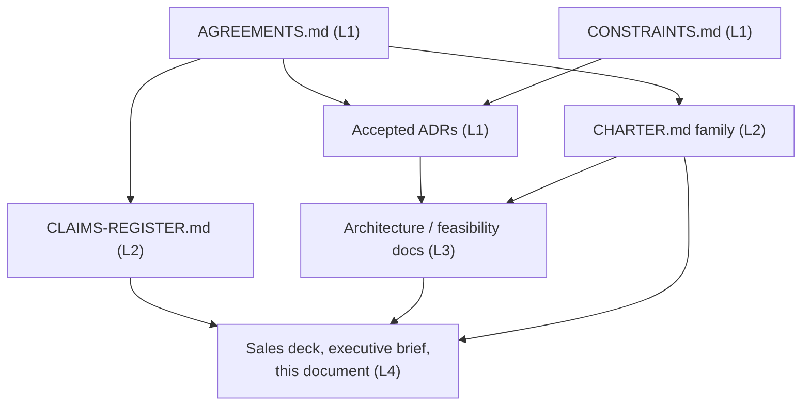
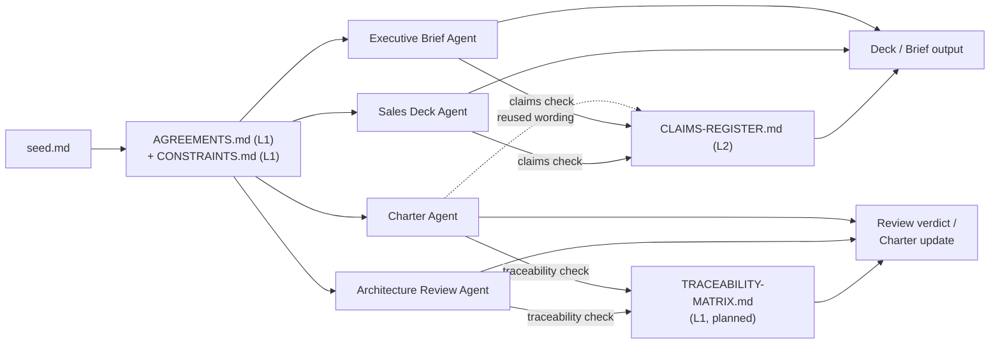

**AI Guardrails — Generation Agent Output Contracts**

**Authority level:** L4
**Status:** Draft
**Date:** 2026-07-24
**Derived from:** seed.md + AGREEMENTS.md

---

> This document defines what each AI Guardrails generation agent — human or automated — must produce, must not produce, and which guardrail registers govern its output. It is an **L4** document: a derived, agent-facing operating instruction. It must not contradict [`AGREEMENTS.md`](../00-source-of-truth/AGREEMENTS.md) or [`CONSTRAINTS.md`](../00-source-of-truth/CONSTRAINTS.md) (both **L1**), and every "must not" rule below is a restatement of a boundary already established by an accepted agreement, a constraint, or [`CLAIMS-REGISTER.md`](../70-governance/CLAIMS-REGISTER.md) (**L2**) — it introduces no new policy of its own. Where this document and any of those three registers appear to diverge, the register wins and this document must be corrected.

---

## Table of contents

- [1. Purpose and audience](#1-purpose-and-audience)
- [2. Guardrails common to every agent](#2-guardrails-common-to-every-agent)
- [3. Common contract shape](#3-common-contract-shape)
- [4. Contract — Sales Deck Agent](#4-contract--sales-deck-agent)
- [5. Contract — Architecture Review Agent](#5-contract--architecture-review-agent)
- [6. Contract — Executive Brief Agent](#6-contract--executive-brief-agent)
- [7. Contract — Charter Agent](#7-contract--charter-agent)
- [8. Cross-agent comparison](#8-cross-agent-comparison)
- [9. CLAIMS-REGISTER and TRACEABILITY-MATRIX as universal guardrails](#9-claims-register-and-traceability-matrix-as-universal-guardrails)
- [10. Rejection and escalation protocol](#10-rejection-and-escalation-protocol)
- [11. Related documents](#11-related-documents)

---

## 1. Purpose and audience

The AI Guardrails solution-docs set is produced and maintained by a small number of recurring **generation agents**, each responsible for one derived artifact or family of artifacts: a sales deck, an architecture review, an executive brief, or the product charter itself. Whether a given agent is a person following a brief or an automated system executing a prompt, its output must be governed by the same contract so that the resulting artifact is consistent, traceable, and safe to circulate.

This document exists to answer, for each of the four agents in scope, three questions:

1. What must the agent **produce** — the mandatory deliverable shape, not just a narrative?
2. What must the agent **never do** — the prohibited behaviors that would make its output non-compliant regardless of how well-written it is?
3. Which **guardrail registers** bind its output, and in what order?

It does not restate the full content requirements already specified in each agent's dedicated brief — [`DECK-BRIEF.md`](../40-sales-deck/DECK-BRIEF.md) for the sales deck, [`FEASIBILITY-ASSESSMENT.md`](../50-architecture/FEASIBILITY-ASSESSMENT.md) and the [ADR index](../50-architecture/adrs/README.md) for architecture review, [`EXECUTIVE-BRIEF.md`](../30-executive/EXECUTIVE-BRIEF.md) for the executive brief, and [`CHARTER.md`](../10-charter/CHARTER.md) / [`PRINCIPLES.md`](../10-charter/PRINCIPLES.md) / [`SCOPE.md`](../10-charter/SCOPE.md) for the charter. Instead, it names the **contract** — the mandatory output shape and hard prohibitions — that any instance of these agents, present or future, must satisfy.

---

## 2. Guardrails common to every agent

Every agent contract in this document inherits the following, non-optional rules before any agent-specific content is considered.

### 2.1 Authority order

No agent output may contradict a higher-authority document. An agent that discovers a conflict between its source material and a higher-authority register must halt and flag it — see [§10](#10-rejection-and-escalation-protocol) — rather than silently resolve it in either direction.

### 2.2 Universal "must" rules

* **Cite evidence for every substantive claim** — an `AGR-xxx` anchor in [`AGREEMENTS.md`](../00-source-of-truth/AGREEMENTS.md), a `CON-xxx` anchor in [`CONSTRAINTS.md`](../00-source-of-truth/CONSTRAINTS.md), an Accepted ADR, or a specific `seed.md §` section. A claim with no citable evidence is not ready to ship.
* **Use the three-way status discipline from [`CLAIMS-REGISTER.md`](../70-governance/CLAIMS-REGISTER.md)** whenever the output could reach a customer, prospect, executive sponsor, auditor, or partner: **Confirmed design** (stated as fact), **Hypothesis** (stated qualitatively, never quantified), or **Not approved** (excluded entirely).
* **Mark absent figures as TBD**, or describe the point qualitatively. No agent may invent a metric, date, SLA, dollar amount, customer name, or performance number that is not present in `seed.md` or a subsequently measured and approved source.
* **Produce a traceability output** — every agent's mandatory deliverables in [§4](#4-contract--sales-deck-agent)–[§7](#7-contract--charter-agent) include an explicit mapping from the agent's output back to the source agreements, constraints, or charter sections it rests on. An artifact without this mapping is incomplete, not merely unpolished.
* **Default to the lower-confidence outcome** when uncertain — prefer Hypothesis over Confirmed design, prefer flagging a gap over filling it, prefer escalation over a best guess.

### 2.3 Universal "must not" rules

No agent, regardless of which contract in [§4](#4-contract--sales-deck-agent)–[§7](#7-contract--charter-agent) governs it, may:

* Contradict an accepted entry in [`AGREEMENTS.md`](../00-source-of-truth/AGREEMENTS.md) or [`CONSTRAINTS.md`](../00-source-of-truth/CONSTRAINTS.md), or an Accepted ADR.
* Describe **Remote Evaluation (Mode A)** as private, data-local, or "your data never leaves your environment" ([AGR-009](../00-source-of-truth/AGREEMENTS.md#agr-009--remote-evaluation-is-not-a-private-data-or-data-local-model)).
* Describe a **cooperative-mode connector** as bypass-proof, unremovable, or a hard security boundary ([AGR-018](../00-source-of-truth/AGREEMENTS.md#agr-018--trust-and-enforcement-model)).
* Describe a guardrail decision as an **authorization** decision, or imply it removes the consuming application's own authentication/authorization responsibility ([AGR-010](../00-source-of-truth/AGREEMENTS.md#agr-010--guardrails-are-not-authorization)).
* Describe **Amazon Bedrock Guardrails** as the platform's permanent or exclusive detection engine ([AGR-004](../00-source-of-truth/AGREEMENTS.md#agr-004--bedrock-guardrails-as-first-engine-vendor-independent-contract)).
* Present a **Hypothesis**-status claim, an unexecuted PoC, or an unresolved assumption as an achieved, proven, or completed result — including the MVP demonstration itself, which is a target outcome, not a completed fact, until [AGR-020](../00-source-of-truth/AGREEMENTS.md#agr-020--mvp-success-demonstration) has actually executed and been recorded.
* Present any Phase 3, 4, or 5 capability (Guarded Gateway, Customer-Managed Runtime, Advanced Agent Protection) as available today or as included in a current resourcing ask, ahead of [AGR-022](../00-source-of-truth/AGREEMENTS.md#agr-022--five-phase-delivery)'s phase gating.
* Claim, imply, or name any specific compliance certification (SOC 2, ISO 27001, HIPAA, FedRAMP, PCI DSS, or similar), "enterprise-ready," "production-proven," or "GA" status, none of which is documented as attained in `seed.md`.
* Fabricate or imply a specific customer, prospect, partner, or logo — none exist in the source material.
* Redefine a charter term (for example, "import," per [AGR-021](../00-source-of-truth/AGREEMENTS.md#agr-021--meaning-of-import)) informally, or use it in a sense inconsistent with its authoritative definition.

---

## 3. Common contract shape

Every agent contract in [§4](#4-contract--sales-deck-agent)–[§7](#7-contract--charter-agent) below is expressed using the same five fields, so that contracts remain comparable and auditable:

| Field | Meaning |
| --- | --- |
| **Purpose** | What artifact this agent exists to produce, and for whom. |
| **Primary inputs** | The documents this agent must read and treat as binding before generating output. |
| **Produces (mandatory)** | The deliverable shape the agent's output must take — not optional polish, but a checklist an incomplete run fails against. |
| **Must not** | Agent-specific prohibited behaviors, in addition to the universal rules in [§2.3](#23-universal-must-not-rules). |
| **Guardrail references** | Which registers this agent's output is checked against, and by whom. |

---

## 4. Contract — Sales Deck Agent

| Field | Detail |
| --- | --- |
| **Purpose** | Produce the internal AI Guardrails pitch deck per [`DECK-BRIEF.md`](../40-sales-deck/DECK-BRIEF.md) — a live, time-boxed artifact that takes a platform/enterprise audience to a specific funding or pilot decision. |
| **Primary inputs** | [`DECK-BRIEF.md`](../40-sales-deck/DECK-BRIEF.md), [`CLAIMS-REGISTER.md`](../70-governance/CLAIMS-REGISTER.md), [`AGREEMENTS.md`](../00-source-of-truth/AGREEMENTS.md), [`CONSTRAINTS.md`](../00-source-of-truth/CONSTRAINTS.md), [`PRODUCT-OVERVIEW.md`](../20-product/PRODUCT-OVERVIEW.md), [`DIFFERENTIATORS.md`](../20-product/DIFFERENTIATORS.md), [`VALUE-PROPOSITION.md`](../20-product/VALUE-PROPOSITION.md), [`EXECUTIVE-BRIEF.md`](../30-executive/EXECUTIVE-BRIEF.md). |
| **Produces (mandatory)** | 1. An **editable slide deck** (`.pptx` or an equivalent editable slide file) following the 15-slide core structure and slide order in [`DECK-BRIEF.md` § Required slides](../40-sales-deck/DECK-BRIEF.md#required-slides). 2. A **slide-by-slide source mapping** — for every slide, the `AGR-xxx` and/or `seed.md §` anchor(s) backing each on-slide claim, per [`DECK-BRIEF.md` Output requirements #2](../40-sales-deck/DECK-BRIEF.md#output-requirements). 3. **Speaker notes** for every slide, carrying elaboration that does not fit the ≤40-word on-slide text budget. 4. A **claims validation report** — every claim used in the deck checked against its [`CLAIMS-REGISTER.md`](../70-governance/CLAIMS-REGISTER.md) row and status (Confirmed design / Hypothesis / Not approved), flagging any wording that does not match an Approved-wording entry. 5. A **list of missing information** — every point where a figure, metric, date, or dollar amount was structurally needed but absent from `seed.md`, reported as an explicit TBD list rather than silently filled in. |
| **Must not** | * Invent customer metrics, adoption figures, dollar amounts, logos, or case studies (none exist in `seed.md`). * Present a **Hypothesis**-status claim (for example, reduced onboarding effort, reduced application-change volume) as an already-proven or Confirmed-design fact. * Alter approved product positioning — the [core message](../40-sales-deck/DECK-BRIEF.md#core-message), the three deployment-mode names, or the stated scope boundaries — without first securing a change to [`DECK-BRIEF.md`](../40-sales-deck/DECK-BRIEF.md) and, where applicable, [`CLAIMS-REGISTER.md`](../70-governance/CLAIMS-REGISTER.md); the deck agent is a consumer of positioning, not its author. * Exceed the 15-slide core cap, omit the mandatory scope-boundary slide ("What this is — and isn't"), or present it as a footnote or backup slide. * Present any Phase 3–5 capability, or the MVP demonstration in [AGR-020](../00-source-of-truth/AGREEMENTS.md#agr-020--mvp-success-demonstration), as already delivered or achieved. |
| **Guardrail references** | [`CLAIMS-REGISTER.md`](../70-governance/CLAIMS-REGISTER.md) (**L2**) is binding on every word choice; the claims validation report is the mechanism that proves compliance. [`TRACEABILITY-MATRIX.md`](../00-source-of-truth/TRACEABILITY-MATRIX.md) is the secondary check that every slide's claim traces to an accepted agreement, not merely to an aspirational architecture idea. Deck output failing either check must not be used beyond the immediate drafting team, per [`DECK-BRIEF.md` Output requirements #7](../40-sales-deck/DECK-BRIEF.md#output-requirements). |

---

## 5. Contract — Architecture Review Agent

| Field | Detail |
| --- | --- |
| **Purpose** | Assess a proposed architecture artifact — a component design, an ADR draft, a deployment or integration proposal — against [`AGREEMENTS.md`](../00-source-of-truth/AGREEMENTS.md), [`CONSTRAINTS.md`](../00-source-of-truth/CONSTRAINTS.md), `seed.md`, and prior Accepted ADRs, in the style already modeled by [`FEASIBILITY-ASSESSMENT.md`](../50-architecture/FEASIBILITY-ASSESSMENT.md). |
| **Primary inputs** | The candidate architecture artifact under review; [`AGREEMENTS.md`](../00-source-of-truth/AGREEMENTS.md), [`CONSTRAINTS.md`](../00-source-of-truth/CONSTRAINTS.md), `seed.md`; existing entries in the [ADR index](../50-architecture/adrs/README.md); [`FEASIBILITY-ASSESSMENT.md`](../50-architecture/FEASIBILITY-ASSESSMENT.md); [`NON-FUNCTIONAL-REQUIREMENTS.md`](../50-architecture/NON-FUNCTIONAL-REQUIREMENTS.md) and [`REQUIREMENTS.md`](../50-architecture/REQUIREMENTS.md). |
| **Produces (mandatory)** | 1. A **feasibility verdict** — one of *Feasible* / *Feasible with conditions* / *Not feasible as proposed*, in the style of [`FEASIBILITY-ASSESSMENT.md` §1](../50-architecture/FEASIBILITY-ASSESSMENT.md#1-overall-assessment) — never a bare "looks fine." 2. **Blocking issues** — items that must be resolved before the design can proceed, distinguished explicitly from lower-severity findings. 3. **Risk-ranked findings** — every finding ordered by severity/likelihood and tagged with the `AGR-xxx`/`CON-xxx`/`seed.md §` it relates to. 4. **Contradictions between requirements and architecture** — an explicit list of any place the reviewed design conflicts with an accepted agreement, constraint, or Accepted ADR; "no contradictions found" is an acceptable finding only if stated affirmatively, not by omission. 5. **Required ADRs** — a candidate list of decisions that must be recorded as a new or updated ADR before the design can proceed, evaluated against the "[When to write an ADR](../50-architecture/adrs/README.md#when-to-write-an-adr)" criteria in the ADR index. 6. **Recommended proofs of concept** — scoped, time-boxed, and falsifiable, in the pattern of [`FEASIBILITY-ASSESSMENT.md` §4](../50-architecture/FEASIBILITY-ASSESSMENT.md#4-required-proofs-of-concept); each PoC must name the specific unresolved risk or assumption it retires. |
| **Must not** | * Approve, or imply approval of, a design that contradicts an accepted `AGR-xxx`/`CON-xxx` entry or an Accepted ADR — only the agreement/constraint change process, not an architecture review, may relax those. * Invent a specific latency, availability, or throughput figure not present in `seed.md` or actual measured PoC data; unmeasured figures must be marked **TBD** and paired with a recommended PoC (see [CON-015](../00-source-of-truth/CONSTRAINTS.md#con-015--input-size-limits), [CON-016](../00-source-of-truth/CONSTRAINTS.md#con-016--timeout-limits)). * Describe a cooperative-mode connector as bypass-proof, or treat connector telemetry as evidence of mandatory enforcement ([CON-012](../00-source-of-truth/CONSTRAINTS.md#con-012--no-exclusive-reliance-on-weak-security-proxies)). * Treat Bedrock Guardrails' native response shape as part of, or acceptable within, the public evaluation contract ([CON-004](../00-source-of-truth/CONSTRAINTS.md#con-004--no-coupling-to-bedrock-guardrails-response-formats)). * Approve an account or tenant-isolation topology beyond the minimal two-account MVP model ([CON-002](../00-source-of-truth/CONSTRAINTS.md#con-002--minimal-mvp-account-model)) without citing one of AGR-013's named escalation triggers (external customers, compliance requirements, independent security ownership, immutable audit requirements, production scale, dedicated tenant deployments). * Mark an ADR it recommends as `Status: Accepted` — a review agent may only propose `Status: Proposed`; acceptance requires the actual decision owners named in the [ADR template](../50-architecture/adrs/README.md#adr-template). |
| **Guardrail references** | [`TRACEABILITY-MATRIX.md`](../00-source-of-truth/TRACEABILITY-MATRIX.md) is this agent's primary guardrail — it verifies every requirement in [`REQUIREMENTS.md`](../50-architecture/REQUIREMENTS.md)/[`NON-FUNCTIONAL-REQUIREMENTS.md`](../50-architecture/NON-FUNCTIONAL-REQUIREMENTS.md) traces to an architecture decision and vice versa; a requirement without upstream or downstream traceability is itself a contradiction/blocking-issue finding, not a documentation nit. [`CLAIMS-REGISTER.md`](../70-governance/CLAIMS-REGISTER.md) applies secondarily whenever the reviewed artifact contains customer- or auditor-facing wording (for example, a security-architecture document that also asserts a marketing-adjacent claim) — that wording must still conform to the register even inside an architecture document. |

---

## 6. Contract — Executive Brief Agent

| Field | Detail |
| --- | --- |
| **Purpose** | Produce or maintain [`EXECUTIVE-BRIEF.md`](../30-executive/EXECUTIVE-BRIEF.md)-class content — a decision-oriented brief that asks leadership for a specific, bounded approval. |
| **Primary inputs** | [`EXECUTIVE-BRIEF.md`](../30-executive/EXECUTIVE-BRIEF.md), `seed.md`, [`AGREEMENTS.md`](../00-source-of-truth/AGREEMENTS.md), [`CLAIMS-REGISTER.md`](../70-governance/CLAIMS-REGISTER.md), [`RISK-REGISTER.md`](../70-governance/RISK-REGISTER.md), [`ASSUMPTIONS.md`](../00-source-of-truth/ASSUMPTIONS.md), [`OPEN-QUESTIONS.md`](../00-source-of-truth/OPEN-QUESTIONS.md). |
| **Produces (mandatory)** | 1. An **executive summary** stating the problem, the proposed solution, and the specific ask in a small number of paragraphs, per [`EXECUTIVE-BRIEF.md` §1](../30-executive/EXECUTIVE-BRIEF.md#1-executive-summary). 2. A **business impact table** — qualitative impact dimensions (governance consistency, engineering duplication, adoption risk, compliance/residency gap, false assurance), with any missing dollar or percentage figure recorded as **TBD**, never estimated. 3. A **decision request** stated as a single, explicit sentence, paired with an equally explicit "not being asked for" list — mirroring [`EXECUTIVE-BRIEF.md` §10](../30-executive/EXECUTIVE-BRIEF.md#10-decision-required). 4. A **risk summary** — the top principal risks and their mitigations, sourced from [`RISK-REGISTER.md`](../70-governance/RISK-REGISTER.md) and `seed.md §20`, not invented independently. 5. A **traceability appendix** mapping every business claim in the brief to its `AGR-xxx` and/or [`CLAIMS-REGISTER.md`](../70-governance/CLAIMS-REGISTER.md) row. 6. An **open-items and assumptions list** pulled directly from [`ASSUMPTIONS.md`](../00-source-of-truth/ASSUMPTIONS.md) and [`OPEN-QUESTIONS.md`](../00-source-of-truth/OPEN-QUESTIONS.md), not restated as if already resolved. |
| **Must not** | * Invent ROI figures, dollar amounts, timelines, headcount, or SLA numbers not present in `seed.md` or `AGREEMENTS.md`. * Present the MVP demonstration ([AGR-020](../00-source-of-truth/AGREEMENTS.md#agr-020--mvp-success-demonstration)) as already completed, in progress, or "proven" ahead of a dated execution record. * Request approval for a phase beyond what the current gating in [AGR-022](../00-source-of-truth/AGREEMENTS.md#agr-022--five-phase-delivery) justifies — the ask must remain scoped to the phase actually being requested. * Blur operational ownership and data exposure into a single statement ([AGR-008](../00-source-of-truth/AGREEMENTS.md#agr-008--explicit-content-exposure-model-ownership-vs-exposure-are-separate-concerns)) — these must always be two separately answered questions. * Omit the explicit "not asking for" boundary — this is load-bearing to prevent scope creep and must never be cut, exactly as the sales deck's scope-boundary slide must never be cut. |
| **Guardrail references** | [`CLAIMS-REGISTER.md`](../70-governance/CLAIMS-REGISTER.md) is binding on every claim in the brief — its own scope statement names "executive sponsor" explicitly as a semi-external audience whose materials it governs. [`TRACEABILITY-MATRIX.md`](../00-source-of-truth/TRACEABILITY-MATRIX.md) confirms the brief's claimed capabilities trace to accepted agreements rather than to aspirational or unreviewed architecture. |

---

## 7. Contract — Charter Agent

| Field | Detail |
| --- | --- |
| **Purpose** | Author or maintain [`CHARTER.md`](../10-charter/CHARTER.md)-class content and its siblings — [`PRINCIPLES.md`](../10-charter/PRINCIPLES.md), [`SCOPE.md`](../10-charter/SCOPE.md), [`SUCCESS-CRITERIA.md`](../10-charter/SUCCESS-CRITERIA.md) — the durable, boundary-setting reference layer that sits one level below `AGREEMENTS.md` itself. |
| **Primary inputs** | `seed.md` (full), [`AGREEMENTS.md`](../00-source-of-truth/AGREEMENTS.md), [`CONSTRAINTS.md`](../00-source-of-truth/CONSTRAINTS.md), [`DECISIONS.md`](../00-source-of-truth/DECISIONS.md), Accepted ADRs in the [ADR index](../50-architecture/adrs/README.md). |
| **Produces (mandatory)** | 1. **Purpose, vision, and problem-statement sections**, each citing the specific `seed.md §` it restates. 2. **Explicit scope boundaries** — in-scope, future-scope, and out-of-scope-for-the-MVP — mirroring the three-way split in `seed.md §6.1`–`§6.3`; no item may be silently moved between these categories without a recorded decision. 3. A **domain-model restatement** consistent with [AGR-017](../00-source-of-truth/AGREEMENTS.md#agr-017--core-domain-model) — tenant, workload, policy, policy binding, evaluation, decision — using no parallel vocabulary. 4. A **principles section** restating the substance of [AGR-005](../00-source-of-truth/AGREEMENTS.md#agr-005--policy-portability), [AGR-006](../00-source-of-truth/AGREEMENTS.md#agr-006--one-logical-evaluation-contract-across-all-modes), [AGR-007](../00-source-of-truth/AGREEMENTS.md#agr-007--policies-are-separate-from-connectors), [AGR-008](../00-source-of-truth/AGREEMENTS.md#agr-008--explicit-content-exposure-model-ownership-vs-exposure-are-separate-concerns), [AGR-010](../00-source-of-truth/AGREEMENTS.md#agr-010--guardrails-are-not-authorization), [AGR-011](../00-source-of-truth/AGREEMENTS.md#agr-011--observe-before-enforce-progression), and [AGR-012](../00-source-of-truth/AGREEMENTS.md#agr-012--failure-behavior-is-part-of-policy) without weakening any of them. 5. A **related-documents cross-link section**, consistent with the linking convention used throughout this corpus. 6. A **change-impact note** listing which other documents are named as "Affected documents" for any `AGREEMENTS.md` row the charter update touches. |
| **Must not** | * Contradict any Accepted agreement in [`AGREEMENTS.md`](../00-source-of-truth/AGREEMENTS.md), any entry in [`CONSTRAINTS.md`](../00-source-of-truth/CONSTRAINTS.md), or any Accepted ADR. * Introduce new scope — a feature, mode, or capability — that is not present in `seed.md` and not the product of a subsequently recorded agreement or [`DECISIONS.md`](../00-source-of-truth/DECISIONS.md) entry. * Describe the MVP, or any delivery phase, as complete ahead of a dated record of completion. * Introduce a fourth deployment mode, or otherwise alter the three-mode model fixed by [AGR-002](../00-source-of-truth/AGREEMENTS.md#agr-002--three-deployment-modes). * Redefine "import" ([AGR-021](../00-source-of-truth/AGREEMENTS.md#agr-021--meaning-of-import)) or any other charter term informally, or in a way inconsistent with its authoritative definition. |
| **Guardrail references** | Charter output is itself **L2** — one level below `AGREEMENTS.md` — so [`TRACEABILITY-MATRIX.md`](../00-source-of-truth/TRACEABILITY-MATRIX.md) is the primary check: every charter statement must trace to a `seed.md §` or an accepted `AGR-xxx`. [`CLAIMS-REGISTER.md`](../70-governance/CLAIMS-REGISTER.md) applies whenever charter wording is likely to be reused verbatim in customer-facing material — as already happens with the `seed.md §23` product statement reused in the sales deck — so that internal charter phrasing never inadvertently licenses a Not-approved external claim. |

---

## 8. Cross-agent comparison

| Agent | Own output's authority level | Primary binding register | Unique mandatory deliverable | Shared prohibition (all agents) |
| --- | --- | --- | --- | --- |
| Sales Deck Agent | L4 | [`CLAIMS-REGISTER.md`](../70-governance/CLAIMS-REGISTER.md) | Claims validation report + missing-information list | No invented figures; no Hypothesis presented as fact |
| Architecture Review Agent | L3 (its verdict); may trigger L1 ADRs | [`TRACEABILITY-MATRIX.md`](../00-source-of-truth/TRACEABILITY-MATRIX.md) | Required-ADR list + recommended PoCs | No approval that contradicts AGREEMENTS.md/CONSTRAINTS.md |
| Executive Brief Agent | L4 | [`CLAIMS-REGISTER.md`](../70-governance/CLAIMS-REGISTER.md) | Explicit "not being asked for" boundary | No MVP demonstration presented as completed |
| Charter Agent | L2 | [`TRACEABILITY-MATRIX.md`](../00-source-of-truth/TRACEABILITY-MATRIX.md) | Change-impact note across Affected documents | No new scope beyond seed.md / recorded decisions |

Every row in this table inherits [§2](#2-guardrails-common-to-every-agent) in full; the table names only what differs between agents, not the full rule set each must satisfy.

---

## 9. CLAIMS-REGISTER and TRACEABILITY-MATRIX as universal guardrails

Two registers do the actual gatekeeping referenced throughout [§4](#4-contract--sales-deck-agent)–[§7](#7-contract--charter-agent). Agents differ in which one they consult first, but every agent must consult both before finalizing output that could be read outside its own drafting team.

* **[`CLAIMS-REGISTER.md`](../70-governance/CLAIMS-REGISTER.md) (L2, `70-governance/`)** governs **external and semi-external wording** — anything a customer, prospect, executive sponsor, auditor, or partner might read or hear (its own stated scope). It carries the Hypothesis / Confirmed design / Not approved status discipline and the Approved-wording / Restricted-wording pairs that the Sales Deck Agent and Executive Brief Agent must check every claim against before finalizing output. It is authored and exists today.
* **[`TRACEABILITY-MATRIX.md`](../00-source-of-truth/TRACEABILITY-MATRIX.md) (L1, `00-source-of-truth/`)** is referenced as an "Affected document" throughout [`AGREEMENTS.md`](../00-source-of-truth/AGREEMENTS.md) (see [AGR-006](../00-source-of-truth/AGREEMENTS.md#agr-006--one-logical-evaluation-contract-across-all-modes), [AGR-017](../00-source-of-truth/AGREEMENTS.md#agr-017--core-domain-model)) and governs **internal requirement ↔ agreement ↔ architecture ↔ delivery-phase traceability** — confirming that every requirement in [`REQUIREMENTS.md`](../50-architecture/REQUIREMENTS.md) traces to an accepted agreement, that every accepted agreement is reflected in at least one architecture document, and that every architecture decision maps to a delivery phase. It is authored and exists today; the Architecture Review Agent and Charter Agent consult it directly, in addition to citing `AGR-xxx`/`CON-xxx`/`seed.md §` anchors, exactly as every document in this corpus already does — this document included.

Neither register may be bypassed on the grounds that it "obviously" doesn't apply to a given output — an architecture document that also contains a marketing-adjacent sentence, or a charter passage a sales deck will later quote verbatim, is exactly the case both registers exist to catch.

---

## 10. Rejection and escalation protocol

Any draft output — from any agent in [§4](#4-contract--sales-deck-agent)–[§7](#7-contract--charter-agent) — that contains any of the following must not ship, must not be reused downstream, and must be corrected or escalated before further use:

1. A **Not approved** claim per [`CLAIMS-REGISTER.md`](../70-governance/CLAIMS-REGISTER.md), in any wording.
2. An **invented figure** — metric, percentage, date, SLA, or dollar amount — not present in `seed.md`, `AGREEMENTS.md`, or a subsequently measured and approved source.
3. A **contradiction** with an accepted `AGR-xxx`, `CON-xxx`, or Accepted ADR.
4. A **missing mandatory deliverable** named in the agent's contract in [§4](#4-contract--sales-deck-agent)–[§7](#7-contract--charter-agent) (for example, a sales deck without a claims validation report, or an architecture review without a feasibility verdict).

Escalation follows the same ownership pattern used for [`AGREEMENTS.md`](../00-source-of-truth/AGREEMENTS.md) and [`CLAIMS-REGISTER.md`](../70-governance/CLAIMS-REGISTER.md) additions: Product Lead and Security/Governance Lead jointly resolve claims-boundary conflicts; Technical Lead and Architecture Lead jointly resolve architecture-contradiction findings. No agent may resolve a §10 flag by silently rewording around it — the correction must trace to an actual register update or a documented exception, not a paraphrase.

---

## 11. Related documents

- [`AGREEMENTS.md`](../00-source-of-truth/AGREEMENTS.md) — L1 authoritative agreement register every agent contract ultimately derives from.
- [`CONSTRAINTS.md`](../00-source-of-truth/CONSTRAINTS.md) — L1 authoritative constraint register (`CON-001`…`CON-016`) cited throughout the Architecture Review Agent contract.
- [`CLAIMS-REGISTER.md`](../70-governance/CLAIMS-REGISTER.md) — L2 authoritative claims register governing the Sales Deck Agent and Executive Brief Agent.
- [`TRACEABILITY-MATRIX.md`](../00-source-of-truth/TRACEABILITY-MATRIX.md) — the L1 traceability register the Architecture Review Agent and Charter Agent consult, in addition to direct `AGR-xxx`/`CON-xxx`/`seed.md §` citation.
- [`RISK-REGISTER.md`](../70-governance/RISK-REGISTER.md) — source material for the Executive Brief Agent's risk summary.
- [`DECK-BRIEF.md`](../40-sales-deck/DECK-BRIEF.md) — the full content brief the Sales Deck Agent's contract in [§4](#4-contract--sales-deck-agent) summarizes.
- [`FEASIBILITY-ASSESSMENT.md`](../50-architecture/FEASIBILITY-ASSESSMENT.md) — the worked example the Architecture Review Agent's deliverable shape in [§5](#5-contract--architecture-review-agent) is modeled on.
- [`50-architecture/adrs/README.md`](../50-architecture/adrs/README.md) — the ADR lifecycle and template the Architecture Review Agent's "required ADRs" deliverable must conform to.
- [`EXECUTIVE-BRIEF.md`](../30-executive/EXECUTIVE-BRIEF.md) — the full brief the Executive Brief Agent's contract in [§6](#6-contract--executive-brief-agent) summarizes.
- [`CHARTER.md`](../10-charter/CHARTER.md), [`PRINCIPLES.md`](../10-charter/PRINCIPLES.md), [`SCOPE.md`](../10-charter/SCOPE.md) — the charter family the Charter Agent's contract in [§7](#7-contract--charter-agent) governs.
- [`DECISIONS.md`](../00-source-of-truth/DECISIONS.md) — the product/organizational/delivery decision log the Charter Agent must check before introducing any change-impact note.
