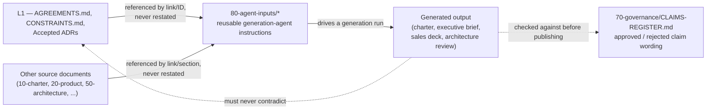

**AI Guardrails — Agent Inputs Directory**

**Authority level:** L4
**Status:** Draft
**Date:** 2026-07-24
**Derived from:** seed.md + AGREEMENTS.md

---

## Purpose and authority

This directory holds the **reusable instruction sets fed to generation agents** — the prompts and generation briefs that drive the AI agents responsible for producing this solution's derived narrative documents: the executive brief, the sales deck, the architecture review, and the charter.

These instruction files are themselves **L4 — process/generation material**, on the same non-authoritative footing as the documents they help produce. They do not carry technical or business decisions of their own. Their sole job is to tell a generation agent *what to assemble and from where* — never to restate a decision that already lives in a source-of-truth document.

This directory is **not** the place to define what AI Guardrails is, what it must do, or what it must never claim. Those questions are already answered, authoritatively, elsewhere:

* [`00-source-of-truth/AGREEMENTS.md`](../00-source-of-truth/AGREEMENTS.md) — accepted agreements (L1).
* [`00-source-of-truth/CONSTRAINTS.md`](../00-source-of-truth/CONSTRAINTS.md) — checkable boundaries (L1).
* Any `Accepted` ADR under [`50-architecture/adrs/`](../50-architecture/adrs/README.md) — deep architecture decisions (L1, once accepted).
* [`70-governance/CLAIMS-REGISTER.md`](../70-governance/CLAIMS-REGISTER.md) — the canonical list of claims that are and are not safe to make externally.

Every instruction file in this directory must point *at* those documents. It must never copy their content into a prompt.

---

## Table of contents

- [Purpose and authority](#purpose-and-authority)
- [Why this directory exists](#why-this-directory-exists)
- [The governing rule: reference, don't duplicate](#the-governing-rule-reference-dont-duplicate)
- [Files in this directory](#files-in-this-directory)
- [Output contract](#output-contract)
- [Authority model reminder for generation agents](#authority-model-reminder-for-generation-agents)
- [Related documents](#related-documents)

---

## Why this directory exists

The rest of `solution-docs/` is a layered set of derived views over two sources of truth (`seed.md` and `AGREEMENTS.md`): a charter, a product description, executive materials, sales materials, an architecture set, and a delivery plan. Several of those views — the executive brief, the sales deck, the architecture review, and the charter — are produced by dedicated generation agents rather than written from scratch each time.

`80-agent-inputs/` is where the **instructions those agents run on** live, so that:

* The same generation logic can be re-run consistently as source documents evolve, instead of being re-invented ad hoc per request.
* A reviewer can audit *how* an executive brief, sales deck, architecture review, or charter was produced, not just read the result.
* Updates to `AGREEMENTS.md`, `CONSTRAINTS.md`, or an Accepted ADR propagate into the next generation run automatically, because the instruction file points at the live document rather than a frozen copy of its wording.

---

## The governing rule: reference, don't duplicate

**Instruction files in this directory reference source documents; they do not duplicate source-document content.**

An instruction file tells the generation agent *which document, which section, and which agreement or constraint ID* to pull from. It does not paraphrase or embed that material inline. This is what keeps every generated output **traceable** (you can walk from a sentence in the output back to the exact clause it came from) and **non-contradictory** (when the source document changes, the next generation run reflects the change automatically, instead of working from a stale copy baked into an old prompt).

| Don't (duplicates, can drift) | Do (references, stays synced) |
|---|---|
| "Remote Evaluation must always be described as 'bring your own gateway while consuming a hosted guardrail runtime,' and must never be described as private-data or data-local, because prompts and responses are transmitted to the hosted Evaluation API." | "State Mode A's positioning and data-exposure wording exactly as required by [`AGREEMENTS.md` AGR-009](../00-source-of-truth/AGREEMENTS.md#agr-009--remote-evaluation-is-not-a-private-data-or-data-local-model); do not restate it here — link to it and quote it verbatim from the source." |
| "The MVP account model is one non-production account and one production account, since three-account separation isn't needed yet." | "Cite [`CONSTRAINTS.md` CON-002](../00-source-of-truth/CONSTRAINTS.md#con-002--minimal-mvp-account-model) for the MVP account model; do not restate the constraint's wording in this instruction file." |

If a generation agent needs a fact that is not present in any source document, the instruction file must direct the agent to write **"TBD"** or describe the point qualitatively — never to invent a metric, figure, date, SLA, or customer example.

---

## Files in this directory

This directory is populated incrementally, one instruction file per generation agent, plus one shared output-format contract. As of this writing, only this `README.md` has been authored; the remaining files are the planned structure that subsequent authoring work will fill in.

| File | Drives generation agent | Produces (target document family) | Status |
|---|---|---|---|
| `README.md` | — | This document | Authored |
| `CHARTER-AGENT.md` | Charter generation agent | [`10-charter/CHARTER.md`](../10-charter/CHARTER.md) and its companions ([`PRINCIPLES.md`](../10-charter/PRINCIPLES.md), [`SCOPE.md`](../10-charter/SCOPE.md), [`SUCCESS-CRITERIA.md`](../10-charter/SUCCESS-CRITERIA.md)) | Not yet authored |
| `EXECUTIVE-BRIEF-AGENT.md` | Executive brief generation agent | [`30-executive/EXECUTIVE-BRIEF.md`](../30-executive/EXECUTIVE-BRIEF.md) and its companions ([`BUSINESS-CASE.md`](../30-executive/BUSINESS-CASE.md), [`DECISION-REQUEST.md`](../30-executive/DECISION-REQUEST.md), [`EXPECTED-OUTCOMES.md`](../30-executive/EXPECTED-OUTCOMES.md), [`INVESTMENT-SUMMARY.md`](../30-executive/INVESTMENT-SUMMARY.md), [`RISKS-AND-DEPENDENCIES.md`](../30-executive/RISKS-AND-DEPENDENCIES.md)) | Not yet authored |
| `SALES-DECK-AGENT.md` | Sales deck generation agent | [`40-sales-deck/DECK-BRIEF.md`](../40-sales-deck/DECK-BRIEF.md) and the full slide/narrative family under `40-sales-deck/` | Not yet authored |
| `ARCHITECTURE-REVIEW-AGENT.md` | Architecture review generation agent | [`50-architecture/ARCHITECTURE-REPORT.md`](../50-architecture/ARCHITECTURE-REPORT.md), the consolidated technical report | Not yet authored |
| `OUTPUT-CONTRACTS.md` | Shared by all four agents above | Not a document in its own right — defines the structural and format contract every generated output must satisfy | Not yet authored |

Each future instruction file should be scoped to exactly one generation agent and should itself remain a thin, reference-only document: what to pull, from where, in what order, for which audience — not a restatement of product, architecture, or governance content.

---

## Output contract

Every generation agent listed above must produce output conforming to [`OUTPUT-CONTRACTS.md`](./OUTPUT-CONTRACTS.md) — the shared, cross-agent contract for what a generated document must contain and how it must be shaped, independent of any one document's specific subject matter. That contract is expected to define, at minimum:

* The standard header block (title, authority level, status, date, "Derived from" line) every generated document must open with.
* The mandatory disclaimer wording tied to specific agreements — for example, the Mode A data-exposure statement required by [AGR-009](../00-source-of-truth/AGREEMENTS.md#agr-009--remote-evaluation-is-not-a-private-data-or-data-local-model), the authorization-boundary statement required by [AGR-010](../00-source-of-truth/AGREEMENTS.md#agr-010--guardrails-are-not-authorization), and the enforcement-posture statement required by [AGR-018](../00-source-of-truth/AGREEMENTS.md#agr-018--trust-and-enforcement-model).
* Citation and cross-link conventions so a generated document's claims can be traced back to `AGREEMENTS.md`, `CONSTRAINTS.md`, an Accepted ADR, or another source-of-truth document.
* The prohibition on invented metrics, customer names, dollar figures, dates, SLAs, or performance numbers, and the required use of "TBD" or qualitative description where a figure is genuinely absent from the source material.
* A closing requirement that every generated document be checked against [`70-governance/CLAIMS-REGISTER.md`](../70-governance/CLAIMS-REGISTER.md) before publication.

Until `OUTPUT-CONTRACTS.md` is authored, any generation agent instruction file added to this directory must state its formatting and disclaimer requirements inline and flag them for consolidation into that shared contract once it exists.

---

## Authority model reminder for generation agents

Every instruction file added to this directory, and every generation agent that runs on it, is bound by the same authority model as the rest of `solution-docs/`:

1. **L1 is non-negotiable.** [`AGREEMENTS.md`](../00-source-of-truth/AGREEMENTS.md), [`CONSTRAINTS.md`](../00-source-of-truth/CONSTRAINTS.md), and any `Accepted` ADR under [`50-architecture/adrs/`](../50-architecture/adrs/README.md) outrank every generated output. A generation agent must never produce content that contradicts, relaxes, or reinterprets an accepted agreement or constraint.
2. **The claims register is a mandatory gate, not a suggestion.** Before a generated output (executive brief, sales deck, architecture review, or charter) is treated as final, it must be checked against [`70-governance/CLAIMS-REGISTER.md`](../70-governance/CLAIMS-REGISTER.md), which enumerates the wording that is approved for external use and the wording that is explicitly rejected (for example, describing Remote Evaluation as data-local, or describing a cooperative connector as bypass-proof).
3. **Silence in this directory is not permission.** If an instruction file is unclear about how to phrase something, the generation agent must resolve the question by consulting L1 and the claims register directly — never by inventing a plausible-sounding figure or claim to fill the gap.
4. **Conflicts resolve upward.** If a generation agent's output appears to require content that isn't present in, or seems to conflict with, `AGREEMENTS.md`, `CONSTRAINTS.md`, or an Accepted ADR, that is a signal to raise the gap for resolution at the L1 level — not to work around it in the generated document.

---

## Related documents

- [`00-source-of-truth/AGREEMENTS.md`](../00-source-of-truth/AGREEMENTS.md) — authoritative agreement register (L1); every instruction file in this directory must reference, not restate, its entries.
- [`00-source-of-truth/CONSTRAINTS.md`](../00-source-of-truth/CONSTRAINTS.md) — authoritative constraint register (L1); same reference-only rule applies.
- [`50-architecture/adrs/README.md`](../50-architecture/adrs/README.md) — the ADR index; Accepted ADRs are L1 and bind generation agents the same way agreements and constraints do.
- [`70-governance/CLAIMS-REGISTER.md`](../70-governance/CLAIMS-REGISTER.md) — the mandatory pre-publication gate for every generated output.
- [`10-charter/CHARTER.md`](../10-charter/CHARTER.md), [`30-executive/EXECUTIVE-BRIEF.md`](../30-executive/EXECUTIVE-BRIEF.md), [`40-sales-deck/DECK-BRIEF.md`](../40-sales-deck/DECK-BRIEF.md), [`50-architecture/ARCHITECTURE-REPORT.md`](../50-architecture/ARCHITECTURE-REPORT.md) — the current target outputs of the four generation agents this directory serves.
