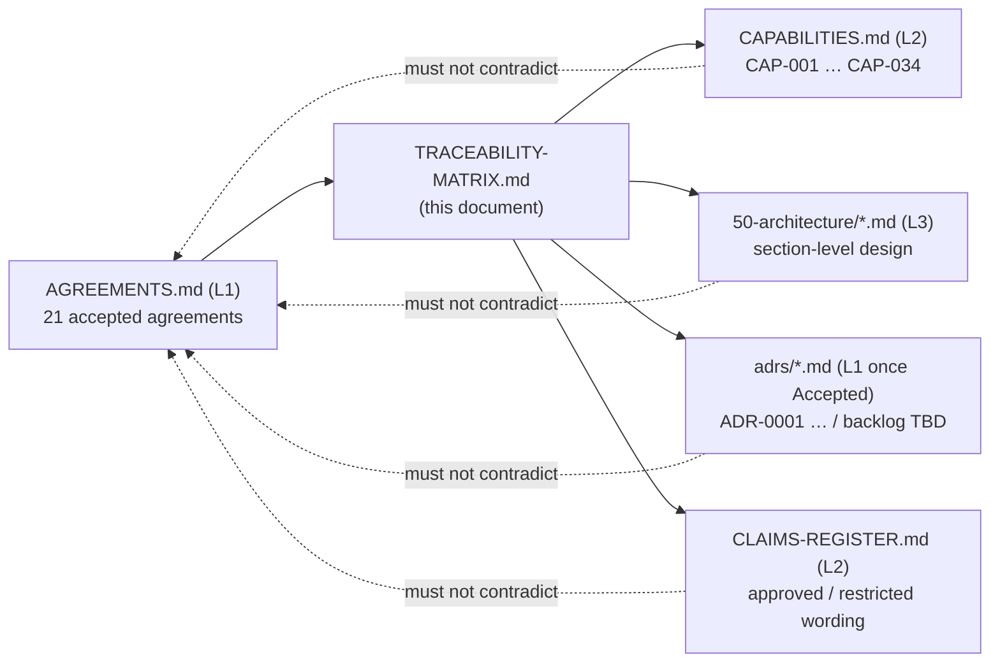

**AI Guardrails — Traceability Matrix**

**Authority level:** L1 (as held immediately before archival — see `90-archive/README.md` §6)
**Status:** Superseded
**Date:** 2026-07-26
**Derived from:** AGREEMENTS.md

> **Archived 2026-07-26 — do not cite this document as current fact.**
>
> This register's role was retired from the active information architecture
> ([`README.md`](README.md) §2). Every column it maintained duplicated, in reverse, a
> relationship already recorded beside the thing it describes: `CAPABILITIES.md` names each
> capability's agreements, `adrs/README.md` names each ADR's, the architecture set cites
> agreements inline, and `CLAIMS-REGISTER.md` names the agreement governing each claim.
> Because a reverse index is derivable from those forward citations, it is now computed on
> demand by `just trace` instead of maintained by hand — which is why this copy had drifted
> thirteen ADRs and seven capabilities behind before it was retired.
>
> Its one non-duplicated function, orphan detection, is now enforced by `just check`.
> Recorded as [DEC-021](../00-source-of-truth/DECISIONS.md#dec-021--retire-the-traceability-matrix-in-favour-of-generated-traceability).

---

## Purpose and authority

This matrix exists so that **no derived document can drift from an accepted agreement without the drift being visible.** [`AGREEMENTS.md`](../00-source-of-truth/AGREEMENTS.md) records what was negotiated and why; this matrix records **where** each agreement is expected to show up — as a product capability, as an architecture section, as an Architecture Decision Record, and as approved external wording. When a new architecture document, capability, ADR, or sales claim is written, its author checks this matrix first to see which row it must satisfy. When a reviewer finds a derived document that contradicts an agreement, this matrix is the fastest way to find every other artifact that needs the same correction.

This document is **L1 — Authoritative** in the narrow sense that its cross-references are the binding record of *which artifact implements which agreement*. It does not itself create, relax, or reinterpret any agreement — [`AGREEMENTS.md`](../00-source-of-truth/AGREEMENTS.md) and [`CONSTRAINTS.md`](../00-source-of-truth/CONSTRAINTS.md) remain the sole source of the underlying decisions and boundaries. If this matrix and a derived document disagree about coverage, the derived document is corrected. If this matrix and `AGREEMENTS.md` disagree about what was agreed, `AGREEMENTS.md` wins and this matrix is corrected.

**Scope:** one row per accepted agreement in `AGREEMENTS.md` (AGR-001 through AGR-021 — all 21 are "major" in the sense that all are `Status: Accepted`, L1). The former AGR-019 (MVP scope boundaries) and former AGR-020 (MVP success demonstration) were removed by [DEC-008](../00-source-of-truth/DECISIONS.md#dec-008--supersede-the-mvp-bounded-scope-define-and-estimate-the-full-feature-set-across-five-phases); their rows are gone, and their governing role passed to [`SCOPE.md`](../10-charter/SCOPE.md)/§16, [`10-charter/SCOPE.md`](../10-charter/SCOPE.md), and [`60-delivery/VALIDATION-PLAN.md`](../60-delivery/VALIDATION-PLAN.md) as noted below the matrix. For each agreement, the row records:

| Column | What it records | Source of truth for this column |
| --- | --- | --- |
| **Agreement** | The AGR ID and its short name. | [`AGREEMENTS.md`](../00-source-of-truth/AGREEMENTS.md) |
| **Product capability** | The `CAP-NNN` entr(y/ies) in the capability catalog that implement or are bounded by this agreement. | [`20-product/CAPABILITIES.md`](../20-product/CAPABILITIES.md) |
| **Architecture section** | The real architecture document and section number expected to specify the design. | `50-architecture/*.md` (as authored) |
| **ADR** | `ADR-0001` if an Accepted ADR already covers this agreement; otherwise `TBD` — see the [ADR backlog cross-reference](#adr-backlog-cross-reference) below. | [`50-architecture/adrs/README.md`](../50-architecture/adrs/README.md) |
| **Executive/sales claim** | The `CLAIMS-REGISTER.md` section and claim row this agreement governs, with its status (`Confirmed design` / `Hypothesis` / `Not approved`). | [`70-governance/CLAIMS-REGISTER.md`](../70-governance/CLAIMS-REGISTER.md) |

A blank-looking **ADR** cell is never actually blank in this matrix — it always reads `TBD`, and `TBD` is a deliberate backlog signal, not an omission. See the note directly below the main table.

---

## Table of contents

<!-- BEGIN GENERATED: toc -->
- [Purpose and authority](#purpose-and-authority)
- [The matrix](#the-matrix)
- [ADR backlog cross-reference](#adr-backlog-cross-reference)
- [Coverage check: every core (Phases 1–2) capability traces to an agreement](#coverage-check-every-core-phases-12-capability-traces-to-an-agreement)
- [Coverage check: every Not-approved claim traces to an agreement](#coverage-check-every-not-approved-claim-traces-to-an-agreement)
- [Maintenance and change control](#maintenance-and-change-control)
- [Related documents](#related-documents)
<!-- END GENERATED: toc -->
---

## The matrix

> **Note on the ADR column:** as of this draft, two ADRs read Accepted — [`ADR-0001-example-decision.md`](../50-architecture/adrs/ADR-0001-example-decision.md), which covers AGR-001, and [`ADR-0002-guardrail-category-catalog-and-extension-model.md`](../50-architecture/adrs/ADR-0002-guardrail-category-catalog-and-extension-model.md) (Accepted, pending owner ratification), which covers AGR-021. Every other row reads `TBD`. Per [`50-architecture/adrs/README.md`](../50-architecture/adrs/README.md), a `TBD` here does not mean the decision is unimportant — several are already listed as **candidate topics** in that document's backlog table and are expected to become numbered ADRs once someone begins the corresponding design work. The [ADR backlog cross-reference](#adr-backlog-cross-reference) section below maps each `TBD` row to its matching backlog candidate where one exists.

| Agreement | Product capability | Architecture section | ADR | Executive/sales claim |
| --- | --- | --- | --- | --- |
| **[AGR-001](../00-source-of-truth/AGREEMENTS.md#agr-001--standalone-platform-not-embedded-in-the-internal-litellm)** Standalone platform, not embedded in the internal LiteLLM | Foundational to all MVP capabilities ([`CAP-001`–`CAP-017`](../20-product/CAPABILITIES.md#core-capabilities--phases-12)); no single capability is scoped to this agreement alone. | [`SYSTEM-CONTEXT.md`](../50-architecture/SYSTEM-CONTEXT.md) §2 "What is inside the boundary"; [`ARCHITECTURE-REPORT.md`](../50-architecture/ARCHITECTURE-REPORT.md) §3 "Scope and system boundaries" | **[ADR-0001](../50-architecture/adrs/ADR-0001-example-decision.md)** — Accepted (worked example) | No dedicated register row; underlies "Supports multiple deployment modes" — Confirmed design ([Section 1](../70-governance/CLAIMS-REGISTER.md#section-1--required-core-claims)) |
| **[AGR-002](../00-source-of-truth/AGREEMENTS.md#agr-002--three-deployment-modes)** Three deployment modes | `CAP-016` Hosted runtime deployment; `CAP-017` Path to customer-managed deployment ([Deployment](../20-product/CAPABILITIES.md#deployment)); bounds `CAP-032` Dedicated hosted runtimes (Future) | [`DEPLOYMENT-ARCHITECTURE.md`](../50-architecture/DEPLOYMENT-ARCHITECTURE.md) §2–§4 (Modes A/B/C), §5 "Cross-mode comparison" | TBD | "Supports multiple deployment modes" — Confirmed design ([Section 1](../70-governance/CLAIMS-REGISTER.md#section-1--required-core-claims)) |
| **[AGR-003](../00-source-of-truth/AGREEMENTS.md#agr-003--litellm-as-first-connector-not-the-product-boundary)** LiteLLM as first connector, not the product boundary | `CAP-006` LiteLLM pre-call connector; `CAP-007` LiteLLM post-call connector; `CAP-008` Generic HTTP Evaluation API ([Connectors and APIs](../20-product/CAPABILITIES.md#connectors-and-apis)) | [`INTEGRATION-ARCHITECTURE.md`](../50-architecture/INTEGRATION-ARCHITECTURE.md) §4 "The LiteLLM connector" | TBD | "Portable policy across gateways/providers" — Confirmed design ([Section 4](../70-governance/CLAIMS-REGISTER.md#section-4--policy-and-contract-portability-claims)) |
| **[AGR-004](../00-source-of-truth/AGREEMENTS.md#agr-004--bedrock-guardrails-as-first-engine-vendor-independent-contract)** Bedrock Guardrails as first engine, vendor-independent contract | `CAP-009` Bedrock Guardrails adapter; `CAP-010` Deterministic organization rules; `CAP-012` Normalized evaluation decisions ([Connectors and APIs](../20-product/CAPABILITIES.md#connectors-and-apis), [Decisions, audit, and observability](../20-product/CAPABILITIES.md#decisions-audit-and-observability)); bounds `CAP-030` Customer-specific evaluator plugins (Future) | [`INTEGRATION-ARCHITECTURE.md`](../50-architecture/INTEGRATION-ARCHITECTURE.md) §6 "Bedrock Guardrails adapter"; [`COMPONENT-ARCHITECTURE.md`](../50-architecture/COMPONENT-ARCHITECTURE.md) §4 "Guardrails Runtime — components" | TBD | "Bedrock Guardrails is AI Guardrails' permanent or exclusive detection engine" — **Not approved** ([Section 4](../70-governance/CLAIMS-REGISTER.md#section-4--policy-and-contract-portability-claims)) |
| **[AGR-005](../00-source-of-truth/AGREEMENTS.md#agr-005--policy-portability)** Policy portability | `CAP-001` Versioned guardrail policies; `CAP-010` Deterministic organization rules ([Policy governance](../20-product/CAPABILITIES.md#policy-governance), [Connectors and APIs](../20-product/CAPABILITIES.md#connectors-and-apis)) | [`COMPONENT-ARCHITECTURE.md`](../50-architecture/COMPONENT-ARCHITECTURE.md) §9 "Design rules this architecture enforces" | TBD | "Portable policy across gateways/providers" — Confirmed design ([Section 4](../70-governance/CLAIMS-REGISTER.md#section-4--policy-and-contract-portability-claims)) |
| **[AGR-006](../00-source-of-truth/AGREEMENTS.md#agr-006--one-logical-evaluation-contract-across-all-modes)** One logical evaluation contract across all modes | `CAP-001`, `CAP-004` Input evaluation, `CAP-005` Output evaluation, `CAP-008`, `CAP-012`, `CAP-014` Evaluation latency metrics (spans [Policy governance](../20-product/CAPABILITIES.md#policy-governance), [Evaluation](../20-product/CAPABILITIES.md#evaluation), [Connectors and APIs](../20-product/CAPABILITIES.md#connectors-and-apis), [Decisions, audit, and observability](../20-product/CAPABILITIES.md#decisions-audit-and-observability)) | [`INTEGRATION-ARCHITECTURE.md`](../50-architecture/INTEGRATION-ARCHITECTURE.md) §3 "The evaluation contract" | TBD | "One evaluation contract across all three deployment modes" — Confirmed design ([Section 4](../70-governance/CLAIMS-REGISTER.md#section-4--policy-and-contract-portability-claims)) |
| **[AGR-007](../00-source-of-truth/AGREEMENTS.md#agr-007--policies-are-separate-from-connectors)** Policies are separate from connectors | `CAP-006`, `CAP-007` ([Connectors and APIs](../20-product/CAPABILITIES.md#connectors-and-apis)) | [`COMPONENT-ARCHITECTURE.md`](../50-architecture/COMPONENT-ARCHITECTURE.md) §6 "Cross-cutting contracts" | TBD | "Policies and connectors are separable and independently reusable" — Confirmed design ([Section 4](../70-governance/CLAIMS-REGISTER.md#section-4--policy-and-contract-portability-claims)) |
| **[AGR-008](../00-source-of-truth/AGREEMENTS.md#agr-008--explicit-content-exposure-model-ownership-vs-exposure-are-separate-concerns)** Explicit content-exposure model; ownership vs. exposure are separate concerns | Cross-cutting requirement on every deployment-related capability (`CAP-016`, `CAP-017`); no single dedicated CAP-ID | [`DATA-ARCHITECTURE.md`](../50-architecture/DATA-ARCHITECTURE.md) §3 "Data-handling policy"; [`SYSTEM-CONTEXT.md`](../50-architecture/SYSTEM-CONTEXT.md) §7 "Content exposure at the boundary" | TBD | "Every deployment discloses exactly where content is processed and what leaves the runtime" — Confirmed design; "Deployment modes offer identical operational ownership" — **Not approved** ([Section 5](../70-governance/CLAIMS-REGISTER.md#section-5--content-exposure-and-data-handling-claims), [Section 3](../70-governance/CLAIMS-REGISTER.md#section-3--deployment-model-claims)) |
| **[AGR-009](../00-source-of-truth/AGREEMENTS.md#agr-009--remote-evaluation-is-not-a-private-data-or-data-local-model)** Remote Evaluation is not a private-data or data-local model | `CAP-016` Hosted runtime deployment (Mode A framing specifically) | [`DEPLOYMENT-ARCHITECTURE.md`](../50-architecture/DEPLOYMENT-ARCHITECTURE.md) §2 "Mode A — Remote Evaluation" | TBD | "Remote Evaluation is a private-data or data-local model" — **Not approved** ([Section 3](../70-governance/CLAIMS-REGISTER.md#section-3--deployment-model-claims)) |
| **[AGR-010](../00-source-of-truth/AGREEMENTS.md#agr-010--guardrails-are-not-authorization)** Guardrails are not authorization | Bounds Future `CAP-021` Tool-call validation and `CAP-022` MCP authorization ([Future capabilities](../20-product/CAPABILITIES.md#later-phase-capabilities--committed-and-estimated-phases-35)) — these remain excluded from the MVP because of this agreement | [`SECURITY-ARCHITECTURE.md`](../50-architecture/SECURITY-ARCHITECTURE.md) §11 "Guardrails are not authorization" | TBD | "Guardrails are not authorization" — Confirmed design ([Section 6](../70-governance/CLAIMS-REGISTER.md#section-6--enforcement-posture-claims)) |
| **[AGR-011](../00-source-of-truth/AGREEMENTS.md#agr-011--observe-before-enforce-progression)** Observe-before-enforce progression | `CAP-003` Policy-to-workload binding; `CAP-013` Observe and enforce modes ([Workload and binding](../20-product/CAPABILITIES.md#workload-and-binding), [Decisions, audit, and observability](../20-product/CAPABILITIES.md#decisions-audit-and-observability)) | [`OPERABILITY.md`](../50-architecture/OPERABILITY.md) §4 "Policy rollout" | TBD | "Observe-before-enforce" — Confirmed design ([Section 1](../70-governance/CLAIMS-REGISTER.md#section-1--required-core-claims)) |
| **[AGR-012](../00-source-of-truth/AGREEMENTS.md#agr-012--failure-behavior-is-part-of-policy)** Failure behavior is part of policy | `CAP-015` Decision metadata auditing ([Decisions, audit, and observability](../20-product/CAPABILITIES.md#decisions-audit-and-observability)) | [`OPERABILITY.md`](../50-architecture/OPERABILITY.md) §7 "Failure behavior is explicit — no undocumented fallback" | TBD | No dedicated register row; constrains "Enterprise-ready / production-proven / compliance-certified" — **Not approved** ([Section 1](../70-governance/CLAIMS-REGISTER.md#section-1--required-core-claims)) by requiring documented failure paths before any such maturity language could be justified |
| **[AGR-013](../00-source-of-truth/AGREEMENTS.md#agr-013--aws-as-primary-cloud-minimal-mvp-account-model)** AWS as primary cloud; minimal MVP account model | `CAP-016` Hosted runtime deployment ([Deployment](../20-product/CAPABILITIES.md#deployment)); `CAP-035` Multi-region availability & per-tenant residency enforcement ([Extended deployment and commercial](../20-product/CAPABILITIES.md#extended-deployment-and-commercial)) — added by the AGR-013 amendment ([DEC-018](../00-source-of-truth/DECISIONS.md#dec-018--multi-region-availability-at-ga), Proposed) | [`DEPLOYMENT-ARCHITECTURE.md`](../50-architecture/DEPLOYMENT-ARCHITECTURE.md) §7 "AWS implementation direction"; §8 "MVP account model"; a dedicated multi-region/regionality section is not yet written — the DEC-018 amendment is not yet reflected there | TBD | No dedicated register row; constrains "Supports multiple deployment modes" restricted wording — "deploys anywhere" is disallowed ([Section 1](../70-governance/CLAIMS-REGISTER.md#section-1--required-core-claims)) |
| **[AGR-014](../00-source-of-truth/AGREEMENTS.md#agr-014--no-raw-promptresponse-retention-by-default)** No raw prompt/response retention by default | `CAP-011` Basic sensitive-data handling; `CAP-015` Decision metadata auditing ([Connectors and APIs](../20-product/CAPABILITIES.md#connectors-and-apis), [Decisions, audit, and observability](../20-product/CAPABILITIES.md#decisions-audit-and-observability)) | [`DATA-ARCHITECTURE.md`](../50-architecture/DATA-ARCHITECTURE.md) §3 "Data-handling policy" | TBD | "No raw prompt/response retention by default (hosted runtime)" — Confirmed design ([Section 5](../70-governance/CLAIMS-REGISTER.md#section-5--content-exposure-and-data-handling-claims)) |
| **[AGR-015](../00-source-of-truth/AGREEMENTS.md#agr-015--customer-managed-runtime-executes-without-a-synchronous-control-plane-connection)** Customer-managed runtime executes without a synchronous control-plane connection | `CAP-017` Path to customer-managed deployment ([Deployment](../20-product/CAPABILITIES.md#deployment)); bounds `CAP-033` Air-gapped installation (Future) | [`DEPLOYMENT-ARCHITECTURE.md`](../50-architecture/DEPLOYMENT-ARCHITECTURE.md) §4 "Mode C — Customer-Managed Runtime" | TBD | "Customer-managed runtime operates without a live dependency on the hosted control plane" — Confirmed design ([Section 5](../70-governance/CLAIMS-REGISTER.md#section-5--content-exposure-and-data-handling-claims)) |
| **[AGR-016](../00-source-of-truth/AGREEMENTS.md#agr-016--customer-controlled-telemetry-for-the-customer-managed-runtime)** Customer-controlled telemetry for the customer-managed runtime | `CAP-017` Path to customer-managed deployment ([Deployment](../20-product/CAPABILITIES.md#deployment)) | [`DATA-ARCHITECTURE.md`](../50-architecture/DATA-ARCHITECTURE.md) §3 "Data-handling policy" (customer-managed telemetry) | TBD | "Customer-managed runtime supports customer-controlled telemetry" — Confirmed design ([Section 5](../70-governance/CLAIMS-REGISTER.md#section-5--content-exposure-and-data-handling-claims)) |
| **[AGR-017](../00-source-of-truth/AGREEMENTS.md#agr-017--core-domain-model)** Core domain model | `CAP-001`, `CAP-002` Workload registration, `CAP-003`, `CAP-012`, `CAP-014`, `CAP-015` — nearly every MVP capability is expressed in terms of this model | [`DATA-ARCHITECTURE.md`](../50-architecture/DATA-ARCHITECTURE.md) §1 "Domain entity model" | TBD | No dedicated register row (internal vocabulary); underlies every "Confirmed design" claim that depends on tenant/workload/policy/binding/evaluation/decision structure |
| **[AGR-018](../00-source-of-truth/AGREEMENTS.md#agr-018--trust-and-enforcement-model)** Trust and enforcement model | Cross-cutting — bounds the enforcement posture of `CAP-006`, `CAP-007` connectors; no dedicated CAP-ID | [`SECURITY-ARCHITECTURE.md`](../50-architecture/SECURITY-ARCHITECTURE.md) §3 "Trust and enforcement model" | TBD | "Cooperative connector is a hard or bypass-proof security boundary" — **Not approved**; "Enforcement posture is explicit and auditable per workload" — Confirmed design ([Section 6](../70-governance/CLAIMS-REGISTER.md#section-6--enforcement-posture-claims)) |
| **[AGR-019](../00-source-of-truth/AGREEMENTS.md#agr-019--meaning-of-import)** Meaning of "import" | `CAP-002` Workload registration ([Workload and binding](../20-product/CAPABILITIES.md#workload-and-binding)) | [`COMPONENT-ARCHITECTURE.md`](../50-architecture/COMPONENT-ARCHITECTURE.md) §5 "Guardrails Control Plane — components" | TBD | "'Importing' a policy means AI Guardrails can access, clone, or remotely control another team's LiteLLM instance" — **Not approved** ([Section 10](../70-governance/CLAIMS-REGISTER.md#section-10--import-semantics-claims)); "Onboarding follows a predictable, repeatable flow" — Confirmed design ([Section 2](../70-governance/CLAIMS-REGISTER.md#section-2--adoption-and-onboarding-claims)) |
| **[AGR-020](../00-source-of-truth/AGREEMENTS.md#agr-020--five-phase-delivery)** Five-phase delivery | Sequences when later-phase capabilities (`CAP-018`–`CAP-034`) are delivered; not itself a CAP-ID | [`ARCHITECTURE-REPORT.md`](../50-architecture/ARCHITECTURE-REPORT.md) §19 "Delivery and migration approach"; primary detail is delivery-scoped — see [`60-delivery/MILESTONES.md`](../60-delivery/MILESTONES.md) | TBD | "Delivery has passed the initial phases / is generally available" — **Not approved** ([Section 8](../70-governance/CLAIMS-REGISTER.md#section-8--maturity-and-certification-claims)) |
| **[AGR-021](../00-source-of-truth/AGREEMENTS.md#agr-021--guardrail-category-taxonomy-and-extension-model)** Guardrail-category taxonomy and extension model | The guardrail-category catalog itself ([`20-product/GUARDRAIL-CATALOG.md`](../20-product/GUARDRAIL-CATALOG.md), `GR-001`–`GR-018`) — classification over, not addition to, `CAP-001`–`CAP-034` | [`EXTENSIBILITY-ARCHITECTURE.md`](../50-architecture/EXTENSIBILITY-ARCHITECTURE.md) (extension seams, catalog governance) | **[ADR-0002](../50-architecture/adrs/ADR-0002-guardrail-category-catalog-and-extension-model.md)** — Accepted (pending owner ratification); the former `TBD` gap is closed | "Covers all guardrail categories / complete AI-risk coverage" — **Not approved**; approved wording: the architecture permits — but does not yet deliver — extension into most categories ([Section 7](../70-governance/CLAIMS-REGISTER.md#section-7--safety-and-detection-claims)) |

> **Removed rows (DEC-008).** The former **AGR-019 — MVP scope boundaries** and **AGR-020 — MVP success demonstration** were removed from the register by [DEC-008](../00-source-of-truth/DECISIONS.md#dec-008--supersede-the-mvp-bounded-scope-define-and-estimate-the-full-feature-set-across-five-phases): the solution is now defined and estimated over the full feature set (`CAP-001`–`CAP-034`) across the five phases of AGR-020. Their traceability did not disappear — it moved:
> * Scope boundaries → [`SCOPE.md`](../10-charter/SCOPE.md) and [`10-charter/SCOPE.md`](../10-charter/SCOPE.md) (core Phases 1–2 vs. later-phase scope vs. [`SCOPE.md`](../10-charter/SCOPE.md) exclusions). Claims formerly rejected under the old AGR-019 — "complete AI governance platform / general MCP security platform", compliance-certification, invented latency/ROI figures — remain **Not approved**, re-anchored to [`SCOPE.md`](../10-charter/SCOPE.md) and the TBD discipline (see the [Not-approved coverage check](#coverage-check-every-not-approved-claim-traces-to-an-agreement)).
> * Success demonstration → the **Phase 1–2 validation demonstration** in [`60-delivery/VALIDATION-PLAN.md`](../60-delivery/VALIDATION-PLAN.md) ([`SUCCESS-CRITERIA.md`](../10-charter/SUCCESS-CRITERIA.md)); the claim "two independent LiteLLM instances have successfully shared one policy" remains **Hypothesis** until executed and recorded ([Section 9](../70-governance/CLAIMS-REGISTER.md#section-9--validation-demonstration-proof-and-metrics-claims)).

---

## ADR backlog cross-reference

Every `TBD` row above is a **backlog item**, not a gap that was overlooked. [`50-architecture/adrs/README.md`](../50-architecture/adrs/README.md) already lists five candidate topics awaiting a numbered ADR; the table below shows which agreements each candidate would close out once written and Accepted.

| Backlog candidate (see [ADR README §"Suggested backlog of future ADRs"](../50-architecture/adrs/README.md#suggested-backlog-of-future-adrs)) | Agreements it would close | Likely phase |
| --- | --- | --- |
| API + SDK integration model | AGR-003, AGR-006, AGR-007 | Phase 1–2 |
| Separate control plane and data plane | AGR-006, AGR-015, AGR-017 | Phase 1–2 |
| Support managed and standalone deployment | AGR-002, AGR-015, AGR-020 (Phase 4 sequencing) | Phase 4 |
| Event-driven policy distribution | AGR-011, AGR-012, AGR-015 | Phase 2 and 4 |
| Tenant isolation model | AGR-013, AGR-017 | Phase 2–3 |
| KMS for policy signing | (bounds `CON-009`; relevant when `CAP-028` Policy signing enters its delivery phase — see [`10-charter/SCOPE.md`](../10-charter/SCOPE.md) later-phase scope) | Phase 5 |
| Guardrail-category catalog and extension model — delivered as [ADR-0002](../50-architecture/adrs/ADR-0002-guardrail-category-catalog-and-extension-model.md) (**Accepted**, pending owner ratification) | AGR-021 — **closed** (see the main table row and the note above it) | Phase 1–2 (governance), Phase 5 (agentic categories) |

Agreements **not** covered by any current backlog candidate — AGR-001 (already Accepted as ADR-0001), AGR-004, AGR-005, AGR-007 (partially, see above), AGR-008, AGR-009, AGR-010, AGR-014, AGR-016, AGR-018, AGR-019 — remain `TBD` with no candidate topic yet proposed. That is expected: per the ADR README, not every agreement rises to the level of "a deep, hard-to-reverse architectural decision"; several of these are adequately governed by `AGREEMENTS.md`/`CONSTRAINTS.md` directly and may never need a dedicated ADR. A new candidate should be added to the ADR backlog table (not invented here) the first time someone begins design work that depends on one of these agreements and finds no existing record to cite.

---

## Coverage check: every core (Phases 1–2) capability traces to an agreement

This check confirms the matrix has not silently dropped a capability. Cross-referencing the core capabilities `CAP-001`–`CAP-017` in [`CAPABILITIES.md`](../20-product/CAPABILITIES.md) against the **Product capability** column above:

| Capability | Appears in row(s) for |
| --- | --- |
| CAP-001 | AGR-005, AGR-006, AGR-017 |
| CAP-002 | AGR-017, AGR-019 |
| CAP-003 | AGR-011, AGR-017 |
| CAP-004 | AGR-006 |
| CAP-005 | AGR-006 |
| CAP-006 | AGR-003, AGR-007, AGR-018 |
| CAP-007 | AGR-003, AGR-007, AGR-018 |
| CAP-008 | AGR-003, AGR-006 |
| CAP-009 | AGR-004 |
| CAP-010 | AGR-004, AGR-005 |
| CAP-011 | AGR-014 |
| CAP-012 | AGR-004, AGR-006, AGR-017 |
| CAP-013 | AGR-011 |
| CAP-014 | AGR-006, AGR-017 |
| CAP-015 | AGR-012, AGR-014, AGR-017 |
| CAP-016 | AGR-002, AGR-009, AGR-013 |
| CAP-017 | AGR-002, AGR-015, AGR-016 |

All 17 core (Phases 1–2) capabilities trace to at least one agreement row. No core capability is orphaned. Later-phase capabilities (`CAP-018`–`CAP-034`) are sequenced by AGR-020 and scoped by [`10-charter/SCOPE.md`](../10-charter/SCOPE.md).

---

## Coverage check: every Not-approved claim traces to an agreement

This check confirms every restricted external claim in [`CLAIMS-REGISTER.md`](../70-governance/CLAIMS-REGISTER.md) is anchored to the agreement that forbids it, so a future reviewer can find the underlying reasoning rather than taking the restriction on faith.

| Not-approved claim (Claims Register) | Governing authority (this matrix) |
| --- | --- |
| Enterprise-ready / production-proven / compliance-certified (§1) | AGR-012 (constrains); [`SCOPE.md`](../10-charter/SCOPE.md) + TBD discipline (former AGR-019, removed by DEC-008) |
| Blocks all prompt injection / guarantees safety (§1) | [`SCOPE.md`](../10-charter/SCOPE.md) + claims discipline (former AGR-019, removed by DEC-008) |
| Remote Evaluation is a private-data or data-local model (§3) | AGR-009 |
| Deployment modes offer identical operational ownership (§3) | AGR-008 |
| Bedrock Guardrails is AI Guardrails' permanent or exclusive detection engine (§4) | AGR-004 |
| AI Guardrails is a complete AI governance platform or general MCP security platform (§7) | [`SCOPE.md`](../10-charter/SCOPE.md) (former AGR-019, removed by DEC-008) |
| Delivery has passed the initial phases / is generally available (§8) | AGR-020 |
| The product carries a specific compliance certification (§8) | [`SCOPE.md`](../10-charter/SCOPE.md) (former AGR-019, removed by DEC-008) |
| Specific evaluation latency figures (§9) | TBD discipline — no metric committed beyond "must measure" (former AGR-019, removed by DEC-008) |
| Adoption, ROI, or cost-savings figures (§9) | TBD discipline (former AGR-019, removed by DEC-008) |
| "Importing" implies remote control of another team's LiteLLM (§10) | AGR-019 |
| Cooperative connector is a hard or bypass-proof security boundary (§6) | AGR-018 |
| Covers all guardrail categories / complete AI-risk coverage (§7) | AGR-021; [`SCOPE.md`](../10-charter/SCOPE.md) (out-of-boundary categories are excluded, not future) |

---

## Maintenance and change control

1. **This matrix is updated, not re-derived, when an artifact changes.** When a new `CAP-NNN` is added to `CAPABILITIES.md`, a new ADR is Accepted, or a claim's status changes in `CLAIMS-REGISTER.md`, the corresponding row(s) above must be updated in the same change set — not left to drift until the next full review.
2. **A new agreement requires a new row.** If `AGREEMENTS.md` gains an `AGR-021` or later, a row must be added here before that agreement is considered fully operationalized.
3. **An `ADR` cell only changes from `TBD` to an ADR ID when that ADR's `Status` field reads `Accepted`** — a `Proposed` ADR does not yet close the gap (see [`adrs/README.md`](../50-architecture/adrs/README.md) ADR lifecycle).
4. **Conflict resolution follows the standard authority order:** `AGREEMENTS.md` / `CONSTRAINTS.md` (L1) outrank Accepted ADRs (L1) outrank this matrix's cross-references outrank `CAPABILITIES.md` / `CLAIMS-REGISTER.md` (L2) outrank narrative or collateral documents (L3). If any two disagree, the higher-authority document wins and the lower one is corrected.
5. **Ownership** mirrors the pattern used for `AGREEMENTS.md`: Product lead and Technical lead jointly approve row additions and changes; Security and Governance lead co-approves any row touching a Claims Register `Not approved` status.

---

## Related documents

- [`AGREEMENTS.md`](../00-source-of-truth/AGREEMENTS.md) — the 21 authoritative agreements this matrix indexes.
- [`CONSTRAINTS.md`](../00-source-of-truth/CONSTRAINTS.md) — the checkable boundaries (`CON-001`–`CON-016`) that operationalize a subset of these agreements; consulted where an architecture section implements a constraint alongside an agreement.
- [`DECISIONS.md`](../00-source-of-truth/DECISIONS.md) — the product/organizational/delivery decision log; several decisions there (e.g. DEC-001) correspond 1:1 with an agreement row above. As of this draft the log also holds DEC-010–DEC-020 (all `Proposed`, owner-to-ratify); most amend or extend existing rows rather than requiring new ones — DEC-018 (multi-region availability at GA) is the one cited against the AGR-013 row above, since it is the one with a direct effect on this matrix so far.
- [`../20-product/CAPABILITIES.md`](../20-product/CAPABILITIES.md) — the capability catalog (`CAP-001`–`CAP-034`) referenced in the Product capability column.
- [`../50-architecture/adrs/README.md`](../50-architecture/adrs/README.md) — the ADR index, lifecycle, and backlog table referenced in the ADR column.
- [`../70-governance/CLAIMS-REGISTER.md`](../70-governance/CLAIMS-REGISTER.md) — the approved/restricted wording referenced in the Executive/sales claim column.
- [`../50-architecture/ARCHITECTURE-REPORT.md`](../50-architecture/ARCHITECTURE-REPORT.md) — the consolidated technical report; cites the same architecture sections indexed here.
