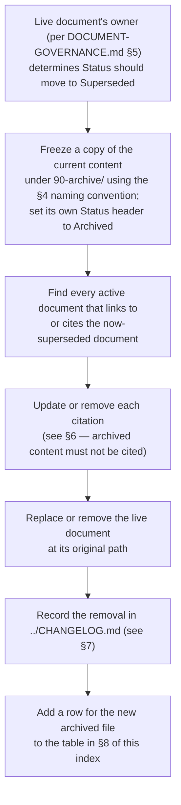

**AI Guardrails — Archive Index**

**Authority level:** L5
**Status:** Draft
**Date:** 2026-07-24
**Derived from:** seed.md + AGREEMENTS.md

---

> This document explains what `90-archive/` is for, what may be placed in it, the naming and dating convention archived files must follow, and the rule that archived content is never authoritative and must never be cited by an active document. It operationalizes, for this one directory, the document lifecycle already defined at L2 in [`DOCUMENT-GOVERNANCE.md`](../70-governance/DOCUMENT-GOVERNANCE.md) §10 ("Document lifecycle and archival"). It does not itself define that lifecycle and does not introduce any new product, architecture, or delivery ground truth — see [§1](#1-purpose-and-authority) for why it is classified **L5**.
>
> **This directory is currently empty.** No document in `solution-docs/` has yet been superseded and moved here. See [§8](#8-current-archive-contents).

---

## Table of contents

- [1. Purpose and authority](#1-purpose-and-authority)
- [2. What belongs in this archive](#2-what-belongs-in-this-archive)
- [3. What does not belong in this archive](#3-what-does-not-belong-in-this-archive)
- [4. Naming and dating convention](#4-naming-and-dating-convention)
- [5. Archival workflow](#5-archival-workflow)
- [6. Authority rule: archived documents are non-authoritative](#6-authority-rule-archived-documents-are-non-authoritative)
- [7. CHANGELOG requirement](#7-changelog-requirement)
- [8. Current archive contents](#8-current-archive-contents)
- [9. Related documents](#9-related-documents)

---

## 1. Purpose and authority

As the AI Guardrails documentation set evolves, individual documents will eventually be replaced end-to-end — a full rewrite after a scope change, a delivery-plan update after a phase-gate review, a sales-deck input retired ahead of a new cycle. [`DOCUMENT-GOVERNANCE.md`](../70-governance/DOCUMENT-GOVERNANCE.md) §10 already defines the lifecycle every document in `solution-docs/` moves through — `Draft → Accepted → Superseded → Archived` — and states that a superseded document is moved to `90-archive/` as a frozen, historical copy rather than deleted outright or left in place to drift.

This directory exists so that:

* The **active tree** (everything under `solution-docs/` outside `90-archive/`) contains only currently governing content at whatever authority level (L1–L4) each document actually holds — never a stale copy competing with the current version.
* The organization can still answer **"what did we say before, and when did it change"** — for audit trail, claims-register history (see [`CLAIMS-REGISTER.md`](../70-governance/CLAIMS-REGISTER.md)), and delivery retrospectives — without that historical copy being mistaken for present product, architecture, or delivery fact.
* Removal of a document from the active tree is always a **deliberate, recorded** act, not a silent deletion — see [§7](#7-changelog-requirement).

**Why this index is L5.** Per the authority model in [`DOCUMENT-GOVERNANCE.md`](../70-governance/DOCUMENT-GOVERNANCE.md) §2, a document's level describes how much new ground truth it is allowed to introduce, not its importance. This index introduces none: it restates and operationalizes a lifecycle already settled at L2 (`DOCUMENT-GOVERNANCE.md` §10), the same way [`50-architecture/adrs/README.md`](../50-architecture/adrs/README.md) operationalizes the ADR process without itself carrying a technical decision. Consistent with `DOCUMENT-GOVERNANCE.md` §4, an **individual document placed in this archive keeps whatever authority level it held immediately before archival** — archiving changes a document's `Status` and its citability, never the level it once carried. This index file is the only thing in the directory that is itself classified L5.

---

## 2. What belongs in this archive

A file belongs in `90-archive/` when a whole document under `solution-docs/` — outside the exclusions in [§3](#3-what-does-not-belong-in-this-archive) — has reached `Status: Superseded` per [`DOCUMENT-GOVERNANCE.md`](../70-governance/DOCUMENT-GOVERNANCE.md) §10, because either:

* it was **replaced end-to-end** by a newer edition of the same document (a full rewrite, not an incremental edit), or
* it was **replaced by a different document** taking over its role in the active tree, or
* its role was **retired** from the active information architecture altogether (for example, if a directory or document type described in `folder-spectation.md` is later dropped from the set).

Illustrative examples of the *kind* of document this covers — none of these have actually been archived as of this date:

* A full rewrite of `20-product/PRODUCT-OVERVIEW.md` after a material scope change.
* `40-sales-deck/DECK-BRIEF.md` replaced ahead of a new sales cycle with a differently structured brief.
* `50-architecture/ARCHITECTURE-REPORT.md` superseded after a phase-gate architecture review produces a new consolidated report.

---

## 3. What does not belong in this archive

Several categories of "old" content are handled elsewhere and must **not** be moved here:

| Category | Where it actually lives | Why it is excluded here |
| --- | --- | --- |
| Individual entries in [`AGREEMENTS.md`](../00-source-of-truth/AGREEMENTS.md) or `CONSTRAINTS.md` that are amended or superseded | Stay in the register file itself, with the entry's own `Status`/`Date` updated | Registers version at the entry level (`AGR-NNN`, `CON-NNN`), not the file level; the register file is never moved. |
| Individual entries in [`DECISIONS.md`](../00-source-of-truth/DECISIONS.md) that are superseded | Stay in the decision log, with the entry marked accordingly and pointing to the superseding `DEC-NNN` | Same entry-level versioning pattern as agreements and constraints. |
| Architecture Decision Records, at any status (`Proposed`, `Accepted`, `Rejected`, `Superseded`) | Stay in [`50-architecture/adrs/`](../50-architecture/adrs/README.md) | ADRs have their own permanent, never-reused numbering and their own historical-record obligation; a `Superseded` ADR is retained in place, pointing forward to the ADR that replaced it, per the ADR index. |
| Ordinary wording corrections, cross-link fixes, and other Path B edits | Git history | Archiving is for retiring a document's role or entire content, not for tracking incremental edits already covered by version control. |
| L5 generated artifacts (rendered decks, one-page summaries, `80-agent-inputs/` digests) | Regenerated on demand, not preserved | Per `DOCUMENT-GOVERNANCE.md` §6.3 and §7, a stale generated artifact is simply regenerated from current L1–L4 content, not archived as a historical record. |
| `seed.md` | Stays at the repository root | Treated as frozen historical input from the outset (`DOCUMENT-GOVERNANCE.md` §1) — it was never a live member of the L1–L5 hierarchy to begin with, so it cannot be "archived" out of it. |

---

## 4. Naming and dating convention

`90-archive/` is a **flat** directory — no subdirectories by phase, area, or document type — so an archived file's name must encode its original location and archival date on its own.

**Convention:**

```text
<original-path-with-slashes-replaced-by-‑‑>--archived-<YYYY-MM-DD>.md
```

To construct it:

1. Take the document's path relative to `solution-docs/` (for example `20-product/PRODUCT-OVERVIEW.md`).
2. Replace every `/` with `--` and drop the trailing `.md`.
3. Append `--archived-<YYYY-MM-DD>`, using the date the document's `Status` became `Superseded` (matching the `YYYY-MM-DD` format used in every document header in this set).
4. Restore the `.md` extension.

**Illustrative examples** (no document has actually been archived yet — these show the pattern only):

| Original path | Date archived | Archived filename |
| --- | --- | --- |
| `20-product/PRODUCT-OVERVIEW.md` | `2026-09-01` | `20-product--PRODUCT-OVERVIEW--archived-2026-09-01.md` |
| `40-sales-deck/DECK-BRIEF.md` | `2026-10-15` | `40-sales-deck--DECK-BRIEF--archived-2026-10-15.md` |
| `50-architecture/ARCHITECTURE-REPORT.md` | `2027-01-20` | `50-architecture--ARCHITECTURE-REPORT--archived-2027-01-20.md` |

If the same original path is archived more than once over time (for example, a document is rewritten, superseded, later restored, and eventually superseded again), each archived copy keeps its own distinct `--archived-YYYY-MM-DD` suffix, so multiple historical snapshots of the same original path can coexist without a naming collision.

---

## 5. Archival workflow



A few points that keep this consistent with `DOCUMENT-GOVERNANCE.md` §10:

* The archived copy is **frozen** — once placed in `90-archive/`, it is never edited again. A later correction to history is not possible by design; only a new archival event (a new file, a new date suffix) can add to the record.
* The live path in the active tree is the only one change control (`DOCUMENT-GOVERNANCE.md` §6) continues to apply to. Once a document is archived, `90-archive/` is out of scope for the ongoing Path A / Path B process.
* This archival step is usually the direct consequence of a Path A amendment or a Path B correction that already required updating [`TRACEABILITY-MATRIX.md`](../00-source-of-truth/TRACEABILITY-MATRIX.md) and logging a `CHANGELOG.md` entry — archiving does not introduce a third, separate approval process on top of those.

---

## 6. Authority rule: archived documents are non-authoritative

An archived document carries **no authority**, regardless of the level (L1–L4) it held while it was part of the active tree. Specifically:

* An archived document must **never be cited as evidence** for a claim in [`CLAIMS-REGISTER.md`](../70-governance/CLAIMS-REGISTER.md), a risk assessment in [`RISK-REGISTER.md`](../70-governance/RISK-REGISTER.md), or any other active document.
* An active document must **never link to a file under `90-archive/`** as if it were describing current product, architecture, or delivery behavior. A link found doing this is itself a defect and must be corrected through Path B ([`DOCUMENT-GOVERNANCE.md`](../70-governance/DOCUMENT-GOVERNANCE.md) §6.2) — either point the citation at the current, superseding document, or remove the reference.
* The only legitimate reason to reference an archived file from an active document is explicitly historical narrative — for example, "an earlier edition of this report described the deployment model differently; see the archived copy for the prior wording" — and even then, the archived content must not be presented as still governing anything.
* Because an archived copy is frozen at whatever level it held before archival, it does not "downgrade" to L5 on entry — but it does lose all citability. Level and citability are separate: level records what the document was allowed to say when it was live; citability records whether it may still be relied on today. Archival ends the latter unconditionally.

---

## 7. CHANGELOG requirement

Moving a document out of the active tree and into `90-archive/` is a change to the documentation set itself, and per [`DOCUMENT-GOVERNANCE.md`](../70-governance/DOCUMENT-GOVERNANCE.md) §9 it must be recorded in [`../CHANGELOG.md`](../CHANGELOG.md), using the same entry shape as any other documentation-set change: Date, Document(s), Change type (Path A or Path B), Trigger, Owner.

The `CHANGELOG.md` entry that records the archival should name **both** the active-tree document that changed (or was removed) and the resulting archived filename, so a reader can find one from the other without consulting this index separately. In the ordinary case, the archival is the direct outcome of a Path A amendment or a Path B correction that already required a `CHANGELOG.md` entry — the archival does not need a second, independent entry, but that entry must not omit the archived filename.

[`../CHANGELOG.md`](../CHANGELOG.md) is referenced by `DOCUMENT-GOVERNANCE.md` and by `folder-spectation.md` as the intended root-level ledger of documentation-set changes, and it exists in this document set at `solution-docs/CHANGELOG.md`. Every future archival event must be logged there under this rule.

---

## 8. Current archive contents

| Archived filename | Original path | Date archived | Reason | Superseded by | CHANGELOG entry |
| --- | --- | --- | --- | --- | --- |
| — | — | — | — | — | — |

No document has been archived yet. This table is updated as the final step of the workflow in [§5](#5-archival-workflow), one row per archived file, in the order files are added.

---

## 9. Related documents

- [`../70-governance/DOCUMENT-GOVERNANCE.md`](../70-governance/DOCUMENT-GOVERNANCE.md) — the L2 document that defines the full L1–L5 authority model and the document lifecycle (§10) this index operationalizes; where the two could be read as disagreeing, `DOCUMENT-GOVERNANCE.md` governs and this index must be corrected.
- [`../00-source-of-truth/AGREEMENTS.md`](../00-source-of-truth/AGREEMENTS.md) — L1 authoritative agreements; agreement-level supersession happens in place within this register, not via this archive (see [§3](#3-what-does-not-belong-in-this-archive)).
- [`../00-source-of-truth/DECISIONS.md`](../00-source-of-truth/DECISIONS.md) — the product/organizational/delivery decision log; same in-place versioning pattern as agreements.
- [`../50-architecture/adrs/README.md`](../50-architecture/adrs/README.md) — the sibling lifecycle for Architecture Decision Records, which are never relocated to this archive.
- [`../CHANGELOG.md`](../CHANGELOG.md) — the chronological ledger every archival must be recorded in.
- [`../70-governance/CLAIMS-REGISTER.md`](../70-governance/CLAIMS-REGISTER.md) — must never cite an archived document as evidence for a live external-facing claim.
- [`../../folder-spectation.md`](../../folder-spectation.md) — the original documentation-set proposal that reserved this directory and first described `CHANGELOG.md`'s purpose.
