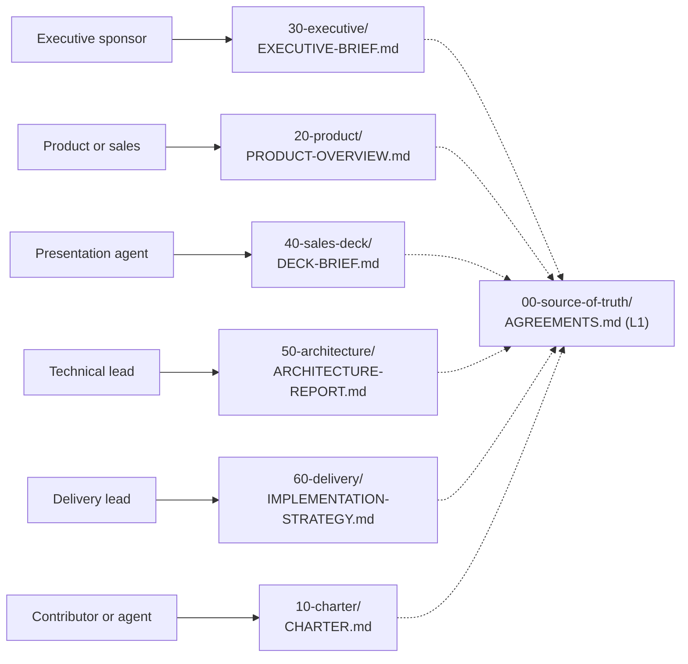

**AI Guardrails — Document Map**

**Authority level:** L4
**Status:** Draft
**Date:** 2026-07-24
**Derived from:** AGREEMENTS.md

---

## Purpose

This document is the navigational entry point for `solution-docs/`. It answers one question for every reader: *"Given who I am, what should I read first, and what else do I need?"*

It is a communicative document, not a source of new content. It introduces no agreements, requirements, or figures of its own — it only routes readers to the documents that already contain them. If anything in this map appears to disagree with a linked document, the linked document governs, and ultimately [`00-source-of-truth/AGREEMENTS.md`](00-source-of-truth/AGREEMENTS.md) governs both. See [`70-governance/DOCUMENT-GOVERNANCE.md`](70-governance/DOCUMENT-GOVERNANCE.md) for the full L1–L5 authority model and precedence rules that this map operates under.

As of this writing, the documentation set spans **10 top-level folders and 69 Markdown files**. No reader is expected to read all of them; this map exists precisely so that no one has to.

---

## How to use this map

1. Find your role (or the closest match) in the table below.
2. Open the **Start here** document. It is written for your audience and will make sense without reading anything else first.
3. Follow its **Related documents** section, or the **Supporting documents** listed here, only as deep as you need.
4. If you are a generation agent producing a derived artifact (executive brief, sales deck, architecture review, charter update), go to [`80-agent-inputs/`](80-agent-inputs/) instead of reasoning from this map alone — it contains your binding output contract.

---

## Reader-to-document map

| Reader | Start here | Focus | Supporting documents |
| --- | --- | --- | --- |
| **Executive sponsor** | [`30-executive/EXECUTIVE-BRIEF.md`](30-executive/EXECUTIVE-BRIEF.md) | Business case, expected outcomes, risks | [`BUSINESS-CASE.md`](30-executive/BUSINESS-CASE.md) · [`EXPECTED-OUTCOMES.md`](30-executive/EXPECTED-OUTCOMES.md) · [`RISKS-AND-DEPENDENCIES.md`](30-executive/RISKS-AND-DEPENDENCIES.md) · [`INVESTMENT-SUMMARY.md`](30-executive/INVESTMENT-SUMMARY.md) · [`DECISION-REQUEST.md`](30-executive/DECISION-REQUEST.md) |
| **Product or sales** | [`20-product/PRODUCT-OVERVIEW.md`](20-product/PRODUCT-OVERVIEW.md) | Value proposition, personas, use cases | [`VALUE-PROPOSITION.md`](20-product/VALUE-PROPOSITION.md) · [`TARGET-USERS.md`](20-product/TARGET-USERS.md) · [`USE-CASES.md`](20-product/USE-CASES.md) · [`CAPABILITIES.md`](20-product/CAPABILITIES.md) · [`GUARDRAIL-CATALOG.md`](20-product/GUARDRAIL-CATALOG.md) · [`DIFFERENTIATORS.md`](20-product/DIFFERENTIATORS.md) · [`PROBLEM-STATEMENT.md`](20-product/PROBLEM-STATEMENT.md) · [`PRODUCT-ROADMAP.md`](20-product/PRODUCT-ROADMAP.md) · [`FAQ.md`](20-product/FAQ.md) |
| **Presentation agent** | [`40-sales-deck/DECK-BRIEF.md`](40-sales-deck/DECK-BRIEF.md) | Slide outline, narrative, proof points | [`SLIDE-OUTLINE.md`](40-sales-deck/SLIDE-OUTLINE.md) · [`SALES-NARRATIVE.md`](40-sales-deck/SALES-NARRATIVE.md) · [`PROOF-POINTS.md`](40-sales-deck/PROOF-POINTS.md) · [`AUDIENCE-AND-PERSONAS.md`](40-sales-deck/AUDIENCE-AND-PERSONAS.md) · [`BENEFITS-AND-OUTCOMES.md`](40-sales-deck/BENEFITS-AND-OUTCOMES.md) · [`CUSTOMER-PAIN-POINTS.md`](40-sales-deck/CUSTOMER-PAIN-POINTS.md) · [`OBJECTION-HANDLING.md`](40-sales-deck/OBJECTION-HANDLING.md) · [`CALL-TO-ACTION.md`](40-sales-deck/CALL-TO-ACTION.md) · [`VISUAL-DIRECTION.md`](40-sales-deck/VISUAL-DIRECTION.md) |
| **Technical lead** | [`50-architecture/ARCHITECTURE-REPORT.md`](50-architecture/ARCHITECTURE-REPORT.md) | NFRs, security, deployment, feasibility | [`NON-FUNCTIONAL-REQUIREMENTS.md`](50-architecture/NON-FUNCTIONAL-REQUIREMENTS.md) · [`REQUIREMENTS.md`](50-architecture/REQUIREMENTS.md) · [`SECURITY-ARCHITECTURE.md`](50-architecture/SECURITY-ARCHITECTURE.md) · [`DEPLOYMENT-ARCHITECTURE.md`](50-architecture/DEPLOYMENT-ARCHITECTURE.md) · [`FEASIBILITY-ASSESSMENT.md`](50-architecture/FEASIBILITY-ASSESSMENT.md) · [`SYSTEM-CONTEXT.md`](50-architecture/SYSTEM-CONTEXT.md) · [`CONTAINER-ARCHITECTURE.md`](50-architecture/CONTAINER-ARCHITECTURE.md) · [`COMPONENT-ARCHITECTURE.md`](50-architecture/COMPONENT-ARCHITECTURE.md) · [`DATA-ARCHITECTURE.md`](50-architecture/DATA-ARCHITECTURE.md) · [`INTEGRATION-ARCHITECTURE.md`](50-architecture/INTEGRATION-ARCHITECTURE.md) · [`EXTENSIBILITY-ARCHITECTURE.md`](50-architecture/EXTENSIBILITY-ARCHITECTURE.md) · [`OPERABILITY.md`](50-architecture/OPERABILITY.md) · [`TECHNICAL-RISKS.md`](50-architecture/TECHNICAL-RISKS.md) · [`TRADE-OFFS.md`](50-architecture/TRADE-OFFS.md) · [`adrs/README.md`](50-architecture/adrs/README.md) |
| **Delivery lead** | [`60-delivery/IMPLEMENTATION-STRATEGY.md`](60-delivery/IMPLEMENTATION-STRATEGY.md) | Milestones, dependencies, validation | [`MILESTONES.md`](60-delivery/MILESTONES.md) · [`DEPENDENCIES.md`](60-delivery/DEPENDENCIES.md) · [`VALIDATION-PLAN.md`](60-delivery/VALIDATION-PLAN.md) · [`RELEASE-CRITERIA.md`](60-delivery/RELEASE-CRITERIA.md) · [`TEAM-AND-OWNERSHIP.md`](60-delivery/TEAM-AND-OWNERSHIP.md) |
| **Contributor or agent** | [`10-charter/CHARTER.md`](10-charter/CHARTER.md) | Agreements, principles, output contracts | [`00-source-of-truth/AGREEMENTS.md`](00-source-of-truth/AGREEMENTS.md) · [`PRINCIPLES.md`](10-charter/PRINCIPLES.md) · [`SCOPE.md`](10-charter/SCOPE.md) · [`SUCCESS-CRITERIA.md`](10-charter/SUCCESS-CRITERIA.md) · [`80-agent-inputs/OUTPUT-CONTRACTS.md`](80-agent-inputs/OUTPUT-CONTRACTS.md) · [`80-agent-inputs/README.md`](80-agent-inputs/README.md) · [`70-governance/GLOSSARY.md`](70-governance/GLOSSARY.md) |



---

## Reader profiles in detail

### Executive sponsor

**Start here:** [`30-executive/EXECUTIVE-BRIEF.md`](30-executive/EXECUTIVE-BRIEF.md)

Answers: what problem is this solving, what is the proposed solution, what outcomes are expected, what does it cost the organization in investment and risk, and what decision is being asked for right now. Written to be readable without any architecture or delivery background.

Supporting documents, in the order they are typically needed:

- [`30-executive/BUSINESS-CASE.md`](30-executive/BUSINESS-CASE.md) — the underlying business justification the brief summarizes.
- [`30-executive/EXPECTED-OUTCOMES.md`](30-executive/EXPECTED-OUTCOMES.md) — outcomes tied to the five delivery phases.
- [`30-executive/RISKS-AND-DEPENDENCIES.md`](30-executive/RISKS-AND-DEPENDENCIES.md) — the risk view an executive is accountable for accepting.
- [`30-executive/INVESTMENT-SUMMARY.md`](30-executive/INVESTMENT-SUMMARY.md) — organizational and investment impact.
- [`30-executive/DECISION-REQUEST.md`](30-executive/DECISION-REQUEST.md) — the specific ask and decision rights involved.

### Product or sales

**Start here:** [`20-product/PRODUCT-OVERVIEW.md`](20-product/PRODUCT-OVERVIEW.md)

Answers: what AI Guardrails is, why it exists, the three operating models, who it serves, and where the phased scope boundary sits — without requiring architecture depth.

Supporting documents:

- [`20-product/VALUE-PROPOSITION.md`](20-product/VALUE-PROPOSITION.md) — the value case per audience.
- [`20-product/TARGET-USERS.md`](20-product/TARGET-USERS.md) — platform teams, application teams, security/compliance, product operators.
- [`20-product/USE-CASES.md`](20-product/USE-CASES.md) — concrete scenarios, including the meaning of "import."
- [`20-product/CAPABILITIES.md`](20-product/CAPABILITIES.md) — the capability catalog (L2 — definitional).
- [`20-product/DIFFERENTIATORS.md`](20-product/DIFFERENTIATORS.md) — what distinguishes the product from alternatives.
- [`20-product/PROBLEM-STATEMENT.md`](20-product/PROBLEM-STATEMENT.md) — the problem being solved, stated plainly.
- [`20-product/PRODUCT-ROADMAP.md`](20-product/PRODUCT-ROADMAP.md) — how capability grows across the five delivery phases.
- [`20-product/FAQ.md`](20-product/FAQ.md) — anticipated questions and their answers.

### Presentation agent

**Start here:** [`40-sales-deck/DECK-BRIEF.md`](40-sales-deck/DECK-BRIEF.md)

This is the operating brief for any agent or person assembling a sales deck: objective, audience, required slides, claims that may and may not be made, tone, and visual direction. It exists precisely so that deck generation does not need to re-derive messaging from first principles.

Supporting documents:

- [`40-sales-deck/SLIDE-OUTLINE.md`](40-sales-deck/SLIDE-OUTLINE.md) — the slide-by-slide structure.
- [`40-sales-deck/SALES-NARRATIVE.md`](40-sales-deck/SALES-NARRATIVE.md) — the narrative arc connecting the slides.
- [`40-sales-deck/PROOF-POINTS.md`](40-sales-deck/PROOF-POINTS.md) — evidence permitted to back the narrative.
- [`40-sales-deck/AUDIENCE-AND-PERSONAS.md`](40-sales-deck/AUDIENCE-AND-PERSONAS.md) — who is in the room.
- [`40-sales-deck/BENEFITS-AND-OUTCOMES.md`](40-sales-deck/BENEFITS-AND-OUTCOMES.md) — benefit framing.
- [`40-sales-deck/CUSTOMER-PAIN-POINTS.md`](40-sales-deck/CUSTOMER-PAIN-POINTS.md) — the pain the narrative opens with.
- [`40-sales-deck/OBJECTION-HANDLING.md`](40-sales-deck/OBJECTION-HANDLING.md) — anticipated pushback and responses.
- [`40-sales-deck/CALL-TO-ACTION.md`](40-sales-deck/CALL-TO-ACTION.md) — the close.
- [`40-sales-deck/VISUAL-DIRECTION.md`](40-sales-deck/VISUAL-DIRECTION.md) — visual and tone direction for the rendered deck.

A presentation agent should also consult [`80-agent-inputs/SALES-DECK-AGENT.md`](80-agent-inputs/SALES-DECK-AGENT.md) and [`80-agent-inputs/OUTPUT-CONTRACTS.md`](80-agent-inputs/OUTPUT-CONTRACTS.md) for the binding output contract before generating anything.

### Technical lead

**Start here:** [`50-architecture/ARCHITECTURE-REPORT.md`](50-architecture/ARCHITECTURE-REPORT.md)

Consolidates scope and system boundaries, functional and non-functional requirements, the proposed logical architecture, the domain model, and deployment-mode topology into one report.

Supporting documents:

- [`50-architecture/NON-FUNCTIONAL-REQUIREMENTS.md`](50-architecture/NON-FUNCTIONAL-REQUIREMENTS.md) and [`REQUIREMENTS.md`](50-architecture/REQUIREMENTS.md) — the requirement baselines (L2 — definitional).
- [`50-architecture/SECURITY-ARCHITECTURE.md`](50-architecture/SECURITY-ARCHITECTURE.md) — security requirements and controls.
- [`50-architecture/DEPLOYMENT-ARCHITECTURE.md`](50-architecture/DEPLOYMENT-ARCHITECTURE.md) — the three deployment modes realized as infrastructure.
- [`50-architecture/FEASIBILITY-ASSESSMENT.md`](50-architecture/FEASIBILITY-ASSESSMENT.md) — build feasibility against the phased delivery boundary.
- [`50-architecture/SYSTEM-CONTEXT.md`](50-architecture/SYSTEM-CONTEXT.md), [`CONTAINER-ARCHITECTURE.md`](50-architecture/CONTAINER-ARCHITECTURE.md), [`COMPONENT-ARCHITECTURE.md`](50-architecture/COMPONENT-ARCHITECTURE.md) — the C4 view set, in zoom order.
- [`50-architecture/DATA-ARCHITECTURE.md`](50-architecture/DATA-ARCHITECTURE.md) — the domain model and data-handling design.
- [`50-architecture/INTEGRATION-ARCHITECTURE.md`](50-architecture/INTEGRATION-ARCHITECTURE.md) — the LiteLLM connector and Bedrock Guardrails adapter.
- [`50-architecture/OPERABILITY.md`](50-architecture/OPERABILITY.md) — availability, failure behavior, and rollout mechanics.
- [`50-architecture/TECHNICAL-RISKS.md`](50-architecture/TECHNICAL-RISKS.md) and [`TRADE-OFFS.md`](50-architecture/TRADE-OFFS.md) — engineering risk and design trade-off analysis.
- [`50-architecture/adrs/README.md`](50-architecture/adrs/README.md) — the Architecture Decision Record index, including [`ADR-0001-example-decision.md`](50-architecture/adrs/ADR-0001-example-decision.md).

### Delivery lead

**Start here:** [`60-delivery/IMPLEMENTATION-STRATEGY.md`](60-delivery/IMPLEMENTATION-STRATEGY.md)

Covers the relationship to the roadmap and scope, the five delivery phases and build sequence, the phase boundaries, build-vs-buy decisions, and integration order.

Supporting documents:

- [`60-delivery/MILESTONES.md`](60-delivery/MILESTONES.md) — milestone-level breakdown of the delivery phases.
- [`60-delivery/DEPENDENCIES.md`](60-delivery/DEPENDENCIES.md) — cross-phase and cross-team dependencies.
- [`60-delivery/VALIDATION-PLAN.md`](60-delivery/VALIDATION-PLAN.md) — how the Phase 1–2 validation demonstration is proven out.
- [`60-delivery/RELEASE-CRITERIA.md`](60-delivery/RELEASE-CRITERIA.md) — the Phase 1–2 exit gates (L2 — definitional).
- [`60-delivery/TEAM-AND-OWNERSHIP.md`](60-delivery/TEAM-AND-OWNERSHIP.md) — who owns what across delivery.

### Contributor or agent

**Start here:** [`10-charter/CHARTER.md`](10-charter/CHARTER.md)

The charter is the single document that carries purpose, vision, stakeholders, in-scope/out-of-scope capabilities, guiding principles, operating model, and success criteria in one place — the minimum a new contributor or a generation agent needs before touching any other document.

Supporting documents:

- [`00-source-of-truth/AGREEMENTS.md`](00-source-of-truth/AGREEMENTS.md) — the authoritative agreements the charter is derived from; never contradict this.
- [`10-charter/PRINCIPLES.md`](10-charter/PRINCIPLES.md) — the product principles (policy portability, one contract across modes, observe-before-enforce, and so on).
- [`10-charter/SCOPE.md`](10-charter/SCOPE.md) — in-scope, later-phase, and out-of-scope boundaries.
- [`10-charter/SUCCESS-CRITERIA.md`](10-charter/SUCCESS-CRITERIA.md) — what counts as success across the delivery phases.
- [`80-agent-inputs/OUTPUT-CONTRACTS.md`](80-agent-inputs/OUTPUT-CONTRACTS.md) — the binding output contract for every generation agent (sales deck, architecture review, executive brief, charter maintenance).
- [`80-agent-inputs/README.md`](80-agent-inputs/README.md) — why the agent-inputs directory exists and the "reference, don't duplicate" rule.
- [`70-governance/GLOSSARY.md`](70-governance/GLOSSARY.md) — canonical vocabulary used consistently across the set.

---

## Cross-cutting references

These are not owned by any single audience and are relevant regardless of role:

| Document | Why it matters to everyone |
| --- | --- |
| [`00-source-of-truth/AGREEMENTS.md`](00-source-of-truth/AGREEMENTS.md) | The authoritative register (L1). Nothing else in the set may contradict it. |
| [`00-source-of-truth/CONSTRAINTS.md`](00-source-of-truth/CONSTRAINTS.md) | Hard constraints (L1), alongside the agreements. |
| [`00-source-of-truth/DECISIONS.md`](00-source-of-truth/DECISIONS.md) | The decision log (L1). |
| [`00-source-of-truth/ASSUMPTIONS.md`](00-source-of-truth/ASSUMPTIONS.md) | Standing assumptions the rest of the set relies on (L1). |
| [`00-source-of-truth/OPEN-QUESTIONS.md`](00-source-of-truth/OPEN-QUESTIONS.md) | Unresolved questions tracked for future resolution (L1). |
| [`00-source-of-truth/PROVENANCE.md`](00-source-of-truth/PROVENANCE.md) | Where the original solution charter's content now lives; a lookup aid, not a source. |
| [`70-governance/DOCUMENT-GOVERNANCE.md`](70-governance/DOCUMENT-GOVERNANCE.md) | The L1–L5 authority model, precedence rules, and change-control process governing this entire map. |
| [`70-governance/GLOSSARY.md`](70-governance/GLOSSARY.md) | Canonical terminology (tenant, workload, policy, binding, evaluation, decision, and the three deployment modes). |
| [`70-governance/CLAIMS-REGISTER.md`](70-governance/CLAIMS-REGISTER.md) | Claim patterns that are approved or explicitly rejected (for example, Mode A must never be described as data-local). |
| [`70-governance/RISK-REGISTER.md`](70-governance/RISK-REGISTER.md) | The consolidated risk register referenced by executive, architecture, and delivery materials alike. |
| [`70-governance/REFERENCES.md`](70-governance/REFERENCES.md) | Source references cited across the set. |

---

## Full repository index

For completeness, every document in `solution-docs/` grouped by folder. Authority level (L1–L5) is read directly from each document's own header, as required by [`70-governance/DOCUMENT-GOVERNANCE.md`](70-governance/DOCUMENT-GOVERNANCE.md#2-the-l1l5-authority-model).

```text
solution-docs/
├── 00-source-of-truth/   L1 — authoritative registers
├── 10-charter/           L2 — the charter and its companions
├── 20-product/           L2/L4 — product-facing material
├── 30-executive/         L3/L4 — executive material
├── 40-sales-deck/        L4 — sales-deck inputs
├── 50-architecture/      L2/L3 (L1 once ADRs are accepted) — architecture
├── 60-delivery/          L2/L3 — delivery planning
├── 70-governance/        L2/L3 — governance and registers
├── 80-agent-inputs/      L4 — generation-agent instructions
└── 90-archive/           L5 — superseded, non-authoritative copies
```

### `00-source-of-truth/` — L1, authoritative

| Document | Purpose |
| --- | --- |
| [`AGREEMENTS.md`](00-source-of-truth/AGREEMENTS.md) | The 20 accepted agreements that no other document may contradict. |
| [`ASSUMPTIONS.md`](00-source-of-truth/ASSUMPTIONS.md) | Standing assumptions underlying the solution. |
| [`CONSTRAINTS.md`](00-source-of-truth/CONSTRAINTS.md) | Hard constraints on the solution. |
| [`DECISIONS.md`](00-source-of-truth/DECISIONS.md) | The decision log. |
| [`OPEN-QUESTIONS.md`](00-source-of-truth/OPEN-QUESTIONS.md) | Open questions awaiting resolution. |
| [`PROVENANCE.md`](00-source-of-truth/PROVENANCE.md) | Provenance of the original solution charter. |
| [`TRACEABILITY-MATRIX.md`](00-source-of-truth/TRACEABILITY-MATRIX.md) | Maps each agreement to the capability, architecture section, ADR, and executive/sales claim that realize it; the drift-prevention backbone of the set. |

### `10-charter/` — L2, defining

| Document | Purpose |
| --- | --- |
| [`CHARTER.md`](10-charter/CHARTER.md) | Purpose, vision, stakeholders, scope, principles, operating model, success criteria. |
| [`PRINCIPLES.md`](10-charter/PRINCIPLES.md) | The product's guiding principles. |
| [`SCOPE.md`](10-charter/SCOPE.md) | In-scope, later-phase, and out-of-scope boundaries. |
| [`SUCCESS-CRITERIA.md`](10-charter/SUCCESS-CRITERIA.md) | What counts as success. |

### `20-product/` — L2 (`CAPABILITIES.md`) / L4 (remainder)

| Document | Purpose |
| --- | --- |
| [`CAPABILITIES.md`](20-product/CAPABILITIES.md) | The capability catalog, by delivery status. |
| [`GUARDRAIL-CATALOG.md`](20-product/GUARDRAIL-CATALOG.md) | The guardrail-category taxonomy (`GR-001`–`GR-018`) — vision taxonomy, classification not commitment (AGR-021). |
| [`DIFFERENTIATORS.md`](20-product/DIFFERENTIATORS.md) | What distinguishes the product. |
| [`FAQ.md`](20-product/FAQ.md) | Frequently asked questions. |
| [`PROBLEM-STATEMENT.md`](20-product/PROBLEM-STATEMENT.md) | The problem being solved. |
| [`PRODUCT-OVERVIEW.md`](20-product/PRODUCT-OVERVIEW.md) | What AI Guardrails is, the three operating models, capability snapshot. |
| [`PRODUCT-ROADMAP.md`](20-product/PRODUCT-ROADMAP.md) | How capability grows across the five delivery phases. |
| [`TARGET-USERS.md`](20-product/TARGET-USERS.md) | Target users and stakeholders. |
| [`USE-CASES.md`](20-product/USE-CASES.md) | Concrete use cases, including the meaning of "import." |
| [`VALUE-PROPOSITION.md`](20-product/VALUE-PROPOSITION.md) | The value case per audience. |

### `30-executive/` — L3 (`BUSINESS-CASE.md`, `INVESTMENT-SUMMARY.md`, `RISKS-AND-DEPENDENCIES.md`) / L4 (remainder)

| Document | Purpose |
| --- | --- |
| [`BUSINESS-CASE.md`](30-executive/BUSINESS-CASE.md) | The business justification. |
| [`DECISION-REQUEST.md`](30-executive/DECISION-REQUEST.md) | The specific decision being asked for. |
| [`EXECUTIVE-BRIEF.md`](30-executive/EXECUTIVE-BRIEF.md) | The executive-facing summary of the whole solution. |
| [`EXPECTED-OUTCOMES.md`](30-executive/EXPECTED-OUTCOMES.md) | Outcomes expected across delivery phases. |
| [`INVESTMENT-SUMMARY.md`](30-executive/INVESTMENT-SUMMARY.md) | Investment and organizational impact. |
| [`RISKS-AND-DEPENDENCIES.md`](30-executive/RISKS-AND-DEPENDENCIES.md) | Executive-level risk and dependency view. |

### `40-sales-deck/` — L4

| Document | Purpose |
| --- | --- |
| [`AUDIENCE-AND-PERSONAS.md`](40-sales-deck/AUDIENCE-AND-PERSONAS.md) | Who the deck is for. |
| [`BENEFITS-AND-OUTCOMES.md`](40-sales-deck/BENEFITS-AND-OUTCOMES.md) | Benefit framing. |
| [`CALL-TO-ACTION.md`](40-sales-deck/CALL-TO-ACTION.md) | The close. |
| [`CUSTOMER-PAIN-POINTS.md`](40-sales-deck/CUSTOMER-PAIN-POINTS.md) | The pain the narrative opens with. |
| [`DECK-BRIEF.md`](40-sales-deck/DECK-BRIEF.md) | The operating brief for deck generation. |
| [`OBJECTION-HANDLING.md`](40-sales-deck/OBJECTION-HANDLING.md) | Anticipated objections and responses. |
| [`PROOF-POINTS.md`](40-sales-deck/PROOF-POINTS.md) | Permitted evidence. |
| [`SALES-NARRATIVE.md`](40-sales-deck/SALES-NARRATIVE.md) | The narrative arc. |
| [`SLIDE-OUTLINE.md`](40-sales-deck/SLIDE-OUTLINE.md) | Slide-by-slide structure. |
| [`VISUAL-DIRECTION.md`](40-sales-deck/VISUAL-DIRECTION.md) | Visual and tone direction. |

### `50-architecture/` — L2 (`NON-FUNCTIONAL-REQUIREMENTS.md`, `REQUIREMENTS.md`) / L3 (remainder) / L1 (`adrs/*`, once accepted)

| Document | Purpose |
| --- | --- |
| [`ARCHITECTURE-REPORT.md`](50-architecture/ARCHITECTURE-REPORT.md) | Consolidated architecture report; the technical lead's start point. |
| [`COMPONENT-ARCHITECTURE.md`](50-architecture/COMPONENT-ARCHITECTURE.md) | C4 Level 3 component view. |
| [`CONTAINER-ARCHITECTURE.md`](50-architecture/CONTAINER-ARCHITECTURE.md) | Container-level view. |
| [`DATA-ARCHITECTURE.md`](50-architecture/DATA-ARCHITECTURE.md) | Domain model and data handling. |
| [`DEPLOYMENT-ARCHITECTURE.md`](50-architecture/DEPLOYMENT-ARCHITECTURE.md) | The three deployment modes as infrastructure. |
| [`FEASIBILITY-ASSESSMENT.md`](50-architecture/FEASIBILITY-ASSESSMENT.md) | Build feasibility against the phased delivery boundary. |
| [`EXTENSIBILITY-ARCHITECTURE.md`](50-architecture/EXTENSIBILITY-ARCHITECTURE.md) | The growth model — extension seams and catalog graduation process. |
| [`INTEGRATION-ARCHITECTURE.md`](50-architecture/INTEGRATION-ARCHITECTURE.md) | LiteLLM connector and Bedrock Guardrails adapter. |
| [`NON-FUNCTIONAL-REQUIREMENTS.md`](50-architecture/NON-FUNCTIONAL-REQUIREMENTS.md) | Non-functional requirement baseline. |
| [`OPERABILITY.md`](50-architecture/OPERABILITY.md) | Availability, failure behavior, rollout mechanics. |
| [`REQUIREMENTS.md`](50-architecture/REQUIREMENTS.md) | Functional requirement baseline. |
| [`SECURITY-ARCHITECTURE.md`](50-architecture/SECURITY-ARCHITECTURE.md) | Security requirements and controls. |
| [`SYSTEM-CONTEXT.md`](50-architecture/SYSTEM-CONTEXT.md) | C4 Level 1 context view. |
| [`TECHNICAL-RISKS.md`](50-architecture/TECHNICAL-RISKS.md) | Engineering risk analysis. |
| [`TRADE-OFFS.md`](50-architecture/TRADE-OFFS.md) | Design trade-off analysis. |
| [`adrs/README.md`](50-architecture/adrs/README.md) | Architecture Decision Record index. |
| [`adrs/ADR-0001-example-decision.md`](50-architecture/adrs/ADR-0001-example-decision.md) | Decision to build as a standalone platform. |
| [`adrs/ADR-0002-guardrail-category-catalog-and-extension-model.md`](50-architecture/adrs/ADR-0002-guardrail-category-catalog-and-extension-model.md) | Guardrail-category catalog and extension model (Proposed). |

### `60-delivery/` — L2 (`RELEASE-CRITERIA.md`) / L3 (remainder)

| Document | Purpose |
| --- | --- |
| [`DEPENDENCIES.md`](60-delivery/DEPENDENCIES.md) | Cross-phase and cross-team dependencies. |
| [`IMPLEMENTATION-STRATEGY.md`](60-delivery/IMPLEMENTATION-STRATEGY.md) | Delivery phases, build sequence, phase boundaries, build-vs-buy, integration order. |
| [`MILESTONES.md`](60-delivery/MILESTONES.md) | Milestone-level breakdown of delivery. |
| [`RELEASE-CRITERIA.md`](60-delivery/RELEASE-CRITERIA.md) | Phase 1–2 exit gates. |
| [`TEAM-AND-OWNERSHIP.md`](60-delivery/TEAM-AND-OWNERSHIP.md) | Ownership across delivery. |
| [`VALIDATION-PLAN.md`](60-delivery/VALIDATION-PLAN.md) | How the Phase 1–2 validation demonstration is proven out. |

### `70-governance/` — L2 (`CLAIMS-REGISTER.md`, `DOCUMENT-GOVERNANCE.md`, `GLOSSARY.md`, `REFERENCES.md`, `RISK-REGISTER.md`)

| Document | Purpose |
| --- | --- |
| [`CLAIMS-REGISTER.md`](70-governance/CLAIMS-REGISTER.md) | Approved and rejected claim patterns. |
| [`DOCUMENT-GOVERNANCE.md`](70-governance/DOCUMENT-GOVERNANCE.md) | The L1–L5 authority model, precedence, and change control. |
| [`GLOSSARY.md`](70-governance/GLOSSARY.md) | Canonical vocabulary. |
| [`REFERENCES.md`](70-governance/REFERENCES.md) | Source references. |
| [`RISK-REGISTER.md`](70-governance/RISK-REGISTER.md) | The consolidated risk register. |

### `80-agent-inputs/` — L4

| Document | Purpose |
| --- | --- |
| [`ARCHITECTURE-REVIEW-AGENT.md`](80-agent-inputs/ARCHITECTURE-REVIEW-AGENT.md) | Instructions for an architecture-review generation agent. |
| [`CHARTER-AGENT.md`](80-agent-inputs/CHARTER-AGENT.md) | Instructions for a charter-maintenance generation agent. |
| [`EXECUTIVE-BRIEF-AGENT.md`](80-agent-inputs/EXECUTIVE-BRIEF-AGENT.md) | Instructions for an executive-brief generation agent. |
| [`OUTPUT-CONTRACTS.md`](80-agent-inputs/OUTPUT-CONTRACTS.md) | Binding output contracts for every generation agent. |
| [`README.md`](80-agent-inputs/README.md) | Why this directory exists; reference-don't-duplicate rule. |
| [`SALES-DECK-AGENT.md`](80-agent-inputs/SALES-DECK-AGENT.md) | Instructions for a sales-deck generation agent. |

### `90-archive/` — L5, non-authoritative

| Document | Purpose |
| --- | --- |
| [`README.md`](90-archive/README.md) | Archive index; archived documents carry no authority. |

---

## Relationship to other navigational documents

This map is deliberately narrow: it routes readers to a starting document per audience and lists an index of the whole set. It does not restate:

- **The authority model itself** — that is [`70-governance/DOCUMENT-GOVERNANCE.md`](70-governance/DOCUMENT-GOVERNANCE.md#2-the-l1l5-authority-model), which is L2 and therefore takes precedence over this L4 map if the two ever appear to disagree on level assignment.
- **Vocabulary** — that is [`70-governance/GLOSSARY.md`](70-governance/GLOSSARY.md).
- **What a generation agent is contractually allowed to output** — that is [`80-agent-inputs/OUTPUT-CONTRACTS.md`](80-agent-inputs/OUTPUT-CONTRACTS.md) and the per-agent specifications alongside it.

## Maintenance

This map should be updated whenever a document is added, removed, or renamed under `solution-docs/`, or when a document's declared authority level changes. It is a communicative (L4) document: it may be regenerated freely from the current state of the folder tree and should never be treated as a source of new agreements, scope, or requirements.
