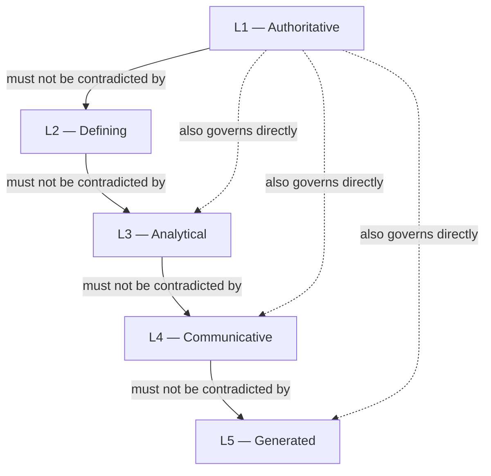

**AI Guardrails — Solution Documentation Set**

**Authority level:** L4
**Status:** Draft
**Date:** 2026-07-24
**Derived from:** seed.md + AGREEMENTS.md

---

> This is the entry point for humans and AI agents working with the AI Guardrails solution documentation. It orients a new reader to what the product is, where the ground truth lives, how the L1–L5 authority model works, how the `solution-docs/` tree is organized, and who owns each area. It introduces no new agreement, requirement, claim, or figure — everything below traces to [`00-source-of-truth/AGREEMENTS.md`](00-source-of-truth/AGREEMENTS.md) (L1), [`seed.md`](../seed.md), or a document this README links to. Where a conflict is ever found between this file and an L1–L3 document, the more authoritative document wins and this README must be corrected.

---

## Table of contents

- [1. What is AI Guardrails](#1-what-is-ai-guardrails)
- [2. Where the ground truth lives](#2-where-the-ground-truth-lives)
- [3. The authority model — L1 to L5](#3-the-authority-model--l1-to-l5)
- [4. Repository layout](#4-repository-layout)
- [5. Directory-by-directory map](#5-directory-by-directory-map)
- [6. Who owns what](#6-who-owns-what)
- [7. Start here by role](#7-start-here-by-role)
- [8. Conventions used throughout this set](#8-conventions-used-throughout-this-set)
- [Related documents](#related-documents)

---

## 1. What is AI Guardrails

> AI Guardrails is an AWS-based policy and enforcement platform that applies reusable safeguards to LLM applications and gateways. Teams may connect their existing LiteLLM instance to a hosted Evaluation API, consume a fully managed Guarded Gateway, or deploy the same guardrail runtime within their own AWS account. Policies remain portable across all three modes, while operational ownership and content exposure are explicitly defined for each deployment.
>
> — [`seed.md`](../seed.md) §23, "Product statement"

In practice, this means a single guardrail policy — what to detect, what to do about it, and how to fail safely — can be defined once and applied consistently whether a team operates its own LiteLLM gateway ([Mode A — Remote Evaluation](50-architecture/DEPLOYMENT-ARCHITECTURE.md)), consumes a fully hosted gateway-plus-guardrails service ([Mode B — Guarded Gateway](50-architecture/DEPLOYMENT-ARCHITECTURE.md)), or runs the guardrail runtime entirely inside its own AWS account ([Mode C — Customer-Managed Runtime](50-architecture/DEPLOYMENT-ARCHITECTURE.md)). LiteLLM is the first supported connector and Amazon Bedrock Guardrails is the first evaluation engine, but neither defines the product's boundary — the policy model, evaluation contract, and decision structure are vendor- and framework-independent by design (see [AGR-003](00-source-of-truth/AGREEMENTS.md#agr-003--litellm-as-first-connector-not-the-product-boundary) and [AGR-004](00-source-of-truth/AGREEMENTS.md#agr-004--bedrock-guardrails-as-first-engine-vendor-independent-contract)). For the full narrative, start with [`20-product/PRODUCT-OVERVIEW.md`](20-product/PRODUCT-OVERVIEW.md) or the [`10-charter/CHARTER.md`](10-charter/CHARTER.md).

---

## 2. Where the ground truth lives

[`00-source-of-truth/AGREEMENTS.md`](00-source-of-truth/AGREEMENTS.md) is the **authoritative (L1)** register for this entire solution. It records twenty-two accepted agreements (`AGR-001`…`AGR-022`) — the standalone-platform decision, the three deployment modes, policy portability, the one-contract rule, the guardrails-are-not-authorization boundary, the observe-before-enforce progression, the five-phase delivery plan, and more. Alongside it, [`00-source-of-truth/CONSTRAINTS.md`](00-source-of-truth/CONSTRAINTS.md) restates the checkable, non-negotiable boundaries (cloud placement, security, data handling, resource limits) at L1 rigor, and [`00-source-of-truth/DECISIONS.md`](00-source-of-truth/DECISIONS.md), [`00-source-of-truth/ASSUMPTIONS.md`](00-source-of-truth/ASSUMPTIONS.md), and [`00-source-of-truth/OPEN-QUESTIONS.md`](00-source-of-truth/OPEN-QUESTIONS.md) round out the L1 tier.

Every other document in `solution-docs/` — the charter, product materials, executive brief, sales deck, architecture set, and delivery plan — is a **derived view** produced for a specific audience or purpose. Derived documents must never contradict `AGREEMENTS.md` or `CONSTRAINTS.md`. When a conflict is discovered, the L1 register wins and the derived document is corrected — never the reverse. This rule, and the full change-control process behind it, is defined in [`70-governance/DOCUMENT-GOVERNANCE.md`](70-governance/DOCUMENT-GOVERNANCE.md).

[`seed.md`](../seed.md), the raw solution charter, is treated as a **frozen historical input** — the original source material every document here is derived from. It is never edited to reflect later decisions; where `AGREEMENTS.md` narrows or supersedes something `seed.md` stated more loosely, `AGREEMENTS.md` governs going forward.

---

## 3. The authority model — L1 to L5

Every document in this set declares an `**Authority level:**` in its header, one of `L1` through `L5`. The full model, precedence rules, ownership-per-area, and change-control process are defined authoritatively in [`70-governance/DOCUMENT-GOVERNANCE.md`](70-governance/DOCUMENT-GOVERNANCE.md); this section only summarizes it.

| Level | Name | What it does | Examples in this set |
| --- | --- | --- | --- |
| **L1** | Authoritative | Records negotiated, accepted ground truth. Cited by every other level; never silently overridden. | `AGREEMENTS.md`, `CONSTRAINTS.md`, `DECISIONS.md`, an ADR once its `Status` is `Accepted` |
| **L2** | Defining | Gives durable, boundary-setting structure derived from L1 — charters, capability catalogs, requirement registers, the glossary. | `CHARTER.md`, `PRINCIPLES.md`, `SCOPE.md`, `CAPABILITIES.md`, `NON-FUNCTIONAL-REQUIREMENTS.md`, `GLOSSARY.md`, `CLAIMS-REGISTER.md` |
| **L3** | Analytical | Explains, models, and justifies a design or plan in terms of L1/L2; must be fully re-derivable from L1/L2 at any time. | `ARCHITECTURE-REPORT.md`, component/data/deployment/integration architecture, `BUSINESS-CASE.md`, `FEASIBILITY-ASSESSMENT.md`, delivery planning |
| **L4** | Communicative | Simplifies and tailors L1–L3 content for a specific audience (executives, prospects, application teams) — including this README. | `EXECUTIVE-BRIEF.md`, product-facing materials, `FAQ.md`, sales-deck inputs |
| **L5** | Generated | Regenerated on demand from L1–L4; never hand-edited as if it were a new source of truth. | Rendered decks, one-page summaries, and any point-in-time digest produced for another AI agent or audience; currently `90-archive/` |



A document's level describes **how much new ground truth it may introduce**, not its importance to a reader — this README is L4, yet it is often the first document anyone opens.

---

## 4. Repository layout

```text
solution-docs/
├── README.md                  ← you are here — entry point (L4)
├── 00-source-of-truth/        ← L1 — authoritative agreements, constraints, decisions
├── 10-charter/                ← L2 — solution charter, principles, scope, success criteria
├── 20-product/                ← L2/L4 — capability catalog and product-facing materials
├── 30-executive/              ← L3/L4 — business case, executive brief, decision request
├── 40-sales-deck/             ← L4 — sales narrative, slide outline, objection handling
├── 50-architecture/           ← L2/L3 — requirements, C4 architecture views, ADRs
│   └── adrs/                  ← L1 once Accepted — Architecture Decision Records
├── 60-delivery/               ← L2/L3 — implementation strategy, milestones, ownership
├── 70-governance/             ← L2 — document governance, claims register, glossary, risk register
├── 80-agent-inputs/           ← L4 — instruction sets that drive documentation-generation agents
└── 90-archive/                ← L5 — frozen copies of superseded documents (currently empty)
```

---

## 5. Directory-by-directory map

Each table lists the documents in one directory with the authority level declared in that document's own header and a one-line description of its purpose. For the authoritative statement of which level governs each area (including cases where a document's own header and the governance model's directory table might drift over time), see [`70-governance/DOCUMENT-GOVERNANCE.md`](70-governance/DOCUMENT-GOVERNANCE.md) §4.

### [`00-source-of-truth/`](00-source-of-truth/) — L1, authoritative

| Document | Level | Description |
| --- | --- | --- |
| [`AGREEMENTS.md`](00-source-of-truth/AGREEMENTS.md) | L1 | The 22 accepted agreements (`AGR-001`…`AGR-022`) that govern this entire solution. |
| [`CONSTRAINTS.md`](00-source-of-truth/CONSTRAINTS.md) | L1 | Non-negotiable, checkable boundaries — cloud placement, security, data handling, resource limits (`CON-NNN`). |
| [`DECISIONS.md`](00-source-of-truth/DECISIONS.md) | L1 | Chronological log of product, organizational, and delivery decisions (`DEC-NNN`), distinct from architecture-level ADRs. |
| [`ASSUMPTIONS.md`](00-source-of-truth/ASSUMPTIONS.md) | L1 | Register of load-bearing but not-yet-validated beliefs the charter and delivery sequencing depend on (`ASM-NNN`). |
| [`OPEN-QUESTIONS.md`](00-source-of-truth/OPEN-QUESTIONS.md) | L1 | Decisions not yet made that could materially change scope, feasibility, cost, or architecture. |

### [`10-charter/`](10-charter/) — L2, defining

| Document | Level | Description |
| --- | --- | --- |
| [`CHARTER.md`](10-charter/CHARTER.md) | L2 | The solution charter: purpose, vision, three-mode architectural decision, scope, and ownership boundaries. |
| [`PRINCIPLES.md`](10-charter/PRINCIPLES.md) | L2 | The product principles (seed.md §5) — policy portability, one contract, policy/connector separation, observe-before-enforce, and more. |
| [`SCOPE.md`](10-charter/SCOPE.md) | L2 | Expands the charter's in-scope/out-of-scope sections into full MVP scope-boundary detail. |
| [`SUCCESS-CRITERIA.md`](10-charter/SUCCESS-CRITERIA.md) | L2 | The measurable criteria the MVP and adoption/reliability/effectiveness/portability goals are judged against. |

### [`20-product/`](20-product/) — mostly L4, `CAPABILITIES.md` is L2

| Document | Level | Description |
| --- | --- | --- |
| [`CAPABILITIES.md`](20-product/CAPABILITIES.md) | L2 | The traceable capability catalog (`CAP-NNN`) — what the product does or will do, by delivery status. |
| [`PRODUCT-OVERVIEW.md`](20-product/PRODUCT-OVERVIEW.md) | L4 | The start-here explanation of what AI Guardrails is, for product, sales, and solution-engineering audiences. |
| [`PROBLEM-STATEMENT.md`](20-product/PROBLEM-STATEMENT.md) | L4 | States, without solutioning, the problem that justifies building AI Guardrails. |
| [`VALUE-PROPOSITION.md`](20-product/VALUE-PROPOSITION.md) | L4 | Value proposition per stakeholder group — platform teams, application teams, security/compliance, product operators. |
| [`DIFFERENTIATORS.md`](20-product/DIFFERENTIATORS.md) | L4 | What distinguishes AI Guardrails from an embedded gateway feature or a single-vendor moderation add-on. |
| [`TARGET-USERS.md`](20-product/TARGET-USERS.md) | L4 | The four stakeholder groups (seed.md §7) and what each needs from the platform. |
| [`USE-CASES.md`](20-product/USE-CASES.md) | L4 | Concrete, actor-driven use cases illustrating the three deployment modes and the trust/enforcement model. |
| [`PRODUCT-ROADMAP.md`](20-product/PRODUCT-ROADMAP.md) | L4 | The five-phase delivery roadmap, product-facing. |
| [`FAQ.md`](20-product/FAQ.md) | L4 | Answers to the questions platform, application, and security-review teams most commonly ask. |

### [`30-executive/`](30-executive/) — L3 analytical, L4 communicative

| Document | Level | Description |
| --- | --- | --- |
| [`EXECUTIVE-BRIEF.md`](30-executive/EXECUTIVE-BRIEF.md) | L4 | The primary executive-facing narrative and decision context. |
| [`EXPECTED-OUTCOMES.md`](30-executive/EXPECTED-OUTCOMES.md) | L4 | What success looks like, tied to `SUCCESS-CRITERIA.md`. |
| [`DECISION-REQUEST.md`](30-executive/DECISION-REQUEST.md) | L4 | The specific, actionable approvals leadership must grant, isolated from the fuller brief. |
| [`BUSINESS-CASE.md`](30-executive/BUSINESS-CASE.md) | L3 | The analytical justification behind the executive brief's ask — costs of inaction, risk exposure, expected benefits. |
| [`INVESTMENT-SUMMARY.md`](30-executive/INVESTMENT-SUMMARY.md) | L3 | What investment is required, at what granularity, and in what sequence. |
| [`RISKS-AND-DEPENDENCIES.md`](30-executive/RISKS-AND-DEPENDENCIES.md) | L3 | A single, decision-relevant view of principal risks and external dependencies for leadership. |

### [`40-sales-deck/`](40-sales-deck/) — L4, communicative

| Document | Level | Description |
| --- | --- | --- |
| [`DECK-BRIEF.md`](40-sales-deck/DECK-BRIEF.md) | L4 | The brief that frames the sales deck's purpose, audience, and constraints. |
| [`SLIDE-OUTLINE.md`](40-sales-deck/SLIDE-OUTLINE.md) | L4 | The slide-by-slide structure of the deck. |
| [`SALES-NARRATIVE.md`](40-sales-deck/SALES-NARRATIVE.md) | L4 | The connective narrative explaining why each slide follows the one before it. |
| [`AUDIENCE-AND-PERSONAS.md`](40-sales-deck/AUDIENCE-AND-PERSONAS.md) | L4 | Who the deck is written for and what each persona cares about. |
| [`CUSTOMER-PAIN-POINTS.md`](40-sales-deck/CUSTOMER-PAIN-POINTS.md) | L4 | The pain points the deck opens with. |
| [`BENEFITS-AND-OUTCOMES.md`](40-sales-deck/BENEFITS-AND-OUTCOMES.md) | L4 | The benefits and outcomes claimed in the deck, traced to source. |
| [`PROOF-POINTS.md`](40-sales-deck/PROOF-POINTS.md) | L4 | The evidence and demonstrations the deck may cite. |
| [`OBJECTION-HANDLING.md`](40-sales-deck/OBJECTION-HANDLING.md) | L4 | Anticipated objections and how to respond without overclaiming. |
| [`CALL-TO-ACTION.md`](40-sales-deck/CALL-TO-ACTION.md) | L4 | The single, concrete ask the deck closes with. |
| [`VISUAL-DIRECTION.md`](40-sales-deck/VISUAL-DIRECTION.md) | L4 | Visual and design direction for the rendered deck. |

### [`50-architecture/`](50-architecture/) — L2 requirements, L3 analytical, L1 for Accepted ADRs

| Document | Level | Description |
| --- | --- | --- |
| [`REQUIREMENTS.md`](50-architecture/REQUIREMENTS.md) | L2 | Individually identified, testable functional requirements (`FR-NNN`), each mapped to a `CAP-` capability. |
| [`NON-FUNCTIONAL-REQUIREMENTS.md`](50-architecture/NON-FUNCTIONAL-REQUIREMENTS.md) | L2 | Availability, performance, security, and operability requirements the platform must meet. |
| [`ARCHITECTURE-REPORT.md`](50-architecture/ARCHITECTURE-REPORT.md) | L3 | The consolidated architecture narrative tying together every architecture sub-document. |
| [`SYSTEM-CONTEXT.md`](50-architecture/SYSTEM-CONTEXT.md) | L3 | C4 Level 1 — the system in its environment. |
| [`CONTAINER-ARCHITECTURE.md`](50-architecture/CONTAINER-ARCHITECTURE.md) | L3 | C4 Level 2 — the deployable containers (control plane, runtime, connectors). |
| [`COMPONENT-ARCHITECTURE.md`](50-architecture/COMPONENT-ARCHITECTURE.md) | L3 | C4 Level 3 — internal components (policy resolver, decision engine, evaluator adapters, audit producer). |
| [`DATA-ARCHITECTURE.md`](50-architecture/DATA-ARCHITECTURE.md) | L3 | Data model, retention behavior, and the content-exposure statement per deployment mode. |
| [`DEPLOYMENT-ARCHITECTURE.md`](50-architecture/DEPLOYMENT-ARCHITECTURE.md) | L3 | How the three deployment modes (Remote Evaluation, Guarded Gateway, Customer-Managed Runtime) are realized on AWS. |
| [`INTEGRATION-ARCHITECTURE.md`](50-architecture/INTEGRATION-ARCHITECTURE.md) | L3 | The evaluation contract and how LiteLLM and other connectors invoke it. |
| [`SECURITY-ARCHITECTURE.md`](50-architecture/SECURITY-ARCHITECTURE.md) | L3 | Authentication, encryption, least-privilege, and the trust/enforcement postures. |
| [`OPERABILITY.md`](50-architecture/OPERABILITY.md) | L3 | Availability objectives, failure behavior, degraded modes, and policy rollout mechanics. |
| [`FEASIBILITY-ASSESSMENT.md`](50-architecture/FEASIBILITY-ASSESSMENT.md) | L3 | Technical feasibility of the proposed architecture against the MVP scope. |
| [`TECHNICAL-RISKS.md`](50-architecture/TECHNICAL-RISKS.md) | L3 | Architecture-level technical risks and mitigations. |
| [`TRADE-OFFS.md`](50-architecture/TRADE-OFFS.md) | L3 | Named architectural trade-offs (hosted vs. customer-managed, DynamoDB vs. versioned S3, and others). |
| [`adrs/README.md`](50-architecture/adrs/README.md) | L1 | Index and process guide for Architecture Decision Records; an individual ADR is L1 only once `Accepted`. |
| [`adrs/ADR-0001-example-decision.md`](50-architecture/adrs/ADR-0001-example-decision.md) | L1 | Records the decision to build AI Guardrails as a standalone platform, not embedded in the internal LiteLLM. |

### [`60-delivery/`](60-delivery/) — L2/L3

| Document | Level | Description |
| --- | --- | --- |
| [`IMPLEMENTATION-STRATEGY.md`](60-delivery/IMPLEMENTATION-STRATEGY.md) | L3 | How the five delivery phases are sequenced and staffed at a working level. |
| [`MILESTONES.md`](60-delivery/MILESTONES.md) | L3 | Delivery milestones within and across phases. |
| [`RELEASE-CRITERIA.md`](60-delivery/RELEASE-CRITERIA.md) | L2 | The MVP exit gates — the conditions that must all hold for the MVP to be declared done. |
| [`VALIDATION-PLAN.md`](60-delivery/VALIDATION-PLAN.md) | L3 | How the MVP success demonstration (two independent LiteLLM instances, one policy) will be validated. |
| [`DEPENDENCIES.md`](60-delivery/DEPENDENCIES.md) | L3 | The dependency register gating each phase or milestone. |
| [`TEAM-AND-OWNERSHIP.md`](60-delivery/TEAM-AND-OWNERSHIP.md) | L3 | Who is responsible for what across the AI Guardrails team, platform operations, security and governance, and consuming teams — see [§6](#6-who-owns-what) below. |

### [`70-governance/`](70-governance/) — L2

| Document | Level | Description |
| --- | --- | --- |
| [`DOCUMENT-GOVERNANCE.md`](70-governance/DOCUMENT-GOVERNANCE.md) | L2 | Defines the L1–L5 model, precedence rules, ownership per documentation area, and change control for this entire set. |
| [`CLAIMS-REGISTER.md`](70-governance/CLAIMS-REGISTER.md) | L2 | The single source of truth for how AI Guardrails may be described in sales, executive, and technical materials. |
| [`RISK-REGISTER.md`](70-governance/RISK-REGISTER.md) | L2 | The fuller, governance-owned risk register behind the executive and feasibility risk summaries. |
| [`GLOSSARY.md`](70-governance/GLOSSARY.md) | L2 | Canonical terminology, including the precise meaning of "import" and the core domain-model terms. |
| [`REFERENCES.md`](70-governance/REFERENCES.md) | L2 | Navigational and citation register of every internal document and external framework this set cites. |

### [`80-agent-inputs/`](80-agent-inputs/) — L4

| Document | Level | Description |
| --- | --- | --- |
| [`README.md`](80-agent-inputs/README.md) | L4 | Explains what this directory is for and what it is not the place to define. |
| [`CHARTER-AGENT.md`](80-agent-inputs/CHARTER-AGENT.md) | L4 | Instructions for the agent that maintains the charter. |
| [`EXECUTIVE-BRIEF-AGENT.md`](80-agent-inputs/EXECUTIVE-BRIEF-AGENT.md) | L4 | Instructions for the agent that generates the executive brief. |
| [`SALES-DECK-AGENT.md`](80-agent-inputs/SALES-DECK-AGENT.md) | L4 | Instructions for the agent that generates the sales deck. |
| [`ARCHITECTURE-REVIEW-AGENT.md`](80-agent-inputs/ARCHITECTURE-REVIEW-AGENT.md) | L4 | Instructions for the agent that reviews architecture documents for drift. |
| [`OUTPUT-CONTRACTS.md`](80-agent-inputs/OUTPUT-CONTRACTS.md) | L4 | What each generation agent must and must not produce, and which registers govern its output. |

### [`90-archive/`](90-archive/) — L5

| Document | Level | Description |
| --- | --- | --- |
| [`README.md`](90-archive/README.md) | L5 | Explains the archive's purpose and naming convention. The directory is currently empty — nothing has yet been superseded. |

---

## 6. Who owns what

Ownership of the **documentation set** is defined in [`70-governance/DOCUMENT-GOVERNANCE.md`](70-governance/DOCUMENT-GOVERNANCE.md) §5. Ownership of the **product itself** — the four groups named in seed.md §21 (AI Guardrails team, Platform operations, Security and governance, Consuming teams), their detailed responsibilities, a lightweight RACI, and how ownership shifts by deployment mode and delivery phase — is defined authoritatively in [`60-delivery/TEAM-AND-OWNERSHIP.md`](60-delivery/TEAM-AND-OWNERSHIP.md). Do not conflate the two: a documentation-area owner (for example, the Product lead owning `20-product/`) is not necessarily the same accountable party as the product-ownership group responsible for the capability that area describes.

| Ownership group | One-line mandate |
| --- | --- |
| AI Guardrails team | Builds and evolves the product — architecture, policy schemas, evaluation contract, runtime, connectors, Bedrock integration, documentation. |
| Platform operations | Runs the AI Guardrails provider's own hosted infrastructure — deployment, monitoring, capacity, incident response. |
| Security and governance | Sets organization-level policy requirements, risk classifications, policy approval, retention, and audit requirements. |
| Consuming teams | Own the applications and workloads bound to guardrail policies — application behavior, connector installation, authentication, business authorization. |

---

## 7. Start here by role

For a fuller, role-oriented reading path through this set, see **`DOCUMENT-MAP.md`** *(planned; not yet authored — follow the pointers below in the meantime, and consult [`70-governance/REFERENCES.md`](70-governance/REFERENCES.md) for the complete document inventory)*.

| If you are a... | Start with |
| --- | --- |
| Executive or decision-maker | [`30-executive/EXECUTIVE-BRIEF.md`](30-executive/EXECUTIVE-BRIEF.md), then [`30-executive/DECISION-REQUEST.md`](30-executive/DECISION-REQUEST.md) |
| Product manager | [`20-product/PRODUCT-OVERVIEW.md`](20-product/PRODUCT-OVERVIEW.md), then [`10-charter/CHARTER.md`](10-charter/CHARTER.md) and [`20-product/CAPABILITIES.md`](20-product/CAPABILITIES.md) |
| Architect or technical lead | [`50-architecture/ARCHITECTURE-REPORT.md`](50-architecture/ARCHITECTURE-REPORT.md), then [`50-architecture/SYSTEM-CONTEXT.md`](50-architecture/SYSTEM-CONTEXT.md) and the rest of `50-architecture/` |
| Delivery or program lead | [`60-delivery/IMPLEMENTATION-STRATEGY.md`](60-delivery/IMPLEMENTATION-STRATEGY.md), then [`60-delivery/MILESTONES.md`](60-delivery/MILESTONES.md) and [`60-delivery/RELEASE-CRITERIA.md`](60-delivery/RELEASE-CRITERIA.md) |
| Sales or solution engineer | [`40-sales-deck/DECK-BRIEF.md`](40-sales-deck/DECK-BRIEF.md), then [`20-product/VALUE-PROPOSITION.md`](20-product/VALUE-PROPOSITION.md) and [`70-governance/CLAIMS-REGISTER.md`](70-governance/CLAIMS-REGISTER.md) (read this before saying anything about the product externally) |
| Security or compliance reviewer | [`50-architecture/SECURITY-ARCHITECTURE.md`](50-architecture/SECURITY-ARCHITECTURE.md) and [`50-architecture/DATA-ARCHITECTURE.md`](50-architecture/DATA-ARCHITECTURE.md), then [`70-governance/RISK-REGISTER.md`](70-governance/RISK-REGISTER.md) |
| Consuming/application team | [`20-product/USE-CASES.md`](20-product/USE-CASES.md) and [`20-product/FAQ.md`](20-product/FAQ.md), then [`60-delivery/TEAM-AND-OWNERSHIP.md`](60-delivery/TEAM-AND-OWNERSHIP.md) §2.4 for what you remain responsible for |
| AI agent generating derived content | [`80-agent-inputs/README.md`](80-agent-inputs/README.md) and [`80-agent-inputs/OUTPUT-CONTRACTS.md`](80-agent-inputs/OUTPUT-CONTRACTS.md) before producing anything |
| Anyone editing this documentation set | [`70-governance/DOCUMENT-GOVERNANCE.md`](70-governance/DOCUMENT-GOVERNANCE.md) — read this before changing any file under `solution-docs/` |

---

## 8. Conventions used throughout this set

* **Header block.** Every document opens with a bold title, `Authority level`, `Status` (`Draft` / `Accepted` / `Superseded` / `Archived` — see [`70-governance/DOCUMENT-GOVERNANCE.md`](70-governance/DOCUMENT-GOVERNANCE.md) §10), `Date`, and `Derived from`.
* **No invented figures.** No metric, SLA, dollar figure, customer name, or date appears anywhere in this set unless it is present in [`seed.md`](../seed.md) or an accepted agreement. Where a figure would normally appear and is not available, the document says **TBD** or describes the point qualitatively — never estimates.
* **Non-contradiction.** A derived document must not contradict an L1 register. If a conflict is found, the L1 register wins and the derived document is corrected — see [`70-governance/DOCUMENT-GOVERNANCE.md`](70-governance/DOCUMENT-GOVERNANCE.md) §3 for the full precedence rule, including how same-level conflicts are resolved.
* **Claims discipline.** Certain statements are rejected at every level regardless of audience — for example, describing Mode A (Remote Evaluation) as private or data-local ([AGR-009](00-source-of-truth/AGREEMENTS.md#agr-009--remote-evaluation-is-not-a-private-data-or-data-local-model)), or describing a cooperative connector as a hard security boundary ([AGR-018](00-source-of-truth/AGREEMENTS.md#agr-018--trust-and-enforcement-model)). See [`70-governance/CLAIMS-REGISTER.md`](70-governance/CLAIMS-REGISTER.md) before writing anything customer-facing.

---

## Related documents

| Document | Relationship |
| --- | --- |
| [`../seed.md`](../seed.md) | The frozen, full source-of-truth charter every document in this set derives from. |
| [`00-source-of-truth/AGREEMENTS.md`](00-source-of-truth/AGREEMENTS.md) | The authoritative (L1) agreements register — the single most important document in this set to read first. |
| [`00-source-of-truth/CONSTRAINTS.md`](00-source-of-truth/CONSTRAINTS.md) | The authoritative (L1) checkable boundary conditions, complementary to `AGREEMENTS.md`. |
| [`70-governance/DOCUMENT-GOVERNANCE.md`](70-governance/DOCUMENT-GOVERNANCE.md) | The full L1–L5 authority model, precedence rules, ownership per documentation area, and change-control process. |
| [`60-delivery/TEAM-AND-OWNERSHIP.md`](60-delivery/TEAM-AND-OWNERSHIP.md) | Full detail on who owns each part of the *product* (as distinct from the documentation set). |
| [`70-governance/GLOSSARY.md`](70-governance/GLOSSARY.md) | Canonical terminology used consistently across every document in this set. |
| [`70-governance/CLAIMS-REGISTER.md`](70-governance/CLAIMS-REGISTER.md) | Approved and rejected external-facing claim patterns — read before any customer- or executive-facing writing. |
| [`70-governance/REFERENCES.md`](70-governance/REFERENCES.md) | The full internal and external citation register for this documentation set. |
